# Agent.Core: the write path

What `src/Agent.Core` does as built in milestones 3 to 6: the structured request and the parser seam that produces it, the pipeline that turns it into one reply, the resolvers, the ordered checks, the card and its view, the pending record and its states, the sweep, Confirm and Checking, the conversation that the phone and the test runner share, the live trace, the audit log,, the learning-log rule and table, the masker, the structure validator and the Claude parser. The model side (the parse call, its settings, faults and cost) is told whole in [agent-model.md](agent-model.md). The design it follows is sections 3 to 5 of [architecture.md](architecture.md); the matching and question rules are [matching-rules.md](matching-rules.md); the wallet it calls is [wallet-api.md](wallet-api.md).

## Hosts

`Agent.Core` registers its services with `AddAgentCore` and leaves three choices to the host. The web console's choices, and the rule that every UI action opens its own DI scope, are in [agent-web.md](agent-web.md):

- the parser (`IParser`; the console registers `ScriptedParser`);
- the trace sink (`ITraceSink`; the console routes each action's steps to the circuit's `TraceLog`);
- whether the sweeper runs (`SweepIntervalSeconds`);
- the D6 yes and no words (`YesWords`, `NoWords`; the console sets them from its resource file).

A host that talks to a user builds a `Conversation` (below) per user: the console's `ChatSession` builds one per circuit, and the test runner (milestone 5) one per case.

The test runner (`Agent.Eval`), its grading and its report are described in [agent-eval.md](agent-eval.md).

The test hosts set `SweepIntervalSeconds` to 0 and use `NullTraceSink`, or a recording sink.

## Purpose and the rules it enforces

`Agent.Core` holds every decision between "the user said something" and "the money moved". It talks to the mock wallet over HTTP only, through the typed `WalletClient`, and keeps its own database (`ZainCashAgent`) for pending records and the audit trail.

| Rule (CLAUDE.md) | How milestone 3 enforces it |
|---|---|
| 1. No tap, no money | `WalletClient.ExecuteAsync` is `internal`. Only `ConfirmHandler.ConfirmAsync` and `ConfirmHandler.SettleCheckingAsync` call it, given one pending ID and its user. `NoTapNoMoneyTests` scans the compiled IL and fails if any other method reaches it, if anything in `Agent.Core` other than `Conversation.ConfirmAsync` and `Conversation.SettleAsync` calls those two, if any other method names the `transactions` route, or if any method invokes by reflection |
| 2. The model is read only | The model's output is `ParsedRequest`, a record with no behaviour. The `Orchestrator` validates it against the wallet and treats it as a request to check: every name, bill and product is resolved by code, every amount goes through `AmountRule` and the checks |
| 3. The card is built by code | `CardBuilder` fills `CardDraft` from the wallet's quote and the resolver's choice. No field comes from `ParsedRequest` text except the typed phone, normalised by `PhoneNumbers`, when the user typed a number |
| 4. Replies are templates | `AgentReply` and `ConfirmOutcome` carry codes, figures and option text from the wallet (reason codes, question kinds, options, amounts); the only user text is the `recipient_not_found` detail. The phone fills a template from its resource file (milestone 4) |
| 5. Masking | `ParsedRequest` holds only the user's own words. Nothing the orchestrator reads from the wallet is written back into it. The quoted balance stays on the pending record for the card. The audit log and the learning log have no parameter for a balance, a PIN or a purchase code. From milestone 6 the conversation masks every number before the parse call (`Masker`) and un-masks a recipient token from that message's map only; `ParsedRequestValidator` checks the parse call's structure (see Masking and structure validation) |
| 6. Idempotency | Every pending record gets one key at creation. Every transition is one conditional update on the current state. An unknown outcome is Checking, never failed, and is settled by resending the same body under the same key |

## The structured request

`ParsedRequest` (`src/Agent.Core/Requests/ParsedRequest.cs`) is the request the pipeline acts on. The Claude parser builds it from the model's structure through the validator; the scripted parser (below) and the tests build it directly, the tests with the factory methods `Transfer`, `Bill`, `Purchase` and `Balance`, or with an object initialiser. Every text in it is the user's own words.

| Field | Type | Meaning |
|---|---|---|
| `Intent` | `RequestIntent` | `Transfer`, `Bill`, `Purchase`, `Balance`, `Unsupported` or `Unclear` |
| `RecipientText` | string? | The recipient as typed: a name, an alias or a number. The parse call sees a number as a token (`<NUM_1>`); the conversation turns a recipient that is exactly a token of this message back into the number as typed before the orchestrator reads it |
| `AmountValue` | decimal? | The amount as a number. Rule 19 (a comma is thousands, a dot never is) is applied by the parser |
| `AmountUnit` | `AmountUnit` | `None` (a bare number), `Dinars`, `Thousand` or `Million` |
| `BillerCode` | string? | `electricity`, `water`, `internet`, `school_fees`, or null |
| `BillLabelText` | string? | The user's words for one of several bills of a biller (its label), or null |
| `OperatorText` | string? | The operator as typed, or null |
| `ProductType` | string? | `credit`, `internet`, or null |
| `ProductValue` | long? | The face value the user named, in IQD, or null |
| `UnsupportedReason` | string? | For `Unsupported`: `withdrawal`, `other_balance`, `other_currency`, `refers_back`, `same_as_last_time`, `choose_account`, `part_of_bill`, `credit_to_own_number`, `change_waiting_card`, `other_language`; otherwise null |
| `CurrencyText` | string? | A currency other than dinars, as typed. When set, the request is refused with `dinars_only` |
| `Problem` | string? | Set by `ParsedRequestValidator` when the parse call's structure broke a rule: the field's wire name, with `Intent` `Unclear`. Null from the scripted parser |

## The parser seam

`IParser.ParseAsync(text, context, cancellationToken)` (`src/Agent.Core/Parsing/IParser.cs`) is the parse call of rule 2: one call per message, read only, returning a `ParsedRequest`. `ParseContext(PendingNote, Map)` is all it may know besides the user's words (D5, rule 5): the one-line note of what is pending, built by code from the type and codes only, or null when nothing is pending; and the `MaskMap` of this message, which the structure validator needs to accept a token (null when the caller did not mask). The text it receives is already masked.

The scripted implementation is `ScriptedParser` (`src/Agent.Core/Parsing/ScriptedParser.cs`). From milestone 7 it is an oracle over the development set: `ScriptedParser.Load(path)` reads two files.

- **The set at `Agent:DevSetPath`.** The default is `data/requests.dev.jsonl`, relative to the repository root unless rooted (`ParserFactory.DevSetPath`). Only `id` and the `say` steps are read.
- **The sidecar `data/requests.dev.parses.jsonl` next to it.** It has one line per say step: `{"id", "step" (0-based among the case's steps), "say", "parse"}`. `parse` is the structure the model returns (`ParsedRequestsDto`), with a typed number written as typed.

A typed text that equals a say step gives that step's first request, and anything else is `Unclear`. The two are compared after masking (`Masker`) and `ArabicText.Normalize`, ordinal and whole. The checks:

- **File name.** `Load` accepts only a file named exactly `requests.dev.jsonl` (`ArgumentException`, nothing opened), and neither it nor the sidecar may be a symbolic link (`FileInfo.LinkTarget`; `ScriptedParserTests.ALinkInPlaceOfTheSetOrTheSidecarIsRefused`, skipped where the account may not create links). So the held-out set can never be loaded (rule 7). `ScriptedParserTests.OnlyTheDevSetFileNameIsAccepted` tests this with throwaway files, never with the real path.
- **Consistency at load.** Each say is masked, and every number in its parse becomes its token. `ParsedRequestValidator` then checks the parse against the message's map. The load is refused (`InvalidDataException`) when:
  - a sidecar line points at a step that does not say;
  - a line's text differs from the set's;
  - a say step has no line;
  - a parse breaks the structure;
  - the same message has two parses.

  The message names the case and the step, never the text (`ScriptedParserTests`).
- **Lifetime.** It holds no per-user state, so one instance serves the whole app. `AddAgentCore` registers no parser, and `ParserFactory.AddAgentParser` registers the oracle as a singleton when `Agent:Parser` is `scripted` (the default). It is loaded on first use.

The parses were drafted by Claude from Khalil's answer keys for his review (his ruling of 15 Oct 2026). On the oracle the development set scores 60 of 72 (`docs/reports/dev-scripted-oracle-2026-10-15-2052`); the 12 failures are the items deferred to milestones 8, 9b and 9c. A typed yes or no is not a sentence: D6 is the conversation's business.

Two more pieces belong to the seam (milestone 5):

- **`ParserUnavailableException`.** A parser throws it when the parse call could not be made or gave no answer (the model is down or timed out). The conversation answers it with the refusal `model_unavailable`, traces `parse:unavailable` in the Model zone, and moves nothing. Any other exception from the parser is handled as any other failure: `not_done_nothing_taken`.
- **`IParserUsage`.** A parser may implement it to say what its last call cost: `LastUsage` is a `ParseUsage(InputTokens, OutputTokens, CostUsd, Duration)`, or null before the first call. The runner records it per case (D12). `ScriptedParser` implements it with zero tokens, zero cost and the time the lookup took.

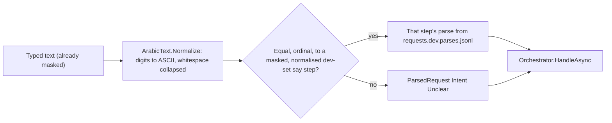

## Masking and structure validation (milestone 6)

Rule 5 and review I3, in `src/Agent.Core/Masking/` and `src/Agent.Core/Parsing/ParsedRequestValidator.cs`.

- **`Masker.Mask(text)`** returns `MaskedText(Text, Map)`. A number is a run of 7 or more digits (ASCII `0-9`, Arabic-Indic U+0660 to U+0669, Extended Arabic-Indic U+06F0 to U+06F9), with any separator between its digits counted inside the run (`NumberSeparators`, shared with `PhoneNumbers`: Unicode whitespace such as a no-break space, a tab or a line break, format characters such as the bidi marks, `-`, `.`, `(` and `)`; never a comma) and an optional leading `+`. Each run becomes `<NUM_1>`, `<NUM_2>`, ... in order of appearance; the map keeps each run exactly as typed (separators and `+` included). Six digits or fewer are never masked (`150000`, `1,000,000` with its commas). A seven-digit amount written without separators is masked (see [failure-modes.md](failure-modes.md)).
- **`MaskMap.TryUnmask(token, out original)`** gives the number only for a token of that map; `MaskMap.IsToken` says whether a text is exactly one token.
- **The conversation masks before the parse call** and passes the map in `ParseContext`. After the call, a `RecipientText` that is exactly a token of this message's map becomes the number as typed; any other token stays a token, so the contact resolver finds nothing. Un-masking happens there and nowhere else, for every parser. The orchestrator then reads the number as it always did (`PhoneNumbers.LooksLikeNumber`, `TryNormalize`, `invalid_number`).
- **`ParsedRequestValidator.Validate(ParsedRequestDto dto, MaskMap map)`** returns `ValidationResult(Request, Problem, MoreThanOneRequest)`. `ParsedRequestDto` is the strict structure on the wire (snake_case; a field it does not name is refused when the reply is read, `JsonUnmappedMemberHandling.Disallow`); `ParsedRequestsDto` is the reply's list (D7). The checks, in order: `intent` in `transfer`, `bill`, `purchase`, `balance`, `unsupported`, `unclear`; `amount_unit` in `none`, `dinars`, `thousand`, `million`; `biller_code` null or in `electricity`, `water`, `internet`, `school_fees`; `product_type` null or in `credit`, `internet`; `unsupported_reason` null or one of the ten documented reasons; every text at most 100 characters; `amount_value` null, or finite and not below zero; `product_value` null or above zero; `recipient_text` exactly one token of this message's map, or words with no run of 7 or more digits, nothing `PhoneNumbers.LooksLikeNumber` would take for a phone number, and no token the map does not hold (the user typed no such number: the parse call invented it). Sets are exact and lower case. A blank text is null. The first violation gives `ParsedRequest { Intent = Unclear, Problem = <field> }`; nothing throws. The list form takes the first request (an empty list is the problem `requests`) and sets `MoreThanOneRequest` when there were more; until milestone 9 the others are dropped.
- **An invalid structure** reaches the orchestrator as `Unclear`, so the reply is the `not_understood` refusal. The conversation traces `model_invalid_reply` with the field name and writes the learning entry `model_invalid_reply` with the field as detail (in place of `not_understood`).

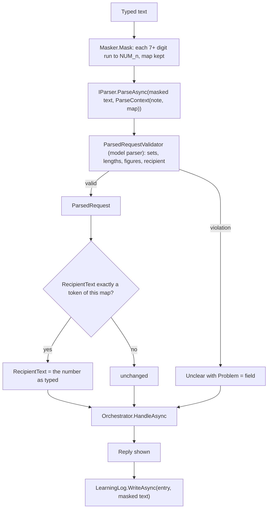

## The Claude parser (milestone 6)

`ClaudeParser` (`src/Agent.Core/Parsing/ClaudeParser.cs`) is the model parser: one read-only call per message through `IChatClient` (`Microsoft.Extensions.AI` 10.11.0 over the official `Anthropic` 12.56.0 SDK, `AnthropicClient.AsIChatClient(modelId, maxOutputTokens)`), so a candidate model is a configuration change.

- **What it sends.** A system message, the prompt `parse-prompt.md` (embedded; first line `version: 2`, version 1 frozen for the milestone 6 baselines; `ClaudeParser.PromptVersion`; English, with the full-request examples of `docs/matching-rules.md` rules 1 to 17 that name no seed contact), and one user message: `Pending: <the pending note, or none>` and `Message: <the masked text>`. Nothing else: no history, no name, no balance, no purchase code (rule 5; `OutboundPayloadTests` drives the whole conversation and checks the captured payload).
- **The options.** `ModelId`, `MaxOutputTokens` (1,500: the 5.5 models think by default and thinking tokens count against it), the candidate's `Effort` (`low` by default; `low`, `medium`, `high`, `xhigh` or `max`) sent as `output_config.effort` through `ChatOptions.RawRepresentationFactory` (the SDK's `MessageCreateParams` with `OutputConfig.Effort`; the adapter has no other way to say it and merges the schema format into the same `output_config`), `Temperature` only when a candidate sets it (none does: the Claude 5.5 models reject a non-default temperature, and Opus 5.5 any), and `ResponseFormat = ChatResponseFormat.ForJsonSchema(ClaudeParser.Schema, "parse", ...)`. The schema is `JsonSchemaExporter`'s schema of `ParsedRequestsDto`, every object closed (`additionalProperties: false`) with every field required, and each enum string limited to its set. The Anthropic adapter maps it to the API's `output_config.format` (`json_schema`); `AnthropicAdapterTests` proves it offline by reading the request body the real adapter sends to a stub handler, so no `RawRepresentationFactory` fallback is built.
- **What it reads.** A reply cut off at `MaxOutputTokens` (`FinishReason` `Length`) is `Unclear` with `Problem` `truncated`. Otherwise the reply text, deserialised strictly (an unknown field, a wrong type or text that is not JSON gives `Unclear` with `Problem` `json`), then `ParsedRequestValidator.Validate` with the message's `MaskMap` from `ParseContext.Map`. A reply with more than one request gives the first and traces `more_than_one_request` (Model zone, the count) until milestone 9 builds compound requests.
- **Usage.** `LastUsage` (`IParserUsage`): the input and output tokens of `ChatResponse.Usage` (`InputTokenCount`, `OutputTokenCount`), the cost at the candidate's prices per million tokens, and the time.
- **Failures.** The candidate's `TimeoutSeconds` (20) ends the call (`timeout`); an HTTP answer with a status (401 bad key, 400 bad request, 429 rate limit, 5xx, 529 overloaded) gives `http_<status>`; a transport failure gives `connection`; any other exception its type. Each is a `ParserUnavailableException` (the reply `model_unavailable`) whose message holds the reason only, never the key or the response body. The caller's own cancellation propagates. The Anthropic client never retries (`MaxRetries = 0`): one parse call per message, and a 429 or 529 shows the handover message at once.
- **Logs.** Model id, duration, tokens, cost and finish reason at Information; the reason and duration of a failure at Warning. Never the text.
- **Name.** `claude:<candidate>`, on the trace (`parse:claude:haiku`) and in the report name (`dev-claude-haiku-...`). The scripted parser is `scripted`.

### Choosing the parser

`ParserFactory.AddAgentParser` (`Agent:Parser`, `AgentOptions.Parser`) registers `ScriptedParser` (`scripted`, the default; nothing of Anthropic is constructed) or `ClaudeParser` (`claude`), scoped so it writes to the scope's trace, over a singleton `IChatClient`. With `claude`, `ModelOptions` (section `Model`: `Candidate`, and `Candidates:<name>` with `Provider` `anthropic`, `ModelId`, `MaxOutputTokens`, `Effort`, `Temperature`, `TimeoutSeconds`, `InputPricePerMTok`, `OutputPricePerMTok`) is validated at start: the candidate must exist, the provider be `anthropic`, the model id be set, the limits above 0, the effort one of the five levels, the prices not below 0, and a key must be set (`Anthropic:ApiKey` in user secrets, or `ANTHROPIC_API_KEY`). A failure stops the start with a message that names the settings, never a value. The `Model` section is bound whatever the parser, and the console shows it read-only.

```mermaid
flowchart TD
    setting{"Agent:Parser"} -- "scripted (default)" --> scripted["ScriptedParser (singleton)"]
    setting -- claude --> check{"Candidate valid and a key set?"}
    check -- no --> stop["Start refused: message names the settings"]
    check -- yes --> client["IChatClient: AnthropicClient.AsIChatClient(modelId)"]
    client --> claude["ClaudeParser (scoped, the scope's trace)"]
    claude --> call["GetResponseAsync(prompt + Pending + masked Message, schema, max tokens, timeout)"]
    call -- "timeout, HTTP status, connection" --> unavailable["ParserUnavailableException: model_unavailable"]
    call -- reply --> read{"Strict JSON of ParsedRequestsDto?"}
    read -- no --> json["Unclear, Problem json"]
    read -- yes --> validate["ParsedRequestValidator with the message's map"]
```

## The pipeline, in order

`Orchestrator.HandleAsync(userId, request, cancellationToken)` answers one `ParsedRequest` with one `AgentReply`: `Question`, `Refusal`, `BalanceReply`, `ConsentScreen`, `CardIssued` or `Unsupported`. It never executes. A wallet read with no usable answer is the refusal `not_done_nothing_taken` with detail `wallet_` plus the reason (or the wallet's code for a 4xx); it never throws for one. Every question and refusal writes one audit row, and every step goes to the live trace (below).

1. **Balance question** (D22). Read the user; without consent, the consent screen. Otherwise read the balance and reply `BalanceReply`. The audit row `balance_shown` carries no figure.
2. **Unsupported, unclear, currency.** `Unsupported` with reason `other_balance` is refused `only_own_balance`, with `other_language` is refused `not_understood`, and with `other_currency` is refused `dinars_only`, each with the reason as the refusal's detail (RED-10, GAP-08, GAP-07). `Unsupported` with `choose_account` (the user chose the account to pay from, GAP-04) and both a `RecipientText` and an `AmountValue` is the known-gap path: traced `known_gap` with `choose_account`, it goes on as a transfer (the consent gate, then step 4) from the usual account, and a card it gives comes back as `CardIssued` with `Note` `account_choice_unavailable`; a question or a refusal on the way comes back as it is. The conversation keeps the original request as pending, so a tapped answer comes back through the same path. Without the recipient or the amount it is unsupported as below. Any other `Unsupported` replies `Unsupported(reason)` with the parsed reason (`not_supported` when none). `Unclear` is refused `not_understood`. A `CurrencyText` is refused `dinars_only`. These come before the consent gate.
3. **Consent gate.** Read the user; without consent, the consent screen replaces everything.
4. **Transfer.** The recipient first (rule 16), then the amount (rule 10 asks for a missing one, typed; rule 9 asks which reading of a bare number below 1,000). `AmountRule` offers only readings from `MinAmountIqd` up to `PerTransactionCapIqd`; a bare number whose whole readings are all below the minimum is refused `amount_below_minimum` with the minimum as the figure (Khalil, 14 Oct 2026: `0.5` offers only 500,000; `0.0005` is refused). Then the checks and the card.
5. **Bill.** Read the bills (and, for `internet`, the store catalogue), resolve the bill, then D9: a bill is paid in full. An amount the user named must equal the amount due, else the refusal `bills_paid_in_full` with the full amount due. Then the checks (without the format check) and the card.
6. **Purchase.** Read the catalogue, resolve the product, take its catalogue price. Then the checks (without the format check) and the card.
7. **Checks, then the card.** `Checks.RunAsync` in Khalil's order; on a pass, `CardBuilder.BuildAsync` and `PendingStore.CreateAsync`, and the reply is `CardIssued(record)`, whose `View` is the `CardView` a component gets.

### Try again and Send again (D19)

`Orchestrator.ReissueAsync(userId, previous, kind, cancellationToken)` rebuilds a card from `previous`, the stored record of the card shown, in code and without the model. `previous.UserId` must be `userId` (`ArgumentException` otherwise). It traces `reissue` (`try_again` or `send_again`), then the kill switch (on: `not_done_nothing_taken` with detail `kill_switch`, before any wallet read) and the consent gate as above. The subject (type, phone, display name, bill account and code, product and code) is the record's; what the checks need is read again:

- a transfer reads the account by its phone, and that account's ID and registered name go on the card and into the checks (security review I2: the name shown is the account paid); a closed account is refused `account_closed` by the checks, and a number with no account any more `number_has_no_wallet`;
- a bill reads the user's bills and takes the current amount due of the same bill account: 0 is `nothing_due`, a missing one `bill_not_found`;
- a purchase reads the catalogue product by its code and takes its price: a missing one is `product_not_found`.

Then step 7, so a card is a new record with a new ID, key and timer, and nothing moves until its own Confirm. A `SendAgain` card always carries `Warning` `repeat`, whether or not the history rule set it; a `TryAgain` card carries it only when the rule does. The old record is never reopened (architecture section 5).

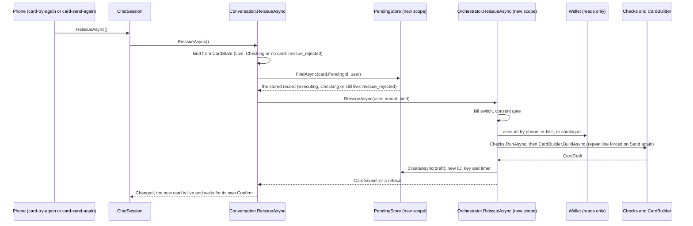

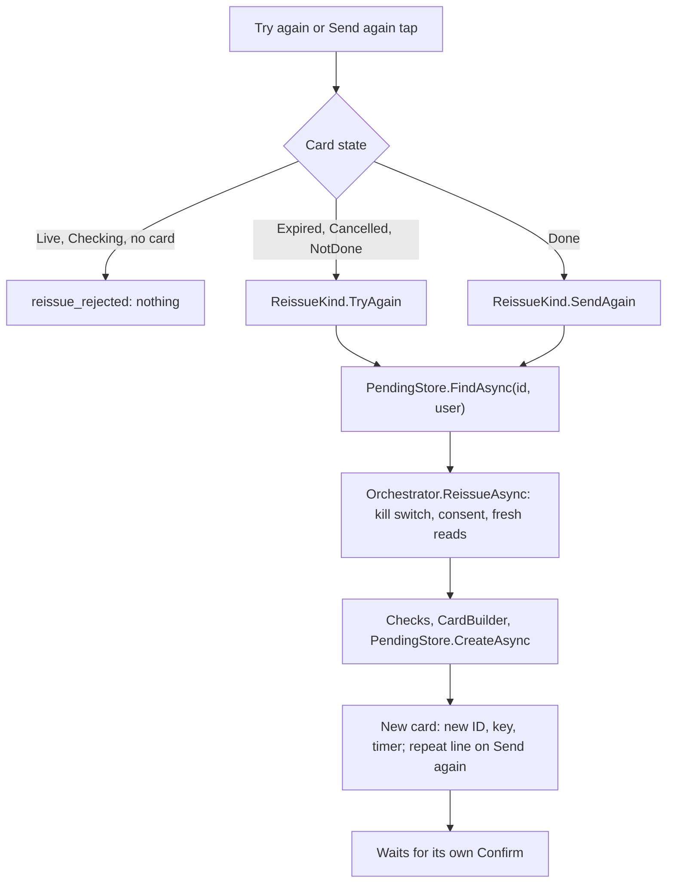

### Recipient: contact and phone

`ContactResolver.Resolve` (`src/Agent.Core/Resolver/ContactResolver.cs`) is pure. It compares `ArabicText.Key` of the typed name with the key of every saved name and alias (rule 1: normalised, leading al stripped, spaces removed). Normalising also drops Unicode format characters (zero-width joiner and non-joiner, zero-width space, bidi controls, and, since the text is read as runes, format characters outside the basic plane such as language tags), so an invisible character neither splits a key nor reorders a name. The first step that hits wins. A closed account stays a candidate; the checks refuse it later. Hits on one account count once, and the alias is shown when an account was hit by both (rule 7).

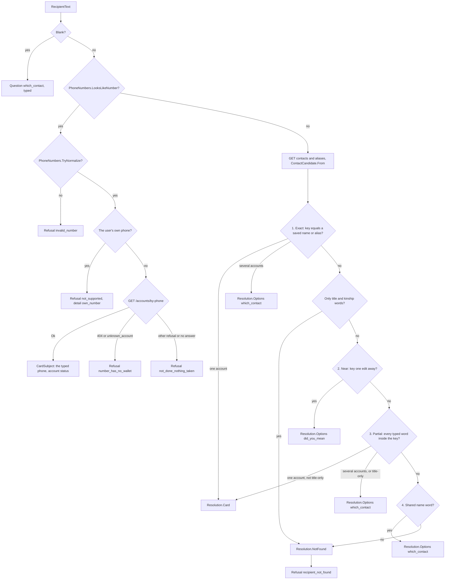

- **Exact** (rules 1, 2, 3, 7): the whole key equals a saved name or alias.
- **Title and kinship only** (rules 1, 15): a typed name made only of title words (abu, umm) and kinship words is not a name.
- **Near** (rule 6): the whole key is one edit away (`ArabicText.EditDistance`). Always a question, even with one candidate. Checked before partial (Khalil, 15 Oct 2026, CLN-03-v1): a name one letter short of a saved name is also inside it, and is asked as `did_you_mean`, not sent to the card.
- **Partial** (rules 4, 5, 7): every typed word occurs inside the candidate's key. A typed word whose key (after the per-word leading al strip) is shorter than the setting `MinSubstringWordLength` (3, default `ContactResolver.MinSubstringWordLength`; Khalil, 14 Oct 2026) must equal a whole word of the candidate instead (both compared after that strip). The orchestrator passes the setting to `ContactResolver.Resolve(typedName, candidates, minSubstringWordLength)`; the two-argument overload uses the default. Rule 5: a "title + name" contact matched by the bare name is only ever an option.
- **Shared word** (rule 15): a name word (not a title, not a kinship word) shared exactly. Never a card.
- **Not found** (rule 8): no card.

The value a tap on a `which_contact` or `did_you_mean` option sends back is the contact's code (`S01`). For an alias whose account no saved contact points to, it is `account:` and the account ID (`account:42`), so it can never be read as a contact code (`Orchestrator.ContactOptionValue`).

The phone path is matching rule 20: a country code makes no difference, spaces and dashes are ignored, and what is left must be 11 digits starting with `07`. A number is never completed or matched to a similar one.

### Bill and product

`BillResolver.Resolve` (rules 13, 14, 17, D9) and `ProductResolver.Resolve` (rules 11, 12) are pure. They were built at code level in milestone 3 because the checks need them; their screens come in milestones 8 and 9b.

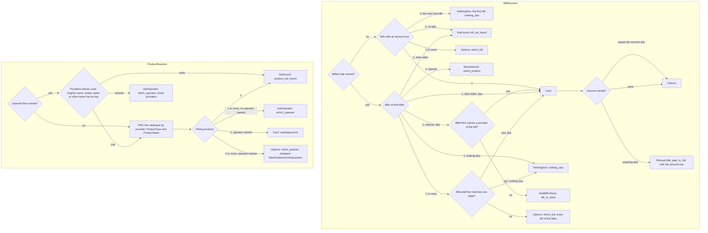

Rule 11: when the user named no operator, the agent asks for it, even when one product fits. Rule 12 (more products than fit one question: operator first) then gives the same answer. An operator text that names no provider is refused `product_not_found`, so the learning log sees it; one that names several providers (a shared other name) asks `which_operator` among those (Khalil, 14 Oct 2026). With no biller named, a user whose bills all have nothing due gets `nothing_due` (the first bill in wallet order), and only a user with no bills gets `bill_not_found` (Khalil, 14 Oct 2026).

The provider-name branch (the bill-or-store rule, Khalil, 16 Oct 2026): where rule 13 applies (one bill of the internet biller with an amount due), `BillResolver.NamesProvider` reads `ParsedRequest.BillerText` (schema version 2, the user's words for the biller). When a word of it is a provider name of the bill, the bill goes straight to the card; otherwise the agent asks `bill_or_store` as before. The provider names are `ProviderNames.Of(bill)`: the first word inside the parentheses of the wallet's Arabic and English biller names (`Internet (Earthlink subscription)` gives `Earthlink`); a name without parentheses gives none (ruling 1 of the milestone 8 plan). A word matches when its `ArabicText.Key` (rule 1: a leading `al` dropped) equals the name's key, ignoring case for the English name; a part of a word does not match. The other branches are unchanged, and `BillerText` is read only here: it is never on the card, the trace or the audit log. So "pay the Earthlink subscription" (CLN-09, CLN-09-v1) is the card, and "pay the internet subscription" (CLN-25) or "pay the internet" (AMB-09, AMB-21) asks.

### The checks

`Checks.RunAsync` runs the checks in the agreed order ([matching-rules.md](matching-rules.md), "Order of checks"). The first that fails is the reason shown, with the figure the reply needs.

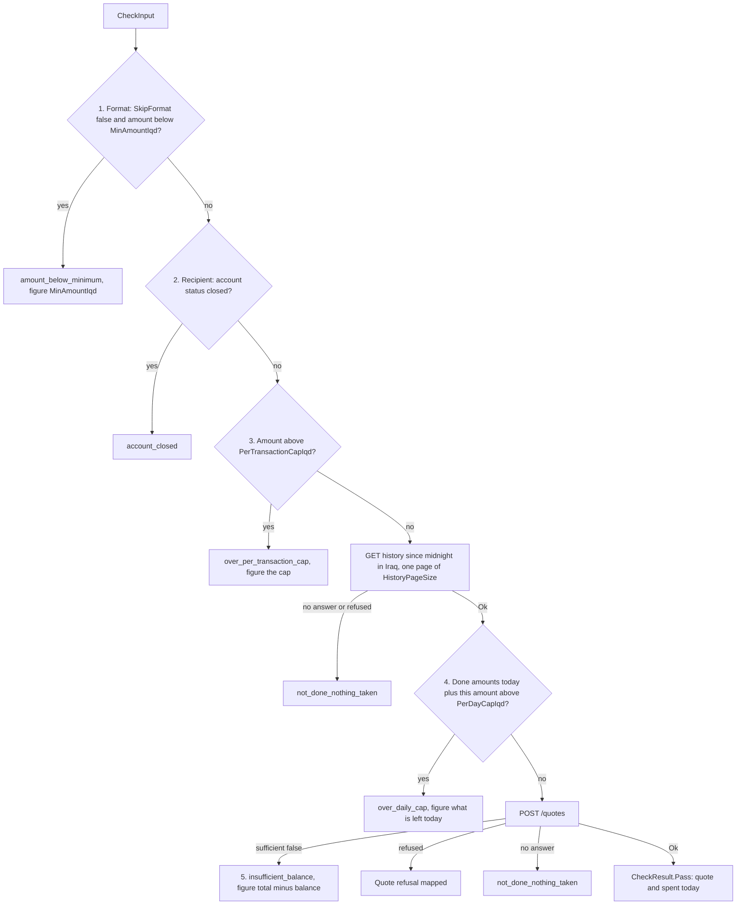

- The format check runs for transfers only. Bills and purchases set `SkipFormat`, since their amount comes from the wallet (the amount due, the catalogue price).
- The daily cap counts the amounts, without fees, of every `done` transaction the user paid since midnight in Iraq (`AgentClock.StartOfIraqDay`, offset +03:00), of every type. `Checks.DailySpentAsync` reads it, for the checks and for the Confirm recheck alike.
- Quote refusals are mapped as a safety net: `account_closed` to `account_closed`, `unknown_recipient` to `recipient_not_found`, `same_account` to `not_supported` with detail `own_number`, `nothing_due` and `bills_paid_in_full` to themselves, anything else to `not_done_nothing_taken` with the wallet's code.

## The card

`CardBuilder.BuildAsync` builds a `CardDraft`, and `PendingStore.CreateAsync` turns it into a `PendingRecord` with a new ID, a new idempotency key and the timer.

| `CardDraft` field | Source |
|---|---|
| `UserId`, `Type` | The request; `Type` is `transfer`, `bill` or `purchase` |
| `AmountIqd`, `FeeIqd`, `TotalIqd`, `QuotedBalanceIqd` | The wallet's quote (`QuotedBalanceIqd` is the quote's balance before; for the card's balance after, never for the model) |
| `ToPhone`, `ToAccountId` | A transfer's recipient: the contact's account, or the typed number's account from `GET /accounts/by-phone` |
| `DisplayName` | A contact: the alias or saved name that matched (the alias when both did). A typed number: the normalised phone. A bill: its label, else its biller name. A purchase: the operator's Arabic name |
| `RegisteredName` | The recipient account's registered name, else the quote's recipient name |
| `BillAccountId`, `BillCode` | A bill |
| `ProductId`, `ProductCode` | A purchase |
| `PinRequired` | The quote |
| `FirstTime` | A transfer with no `done` transfer to the same phone in the last `HistoryDays` (90) days. Bills and purchases are never first time (D16) |
| `Warning` | `repeat` when a `done` transfer of the same amount to the same phone was made within `RepeatWarningWindowMinutes` (10) before now (FLT-05); otherwise null |

Every figure on the card comes from the quote, so the card shows what the wallet will charge.

### The card view

`CardView.From(record)` (`src/Agent.Core/Pipeline/CardView.cs`) is the only shape of a card a component receives; `AgentReply.CardIssued.View` computes it from the record. It carries `PendingId`, `Type`, `AmountIqd`, `FeeIqd`, `TotalIqd`, `BalanceAfterIqd` (the quoted balance less the total), `DisplayName`, `RegisteredName`, `ToPhone`, `BillCode`, `ProductCode`, `PinRequired`, `FirstTime`, `Warning` and `ExpiresAt`. It has no idempotency key, no quoted balance, no row version and no user ID (`CardViewTests`).

## The pending record and its states

`PendingRecord` (`src/Agent.Core/Pending/PendingRecord.cs`, table `PendingTransactions`) is one card and the payment behind it. Its key is a lower-case GUID without dashes (32 characters), unique. It holds no PIN and only the last four characters of a purchase code. `PendingRecord.CanLeave` is the transition table, and `PendingStore` moves a record only by one conditional update on its current state, inside a database transaction that also writes the audit row. The number of rows the update changed is the truth: a record leaves a state once however many calls arrive. Every call made for a user (`FindAsync`, `CancelAsync`, `TryBeginExecuteAsync`, `CompleteAsync`, `BackToPendingAsync`, `MarkCheckingAsync`) names the user, and the update's condition includes it: another user's record is not found. Only the sweeps (`ExpireDueAsync`, `ExpireAllOpenAsync`, `MarkStaleExecutingAsync`) act for no user.

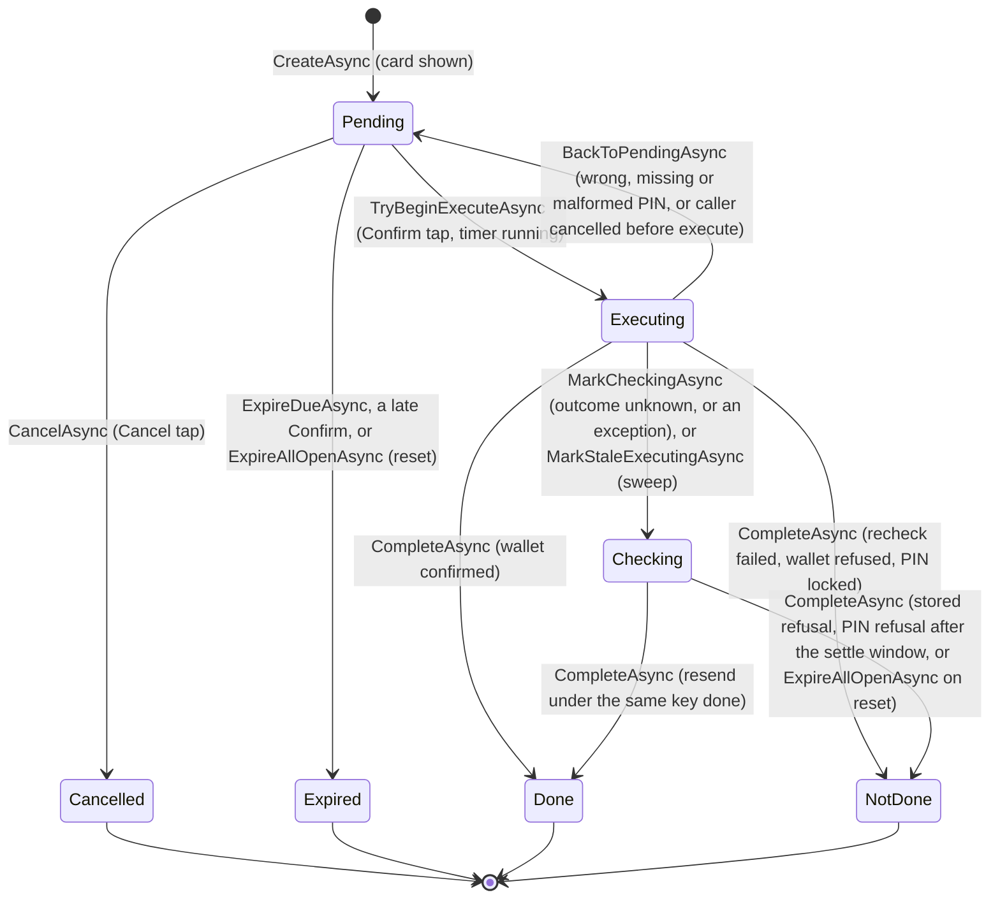

- `TryBeginExecuteAsync` moves Pending to Executing only while `ExpiresAt` is in the future, counts the attempt (`Attempts`) and sets `ExecutingSince`, in the same update. Of any number of concurrent calls exactly one gets `Begun`. A record found still Pending after its timer is marked Expired there and then.
- `BackToPendingAsync` keeps the card open with the same key and the same timer, and clears `ExecutingSince`.
- `MarkCheckingAsync` moves Executing to Checking. A record already Checking (the sweep got there first) is left as it is, with no second audit row; any other state throws.
- `CompleteAsync` returns a `TransitionResult`: `Completed(record)` when this call settled the record, `AlreadyLeft(state)` when it is in another state (another settle or a reset got there first), `NotFound` for a missing or another user's record. It still throws `ArgumentException` for a final state other than Done or NotDone, or more than four characters of a purchase code.
- `ExpireAllOpenAsync(reason)` is for a wallet reset: Pending to Expired and Checking to NotDone, both with the reason. Executing records are left to their executor and to the sweep below.
- `MarkStaleExecutingAsync(olderThan)` is the stale-Executing sweep: every record still Executing whose `ExecutingSince` is at least `olderThan` ago becomes Checking (audit reason `stale_executing`), never NotDone, since its execute call may have reached the wallet; a settle then resolves it under the same key. It covers a process that stopped between the begin and the outcome write. `PendingSweeper` (below) runs it with `olderThan` = `StaleExecutingAfterSeconds`.
### The pending sweeper

`PendingSweeper` (`src/Agent.Core/Pending/PendingSweeper.cs`) is a `BackgroundService`. `AddAgentCore` registers it with `AddHostedService` only when `SweepIntervalSeconds` is above 0 (the test hosts set 0 and call `SweepOnceAsync` on an instance they build). At start and then on a `PeriodicTimer` every `SweepIntervalSeconds`, it opens its own DI scope, resolves `PendingStore`, runs `ExpireDueAsync` and then `MarkStaleExecutingAsync(StaleExecutingAfterSeconds)`, and logs both counts at Debug. A failed sweep is logged at Warning once per outage (the first failure after a success), at Debug while it lasts, and the recovery at Information (`SweepAndLogAsync`); the loop goes on, and only the host's stop token ends it. It never calls the wallet.

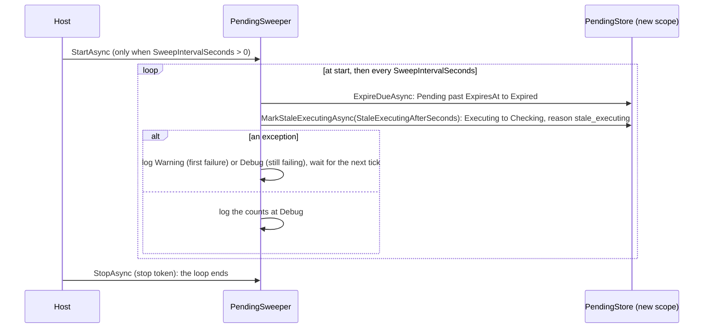

- **For Khalil:** section 5 of the architecture has no Executing to Pending edge. The code needs it, because a wrong PIN keeps the card (and a cancelled Confirm before the execute sent nothing). With it, a record can leave Pending more than once, but only one Executing at a time and always under the same key. Section 5 also says Checking settles by "status found by key"; the code settles by resending the same body under the same key (below), and uses by-key for display only. Suggest adding the edge and that wording to section 5.

## The kill switch

The kill switch is Khalil's ruling of 15 Oct 2026. `KillSwitch` (`src/Agent.Core/Pipeline/KillSwitch.cs`) is a singleton registered by `AddAgentCore`, held in memory and off at every start. The console's settings component flips it, and each flip writes a `kill_switch` audit row (reason `on` or `off`) under the console's `DemoUserId`. While it is on, three gates stop money and cards, and the balance question still answers:

- **Before a card.** `Orchestrator.HandleAsync` refuses a transfer, a bill or a purchase (including the known gap that goes on as a transfer) before any wallet read or question. The switch is read again just before the record opens (`CheckAndIssueAsync`, before `PendingStore.CreateAsync`), so a flip while the checks wait for the wallet still gives no card (`OrchestratorTests.TheKillSwitchTurnedOnDuringTheChecksIssuesNoCard`). The refusal is `not_done_nothing_taken` with detail `kill_switch`, traced `kill_switch on`. `ReissueAsync` (D19) refuses the same way (`OrchestratorTests.TheKillSwitchRefusesARequestThatWouldGetACard`, `TheKillSwitchRefusesAReissue`).
- **Before an execute.** `ConfirmHandler.ConfirmAsync` moves the record Pending to Executing as usual, so it leaves Pending once. It then ends the record NotDone (`kill_switch`) the way a failed recheck does, without calling the wallet (`ConfirmHandlerTests.TheKillSwitchEndsALiveCardNotDoneWithoutAnExecute`). The switch is read again after the recheck and before the execute, since the recheck can wait two wallet timeouts; a flip in between ends the record the same way, with nothing sent (`TheKillSwitchTurnedOnDuringTheRecheckStopsTheExecute`).
- **Before a settle.** `ConfirmHandler.SettleCheckingAsync` sends nothing, and a Checking record stays Checking until the switch is off and the user checks again (`TheKillSwitchLeavesACheckingRecordCheckingWithoutAResend`).

The journey `KillSwitchStopsEverything` shows all of this on screen.

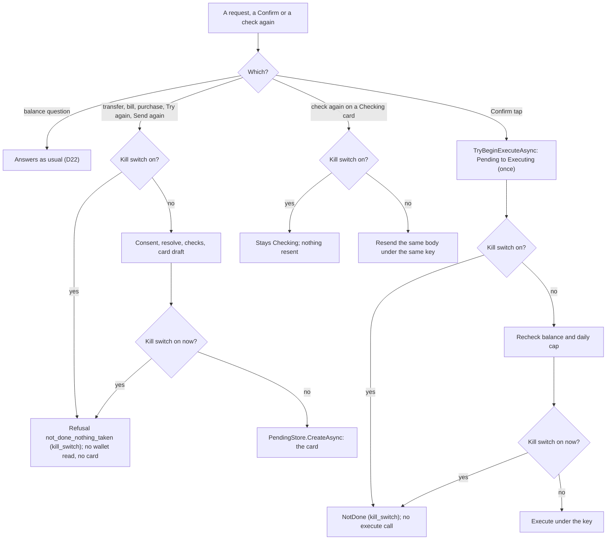

## Confirm and Checking

`ConfirmHandler` (`src/Agent.Core/Confirm/ConfirmHandler.cs`) is the only place money moves.

```mermaid
sequenceDiagram
    participant U as User (Confirm tap)
    participant C as ConfirmHandler
    participant S as PendingStore
    participant W as WalletClient

    U->>C: ConfirmAsync(userId, pendingId, pin)
    C->>S: TryBeginExecuteAsync(pendingId, userId)
    alt Expired, AlreadyLeft or NotFound (another user's record too)
        S-->>C: no Begun
        C-->>U: Expired, AlreadyHandled(state) or NotFound
    else Begun
        S-->>C: record, now Executing
        C->>W: GetBalanceAsync, then GetHistoryAsync since midnight in Iraq
        alt balance below the total, or over the daily cap, or no answer
            C->>S: CompleteAsync(NotDone)
            C-->>U: NotDone(reason)
        else recheck passes
            C->>W: ExecuteAsync(record.IdempotencyKey, body from the record, PIN as ASCII)
            alt 201 or 200
                C->>S: CompleteAsync(Done, reference, balance after, last 4 of a code)
                C-->>U: Done
            else other 5xx (no code, another code), 409, timeout, connection, unreadable
                C->>S: MarkCheckingAsync(reason)
                C-->>U: Checking
            else PIN to try again
                C->>S: BackToPendingAsync(code)
                C-->>U: PinRequired, PinWrong(attemptsLeft) or PinMalformed
            else other 4xx, or a 5xx with injected_error or injected_timeout
                C->>S: CompleteAsync(NotDone, wallet code)
                C-->>U: NotDone(reason)
            end
        end
    end

    Note over C,W: Any exception after the begin (not a cancellation): BackToPendingAsync("exception") if the execute call was not sent yet, else MarkCheckingAsync("exception"); then rethrow

    Note over C,W: Later, for a Checking record
    U->>C: SettleCheckingAsync(userId, pendingId)
    C->>S: FindAsync(pendingId, userId): still Checking?
    C->>W: ExecuteAsync(same key, same body, no PIN)
    alt still unknown, or a PIN refusal within SettleWindowSeconds of ExecutingSince
        C-->>U: Checking (record unchanged)
    else answer
        C->>S: CompleteAsync(Done or NotDone)
        alt Completed
            C-->>U: Done or NotDone
        else AlreadyLeft or NotFound (another settle or a reset got there first)
            C-->>U: AlreadyHandled(state) or NotFound
        end
    end
```

- The execute body is rebuilt from the record every time (`RequestFrom`), so every call under its key (Confirm and settle) carries the same request fingerprint. A transfer names the recipient by the account the quote resolved (the phone only when no account is stored). Every type carries the confirmed amount, `AmountIqd` of the record, bills and purchases included, so the wallet refuses (`bills_paid_in_full`, `invalid_amount`) a bill or a price that no longer matches the card.
- The PIN travels only in the execute body, converted from Arabic-Indic digits to ASCII. It is never stored, logged or written to an audit row.
- Once the wallet has answered, the outcome is recorded with `CancellationToken.None`, so a caller who leaves cannot strand a record in Executing. A cancellation during the recheck puts the record back to Pending (`caller_cancelled`); a cancellation during the execute call marks it Checking (`caller_cancelled`), since the request may have reached the wallet.
- Any other exception after the begin is split by a local `sent` flag, set immediately before the execute call. Before it (the recheck threw, say), nothing reached the wallet, so the record goes back to Pending with the reason `exception` and the card stays open. After it (a database error writing the outcome, an unexpected exception from the wallet client), the call may have reached the wallet, so the record moves to Checking with the reason `exception`. Both writes are best effort and without the caller's token, and the exception then propagates. If even that write fails, the stale-Executing sweep moves the record to Checking later.
- A recheck that stops the payment carries its figure: `NotDone(insufficient_balance, null, shortfall)` with the card's total less the balance now, and `NotDone(over_daily_cap, null, left)` with what is left of the daily cap.
- A settle sends no PIN: a replay needs none. The wallet stores nothing for a PIN refusal, so a settle's `pin_required`, `pin_invalid`, `pin_malformed` or `pin_locked` may only mean the original call (with its PIN) has not reached the wallet's database yet, for instance behind a `slow` fault. Within `SettleWindowSeconds` (610) of `ExecutingSince`, the moment the record last entered Executing (its creation when that is not stored), such a refusal leaves the record Checking; after it the original call can no longer be running, and the record ends NotDone with the wallet's code. Counting from the card's creation would have cut the window short for a Confirm sent late in the card's timer.

### Outcome mapping

As in `ConfirmHandler.cs`.

| Wallet answer or step | Record | `ConfirmOutcome` |
|---|---|---|
| Record not Pending (`AlreadyLeft`) | unchanged | `AlreadyHandled(state)` |
| Record Pending past its timer | Expired | `Expired` |
| No record, or another user's record | none | `NotFound` |
| Recheck: balance below the card's total | NotDone, `insufficient_balance` | `NotDone(insufficient_balance, null, total - balance)` |
| Recheck: done today plus the amount above `PerDayCapIqd` | NotDone, `over_daily_cap` | `NotDone(over_daily_cap, null, what is left today)` |
| Recheck: balance or history read with no answer | NotDone, `wallet_` plus the reason | `NotDone(not_done_nothing_taken, wallet_<reason>)` |
| Recheck: balance or history read refused | NotDone, the wallet's code | `NotDone(not_done_nothing_taken, code)` |
| 201 or 200 | Done, reference, balance after, last four of a purchase code | `Done(reference, balanceAfter, purchaseCode)` |
| 5xx without `injected_error` or `injected_timeout` (no code, another code, no body: `http_500`, `http_502`), 409 (`in_progress`), `timeout`, `connection`, `unreadable_response` | Checking, with the reason | `Checking` |
| 422 `pin_required` | back to Pending | `PinRequired` |
| 422 `pin_invalid` with `attemptsLeft` above 0 | back to Pending | `PinWrong(attemptsLeft)` |
| 422 `pin_invalid` with no attempts left | NotDone, `pin_locked` | `NotDone(pin_locked)` |
| 422 `pin_malformed` | back to Pending | `PinMalformed` |
| 422 `insufficient_funds` | NotDone, `insufficient_funds` | `NotDone(insufficient_balance)` |
| 422 `nothing_due` | NotDone, `nothing_due` | `NotDone(nothing_due)` |
| 422 `account_closed` | NotDone, `account_closed` | `NotDone(account_closed)` |
| 423 `pin_locked` | NotDone, `pin_locked` | `NotDone(pin_locked)` |
| Any other 4xx, or a 5xx whose ProblemDetails carries `injected_error` or `injected_timeout`, the codes that mean nothing was written (ruling of 14 Oct 2026; any other code on a 5xx is unknown, review M1 of milestone 6) | NotDone, the wallet's code | `NotDone(not_done_nothing_taken, code)` |
| The outcome write finds the record no longer Executing (should not happen) | unchanged | `AlreadyHandled(state)` |
| Any exception after the begin and before the execute call, not a cancellation | back to Pending, reason `exception` (best effort) | the exception propagates |
| Any exception once the execute call was sent, not a cancellation | Checking, reason `exception` (best effort) | the exception propagates |
| Settle: no record, or another user's record | none | `NotFound` |
| Settle: record not Checking before the resend, or settled by another call (a concurrent settle, a reset) before the write (`CompleteAsync` returns `AlreadyLeft` or `NotFound`) | unchanged | `AlreadyHandled(state)` or `NotFound` |
| Settle: another unknown outcome, or a 5xx with a wallet `code` (the fault switch answers before the key lookup, so it says nothing about the original call) | stays Checking, no write | `Checking` |
| Settle: 422 `pin_required`, `pin_invalid` or `pin_malformed`, or 423 `pin_locked`, within `SettleWindowSeconds` of `ExecutingSince` | stays Checking, no write | `Checking` |
| Settle: the same PIN codes after `SettleWindowSeconds` | NotDone, the wallet's code | `NotDone(not_done_nothing_taken, code)` |
| Settle: 201, 200 or any other 4xx | as the rows above for Done and the other 4xx | as above |

`ConfirmOutcome.Done.ToString()` masks the purchase code.

## The conversation

`Conversation` (`src/Agent.Core/Conversation/`) is one user's conversation with the agent, without a screen. The phone's `ChatSession` ([agent-web.md](agent-web.md)) is a thin adapter over it, and the test runner drives it directly, so the runner measures the same logic the phone runs. It is not registered in DI. A host builds it with:

- `IServiceScopeFactory`;
- `IParser`;
- `TimeProvider`;
- `IOptions<AgentOptions>`;
- an `ITraceSink` for its own steps;
- the user ID.

Every action opens its own DI scope (`CreateAsyncScope`) and resolves the agent's services from it, so no two actions share a database context. A `SemaphoreSlim(1,1)` runs one action at a time, so a timer refresh and a tap never overlap. `Dispose` cancels the token every action uses, so a running action takes the agent's cancellation path: a Confirm cancelled before the send goes back to Pending, and one cancelled during the send goes to Checking. An action that starts after `Dispose` returns at once.

### Actions

| Action | What it does |
|---|---|
| `SendAsync(text)` | D6 first (below), then the parse call with the pending note, then `Orchestrator.HandleAsync`; the reply becomes messages. A `ParserUnavailableException` gives `model_unavailable` |
| `TapOptionAsync(value)` | Checks the value against the open question's options (anything else is traced `option_rejected` and ignored), then answers the pending request with the tap (below, "Answers to a question"); no wallet read |
| `GiveConsentAsync()` | `WalletClient.GiveConsentAsync`, then answers the pending request and its answers again |
| `ConfirmAsync(pin)` | `ConfirmHandler.ConfirmAsync(user, Card.PendingId, pin)`; the PIN is passed through and kept nowhere |
| `SettleAsync()` | Only while the card is Checking: `ConfirmHandler.SettleCheckingAsync`, the same body under the same key (rule 6) |
| `CancelAsync()` | `PendingStore.CancelAsync` while the card is live |
| `ReissueAsync()` | D19, the card's Try again or Send again: only for a card shown as Expired, Cancelled or NotDone (`ReissueKind.TryAgain`) or Done (`ReissueKind.SendAgain`), and only when its stored record is not live, Executing or Checking (else traced `reissue_rejected`). Reads the record, then `Orchestrator.ReissueAsync`; the reply is shown as any reply (a new card, or a refusal that leaves the old card). Never the Confirm handler |
| `RefreshAsync()` | Reads the record; marks the card expired when it is Pending past `ExpiresAt`, Expired, or gone |

When the Confirm handler throws, the conversation reads the record:

- if it is Pending, nothing was sent, and the reply is `not_done_nothing_taken`;
- otherwise the outcome is shown as checking, never as failed (rule 6).

Any other exception in an action is traced as `error` (the exception type) and answered with `not_done_nothing_taken`.

### State

| Member | What it holds |
|---|---|
| `Messages` | The messages as codes and figures (below), a snapshot |
| `Card`, `CardState` | The card as a `CardView`, and its `CardStatus`: Live, Done, NotDone, Checking, Expired or Cancelled |
| `Question` | The open `AgentReply.Question` |
| `PinVisible`, `Busy` | Whether the card needs a PIN field; whether an action runs |
| `WalletVersion` | Goes up by one on every Done |
| `CardMessageIndex`, `QuestionMessageIndex`, `ActionMessageIndex` | The positions in `Messages` of the card's message, the open question's message, and the message whose button (consent, or check again) is live |
| `CardsIssued` | Every card issued, in order (for the grader) |
| `QuestionsAsked` | Every question, in order, as `ConversationQuestion(Kind, Answer, OptionValues)` (for the grader) |
| `LastReply`, `LastRequest` | The last `AgentReply` to a request, and the request it answered (together they give the learning-log entry) |
| `LastAnswers` | The `SlotAnswers` of the pending request: what taps have answered for `LastRequest` |
| `LastLearningEntry` | The learning-log entry the conversation wrote for its last reply (`model_invalid_reply` for a refused structure, else `LearningLogRule.EntryFor`), or null; the runner grades it |
| `ConsentShown` | True once the consent screen has been shown |

`Changed` is raised on every new message, and at the start and end of every action. It is raised while the action still holds its turn, so a handler sees each message on the async flow of the action that added it.

### D6, the typed yes and no

`AgentOptions.YesWords` and `NoWords` hold the words, and `Agent.Core` has none of its own (rule 4). The rule is Khalil's (15 Oct 2026): a message is a yes when it has at most `MaxYesNoWords` (4) words and is made only of whole yes entries; the same for a no. Never a substring match.

- **The entries.** Each configured entry is a phrase: its words, normalised as a message is, in order. A multi-word entry matches only as the whole phrase, so one of its words alone matches nothing (the no entry of two words does not make its second word a no).
- **The match.** The message's words are cut left to right into entries: at each position the longest entry that fits is taken (`Conversation.IsPhrase`), and a position where none fits means it is not a yes (or no). Two entries in a row count (`cancel` then `the operation`). The limit counts words, not entries.
- **The message.** `ArabicText.Normalize`, then every punctuation or symbol character, anywhere, replaced by a space, Latin letters lower-cased, split on spaces (`Conversation.WordsOf`). The words are compared ordinal with the entries. Yes is checked first.

When a card is live:

- **A yes** never confirms. The reply is `points_to_confirm`, the card stays open, and nothing reaches the wallet.
- **A no** cancels the card (`cancelled`).
- **Unclear text** (any other text that the parse call reads as unclear, including a structure the validator refused, or an unavailable parser) leaves the card until its timer ends. The reply is `not_understood` (or `model_unavailable`), traced `card_kept` with the reason. A request to change the waiting card (`Unsupported` with `change_waiting_card`) also leaves it, and its reply tells the user to cancel and ask again (`ConversationTests.AnUnclearMessageLeavesTheCardUntilItsTimerEnds`, `AnUnclearMessageLeavesTheCardAndConfirmStillMovesTheMoney`, `AChangeRequestLeavesTheCard`, `AnUnavailableParserLeavesALiveCard`).
- **A new request** (anything else the parse call understood) cancels the card the same way and goes on as a new request (`ANewRequestCancelsTheCardAndStartsFresh`).

### Answers to a question

The conversation keeps the pending request as a pair: `LastRequest` and `LastAnswers`, a `SlotAnswers(ContactOption, BillCode, ProductCode)` that only code fills, from tapped option values (D3). The pair goes to `Orchestrator.HandleAsync(user, request, answers)`. Nothing of `SlotAnswers` reaches the parse call: the pending note stays the question kind or the card type (rule 5).

A tap (`TapOptionAsync`) reads nothing from the wallet:

| Question | Pending request | Answers |
|---|---|---|
| `which_contact`, `did_you_mean` | The same | `ContactOption` = the option's value (`Orchestrator.ContactOptionValue`: a contact code or `account:<id>`) |
| `which_amount` | `AmountValue` = the option's dinars, `AmountUnit.Dinars` | Kept |
| `which_operator` | `OperatorText` = the provider code | Kept |
| `which_product` | The same purchase; after a bill request (rule 17), `Purchase(null, "internet", null)` | `ProductCode` = the product code |
| `which_bill`, `bill_or_store` | The same bill request, else `Bill(null, null, null)`; `store:internet` is `Purchase(null, "internet", null)` | `BillCode` = the bill code; none for `store:internet` |

The orchestrator uses an answer only to pick among what it resolved itself:

- **Transfer by name.** The resolver runs on `RecipientText` as before. When it asks (`Options`) and exactly one of its candidates has the tapped `ContactOption`, that candidate goes to the card (trace `recipient_resolved` with `option`), with the text that was offered. A value that is not among the candidates picks nothing, and the question comes back.
- **Bill.** A `BillCode` that is one of the user's bills skips `BillResolver`: nothing due is `nothing_due`, otherwise the D9 named-amount check and the card. Any other code falls through to the resolver.
- **Purchase.** A `ProductCode` in the catalogue skips `ProductResolver`. Any other code falls through.

A typed question (`which_amount` or `which_contact` with no options) takes the next message as its answer:

- **The parse call reads it as `Unclear`.** The slot is filled from the typed text: the amount with `ArabicDigits.ToAscii` and invariant `decimal.TryParse`, so both digit forms work; the recipient as the trimmed text. A text that does not fill the slot is answered as parsed (`not_understood`).
- **A transfer missing its recipient or its amount, on a pending transfer.** It merges: the pending transfer with every slot the parse names put in (`RecipientText`; `AmountValue` with `AmountUnit`; `CurrencyText`), answers kept, trace `answer_merged` with the question kind (AMB-06, AMB-13).
- **Anything else** (a complete request, another intent, the balance, an unsupported request) replaces the pending pair, with no answers.

The learning-log entry is for the request actually handled. A new request while a card is live cancels the card and replaces the pair.

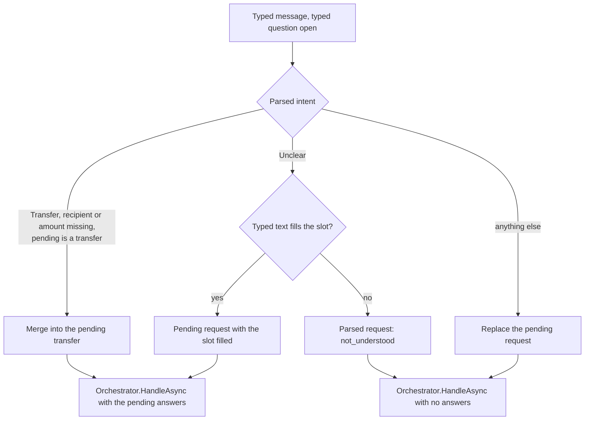

### Messages as codes

A `ConversationMessage(Role, Kind, Code, AmountIqd, Reference, PurchaseCode, AttemptsLeft, Reason)` carries codes and figures only. A user message carries no text: the screen and the runner keep what was typed.

| Kind | Role | Code | Figures |
|---|---|---|---|
| `Typed` | User | none | none |
| `Option` | User | The option's value | none |
| `Refusal` | Agent | The reason code (`ReasonCodes`), including `model_unavailable` and `not_done_nothing_taken` | `AmountIqd`: the refusal's figure, if any |
| `Unsupported` | Agent | The parsed unsupported reason | none |
| `Question` | Agent | The question kind (`QuestionKinds`) | none; the options are on `Question` |
| `Balance` | Agent | none | `AmountIqd`: the balance |
| `Consent` | Agent | none | none |
| `Card` | Agent | none | none; the card is `Card` |
| `Outcome` | Agent | `done`, `checking`, `not_done`, `expired`, `cancelled`, `pin_required`, `pin_wrong`, `pin_malformed`, `already_handled` or `not_found` (`OutcomeCodes`) | `done`: `Reference`, `AmountIqd` (the balance after), `PurchaseCode`; `not_done`: `Reason`, `AmountIqd`; `pin_wrong`: `AttemptsLeft` |
| `Info` | Agent | `points_to_confirm`, or a card's note (`account_choice_unavailable`), added just before the card's message | none |

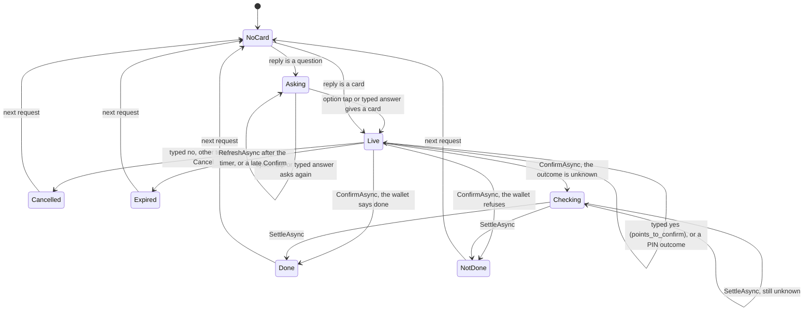

## The live trace

`ITraceSink.Record(zone, step, detail)` (`src/Agent.Core/Trace/`) receives each step of a request for the page's live trace. `TraceZone` is `User`, `Code`, `Model` or `Write`. `AddAgentCore` registers `NullTraceSink`, which drops every step, with `TryAddScoped`, so a host that registers its own sink first keeps it. The `Orchestrator` and the `ConfirmHandler` take it by constructor. The step names are the constants of `TraceSteps`.

| Zone | Written by | Steps (detail) |
|---|---|---|
| Code | `Orchestrator` | `parse_received` (the intent), `consent_checked` (`given` or `required`), `recipient_resolved` (`contact`, `alias`, `number`, `option`, `bill` or `purchase`), `amount_resolved` (the amount), `checks_passed` (the quote's total) or `check_failed:<reason>` (the figure), `card_created` (type, total, `pin` when one is needed), `question:<kind>` (how many options), `refusal:<code>` (the wallet code for `not_done_nothing_taken`, else the figure), `balance_shown` (no figure), `known_gap` (`choose_account`), `reissue` (`try_again` or `send_again`) |
| Write | `ConfirmHandler` | `begin_execute` (type and total), `recheck_ok` or `recheck_failed:<reason>` (the wallet code, if any), `execute_sent`, `outcome:<done, not_done, checking, expired, already_handled, not_found, pin_required, pin_wrong, pin_malformed, cancelled or exception>` (the record's state, the reason, or the attempts left), `settle_sent`, `settle_outcome:<the same names>` |

The User and Model zones are written by the `Conversation` (below; `message_received`, `confirm_tapped`, `check_again_tapped`, `cancel_tapped`, `reissue_tapped`, `parse:<parser name>` with the intent, `parse:unavailable`) and the Claude parser (`more_than_one_request`, Model zone, with the count). The `Conversation` also writes, in the Code zone, `model_invalid_reply` (the field the validator refused), `answer_merged` (the typed question's kind), `option_rejected`, `reissue_rejected` (the card's or the record's state), `learning_logged` (the reason) and `error` (an exception's type). A detail holds codes, states and amounts only: never a PIN, an idempotency key, a purchase code, a phone, a name, a balance or any text the user typed (the unsupported reason stays out of the trace). `TraceSinkTests.NoPinKeyCodeOrPhoneInAnyStep` runs a PIN payment and a purchase through a recording sink and checks every step and detail.

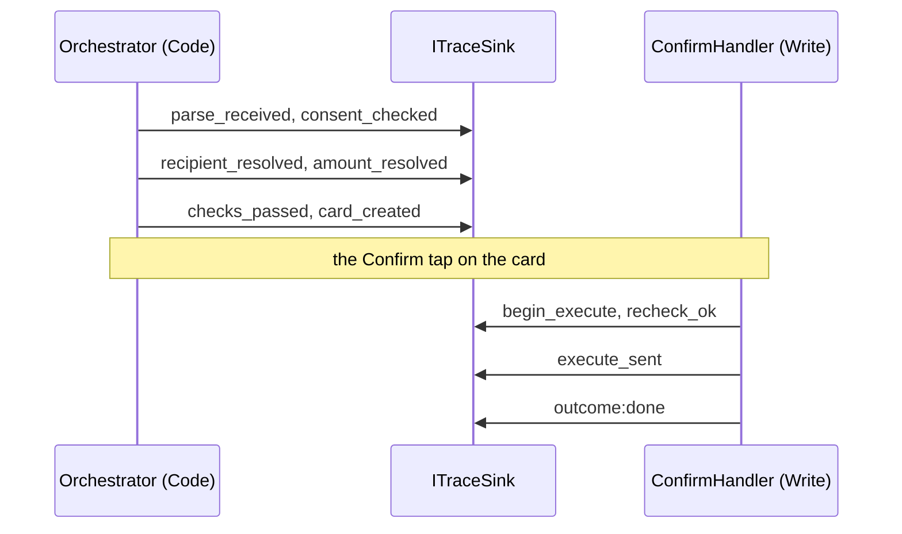

## The audit log

`AuditLog` writes `AuditEntry` rows (table `AuditEntries`): time, user, pending ID, event, from and to state, reason, reference, amount. Every pending-record transition writes exactly one row, in the same database transaction, and only when the transition happened (`created` is saved together with the record).

| Event | Written by |
|---|---|
| `created`, `cancelled`, `expired`, `executing`, `done`, `not_done`, `checking`, `back_to_pending` | `PendingStore`, one per transition; the reason is the result code or the unknown-outcome reason (`checking` also `exception` and `stale_executing`) |
| `question_asked` | `Orchestrator`; the reason is the question kind |
| `refused` | `Orchestrator`, through `AuditLog.WriteRefusalAsync`; the reason is the reason code, or the parsed unsupported reason. `Detail` holds the wallet's code (or `wallet_` and the reason) only when the reason is `not_done_nothing_taken`, and is null otherwise |
| `consent_shown` | `Orchestrator` |
| `balance_shown` | `Orchestrator`; no figure |
| `kill_switch` | The console's settings component; the reason is `on` or `off` |

Never stored: a PIN, a balance figure, a purchase code (full or partial), the typed recipient text, a refusal's figure, or a refusal's detail other than the wallet code kept with `not_done_nothing_taken`. `AuditLog.WriteAsync` and `WriteRefusalAsync` have no parameter for a PIN, a balance or a code, and `AuditLogTests.WriteHasNoParameterForAPinABalanceOrAPurchaseCode` checks both; `AuditLogTests.RefusalKeepsTheDetailOnlyWhenNothingWasTaken` checks the detail rule. `AmountIqd` is the payment's amount, never a balance.

`AuditLog.ReadLatestAsync(take, cancellationToken)` (milestone 7) is the one read. It returns the newest `take` rows (at least 1), ordered by `At` and then by `Id`, newest first, untracked. The console's log component shows them, `LogPageSize` at a time (`AuditLogReadTests.ReadLatestIsNewestFirstAndTheBalanceRowHasNoFigure`).

## The learning-log rule

`LearningLogRule.EntryFor(AgentReply reply, ParsedRequest request)` (`src/Agent.Core/Learning/`) is the pure function that decides what goes to the learning log (D12). It returns a `LearningEntry(Reason, Detail)`, or null when nothing is logged. The conversation persists exactly this entry (The learning log, below); the runner grades the same entry against the answer key.

`LearningLogRule.Logged` and `NotLogged` are the lists of `data/seed/settings.json` (`learning_log`), in the same order. `LearningLogRuleTests.TheListsAreTheSettingsLists` pins them to the seed.

| Reply | Entry |
|---|---|
| `Refusal` with `recipient_not_found`, `bill_not_found`, `biller_unavailable`, `product_not_found`, `not_understood` or `not_supported` | That code, with the reply's detail. Without a detail, `bill_not_found` takes the biller asked for, and `product_not_found` takes the operator, type and value asked for, space separated |
| `Refusal` with `dinars_only` (the request named another currency, GAP-07) | `other_currency` |
| `CardIssued` with `Note` `account_choice_unavailable` (the known gap, GAP-04) | `choose_account`, no detail |
| `Refusal` with `only_own_balance` (someone else's balance, RED-10) | `not_supported`, detail `other_balance` |
| `Refusal` with `not_understood` and detail `other_language` (GAP-08) | `other_language`, no detail |
| `Unsupported` with `same_as_last_time`, `refers_back`, `change_waiting_card`, `choose_account`, `part_of_bill`, `credit_to_own_number`, `other_currency` or `other_language` | That reason, no detail |
| `Unsupported` with any other reason (`withdrawal`) | `not_supported`, with the reason as detail |
| A `not_logged` refusal (`insufficient_balance`, the two caps, `nothing_due`, `account_closed`, `number_has_no_wallet`, `consent_required`), any other refusal, a question, a balance, the consent screen, a card | null |

`more_than_three_requests` and `model_invalid_reply` are in the logged list but are not replies. The caller that splits a message (milestone 9c) builds the first; the conversation builds the second when the parsed request carries a `Problem` (see The learning log).

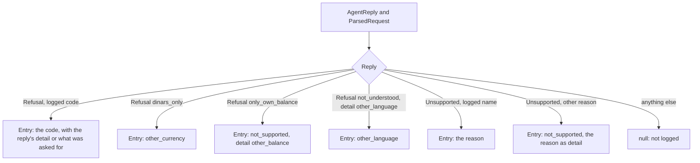

### The learning log (milestone 6)

`LearningLog.WriteAsync(userId, entry, maskedText, cancellationToken)` (`src/Agent.Core/Learning/LearningLog.cs`) writes one `LearningEntryRow` (table `LearningEntries`, migration `LearningLog`): `Id`, `At`, `UserId`, `Reason`, `Detail` (up to 100 characters), `MaskedText` (the message as the parse call saw it, up to 1,000 characters) and `Reviewed` (false until a person has looked at it). It masks the detail and the text once more before it stores them, so a number that reached them another way (a typed answer to a question goes to the orchestrator as typed) never reaches a row. It has no parameter for a PIN, a balance or a purchase code (`LearningLogTests.WriteHasNoParameterForAPinABalanceOrAPurchaseCode`).

The conversation calls it after every reply that yields an entry, with the masked text of the last typed message: the `model_invalid_reply` entry when the parsed request carries a `Problem`, otherwise `LearningLogRule.EntryFor(reply, request)`. The reply is shown first; a failed write is traced (`error`, the exception's type) and changes nothing on the screen. The runner's derived entry stays the graded one; the table is additional.

## The "no tap, no money" test

`tests/Agent.Core.Tests/Architecture/NoTapNoMoneyTests.cs` checks rule 1 on the compiled code. It needs no database and no wallet.

- `OnlyTheConfirmHandlerCanReachExecute` decodes the IL of every method and constructor of every type in `Agent.Core`, and records each one with a `call`, `callvirt`, `ldftn`, `ldvirtftn` or `newobj` whose operand resolves to `WalletClient.ExecuteAsync`. A compiler-generated state machine's `MoveNext`, or a lambda's body, is mapped back to the method that declares it (through `AsyncStateMachineAttribute`, `IteratorStateMachineAttribute`, or the `<Method>d__N` name). The set of callers must equal exactly `ConfirmHandler.ConfirmAsync` and `ConfirmHandler.SettleCheckingAsync`. So neither may hand the call to a helper, and any new caller fails the test.
- `OnlyTheConversationsConfirmAndSettleCallTheConfirmHandler` checks, with the same scan, that the only methods in `Agent.Core` that call `ConfirmAsync` or `SettleCheckingAsync` are `Conversation.ConfirmAsync` (the card's Confirm button) and `Conversation.SettleAsync` (the "check again" button): no parse or reply path can turn words into a Confirm.
- `NothingInAgentWebCallsTheConfirmHandler` and `OnlyTheSessionsConfirmAndSettleCallTheConversationsFromTheWeb` scan `Agent.Web`: nothing there calls the handler, and only `ChatSession.ConfirmAsync` and `ChatSession.SettleAsync` call the conversation's two. `NothingInAgentWebInvokesByReflection` checks that assembly for reflection calls. `Agent.Eval` joins the scan with the runner's case driver (milestone 5, Task 2).
- `OnlyTheWalletClientNamesTheTransactionsRoutes` decodes every `ldstr` (`Module.ResolveString`): the literal `"transactions"` is loaded only by `WalletClient.ExecuteAsync`, `"transactions/by-key/"` only by `WalletClient.FindByKeyAsync`, and no other literal contains `transactions` (ordinal, so a leading slash or a full URL is caught too; the table name `PendingTransactions` is not). So no second HTTP path to the execute route can hide in the assembly.
- `NothingInAgentCoreInvokesByReflection` checks that no method calls `MethodBase.Invoke`, `Type.GetMethod`, `Type.GetMethods`, `Type.InvokeMember`, `Delegate.DynamicInvoke` or any overload of `MethodInfo.CreateDelegate`; `TheReflectionScanKnowsEveryInvokeRoute` checks the predicate catches every public overload of each.
- `TheReissuePathNeverReachesExecute` (D19) builds the call graph of `Agent.Core` with the same scan and follows it from `Orchestrator.ReissueAsync` and `Conversation.ReissueAsync`: what they reach includes `PendingStore.CreateAsync` and never `WalletClient.ExecuteAsync`, the Confirm handler's two entries or the conversation's Confirm and settle; no `ReissueAsync` in `Agent.Web` or `Agent.Eval` calls the conversation's Confirm or settle.
- `ExecuteIsInternal` checks that `ExecuteAsync` is `internal`, not public, and that `Agent.Core.Tests` is the only friend assembly.

## Settings

`AgentOptions` (section `Agent`, validated at start). The limit defaults equal `data/seed/settings.json`; `AgentOptionsTests.DefaultsMatchTheSettingsFile` keeps them equal. `src/Agent.Web/appsettings.json` sets the same values.

| Setting | Default | Used by |
|---|---|---|
| `MinAmountIqd` | 1,000 | Checks, format |
| `PerTransactionCapIqd` | 5,000,000 | Checks; `AmountRule` drops a rule-9 reading above it |
| `PerDayCapIqd` | 10,000,000 | Checks and the Confirm recheck. The three limits must be ordered, `MinAmountIqd` <= `PerTransactionCapIqd` <= `PerDayCapIqd`, validated at start and on every save (review M4, Khalil, 16 Oct 2026) |
| `CardTimerSeconds` | 45 | `PendingStore.CreateAsync` |
| `MaxRequestsPerMessage` | 3 | Not read yet (compound requests, milestone 9c) |
| `MaxProductsInOneQuestion` | 8 | Product and internet-card questions |
| `RepeatWarningWindowMinutes` | 10 | `CardBuilder`, repeat warning |
| `HistoryDays` | 90 | `CardBuilder`, first time |
| `WalletBaseUrl` | none (required); `http://localhost:5276` in Development | `WalletClient` |
| `WalletClientKey` | none; at least 16 characters when set. Null sends `dev` in Development and stops the start elsewhere | `WalletClient`, header `X-Wallet-Client-Key` |
| `WalletTimeoutSeconds` | 10 | `WalletClient`; past it an execute is `Unknown("timeout")` |
| `SettleWindowSeconds` | 610 (the wallet timeout, 10 s, plus the wallet's longest fault delay, 600 s) | `ConfirmHandler.SettleCheckingAsync`: within it of `ExecutingSince` a PIN refusal leaves a record Checking; after it, NotDone |
| `HistoryPageSize` | 200 | Daily cap, recheck and card history reads |
| `DemoUserId` | 1 (U1) | The web console: the wallet user the demo acts for |
| `SweepIntervalSeconds` | 5; 0 to 3,600 | `PendingSweeper`: how often it sweeps. 0 registers no sweeper (the test hosts) |
| `StaleExecutingAfterSeconds` | 40; must be more than three times `WalletTimeoutSeconds` (validated at start) | `PendingSweeper`: a record Executing this long becomes Checking. A Confirm makes three timed wallet calls (balance, history, execute) while the record is Executing, so 40 is 3 x 10 s plus a margin |
| `MinSubstringWordLength` | 3; 1 to 20 | `ContactResolver`, rule 4: a shorter typed word must equal a whole word |
| `MaxYesNoWords` | 4; 1 to 20 | `Conversation`, D6: a yes or a no has at most this many words |
| `LogPageSize` | 100; 1 to 1,000 | The console's log component: how many audit rows, newest first, it shows (`AuditLog.ReadLatestAsync`) |
| `Parser` | `scripted` | `ParserFactory.AddAgentParser`: `scripted` (the oracle) or `claude` |
| `DevSetPath` | `data/requests.dev.jsonl` | The oracle: the development set, relative to the repository root unless rooted; its file name must be `requests.dev.jsonl` (rule 7) |
| `YesWords`, `NoWords` | empty | `Conversation`, D6. Phone text, so not set in `Agent.Core`: the console post-configures them from `Word_yes` and `Word_no` in its resource file, and the test host sets `yes` and `no` |

The settings component shows them ([agent-web.md](agent-web.md), "The settings component"). It edits exactly `RuntimeSettings.EditableNames`: `MinAmountIqd`, `PerTransactionCapIqd`, `PerDayCapIqd`, `CardTimerSeconds`, `MaxProductsInOneQuestion`, `RepeatWarningWindowMinutes`, `HistoryDays`, `MinSubstringWordLength`, `MaxYesNoWords` and `LogPageSize`. The runtime store refuses any other key. The rest, `MaxRequestsPerMessage` included (nothing reads it yet), is read only. The client key goes in user secrets or the environment, never in a committed file.

**Options at run time (D8, milestone 7).** Every scoped service that reads `AgentOptions` reads `IOptionsSnapshot<AgentOptions>`, which is computed again per scope. Every conversation action and every eval step opens its own scope, so a value saved in the settings component applies to the next action without a restart. The singletons (`PendingSweeper`, the `WalletClient` configuration) keep `IOptions`. The conversation takes `IOptionsMonitor<AgentOptions>`: it reads the D6 word lists once, when it is built, and `MaxYesNoWords` again for every message, so a saved limit applies to the next message of an open page (`ConversationTests.AMaxYesNoWordsSavedInTheSettingsAppliesToTheNextMessage`). A value is validated before it is published, as the options are at start (`[Range]` and the cross-field rules), so a refused one never takes effect anywhere (`RuntimeSettingsTests`, `ChecksTests.ACapChangedLiveAppliesToTheNextCheck`).

## The test host and running the tests

The agent's tests that need a database belong to the xUnit collection `agent` (`AgentCollection`, fixture `AgentHost`).

- `AgentHost` hosts its own mock wallet in process on the database `ZainCashWalletAgent_Test` (same server as `ConnectionStrings__WalletTest`), so the `agent` and `wallet-api` collections run in parallel without dropping each other's database.
- It builds the agent's services with `AddAgentCore` over an in-memory configuration (wallet base `http://localhost`, test client key `agent-tests-client-key`, a test value and not a secret, and `SweepIntervalSeconds` 0, so no hosted sweep runs; `PendingSweeperTests` builds a `PendingSweeper` and calls `SweepOnceAsync`), sends the wallet client to the in-process wallet, replaces the clock with `FakeClock`, and recreates the agent's test database: `ConnectionStrings__AgentTest`, or by default `ZainCashAgent_Test` on the local default instance. Both database names must end in `_Test`; the host refuses any other, because it drops the database.
- `AgentHost.ResetAsync` sets the shared `FakeClock` back to the real time, returns the wallet to the seed and empties both agent tables.
- When SQL Server is unreachable the tests skip; with `ZAINCASH_TEST_SQL=1` they fail instead. The pure tests (resolvers, amount rule, `NoTapNoMoneyTests`, `AgentOptionsTests`) always run.

```powershell
dotnet test tests/Agent.Core.Tests
dotnet test tests/Agent.Core.Tests -- --filter-class "Agent.Core.Tests.Confirm.ConfirmHandlerTests"
$env:ConnectionStrings__AgentTest = 'Server=(localdb)\MSSQLLocalDB;Database=ZainCashAgent_Test;Trusted_Connection=True;TrustServerCertificate=True'
```

## Decisions by Khalil (14 Oct 2026) and open questions

Khalil answered the milestone 3 questions on 14 Oct 2026. Items marked *milestone 4* were done in milestone 4's first task.

| Question | Decision | Today |
|---|---|---|
| A code for an amount below the minimum | `amount_below_minimum` is a refusal code in his list; it gets its own phone string | Already used |
| `pin_locked`, `caller_cancelled` and the warning key `repeat` | Kept as their own codes (`caller_cancelled` is audit-only) | Already used |
| Rule 4: how short a typed fragment may be | A typed word of one or two letters must equal a whole word; longer words match inside. The minimum becomes a setting (*milestone 4*) | Done 14 Oct: setting `MinSubstringWordLength` (3), passed to `ContactResolver.Resolve` |
| No biller named, bills exist, none due | `nothing_due` (*milestone 4*) | Done 14 Oct: `NothingDue` of the first bill; `bill_not_found` only with no bills |
| Operator text that matches no operator | Refuse with `product_not_found`, so the learning log sees it (*milestone 4*) | Done 14 Oct: `product_not_found`; a text naming several providers asks among those |
| Rule 9 readings below the minimum | Dropped from the question; a bare number with no valid reading is refused with `amount_below_minimum` (*milestone 4*) | Done 14 Oct: `0.5` offers only 500,000; `0.0005` is refused with the minimum as the figure |
| Architecture section 5 | Updated with the Executing to Pending edge and the resend-under-the-same-key settle note | Done |

Still open:

| Question | Today |
|---|---|
| Rule 4 vs rule 6 | Partial comes before near, so a typed name inside a longer saved name is a card even when another contact is one edit away |
| Display names for bills and purchases | A bill shows its label, else its biller name; a purchase shows the operator's Arabic name |

## Known limits

| Limit | Plan |
|---|---|
| A record strands in Executing if the process dies between `TryBeginExecuteAsync` and the store write after the execute call | Handled by `PendingStore.MarkStaleExecutingAsync` (Executing older than `StaleExecutingAfterSeconds` to Checking, reason `stale_executing`), which the hosted `PendingSweeper` runs every `SweepIntervalSeconds`, and, for an exception in the process, by the catch-all in `ConfirmAsync` (back to Pending before the execute call, Checking after it, reason `exception`) |
| Two concurrent settles of one Checking record: both resend (the wallet replays, so money moves once) | Handled: `CompleteAsync` returns `AlreadyLeft` to the second, and the handler answers `AlreadyHandled(Done)` instead of throwing (`ConfirmHandlerTests.ConcurrentSettlesSettleOnce`) |
| The daily cap and the recheck read one page of `HistoryPageSize` (200) history rows; rows beyond it are not counted | Fail closed on a full page, or read further pages; the seed has at most two rows a day |
| `UnsupportedReason` is stored and returned verbatim | Milestone 6 validates the parsed structure against the allowed list |
| Checking rows are not counted toward the daily cap (only `done` rows) | Decide whether an open Checking record blocks new cards |
| A reissued `choose_account` card (GAP-04) does not carry the `account_choice_unavailable` note | Deferred, minor |
| `Attempts` counts Confirm taps that began an execute, not settle resends | Display only |
