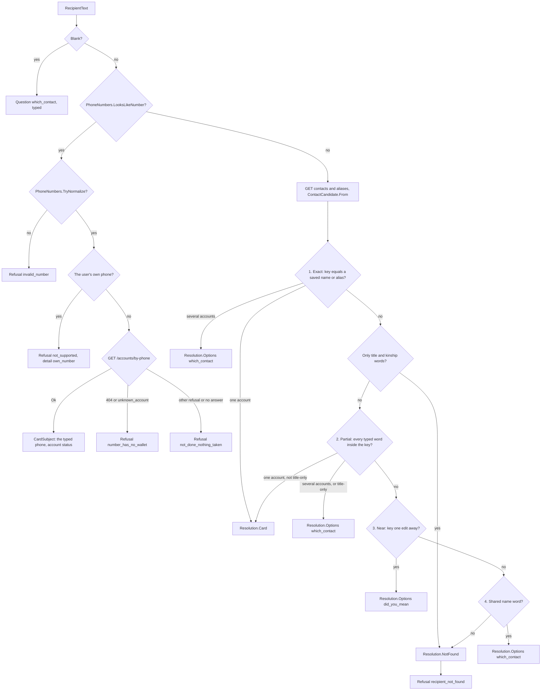
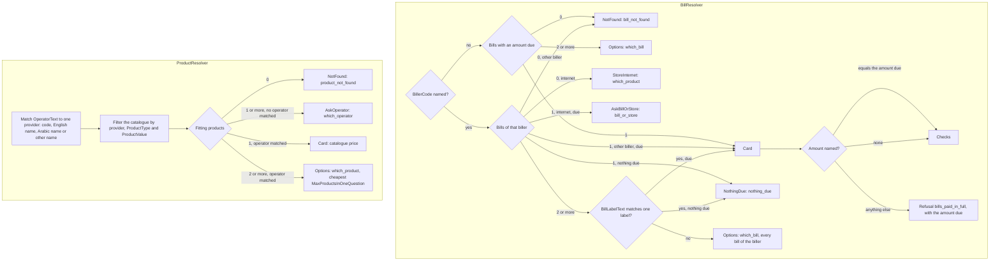
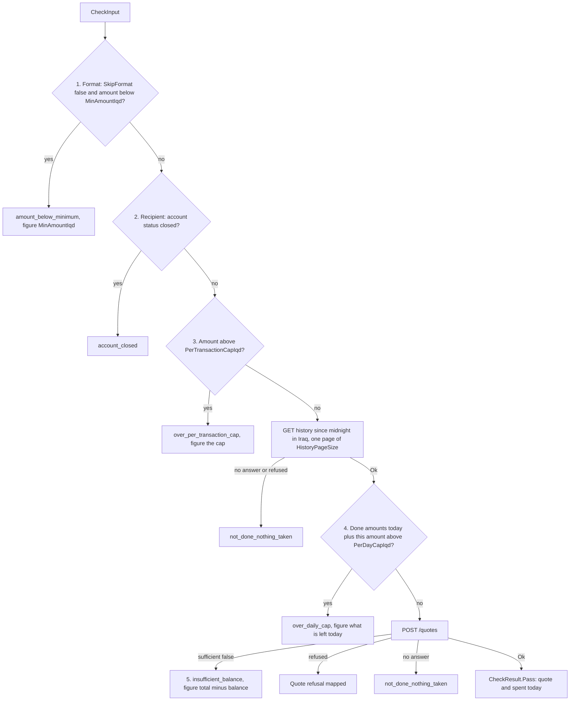
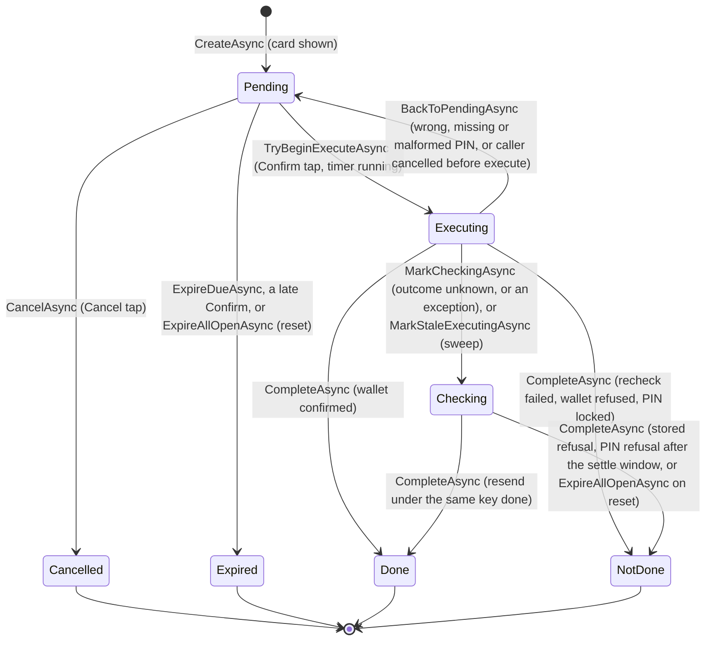
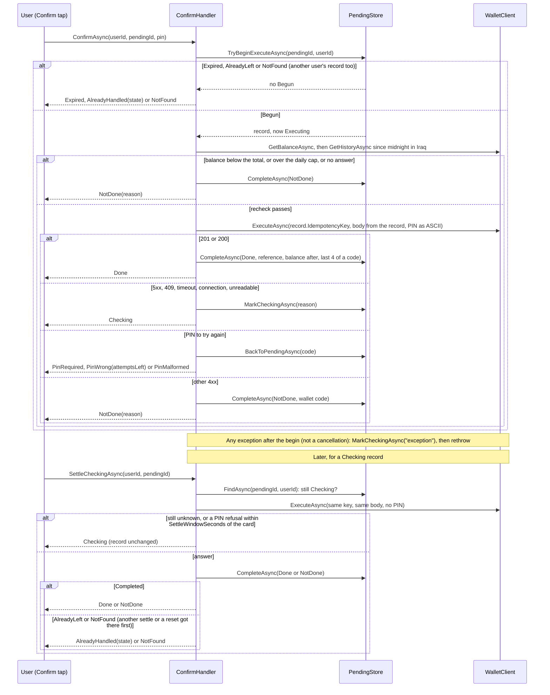

# Agent.Core: the write path

What `src/Agent.Core` does as built in milestone 3: the structured request, the pipeline that turns it into one reply, the resolvers, the ordered checks, the card, the pending record and its states, Confirm and Checking, and the audit log. No model call exists yet; tests build the structured request. The design it follows is sections 3 to 5 of [architecture.md](architecture.md); the matching and question rules are [matching-rules.md](matching-rules.md); the wallet it calls is [wallet-api.md](wallet-api.md).

## Purpose and the rules it enforces

`Agent.Core` holds every decision between "the user said something" and "the money moved". It talks to the mock wallet over HTTP only, through the typed `WalletClient`, and keeps its own database (`ZainCashAgent`) for pending records and the audit trail.

| Rule (CLAUDE.md) | How milestone 3 enforces it |
|---|---|
| 1. No tap, no money | `WalletClient.ExecuteAsync` is `internal`. Only `ConfirmHandler.ConfirmAsync` and `ConfirmHandler.SettleCheckingAsync` call it, given one pending ID and its user. `NoTapNoMoneyTests` scans the compiled IL and fails if any other method reaches it, if anything in `Agent.Core` calls those two, if any other method names the `transactions` route, or if any method invokes by reflection |
| 2. The model is read only | The model's output is `ParsedRequest`, a record with no behaviour. The `Orchestrator` validates it against the wallet and treats it as a request to check: every name, bill and product is resolved by code, every amount goes through `AmountRule` and the checks |
| 3. The card is built by code | `CardBuilder` fills `CardDraft` from the wallet's quote and the resolver's choice. No field comes from `ParsedRequest` text except the typed phone, normalised by `PhoneNumbers`, when the user typed a number |
| 4. Replies are templates | `AgentReply` and `ConfirmOutcome` carry codes, figures and option text from the wallet (reason codes, question kinds, options, amounts); the only user text is the `recipient_not_found` detail. The phone fills a template from its resource file (milestone 4) |
| 5. Masking (groundwork) | `ParsedRequest` holds only the user's own words. Nothing the orchestrator reads from the wallet is written back into it. The quoted balance stays on the pending record for the card. The audit log has no parameter for a balance, a PIN or a purchase code. Masking itself comes with the model in milestone 6 |
| 6. Idempotency | Every pending record gets one key at creation. Every transition is one conditional update on the current state. An unknown outcome is Checking, never failed, and is settled by resending the same body under the same key |

## The structured request

`ParsedRequest` (`src/Agent.Core/Requests/ParsedRequest.cs`) is the strict structure the parse call will return in milestone 6. Today tests build it with the factory methods `Transfer`, `Bill`, `Purchase` and `Balance`, or with an object initialiser. Every text in it is the user's own words.

| Field | Type | Meaning |
|---|---|---|
| `Intent` | `RequestIntent` | `Transfer`, `Bill`, `Purchase`, `Balance`, `Unsupported` or `Unclear` |
| `RecipientText` | string? | The recipient as typed: a name, an alias or a number (a masked number token from milestone 6) |
| `AmountValue` | decimal? | The amount as a number. Rule 19 (a comma is thousands, a dot never is) is applied by the parser |
| `AmountUnit` | `AmountUnit` | `None` (a bare number), `Dinars`, `Thousand` or `Million` |
| `BillerCode` | string? | `electricity`, `water`, `internet`, `school_fees`, or null |
| `BillLabelText` | string? | The user's words for one of several bills of a biller (its label), or null |
| `OperatorText` | string? | The operator as typed, or null |
| `ProductType` | string? | `credit`, `internet`, or null |
| `ProductValue` | long? | The face value the user named, in IQD, or null |
| `UnsupportedReason` | string? | For `Unsupported`: `withdrawal`, `other_balance`, `other_currency`, `refers_back`, `same_as_last_time`, `choose_account`, `part_of_bill`, `credit_to_own_number`, `change_waiting_card`, `other_language`; otherwise null |
| `CurrencyText` | string? | A currency other than dinars, as typed. When set, the request is refused with `dinars_only` |

## The pipeline, in order

`Orchestrator.HandleAsync(userId, request, cancellationToken)` answers one `ParsedRequest` with one `AgentReply`: `Question`, `Refusal`, `BalanceReply`, `ConsentScreen`, `CardIssued` or `Unsupported`. It never executes. A wallet read with no usable answer is the refusal `not_done_nothing_taken` with detail `wallet_` plus the reason (or the wallet's code for a 4xx); it never throws for one. Every question and refusal writes one audit row.

1. **Balance question** (D22). Read the user; without consent, the consent screen. Otherwise read the balance and reply `BalanceReply`. The audit row `balance_shown` carries no figure.
2. **Unsupported, unclear, currency.** `Unsupported` replies `Unsupported(reason)` with the parsed reason (`not_supported` when none). `Unclear` is refused `not_understood`. A `CurrencyText` is refused `dinars_only`. These come before the consent gate.
3. **Consent gate.** Read the user; without consent, the consent screen replaces everything.
4. **Transfer.** The recipient first (rule 16), then the amount (rule 10 asks for a missing one, typed; rule 9 asks which reading of a bare number below 1,000). Then the checks and the card.
5. **Bill.** Read the bills (and, for `internet`, the store catalogue), resolve the bill, then D9: a bill is paid in full. An amount the user named must equal the amount due, else the refusal `bills_paid_in_full` with the full amount due. Then the checks (without the format check) and the card.
6. **Purchase.** Read the catalogue, resolve the product, take its catalogue price. Then the checks (without the format check) and the card.
7. **Checks, then the card.** `Checks.RunAsync` in Khalil's order; on a pass, `CardBuilder.BuildAsync` and `PendingStore.CreateAsync`, and the reply is `CardIssued(record)`.

### Recipient: contact and phone

`ContactResolver.Resolve` (`src/Agent.Core/Resolver/ContactResolver.cs`) is pure. It compares `ArabicText.Key` of the typed name with the key of every saved name and alias (rule 1: normalised, leading al stripped, spaces removed). Normalising also drops Unicode format characters (zero-width joiner and non-joiner, zero-width space, bidi controls), so an invisible character neither splits a key nor reorders a name. The first step that hits wins. A closed account stays a candidate; the checks refuse it later. Hits on one account count once, and the alias is shown when an account was hit by both (rule 7).



- **Exact** (rules 1, 2, 3, 7): the whole key equals a saved name or alias.
- **Title and kinship only** (rules 1, 15): a typed name made only of title words (abu, umm) and kinship words is not a name.
- **Partial** (rules 4, 5, 7): every typed word occurs inside the candidate's key. A typed word whose key (after the per-word leading al strip) is shorter than `ContactResolver.MinSubstringWordLength` (3) letters must equal a whole word of the candidate instead (both compared after that strip). Rule 5: a "title + name" contact matched by the bare name is only ever an option.
- **Near** (rule 6): the whole key is one edit away (`ArabicText.EditDistance`). Always a question, even with one candidate.
- **Shared word** (rule 15): a name word (not a title, not a kinship word) shared exactly. Never a card.
- **Not found** (rule 8): no card.

The phone path is matching rule 20: a country code makes no difference, spaces and dashes are ignored, and what is left must be 11 digits starting with `07`. A number is never completed or matched to a similar one.

### Bill and product

`BillResolver.Resolve` (rules 13, 14, 17, D9) and `ProductResolver.Resolve` (rules 11, 12) are pure. They were built at code level in milestone 3 because the checks need them; their screens come in milestones 8 and 9b.



Rule 11: when the user named no operator, or a text that matches no single operator, the agent asks for it, even when one product fits. Rule 12 (more products than fit one question: operator first) then gives the same answer.

### The checks

`Checks.RunAsync` runs the checks in the agreed order ([matching-rules.md](matching-rules.md), "Order of checks"). The first that fails is the reason shown, with the figure the reply needs.



- The format check runs for transfers only. Bills and purchases set `SkipFormat`, since their amount comes from the wallet (the amount due, the catalogue price).
- The daily cap counts the amounts, without fees, of every `done` transaction the user paid since midnight in Iraq (`AgentClock.StartOfIraqDay`, offset +03:00), of every type. `Checks.DailySpentAsync` reads it, for the checks and for the Confirm recheck alike.
- Quote refusals are mapped as a safety net: `account_closed` to `account_closed`, `unknown_recipient` to `recipient_not_found`, `same_account` to `not_supported` with detail `own_number`, `nothing_due` and `bills_paid_in_full` to themselves, anything else to `not_done_nothing_taken` with the wallet's code.

## The card

`CardBuilder.BuildAsync` builds a `CardDraft`, and `PendingStore.CreateAsync` turns it into a `PendingRecord` with a new ID, a new idempotency key and the timer.

| `CardDraft` field | Source |
|---|---|
| `UserId`, `Type` | The request; `Type` is `transfer`, `bill` or `purchase` |
| `AmountIqd`, `FeeIqd`, `TotalIqd`, `QuotedBalanceIqd` | The wallet's quote (`QuotedBalanceIqd` is the quote's balance before; for the card's balance after, never for the model) |
| `ToPhone`, `ToAccountId` | A transfer's recipient: the contact's account, or the typed number's account from `GET /accounts/by-phone` |
| `DisplayName` | A contact: the alias or saved name that matched (the alias when both did). A typed number: the normalised phone. A bill: its label, else its biller name. A purchase: the operator's Arabic name |
| `RegisteredName` | The recipient account's registered name, else the quote's recipient name |
| `BillAccountId`, `BillCode` | A bill |
| `ProductId`, `ProductCode` | A purchase |
| `PinRequired` | The quote |
| `FirstTime` | A transfer with no `done` transfer to the same phone in the last `HistoryDays` (90) days. Bills and purchases are never first time (D16) |
| `Warning` | `repeat` when a `done` transfer of the same amount to the same phone was made within `RepeatWarningWindowMinutes` (10) before now (FLT-05); otherwise null |

Every figure on the card comes from the quote, so the card shows what the wallet will charge.

## The pending record and its states

`PendingRecord` (`src/Agent.Core/Pending/PendingRecord.cs`, table `PendingTransactions`) is one card and the payment behind it. Its key is a lower-case GUID without dashes (32 characters), unique. It holds no PIN and only the last four characters of a purchase code. `PendingRecord.CanLeave` is the transition table, and `PendingStore` moves a record only by one conditional update on its current state, inside a database transaction that also writes the audit row. The number of rows the update changed is the truth: a record leaves a state once however many calls arrive. Every call made for a user (`FindAsync`, `CancelAsync`, `TryBeginExecuteAsync`, `CompleteAsync`, `BackToPendingAsync`, `MarkCheckingAsync`) names the user, and the update's condition includes it: another user's record is not found. Only the sweeps (`ExpireDueAsync`, `ExpireAllOpenAsync`, `MarkStaleExecutingAsync`) act for no user.



- `TryBeginExecuteAsync` moves Pending to Executing only while `ExpiresAt` is in the future, counts the attempt (`Attempts`) and sets `ExecutingSince`, in the same update. Of any number of concurrent calls exactly one gets `Begun`. A record found still Pending after its timer is marked Expired there and then.
- `BackToPendingAsync` keeps the card open with the same key and the same timer, and clears `ExecutingSince`.
- `CompleteAsync` returns a `TransitionResult`: `Completed(record)` when this call settled the record, `AlreadyLeft(state)` when it is in another state (another settle or a reset got there first), `NotFound` for a missing or another user's record. It still throws `ArgumentException` for a final state other than Done or NotDone, or more than four characters of a purchase code.
- `ExpireAllOpenAsync(reason)` is for a wallet reset: Pending to Expired and Checking to NotDone, both with the reason. Executing records are left to their executor and to the sweep below.
- `MarkStaleExecutingAsync(olderThan)` is the stale-Executing sweep: every record still Executing whose `ExecutingSince` is at least `olderThan` ago becomes Checking (audit reason `stale_executing`), never NotDone, since its execute call may have reached the wallet; a settle then resolves it under the same key. It covers a process that stopped between the begin and the outcome write. Its host, a hosted service that runs it at start and on the expiry timer with `olderThan` = `WalletTimeoutSeconds` plus a margin, comes in milestone 4.
- **For Khalil:** section 5 of the architecture has no Executing to Pending edge. The code needs it, because a wrong PIN keeps the card (and a cancelled Confirm before the execute sent nothing). With it, a record can leave Pending more than once, but only one Executing at a time and always under the same key. Section 5 also says Checking settles by "status found by key"; the code settles by resending the same body under the same key (below), and uses by-key for display only. Suggest adding the edge and that wording to section 5.

## Confirm and Checking

`ConfirmHandler` (`src/Agent.Core/Confirm/ConfirmHandler.cs`) is the only place money moves.



- The execute body is rebuilt from the record every time (`RequestFrom`), so every call under its key (Confirm and settle) carries the same request fingerprint. A transfer names the recipient by the account the quote resolved (the phone only when no account is stored). Every type carries the confirmed amount, `AmountIqd` of the record, bills and purchases included, so the wallet refuses (`bills_paid_in_full`, `invalid_amount`) a bill or a price that no longer matches the card.
- The PIN travels only in the execute body, converted from Arabic-Indic digits to ASCII. It is never stored, logged or written to an audit row.
- Once the wallet has answered, the outcome is recorded with `CancellationToken.None`, so a caller who leaves cannot strand a record in Executing. A cancellation during the recheck puts the record back to Pending (`caller_cancelled`); a cancellation during the execute call marks it Checking (`caller_cancelled`), since the request may have reached the wallet.
- Any other exception after the begin (a database error writing the outcome, an unexpected exception from the wallet client) moves the record to Checking with the reason `exception`, best effort and without the caller's token, and then propagates. If even that write fails, the stale-Executing sweep moves the record later.
- A settle sends no PIN: a replay needs none. The wallet stores nothing for a PIN refusal, so a settle's `pin_required`, `pin_invalid`, `pin_malformed` or `pin_locked` may only mean the original call (with its PIN) has not reached the wallet's database yet, for instance behind a `slow` fault. Within `SettleWindowSeconds` (610) of the card's creation such a refusal leaves the record Checking; after it the original call can no longer be running, and the record ends NotDone with the wallet's code.

### Outcome mapping

As in `ConfirmHandler.cs`.

| Wallet answer or step | Record | `ConfirmOutcome` |
|---|---|---|
| Record not Pending (`AlreadyLeft`) | unchanged | `AlreadyHandled(state)` |
| Record Pending past its timer | Expired | `Expired` |
| No record, or another user's record | none | `NotFound` |
| Recheck: balance below the card's total | NotDone, `insufficient_balance` | `NotDone(insufficient_balance)` |
| Recheck: done today plus the amount above `PerDayCapIqd` | NotDone, `over_daily_cap` | `NotDone(over_daily_cap)` |
| Recheck: balance or history read with no answer | NotDone, `wallet_` plus the reason | `NotDone(not_done_nothing_taken, wallet_<reason>)` |
| Recheck: balance or history read refused | NotDone, the wallet's code | `NotDone(not_done_nothing_taken, code)` |
| 201 or 200 | Done, reference, balance after, last four of a purchase code | `Done(reference, balanceAfter, purchaseCode)` |
| 5xx (`http_500`, `http_504`), 409 (`in_progress`), `timeout`, `connection`, `unreadable_response` | Checking, with the reason | `Checking` |
| 422 `pin_required` | back to Pending | `PinRequired` |
| 422 `pin_invalid` with `attemptsLeft` above 0 | back to Pending | `PinWrong(attemptsLeft)` |
| 422 `pin_invalid` with no attempts left | NotDone, `pin_locked` | `NotDone(pin_locked)` |
| 422 `pin_malformed` | back to Pending | `PinMalformed` |
| 422 `insufficient_funds` | NotDone, `insufficient_funds` | `NotDone(insufficient_balance)` |
| 422 `nothing_due` | NotDone, `nothing_due` | `NotDone(nothing_due)` |
| 422 `account_closed` | NotDone, `account_closed` | `NotDone(account_closed)` |
| 423 `pin_locked` | NotDone, `pin_locked` | `NotDone(pin_locked)` |
| Any other 4xx | NotDone, the wallet's code | `NotDone(not_done_nothing_taken, code)` |
| The outcome write finds the record no longer Executing (should not happen) | unchanged | `AlreadyHandled(state)` |
| Any exception after the begin, not a cancellation | Checking, reason `exception` (best effort) | the exception propagates |
| Settle: no record, or another user's record | none | `NotFound` |
| Settle: record not Checking before the resend, or settled by another call (a concurrent settle, a reset) before the write (`CompleteAsync` returns `AlreadyLeft` or `NotFound`) | unchanged | `AlreadyHandled(state)` or `NotFound` |
| Settle: another unknown outcome | stays Checking, no write | `Checking` |
| Settle: 422 `pin_required`, `pin_invalid` or `pin_malformed`, or 423 `pin_locked`, within `SettleWindowSeconds` of the card's creation | stays Checking, no write | `Checking` |
| Settle: the same PIN codes after `SettleWindowSeconds` | NotDone, the wallet's code | `NotDone(not_done_nothing_taken, code)` |
| Settle: 201, 200 or any other 4xx | as the rows above for Done and the other 4xx | as above |

`ConfirmOutcome.Done.ToString()` masks the purchase code.

## The audit log

`AuditLog` writes `AuditEntry` rows (table `AuditEntries`): time, user, pending ID, event, from and to state, reason, reference, amount. Every pending-record transition writes exactly one row, in the same database transaction, and only when the transition happened (`created` is saved together with the record).

| Event | Written by |
|---|---|
| `created`, `cancelled`, `expired`, `executing`, `done`, `not_done`, `checking`, `back_to_pending` | `PendingStore`, one per transition; the reason is the result code or the unknown-outcome reason (`checking` also `exception` and `stale_executing`) |
| `question_asked` | `Orchestrator`; the reason is the question kind |
| `refused` | `Orchestrator`, through `AuditLog.WriteRefusalAsync`; the reason is the reason code, or the parsed unsupported reason. `Detail` holds the wallet's code (or `wallet_` and the reason) only when the reason is `not_done_nothing_taken`, and is null otherwise |
| `consent_shown` | `Orchestrator` |
| `balance_shown` | `Orchestrator`; no figure |

Never stored: a PIN, a balance figure, a purchase code (full or partial), the typed recipient text, a refusal's figure, or a refusal's detail other than the wallet code kept with `not_done_nothing_taken`. `AuditLog.WriteAsync` and `WriteRefusalAsync` have no parameter for a PIN, a balance or a code, and `AuditLogTests.WriteHasNoParameterForAPinABalanceOrAPurchaseCode` checks both; `AuditLogTests.RefusalKeepsTheDetailOnlyWhenNothingWasTaken` checks the detail rule. `AmountIqd` is the payment's amount, never a balance.

## The "no tap, no money" test

`tests/Agent.Core.Tests/Architecture/NoTapNoMoneyTests.cs` checks rule 1 on the compiled code. It needs no database and no wallet.

- `OnlyTheConfirmHandlerCanReachExecute` decodes the IL of every method and constructor of every type in `Agent.Core`, and records each one with a `call`, `callvirt`, `ldftn`, `ldvirtftn` or `newobj` whose operand resolves to `WalletClient.ExecuteAsync`. A compiler-generated state machine's `MoveNext`, or a lambda's body, is mapped back to the method that declares it (through `AsyncStateMachineAttribute`, `IteratorStateMachineAttribute`, or the `<Method>d__N` name). The set of callers must equal exactly `ConfirmHandler.ConfirmAsync` and `ConfirmHandler.SettleCheckingAsync`. So neither may hand the call to a helper, and any new caller fails the test.
- `NothingInAgentCoreCallsTheConfirmHandler` checks, with the same scan, that no method in `Agent.Core` calls `ConfirmAsync` or `SettleCheckingAsync`: no parse or reply path can turn words into a Confirm. Milestone 4 adds exactly the card component's Confirm handler and the settle timer in `Agent.Web` as callers, and must extend the scan to that assembly with them as the only ones allowed.
- `OnlyTheWalletClientNamesTheTransactionsRoutes` decodes every `ldstr` (`Module.ResolveString`): the literal `"transactions"` is loaded only by `WalletClient.ExecuteAsync`, `"transactions/by-key/"` only by `WalletClient.FindByKeyAsync`, and no other literal starts with `transactions`. So no second HTTP path to the execute route can hide in the assembly.
- `NothingInAgentCoreInvokesByReflection` checks that no method calls `MethodBase.Invoke`, `Type.GetMethod` or `Type.GetMethods`.
- `ExecuteIsInternal` checks that `ExecuteAsync` is `internal`, not public, and that `Agent.Core.Tests` is the only friend assembly.

## Settings

`AgentOptions` (section `Agent`, validated at start). The limit defaults equal `data/seed/settings.json`; `AgentOptionsTests.DefaultsMatchTheSettingsFile` keeps them equal. `src/Agent.Web/appsettings.json` sets the same values.

| Setting | Default | Used by |
|---|---|---|
| `MinAmountIqd` | 1,000 | Checks, format |
| `PerTransactionCapIqd` | 5,000,000 | Checks; `AmountRule` drops a rule-9 reading above it |
| `PerDayCapIqd` | 10,000,000 | Checks and the Confirm recheck |
| `CardTimerSeconds` | 45 | `PendingStore.CreateAsync` |
| `MaxRequestsPerMessage` | 3 | Not read yet (compound requests, milestone 9c) |
| `MaxProductsInOneQuestion` | 8 | Product and internet-card questions |
| `RepeatWarningWindowMinutes` | 10 | `CardBuilder`, repeat warning |
| `HistoryDays` | 90 | `CardBuilder`, first time |
| `WalletBaseUrl` | none (required); `http://localhost:5276` in Development | `WalletClient` |
| `WalletClientKey` | none; at least 16 characters when set. Null sends `dev` in Development and stops the start elsewhere | `WalletClient`, header `X-Wallet-Client-Key` |
| `WalletTimeoutSeconds` | 10 | `WalletClient`; past it an execute is `Unknown("timeout")`. The stale-Executing sweep (milestone 4 host) must use `olderThan` of at least three times this value plus a margin, because a Confirm makes three timed wallet calls (balance, history, execute) while the record is Executing |
| `SettleWindowSeconds` | 610 (the wallet timeout, 10 s, plus the wallet's longest fault delay, 600 s) | `ConfirmHandler.SettleCheckingAsync`: within it a PIN refusal leaves a record Checking; after it, NotDone |
| `HistoryPageSize` | 200 | Daily cap, recheck and card history reads |

The settings component (milestone 4 onwards) shows them. The client key goes in user secrets or the environment, never in a committed file.

## The test host and running the tests

The agent's tests that need a database belong to the xUnit collection `agent` (`AgentCollection`, fixture `AgentHost`).

- `AgentHost` hosts its own mock wallet in process on the database `ZainCashWalletAgent_Test` (same server as `ConnectionStrings__WalletTest`), so the `agent` and `wallet-api` collections run in parallel without dropping each other's database.
- It builds the agent's services with `AddAgentCore` over an in-memory configuration (wallet base `http://localhost`, test client key `agent-tests-client-key`, a test value and not a secret), sends the wallet client to the in-process wallet, replaces the clock with `FakeClock`, and recreates the agent's test database: `ConnectionStrings__AgentTest`, or by default `ZainCashAgent_Test` on the local default instance. Both database names must end in `_Test`; the host refuses any other, because it drops the database.
- `AgentHost.ResetAsync` sets the shared `FakeClock` back to the real time, returns the wallet to the seed and empties both agent tables.
- When SQL Server is unreachable the tests skip; with `ZAINCASH_TEST_SQL=1` they fail instead. The pure tests (resolvers, amount rule, `NoTapNoMoneyTests`, `AgentOptionsTests`) always run.

```powershell
dotnet test tests/Agent.Core.Tests
dotnet test tests/Agent.Core.Tests -- --filter-class "Agent.Core.Tests.Confirm.ConfirmHandlerTests"
$env:ConnectionStrings__AgentTest = 'Server=(localdb)\MSSQLLocalDB;Database=ZainCashAgent_Test;Trusted_Connection=True;TrustServerCertificate=True'
```

## Decisions by Khalil (14 Oct 2026) and open questions

Khalil answered the milestone 3 questions on 14 Oct 2026. Items marked *milestone 4* change code in milestone 4's first task; until then the code does what the "Today" column says.

| Question | Decision | Today |
|---|---|---|
| A code for an amount below the minimum | `amount_below_minimum` is a refusal code in his list; it gets its own phone string | Already used |
| `pin_locked`, `caller_cancelled` and the warning key `repeat` | Kept as their own codes (`caller_cancelled` is audit-only) | Already used |
| Rule 4: how short a typed fragment may be | A typed word of one or two letters must equal a whole word; longer words match inside. The minimum becomes a setting (*milestone 4*) | `ContactResolver.MinSubstringWordLength` = 3, a constant |
| No biller named, bills exist, none due | `nothing_due` (*milestone 4*) | `bill_not_found` |
| Operator text that matches no operator | Refuse with `product_not_found`, so the learning log sees it (*milestone 4*) | Asks `which_operator` |
| Rule 9 readings below the minimum | Dropped from the question; a bare number with no valid reading is refused with `amount_below_minimum` (*milestone 4*) | `0.5` offers 500 and 500,000 |
| Architecture section 5 | Updated with the Executing to Pending edge and the resend-under-the-same-key settle note | Done |

Still open:

| Question | Today |
|---|---|
| Rule 4 vs rule 6 | Partial comes before near, so a typed name inside a longer saved name is a card even when another contact is one edit away |
| Display names for bills and purchases | A bill shows its label, else its biller name; a purchase shows the operator's Arabic name |

## Known limits

| Limit | Plan |
|---|---|
| A record strands in Executing if the process dies between `TryBeginExecuteAsync` and the store write after the execute call | Handled by `PendingStore.MarkStaleExecutingAsync` (Executing older than `olderThan` to Checking, reason `stale_executing`) and, for an exception in the process, by the catch-all in `ConfirmAsync` (Checking, reason `exception`). The hosted service that runs the sweep comes in milestone 4; until then nothing calls it |
| Two concurrent settles of one Checking record: both resend (the wallet replays, so money moves once) | Handled: `CompleteAsync` returns `AlreadyLeft` to the second, and the handler answers `AlreadyHandled(Done)` instead of throwing (`ConfirmHandlerTests.ConcurrentSettlesSettleOnce`) |
| The daily cap and the recheck read one page of `HistoryPageSize` (200) history rows; rows beyond it are not counted | Fail closed on a full page, or read further pages; the seed has at most two rows a day |
| `UnsupportedReason` is stored and returned verbatim | Milestone 6 validates the parsed structure against the allowed list |
| Checking rows are not counted toward the daily cap (only `done` rows) | Decide whether an open Checking record blocks new cards |
| `Attempts` counts Confirm taps that began an execute, not settle resends | Display only |
