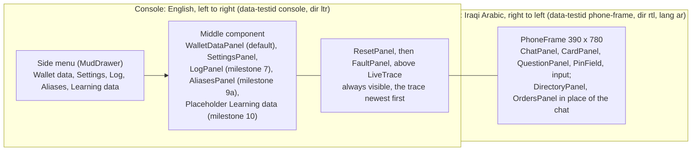
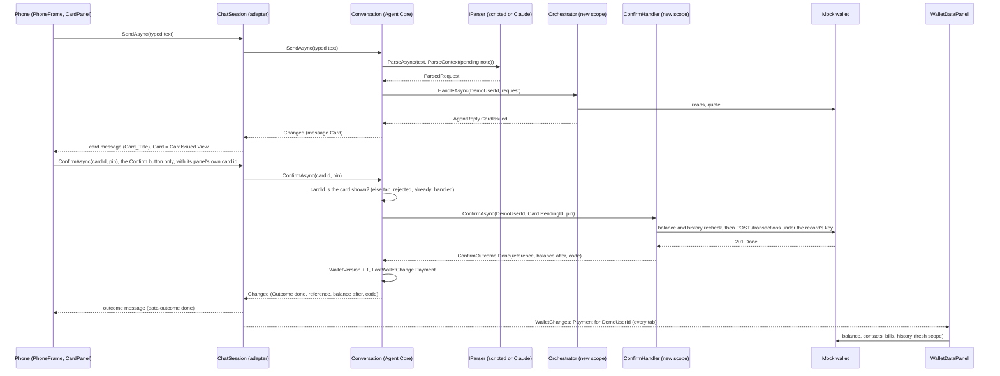
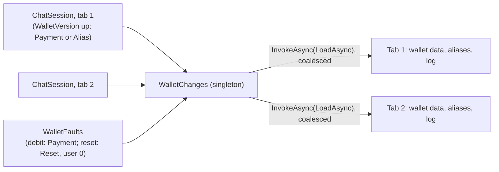
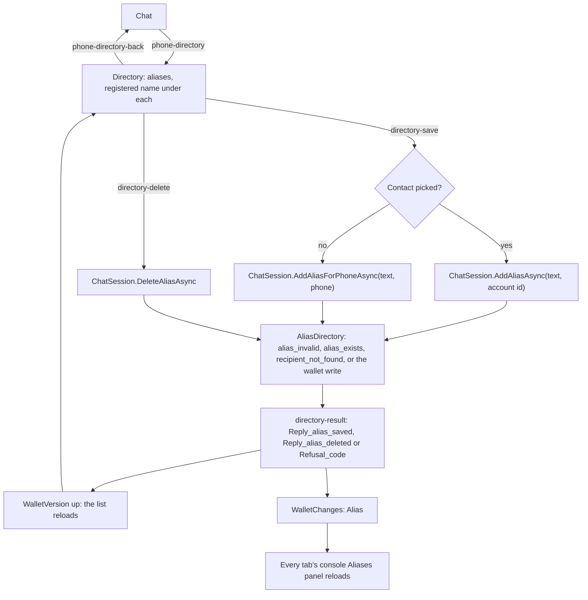
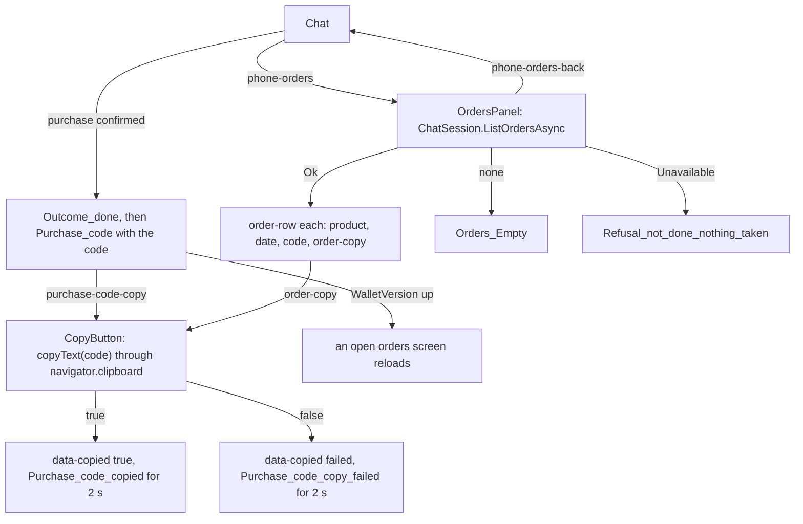
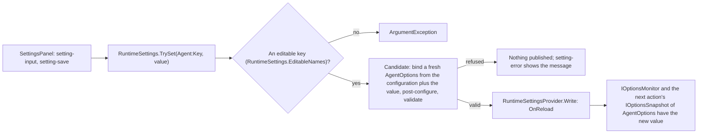
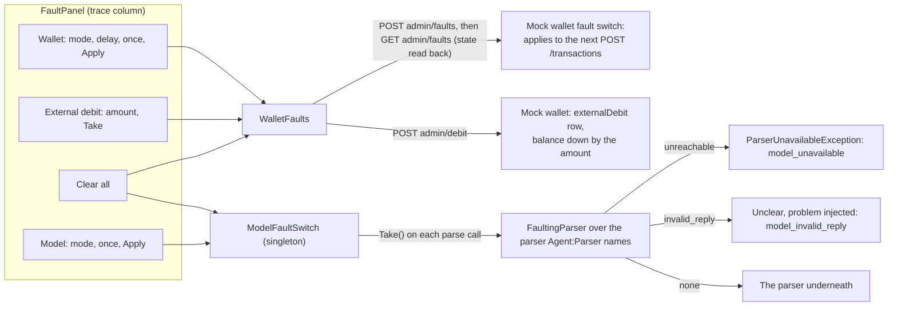
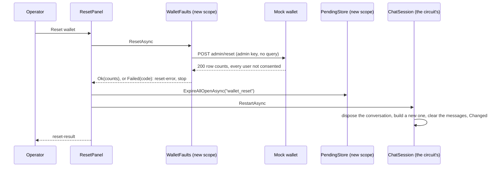
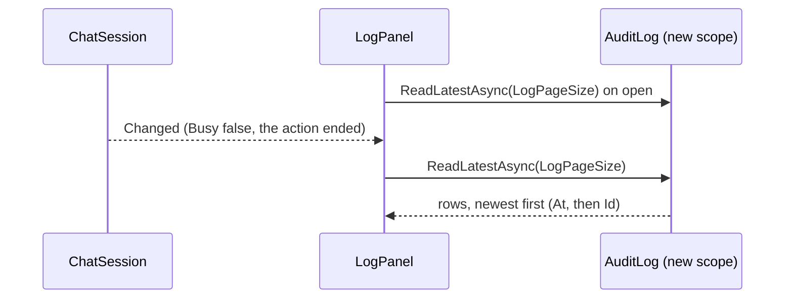

# Agent.Web: the console and the phone

This document describes what `src/Agent.Web` does as built in milestones 4 to 9c and the changes of 20 Oct 2026 (person or bill, the consent screen's No). In milestone 5 the session's logic moved into `Agent.Core` as `Conversation` (see [agent-core.md](agent-core.md), "The conversation"), so the test runner drives the same logic; `ChatSession` is now the phone's adapter over it. It covers:

- page layout B (D17);
- the design tokens and the MudBlazor theme;
- the phone and its session;
- the live trace;
- the phone strings for Khalil;
- the oracle parser;
- the settings component, the kill switch and the log component (milestone 7);
- the screen journeys;
- known gaps.

The agent's logic is in [agent-core.md](agent-core.md). `Agent.Web` references `Agent.Core` only and talks to the mock wallet over HTTP through `Agent.Core`'s `WalletClient`. The page has one route, `/`, and uses global interactive server rendering (Blazor Server, MudBlazor 9.11.0).

## Layout B

`Components/Layout/MainLayout.razor` holds the app bar and the side menu, a persistent `MudDrawer`. `Components/Pages/Home.razor` holds the three columns. The menu sets `ConsoleNavigation.Selected` (one per circuit), and the middle column shows that component.



The side menu sits in the layout outside the `console` element, and it is English and left to right like the rest of the page.

## Design tokens

Every colour, spacing, type size, radius and shadow of the console is a token in the one `:root` block at the top of `wwwroot/app.css` (UI pass, 21 Oct 2026). No other rule there, in `Components/Layout/ReconnectModal.razor.css` or in any `.razor` file names one by value; every rule uses a token. The theme is light only. MudBlazor's palette is set from the same values by `Services/ConsoleTheme.cs` (`ConsoleTheme.Light`, the one `MudTheme`, passed as `<MudThemeProvider Theme="ConsoleTheme.Light" />` in `MainLayout.razor`), so `Color.Primary`, `Color.Error` and `Color.Warning` on the components carry the tokens with no markup change. The console font is the system stack: no font is loaded from another host.

`DesignTokensTests` (`tests/Agent.Core.Tests/Web`) pins all of this: `EveryColourInTheStylesheetIsAToken` (no hex, `rgb(`, `hsl(` or named colour outside `:root`), `EveryTextPairingMeetsAA` (it parses `:root` and recomputes the WCAG 2.x ratios of the pairs below; each is 4.5 or more), `TheMudThemeUsesTheTokens` (every palette value equals its token) and `NoFontIsLoadedFromTheNetwork` (no `<link>` in `App.razor` to another host). A colour is changed in `app.css` and `ConsoleTheme.cs` together, or the third test fails.

| `ConsoleTheme.Light` | Token |
|---|---|
| `Primary`, `AppbarBackground` | `--color-brand` |
| `PrimaryDarken` | `--color-brand-hover` |
| `PrimaryLighten` | `--color-brand-tint` |
| `AppbarText` | `--color-on-brand` |
| `Error` | `--color-danger` |
| `Warning` | `--color-warning` |
| `Success` | `--color-success` |
| `Info` | `--zone-user` |
| `TextPrimary` | `--color-text` |
| `TextSecondary` | `--color-text-muted` |
| `Background` | `--color-page` |
| `Surface`, `DrawerBackground` | `--color-surface` |
| `LinesDefault` | `--color-border` |
| `Typography.Default.FontFamily` | `--font-console` |

Contrast ratios are WCAG 2.x relative-luminance ratios. AA for normal text is 4.5:1, for large text 3:1.

### Brand (Khalil, 21 Oct 2026: `#663b98`, then one digit away at his request: `#673b98`)

| Token | Value | Role | Pairing checked | Ratio |
|---|---|---|---|---|
| `--color-brand` | `#673b98` | Primary and accent: filled buttons, the app bar, links, the active menu item's bar, the phone's send button and progress bar, focus ring | white text on it | 7.91 (AA, AAA) |
| | | | as text on white | 7.91 |
| `--color-brand-hover` | `#5b3486` (brand + 12 % black) | Hover of a filled brand button | white text on it | 9.21 |
| `--color-brand-pressed` | `#4e2d74` (brand + 24 % black) | Pressed or active state | white text on it | 10.76 |
| `--color-brand-tint` | `#f0ebf5` (brand + 90 % white) | Selected menu item, the user's chat bubble, the badge background of brand-coloured chips | brand text on it | 6.74 |
| | | | body text on it | 13.47 |
| `--color-on-brand` | `#ffffff` | Text and icons on brand | | as above |

### Neutrals

| Token | Value | Role | Pairing checked | Ratio |
|---|---|---|---|---|
| `--color-page` | `#f6f7f9` | The page behind the panels | body text on it | 14.74 |
| `--color-surface` | `#ffffff` | Panels, cards, the phone's agent bubble | | |
| `--color-text` | `#1f2328` | Body text | on white | 15.80 |
| `--color-text-muted` | `#59636e` | Secondary text: trace time and detail, units, captions, fee and balance after on the card, input borders | on white | 6.11 |
| `--color-border` | `#d0d7de` | Dividers, table rules, panel edges (decorative, not text) | | |
| `--color-phone-bezel` | `#212121` | The phone's bezel | | |

### Semantic

| Token | Value | Role | Pairing checked | Ratio |
|---|---|---|---|---|
| `--color-success` | `#1a7f37` | `done` and `active` text, success icons | on white | 5.08 |
| `--color-success-tint` | `#dafbe1` | Badge background for `done`, `active` | success text on it | 4.56 |
| `--color-warning` | `#9a6700` | Warning text: the card's first-time and repeat lines, `executing` | on white | 4.87 |
| `--color-warning-tint` | `#fff8c5` | The warning band's background | warning text on it | 4.52 |
| `--color-danger` | `#b42318` | Error text, Delete and Reset and Clear all buttons, `failed`, `closed` text is **not** this (see badges) | on white | 6.57 |
| `--color-danger-tint` | `#ffebe9` | Badge background for `failed`, error lines' background | danger text on it | 5.73 |
| `--color-neutral-tint` | `#eaeef2` | Badge background for `closed` and other muted states | muted text on it | 5.24 |

### Zones (the trace, its legend, and anywhere a zone is named)

No zone is purple; each is paired with a Material icon and its label, so the zones read without colour. The colour is used the same way everywhere: a 4 px left bar on the entry, the icon and the label in the colour, the legend chip in the colour.

| Token | Value | Zone | Icon (`Icons.Material.Filled`) | Text on white | Against brand `#673b98` |
|---|---|---|---|---|---|
| `--zone-user` | `#1565c0` (blue) | User | `Person` | 5.75 | different hue (blue vs purple) |
| `--zone-model` | `#b45309` (amber) | Model | `AutoAwesome` | 5.02 | different hue |
| `--zone-code` | `#2e7d32` (green) | Code | `Code` | 5.13 | different hue |
| `--zone-write` | `#b42318` (red, the danger value: money leaves) | Write | `Payments` | 6.57 | different hue |

### Spacing, type, radii, shadows, focus

| Token | Value | Role |
|---|---|---|
| `--space-1` to `--space-8` | 4, 8, 12, 16, 20, 24, 32, 40 px | The only spacing values used in our CSS |
| `--text-xs`, `--text-sm`, `--text-md`, `--text-lg`, `--text-xl`, `--text-2xl` | 12, 13, 14, 16, 20, 28 px | Trace and captions; table cells; body; phone body; panel titles; the card's amount |
| `--font-console` | `system-ui, "Segoe UI", Roboto, Helvetica, Arial, sans-serif` | Everything outside the phone (also MudBlazor's typography) |
| `--font-phone` | `"Noto Naskh Arabic", "Segoe UI", Tahoma, sans-serif` | Inside the phone; the first font self-hosted (decision 5) |
| `--font-mono` | `Consolas, "Cascadia Mono", monospace` | The trace |
| `--radius-sm`, `--radius-md`, `--radius-lg`, `--radius-phone` | 4, 8, 14, 36 px | Badges and inputs; panels and buttons; bubbles and the card; the phone |
| `--shadow-1`, `--shadow-2` | `0 1px 2px rgba(31,35,40,.08)`, `0 4px 12px rgba(31,35,40,.12)` | Panels; the card and the phone |
| `--focus-ring` | `2px solid var(--color-brand)`, offset 2 px | Every `:focus-visible` |

### Layout sizes and the backdrop

Fixed sizes of the layout are tokens too, so no rule holds a bare length: `--size-phone-width` 390 px, `--size-phone-height` 780 px, `--size-phone-bezel` 12 px, `--size-trace-column-min` 260 px, `--size-trace-offset` 100 px (the trace's height is the viewport less this), `--size-appbar-offset` 64 px (the phone's sticky top), `--size-zone-bar` 4 px, `--size-zone-label-min` 44 px, `--size-error-icon` 1.8 rem (the error boundary's icon), and `--focus-ring-offset` 2 px. `--color-backdrop` (`rgba(31,35,40,.4)`) is the reconnect dialog's backdrop. Half a step, `calc(var(--space-1) / 2)`, keeps the 2 px rows of the trace and the card.

## Services

`AddAgentWebServices(configuration)` (`Services/ServiceCollectionExtensions.cs`), called by `Program.cs`, registers the following:

| Service | Lifetime | Role |
|---|---|---|
| `AddAgentCore` | as there | The orchestrator, the Confirm handler, the wallet client, the pending store, and the hosted `PendingSweeper` when `SweepIntervalSeconds` > 0 |
| `IStringLocalizer<PhoneStrings>` (`AddLocalization`) | transient (its factory is a singleton) | The phone strings in `Resources/PhoneStrings.resx` (rule 4) |
| `TraceLog` | scoped (one per circuit) | The circuit's live trace; it implements `ITraceSink` |
| `ITraceSink` | scoped | `TraceLog.Current.Value ?? sp.GetRequiredService<TraceLog>()` (see "The live trace") |
| `IParser` | singleton or scoped | `ParserFactory.AddAgentParser`: `Agent:Parser` `scripted` (the default) gives the singleton `new ScriptedParser()`; `claude` (set in user secrets with `Anthropic:ApiKey`, see README) gives a scoped `ClaudeParser`, resolved in the circuit's scope so it writes `more_than_one_request` to the circuit's trace. The settings component shows `Agent:Parser` and the `Model` section read-only, never a key. The journeys pin `scripted` |
| `ChatSession` | scoped (one per circuit) | The phone's adapter over a `Conversation`: localised messages, the circuit's trace, `Changed`; raises its conversation's wallet changes on `WalletChanges` |
| `WalletChanges` | singleton | The process-wide wallet-change notification: `event Action<WalletChange>? Changed`, `Raise(WalletChange)`, `WalletChange(UserId, Kind)` with `WalletChangeKind` `Payment`, `Alias` or `Reset` (user 0, `WalletChange.EveryUser`, is every user). Raised by every circuit's `ChatSession` and by `WalletFaults`; the wallet data, aliases and log panels of every tab subscribe. See "Wallet changes" |
| `AgentOptions` post-configuration | options | `YesWords` and `NoWords` (D6) from the resource values `Word_yes` and `Word_no`, so `Agent.Core` holds no phone text |
| `ConsoleNavigation` | scoped | The side menu's selection |
| `RuntimeSettings` | singleton | Saves an agent setting live (D8) through `RuntimeSettingsProvider`, the last configuration source (`Program.cs`); see "The settings component" |
| `KillSwitch` | singleton (from `AddAgentCore`) | The kill switch; see "The kill switch" |
| `FaultingParser` (`AddFaultingParser`) | as the parser it wraps | Replaces the last `IParser` registration with one of the same lifetime that builds the original (its instance, factory or type) and wraps it; see "The fault panel" |
| `ModelFaultSwitch` | singleton | The console's model fault: none, `unreachable` or `invalid_reply`, once or every call; `Changed` for the panels |
| `ConsoleOptions` | options, validated at start | Section `Console`: `WalletAdminKey` (required, default `dev`), the `X-Wallet-Admin-Key` the fault panel sends; shown as `set`, never the value. Outside Development the console refuses to start unless it is set, not `dev`, and at least 16 characters; the message names `Console:WalletAdminKey`, never a value (review R2, Khalil, 16 Oct 2026; `ConsoleOptionsTests`) |
| `WalletFaults` | typed `HttpClient` (transient) | The fault panel's and the reset panel's side door: `GET` and `POST admin/faults`, `POST admin/debit` and `POST admin/reset` (no query: consent cleared) only; the wallet's base address, the client key (as `WalletClient` decides it) and the admin key. A debit the wallet accepted raises a `Payment` change for its user, a reset it accepted a `Reset` change for every user |

## The session flow

`ChatSession` (`Services/ChatSession.cs`) is the adapter. It builds one `Conversation` for the circuit (with the circuit's `TraceLog` as its sink and `DemoUserId` as the user) and passes its state through to the components:

- the messages, localised (below);
- the card as a `CardView` and its status (`CardStatus`, from `Agent.Core.Conversation`: Live, Done, NotDone, Checking, Expired, Cancelled);
- the open question;
- the PIN-field flag;
- the messages the card, the question's options and the live button are shown under (`CardMessageId`, `QuestionMessageId`, `ActionMessageId`, mapped from the conversation's positions);
- `Busy`;
- `WalletVersion`: up after every Done outcome, every alias saved or deleted, and every restart (see "Wallet changes").

Milestone 9b adds two things to the flow. A Done purchase's code message (`Purchase_code`) carries the action `ChatAction.CopyCode`, and `ChatMessage.CopyText` holds the code as the wallet gave it, in memory only; the chat shows a copy button under it (`purchase-code-copy`). `ListOrdersAsync()` reads My orders for the phone's orders screen through the conversation's turn, with the same restart re-read as `ListAliasesAsync` (see "Store purchases (milestone 9b)").

It raises `Changed` after every change of the conversation. Components never see a `PendingRecord`, an idempotency key or a quoted balance, and the component contract (`ChatMessage`, the ids, the actions) is the same as in milestone 4.

The phone's lifecycle: the page is not prerendered (`App.razor` uses `new InteractiveServerRenderMode(prerender: false)`, since 18 Oct 2026, so MudBlazor's theme provider never calls JavaScript during a static render and every component initialises once); the circuit connects and renders the page. `PhoneFrame.OnAfterRenderAsync(firstRender)` calls `ChatSession.OpenAsync()` (the open check, below) and then sets `data-interactive` to `true`, so the `consent_shown` audit row is written once per circuit and the journeys type only after the check. The page renders once per circuit, so the panels' `OnInitializedAsync` reads run once per load.

Every action of the session follows the same pattern:

1. Set `TraceLog.Current` to the circuit's log.
2. Call the conversation's action of the same name. The conversation waits on its `SemaphoreSlim(1,1)`, so a timer refresh and a tap never run together, and opens its own `IServiceScopeFactory.CreateAsyncScope()` for the agent's services, so no two UI events share an `AgentDbContext`.

The conversation's messages are codes and figures, and a user message holds no text. The session keeps the typed words itself: `SendAsync` puts them in an `AsyncLocal`, and the conversation adds the user's message and raises `Changed` on that same async flow, while the action holds its turn. The session's `Changed` handler localises every new conversation message there and then.



### Wallet changes

Since 18 Oct 2026 (milestone 7, post-tag; Khalil) every console panel that mirrors wallet state follows one process-wide notification, the singleton `WalletChanges` (`Services/WalletChanges.cs`). Each browser tab is its own circuit with its own `ChatSession`, so a per-session signal cannot reach a second tab; the singleton can.

- **Who raises.** `ChatSession` raises `Payment` or `Alias` for its demo user whenever its conversation's `WalletVersion` went up since the last change it announced (`OnConversationChanged`, once per rise). The kind comes from `Conversation.LastWalletChange` (`ConversationWalletChange` in `Agent.Core`, which cannot reference `Agent.Web`), set beside each rise: a Done outcome is `Payment`; the offer's Save and the directory's save and delete are `Alias`. `WalletFaults` raises `Payment` for the user of an external debit the wallet accepted, and `Reset` for user 0 (every user) when the wallet accepted a reset, so the reset panel's change is raised before the open cards are closed and its phone restarts. The console's own aliases panel acts through `ChatSession`, so it is covered.
- **Who listens.** `WalletDataPanel`, `AliasesPanel` and `LogPanel` subscribe in `OnInitializedAsync` and unsubscribe in `Dispose`. On a change for their user or for user 0 they reload through `InvokeAsync(LoadAsync)`, since a handler runs on the raiser's thread, which may be another circuit's. A reload asked for while one runs is followed by one more, never dropped, and a read still running when the panel goes away is cancelled.
- **Errors.** `Raise` calls every handler; one that throws is logged at Warning with its exception type only and stops neither the next handler nor the caller.
- **The phone's directory** keeps following `ChatSession.WalletVersion`, which is monotonic for the session's life: `RestartAsync` adds the replaced conversation's version plus one to a base, so a restart is itself a new version and the directory reloads the seed's list after a Reset. A list read cut short by the restart (a panel's reload that started on the replaced conversation) is read once more from the new one.



Tests: `WalletChangesTests` (every handler called, a throwing one stops neither the next nor the caller, an unsubscribed one not called); `ChatSessionTests.AConfirmedTransferRaisesOnePaymentChangeForTheDemoUser`, `AnAliasSavedFromTheOfferAndOneDeletedThroughTheDirectoryRaiseOneAliasChangeEach`, `RestartMakesTheWalletVersionLargerThanBefore`; `FaultPanelServicesTests` (a debit raises `Payment`, a reset raises `Reset` for user 0); the journey `AnAliasSavedOnThePhoneShowsInTheConsoleDirectory` (two tabs).

### Actions

Each action below is the conversation's action of the same name ([agent-core.md](agent-core.md), "The conversation"):

| Action | Called by | What it does |
|---|---|---|
| `SendAsync(text)` | The send button and Enter | D6 first (below), then parse, then `Orchestrator.HandleAsync(DemoUserId, request)`; the reply becomes messages |
| `TapOptionAsync(value)` | A question option | Checks the value against the open question's options, then sends the request again with the slot filled (below) |
| `OpenAsync()` | `PhoneFrame.OnAfterRenderAsync(firstRender)`, once per circuit; `RestartAsync` | The open check (milestone 7 post-tag): a user who has not consented sees the consent message (`Reply_consent`, `consent-button`) before any typing, with one `consent_shown` audit row; a consented user, or a wallet that does not answer, sees nothing (the first request's gate still runs) |
| `GiveConsentAsync()` | The consent button (`consent-button`) | `WalletClient.GiveConsentAsync(DemoUserId)`, then answers the last request again; on the open screen, with no request yet, or after No, it only records consent; the message box is enabled again |
| `DeclineConsentAsync()` | The consent screen's No (`consent-decline`, outlined, beside `consent-button`; Khalil, 20 Oct 2026) | Nothing sent to the wallet: the tap shows as the user's `Reply_consent_decline_button`, the pending request and queue are cleared, the reply is `Refusal_consent_required`, one `consent_declined` audit row. Both buttons stay; a second No repeats the refusal; with no consent message live it does nothing |
| `ConfirmAsync(cardId, pin)` | The card's Confirm button only, with the id its panel captured (ruling 8 of milestone 9c) | `ConfirmHandler.ConfirmAsync(DemoUserId, Card.PendingId, pin)` when `cardId` is the card shown; otherwise `already_handled` and nothing moves |
| `SettleAsync()` | The "check again" button (`check-again`) of a Checking outcome only | `ConfirmHandler.SettleCheckingAsync(DemoUserId, Card.PendingId)`: the same body under the same key (rule 6) |
| `CancelAsync(cardId)` | The card's Cancel button, with the id its panel captured | `PendingStore.CancelAsync` when `cardId` is the card shown; otherwise `already_handled` |
| `ReissueAsync()` | The card's Try again (`card-try-again`) or Send again (`card-send-again`) button | `Orchestrator.ReissueAsync` (D19): a new card from the stored record; never the Confirm handler |
| `RefreshAsync()` | The card's countdown at zero | Reads the record; marks the card expired when it is Pending past `ExpiresAt`, Expired, or gone |
| `SaveAliasAsync()` | The Save button under the alias offer (`save-alias`) | `AliasDirectory.SaveAsync` with the offer's text and account (rule 18, milestone 9a); never the Confirm handler |
| `ListAliasesAsync()`, `AddAliasAsync(text, accountId)`, `AddAliasForPhoneAsync(text, phone)`, `DeleteAliasAsync(aliasId)` | The phone's directory and the console's Aliases panel | The alias directory through `AliasDirectory` (milestone 9a); no chat message |
| `ListOrdersAsync()` | The phone's orders screen (`OrdersPanel`) | My orders through `Conversation.ListOrdersAsync` and `OrdersReader` (milestone 9b); a read, no chat message; a read cut short by a restart is read again once |

Rule 1: nothing in `Agent.Web` calls the Confirm handler, and only `ChatSession.ConfirmAsync` and `ChatSession.SettleAsync` call `Conversation.ConfirmAsync` and `Conversation.SettleAsync`, which are the handler's only callers in `Agent.Core`. `NoTapNoMoneyTests.NothingInAgentWebCallsTheConfirmHandler` and `OnlyTheSessionsConfirmAndSettleCallTheConversationsFromTheWeb` check this on the IL, and `NothingInAgentWebInvokesByReflection` checks the web assembly for reflection calls.

### How replies become messages

The conversation turns each reply into a `ConversationMessage` of codes and figures; the session turns each of those into the `ChatMessage` the components render. Every text comes from the resource file (rule 4). A user's typed message shows the words as typed, with one exception: a typed message the conversation marks `pin_masked` (four to six digits sent while a card with a PIN field is live, known gaps row 34) shows one dot (U+2022) per digit from its `MaskedDigits` count, and the session never reads the typed text for it (Khalil, 19 Oct 2026); four to six digits with no PIN card live show as typed; a tapped option shows the option's display text, its amount, or `Option_store_internet`. In `QuestionPanel`, each option of a `which_contact` or `did_you_mean` question has a small line (`option-last-sent`): `Option_LastSent` with the last amount sent to that contact (`PhoneFormat.Amount`) when the wallet has one, else `Option_NoPreviousTransfer` (Khalil's finding and wording, 16 Oct 2026). The person option of a `person_or_bill` question (`Option.Side` `Person`, 20 Oct 2026) has the same line: the panel decides it by the option as well as by the question kind. The options of the other question kinds, and the bill option of `person_or_bill`, have no such line. `QuestionPanel` renders for every open question, a typed one too, and ends with one more button (`question-decline`, `data-value` the constant), never one of the question's options (17 Oct 2026): `Option_NoneOfThese` on a `which_contact` or `did_you_mean` question with options (`Option.NoneOfThese`, which the orchestrator answers `recipient_not_found`), `Option_CancelQuestion` on every other question, typed ones included (`Option.CancelQuestion`, which clears the pending request; the reply is `Refusal_question_cancelled`). It calls `ChatSession.DeclineQuestionAsync`, and the user's message shows the button's text. A reply that is not understood while a question is open (item 2 of 17 Oct 2026) is shown as `Refusal_not_understood_repeat` with the open question's `Question_<kind>` text as `{0}`; the question stays open and its panel stays under the original question message.

| Reply | Message |
|---|---|
| `Refusal(code, detail, amount)` | `Refusal_<code>`, filled with the figure when there is one; an unknown code falls back to `Refusal_not_done_nothing_taken`. The detail is never shown. A parser that is unavailable gives `Refusal_model_unavailable` |
| `Question(kind, answer, options)` | `Question_<kind>`, with the options under it |
| `BalanceReply(balance)` | `Reply_balance` |
| `ConsentScreen` | `Reply_consent`, with the consent button and the No button. While they show (`ChatSession.ConsentPending`), `phone-input` and `phone-send` are disabled and Enter sends nothing (Khalil, 20 Oct 2026): no request is sent until Agree |
| `CardIssued` | `Card_Title`, with the card under it |
| `Unsupported(reason)` | `Unsupported_<reason>`, or `Refusal_not_supported` for a reason without a key |
| The parts beyond the cap (`Info` `max_three_requests` with `NotPrepared`; rule 22, milestone 9c), after the last prepared part of a compound message finished | Two chat lines: Khalil's `Refusal_max_three_requests` as it is, then `Refusal_not_prepared` with the names as `{0}`. Each name is the part's text (the user's own words, ruling 2 of milestone 9c), or, when it has none, its type's word: `Type_transfer`, `Type_bill`, `Type_purchase`, else `Type_request`. At most `MaxNamedNotPrepared` (5, editable) parts are named, the first in the order spoken; the learning row keeps the total. Names are joined in the order spoken by the template `List_joiner` (`{0}` the names so far, `{1}` the next), so the joiner carries no edge space. Both lines are ordinary agent text messages (`chat-message`, `data-kind="text"`) |
| A typed answer merged into part 1 dropped the rest of a compound message (`Info` `queue_dropped`; review R2 of milestone 9c) | `Reply_queue_dropped`, the one `Info` code whose key starts `Reply_` rather than `Refusal_` (`ChatSessionTests.AQueueDroppedReplyShowsKhalilsLine`) |
| The alias offer (`ConversationKind.AliasOffer`, after a Done transfer; milestone 9a) | `Offer_save_alias` with `Conversation.AliasOffer.Text` (the user's own words) as `{0}` and `AliasOffer.RecipientName` (the account's registered name from the wallet, or the tapped option's saved name or alias when the wallet holds none; review R6) as `{1}`, and the Save button (`ChatAction.SaveAlias`, `save-alias`) while it is the open offer (`AliasOfferMessageId`) |
| The alias saved (`ConversationKind.AliasSaved`) | `Reply_alias_saved` with the saved text as `{0}` |
| A refused save (`alias_exists`, `alias_invalid`, `alias_shared`, `account_closed`) | `Refusal_alias_exists`, `Refusal_alias_invalid`, `Refusal_alias_shared` (one word that would be a question on several accounts, review R4), `Refusal_account_closed` (a closed target account, review R2), through the same `RefusalText` as every code; the phone's directory shows the key as `data-key` on `directory-result` |

`ConfirmOutcome` becomes an outcome message with `data-outcome` (the conversation's outcome code in brackets where it differs):

| Outcome | `data-outcome` | Text |
|---|---|---|
| `Done` | `done` | `Outcome_done` with the reference and balance after, plus `Purchase_code` for a purchase (the full code on screen only) |
| `NotDone` | `not_done` | `Outcome_not_done` with `Refusal_nothing_taken_short` when the reason is `not_done_nothing_taken`, none or one with no text (the outcome already says it did not go through; Khalil, 18 Oct 2026); any other reason's `Refusal_` text with its figure (`ChatSessionTests.NotDoneNothingTakenNestsTheShortText`, `NotDoneWithAnotherReasonNestsItsRefusalAndFigure`) |
| `Checking` | `checking` | `Outcome_checking`, with the "check again" button |
| `Expired` | `expired` | `Card_Expired` |
| `AlreadyHandled`, `NotFound` (`not_found`) | `already_handled` | `Outcome_already_handled` |
| `PinRequired`, `PinWrong(n)`, `PinMalformed` (`pin_required`, `pin_wrong`, `pin_malformed`) | `pin` | `Outcome_pin_required`, `Outcome_pin_wrong` (attempts left), `Outcome_pin_malformed`; the PIN field shows |
| Cancelled by the user or a new request | `cancelled` | `Refusal_card_cancelled` |

When the handler throws, the session reads the record:

- if it is Pending, nothing was sent, and the reply is `Refusal_not_done_nothing_taken`;
- otherwise the outcome is shown as checking, never as failed (rule 6).

### D6 as implemented

The conversation does D6 ([agent-core.md](agent-core.md), "D6, the typed yes and no"). Its words are `AgentOptions.YesWords` and `NoWords`, which `AddAgentWebServices` post-configures from the resource values `Word_yes` and `Word_no`. When a card is live, `SendAsync` first compares the typed text, after `ArabicText.Normalize`, with those words:

A yes (or a no) is a message of at most `MaxYesNoWords` words, after punctuation is dropped, made only of whole entries of those lists; an entry of two words matches only as the whole phrase.

- **The yes word** never confirms. The reply is `Refusal_points_to_confirm`, the card stays open, and nothing reaches the wallet.
- **The no word** cancels the card (`PendingStore.CancelAsync`, message `Refusal_card_cancelled`).
- **Unclear text** (the parse call reads it as unclear, or its structure was refused) leaves the card until its timer ends, with the reply `Refusal_not_understood`. So does a request to change the waiting card (`change_waiting_card`, whose reply tells the user to cancel and ask again). Both are traced `card_kept`.
- **A new request** cancels the card the same way (`Refusal_card_cancelled`) and goes on as a new request.

A question that waits for a typed answer (`which_amount` or `which_contact` with no options) is answered into the pending request (D3; [agent-core.md](agent-core.md), "Answers to a question"):

- a message the parse call reads as unclear fills the slot from the text (the amount through `ArabicDigits.ToAscii` and invariant `decimal.TryParse`, so both digit forms work; the recipient as the trimmed text);
- a transfer that is itself missing the recipient or the amount merges into the pending transfer;
- anything else (a complete request, another intent, the yes or no word) replaces the pending request.

### Option taps

A tap is accepted only for a value that the open question offered. Anything else is ignored and traced as `option_rejected`. An accepted tap answers the pending request (D3) without reading the wallet; the orchestrator checks the answer against what it resolves (`Orchestrator.HandleAsync(user, request, SlotAnswers)`):

| Question | Pending request and answers |
|---|---|
| `which_contact`, `did_you_mean` | The same request; `SlotAnswers.ContactOption` = the option's value (a contact code, or `account:<id>`). The orchestrator takes the candidate of the same question with that value, so two contacts with one saved name are told apart |
| `which_amount` | `AmountValue` = the option's dinars, `AmountUnit.Dinars` |
| `which_operator` | `OperatorText` = the provider code |
| `which_product` | The same purchase, or `Purchase(null, "internet", null)` after a bill request (rule 17); `SlotAnswers.ProductCode` = the product code |
| `which_bill`, `bill_or_store` | The same bill request, or `Bill(null, null, null)`; `SlotAnswers.BillCode` = the bill code. `store:internet` is `Purchase(null, "internet", null)` with no answers, which lists the seven internet cards across the operators (rules 11 and 12 as decided, milestone 9b) |

A product option (`Option.ProductType` set, milestone 9b, ruling 3) is labelled with the display name, the type's word (`Product_type_credit` or `Product_type_internet`) and the price: `PhoneFormat.OptionLabel`, used by both `QuestionPanel` and the tap's echo (`ChatSession.OptionText`), so the user's message after a tap reads exactly as the option did. Two products of one operator and one price (`ZN-CR-10`, `ZN-NET-10`) are told apart by the type word. Other options are labelled as before.

Person or bill (Khalil, 20 Oct 2026): the `person_or_bill` question (`Question_person_or_bill`) lists the person, then the bill or bills, then cancel. The person option is labelled as a contact option is: the contact's saved name, the registered name under it, and the `option-last-sent` line. The bill option is labelled as a bill option is, with the biller's name before the label (`PhoneFormat.OptionName`: `Option.BillerName`, a space, the display name, set only on a `person_or_bill` bill option, since its label is the person's name too), then the amount due. The tap's echo (`ChatSession.OptionText`) reads the same name. The final option is `Option_CancelQuestion`.

### The card, the countdown and the PIN

`CardPanel` shows the `CardView` fields with the resource labels. It captures its card's `PendingId` once, when it initialises, and Confirm and Cancel pass that id (ruling 8 of milestone 9c): `ChatPanel` keys the panel by the id (`@key`), so each card of a compound message gets its own panel, and a tap on card 1 can never reach card 2. When card 1 finishes and card 2 is built, card 1's panel gives way to its title line and outcome, and card 2's panel appears under its own message. Names from the wallet render through Razor encoding inside `<bdi>`. A purchase card shows its type word beside the operator's name (`card-product-type`, `Product_type_<type>` from `CardView.ProductType`, through `PhoneFormat.ProductTypeWord`), only when the key exists, as on an option (security review R4 of milestone 9b, 19 Oct 2026).

- **Amount in words.** Under the amount, every card shows the amount in words (`card-amount-words`, `Card_AmountWords` with the words as `{0}`), the second guard Khalil named; the words are his Iraqi number words (17 Oct 2026). `AmountWords.Compose` (`Agent.Core.Text`) composes them from an `AmountWordParts` table, so `Agent.Core` holds no Arabic; `AddAgentWebServices` builds the table once from the resource file (`AmountWordParts.FromResources`, a C# 14 static extension in `Agent.Web.Services.AmountWordResources`) and registers it as a singleton. The words are computed at render from `CardView.AmountIqd` and are never stored: not on `CardView`, not in the trace, not in an audit row. From 1,000 to 99,999,999 dinars; outside that range `Compose` returns null and the card shows no words line. The rules, from Khalil's list and examples: below 1,000, the hundreds word, then the rest (1 to 19 a unit word; 20 to 99 the unit, then the tens, or the tens alone), joined with `Words_And`; thousands: 1,000 `Words_Thousand`, 2,000 `Words_TwoThousand`, 3,000 to 10,000 the construct form and `Words_Thousands`, from 11,000 the group's words and `Words_Thousand`; millions likewise with `Words_Million`, `Words_TwoMillion` and `Words_Millions`; the millions, the thousands and the rest joined with `Words_And`. One space between words; the joiner is written against the word after it. `AmountWordsTests` checks the structure with an English table; `AmountWordsResourceTests` checks Khalil's examples (50,000; 2,500; 150,000; 1,200,000) and the other amounts by composing the expected text from the same resource values.

- **Countdown.** A one-second display tick computes the seconds left from `ExpiresAt`, and `MudProgressLinear` shows them as a bar. At zero, the panel calls `RefreshAsync`, and the server's record decides; the browser's clock only decides when to ask. The real timer is `CardTimerSeconds`, enforced by `PendingStore`. The line under the bar (`card-timer`, `Card_Timer`) says the card is cancelled after the seconds left unless Confirm is tapped. Khalil changed it from a bare "N seconds left" on 16 Oct 2026, after his testing: a bare countdown could be read as automatic approval, as if the payment would go through when the time ran out, which is the opposite of what happens (rule 1). No journey or test asserts the timer's text; they use `card-timer` and the key only.
- **Buttons.** Confirm and Cancel are disabled when any of these holds:
  - the card is not live;
  - the countdown is at zero;
  - the session is busy;
  - a click from this card is in flight (a flag set before the first await).

  The buttons stay on screen, disabled.
- **Try again and Send again (D19).** When the card is no longer live, the panel offers one more button:
  - `card-try-again` (`Card_TryAgain`) for an Expired, Cancelled or NotDone card;
  - `card-send-again` (`Card_SendAgain`) for a Done card;
  - neither while the card is live or its payment is Checking (`ChatSession.Reissue`).

  The button is disabled while the session is busy or a click is in flight. A tap calls `ChatSession.ReissueAsync`, which rebuilds the card from its stored record with fresh checks (agent-core.md, "Try again and Send again"). The new card has its own panel, keyed by its pending ID, its own timer, and waits for its own Confirm. A Send again card carries `Card_Warning_repeat`.
- **Checking (rule 6, milestone 8).** While the payment's outcome is unknown the card has `data-state="checking"`, no state line of its own (the chat's `Outcome_checking` carries the message; Khalil, 16 Oct 2026: one of the two, not both), no countdown and no progress bar, Confirm and Cancel disabled, no reissue, and a `card-check-again` button (`Outcome_check_again`, disabled while the session is busy or a click is in flight). The button and the chat's `check-again` both call `ChatSession.SettleAsync`, the same body under the same key. The panel also settles by itself: its one-second tick notes when it first sees the card Checking, and once `CheckingRetrySeconds` (5, editable; read from `IOptionsMonitor` on every tick) have passed since then or since the last settle, it calls `ChatSession.SettleAsync` when the session is not busy and no click is in flight. The session's lock serialises it with a tapped settle. After a settle the card shows done or not done as for any outcome. The card never shows "failed" while the outcome is unknown. The automatic settle has no ceiling: with the wallet down, a Checking card resends every `CheckingRetrySeconds` for as long as the page is open. Each settle is bounded by the wallet timeouts (the lookup and the resend) and is idempotent under the same key, so the cadence throttles itself; a cap or a back-off would be a later setting (security review R4 of milestone 8). The tick stops when the card panel is disposed: a tick already queued does nothing, and an exception in a tick is traced as `error` with its type (review M2).

  ```mermaid
  sequenceDiagram
      participant T as CardPanel tick (1 s)
      participant S as ChatSession
      participant H as ConfirmHandler
      participant W as Wallet
      T->>T: first tick in Checking: lastSettle = now
      loop every tick while Checking
          alt now - lastSettle >= CheckingRetrySeconds, not busy, not acting
              T->>S: SettleAsync()
              S->>H: SettleCheckingAsync (same key)
              H->>W: GET by-key (traced lookup_by_key)
              H->>W: POST /transactions (same key, same body)
              W-->>H: done, a refusal, or still unknown
              H-->>S: Done, NotDone or Checking
              T->>T: lastSettle = now
          end
      end
  ```
- **PIN field** (`PinField`). It is `type="password"`, `inputmode="numeric"`, `autocomplete="off"`. It shows when the card needs a PIN or after a PIN outcome. The value lives only in the card component's field and the `ConfirmAsync` call, and is cleared at every call.

### Figures in the phone

`PhoneFormat` (`Services/PhoneFormat.cs`):

- `Number(long)`: Arabic-Indic digits with U+066C (ARABIC THOUSANDS SEPARATOR).
- `Amount(long, IStringLocalizer<PhoneStrings>)`: `Number` plus `Currency_iqd`.
- `Digits(string)`: references, codes and phones with Arabic-Indic digits.
- `Date(DateTimeOffset)`: the Iraq date (`AgentClock.IraqOffset`, UTC+3), `dd/MM/yyyy`, day first, with Arabic-Indic digits (milestone 9b, the orders screen; day first from 19 Oct 2026, security review R2). 23:30 UTC is the next day.
- `OptionLabel(Option, IStringLocalizer<PhoneStrings>)`: a question option's label (see "Option taps").
- `OptionName(Option)`: the name an option shows: its display name, with the biller's name before it on the bill option of a `person_or_bill` question (20 Oct 2026).
- `ProductTypeWord(string?, IStringLocalizer<PhoneStrings>)`: `Product_type_<type>` when the key exists, else null.
- `Console(long)`: ASCII `N0`, invariant, for everything outside the phone.

## The live trace

`ITraceSink.Record(zone, step, detail)` receives every step. Inside the web app the sink is the circuit's `TraceLog`:

- `TraceLog.Current` is a static `AsyncLocal<TraceLog?>`. Each session action sets it before it opens its own scope.
- The scoped `ITraceSink` registration returns `TraceLog.Current.Value` when it is set, and otherwise the scope's own `TraceLog`. That makes it the same instance as `TraceLog` in the circuit's scope.
- An `AsyncLocal` value set in an async method flows into the calls it awaits and is gone when the method returns, so one circuit's steps never reach another's trace.

`LiveTrace` lists the entries newest first. Each entry is a `trace-entry` with `data-zone`, and its colour marks the zone. Details hold codes, states and amounts only: never a PIN, an idempotency key, a purchase code, a phone or typed text. `TraceSinkTests.NoPinKeyCodeOrPhoneInAnyStep` and `ConversationTests.TheTraceKeepsNoPinKeyOrCodeAfterAPinPaymentAndAPurchase` check this, and `ChatSessionTests.ChangedIsRaisedAndTheAgentWritesToTheCircuitsTrace` checks that the agent's steps reach the circuit's log.

| Zone | Written by | Steps |
|---|---|---|
| User | `Conversation` | `message_received` (length only), `confirm_tapped`, `check_again_tapped`, `cancel_tapped` |
| Model | `Conversation` | `parse:<parser name>` (`parse:scripted`, `parse:claude:haiku`; the intent), `parse:unavailable` |
| Model | `ClaudeParser` | `more_than_one_request` (the count) |
| Code | `Orchestrator` (`TraceSteps`) | `parse_received`, `consent_checked`, `recipient_resolved`, `amount_resolved`, `checks_passed`, `check_failed:<reason>`, `card_created`, `question:<kind>`, `refusal:<code>`, `balance_shown` |
| Code | `Conversation` | `points_to_confirm`, `option_rejected`, `consent_given`, `consent_declined`, `consent_required_blocked`, `error` (the exception type), `model_invalid_reply` (the field), `model_refusal` (no detail), `learning_logged` (the reason) |
| Write | `ConfirmHandler` (`TraceSteps`) | `begin_execute`, `recheck_ok`, `recheck_failed:<reason>`, `execute_sent`, `outcome:<name>`, `settle_sent`, `settle_outcome:<name>` |

The outcome names are `done`, `not_done`, `checking`, `expired`, `already_handled`, `not_found`, `pin_required`, `pin_wrong`, `pin_malformed`, `cancelled` and `exception`.

## The sweeper

`AddAgentCore` hosts `PendingSweeper` when `SweepIntervalSeconds` is above 0. The default and the web app's `appsettings.json` both set 5. At start and then every interval, the sweeper does the following in its own scope:

1. It expires the cards past their timer.
2. It moves to Checking the records that have been Executing for at least `StaleExecutingAfterSeconds` (40).

Options validation requires `StaleExecutingAfterSeconds` to be more than three times `WalletTimeoutSeconds` (10), because a Confirm makes three timed wallet calls while its record is Executing. A failed sweep is logged at Warning once per outage (the first failure after a success), at Debug while the outage lasts, and the recovery at Information; the loop goes on. The EF command log is set to Warning in `appsettings.json`, so the healthy sweep stays quiet. Details are in [agent-core.md](agent-core.md), "The pending sweeper".

## Aliases (milestone 9a)

After a Done transfer whose recipient needed a question that rule 18 offers ([agent-core.md](agent-core.md), "The offer (rule 18)"), the chat shows `Offer_save_alias` with the user's own words and a Save button (`save-alias`). The alias is saved only on that tap. The next typed message, tap or reissue closes the offer, and the button goes with it.

The phone's header has a button (`phone-directory`, `Directory_Open`) that shows the alias directory (`DirectoryPanel`) in place of the chat; `phone-directory-back` (`Directory_Back`) returns to the chat. While the directory is open, the compose row (input and Send) is not rendered. The directory lists the user's aliases (`directory-alias`, `data-alias-id`): the alias, and under it the registered name (D16: no stars, no last digits), with a delete button (`directory-delete`). Below the list is the add form:

- a text input (`directory-text`);
- a `MudSelect` of the user's contacts (`directory-target`; each item `directory-target-option` with `data-code`, value the contact's account id, saved name with the registered name under it; two contacts on one account are both listed);
- a phone input (`directory-phone`), shown while no contact is picked (`Directory_TargetNone`);
- Save (`directory-save`), disabled while the text is blank or neither a contact nor a number is given;
- the result line (`directory-result`, `data-key` the resource key shown): `Reply_alias_saved`, `Reply_alias_deleted`, or the refusal's `Refusal_<code>`.

The agent's `AliasDirectory` does every check. The list reloads when `WalletVersion` changes (also after a restart, see "Wallet changes").

The console's Aliases panel (`menu-aliases`, `AliasesPanel`, English) is the same list as a table (`console-alias`, `data-alias-id`; alias, phone, registered name, `console-alias-delete`). It has the same add form (`console-alias-text`, `console-alias-target` with items `console-alias-target-option`, `console-alias-phone`, `console-alias-save`) and a result line (`console-alias-result`, `data-result` `saved`, `deleted`, the refusal's code, or `unavailable`). Both act through the circuit's `ChatSession` on the demo user. The console's list reloads on every `WalletChanges` notification for the demo user or for every user, so an alias saved or deleted from any tab's phone or console, and the reset, show in every tab without a click; the session's `Changed` only re-renders its buttons while an action runs.



## Store purchases (milestone 9b)

After a Done purchase the chat shows the outcome and, under it, the code message (`Purchase_code`, the code in Arabic-Indic digits). The code message has a copy button (`purchase-code-copy`, `CopyButton`). Its label is `Purchase_code_copy`. On a tap it copies the code through the browser's clipboard: a collocated module, `Components/Phone/CopyButton.razor.js`, whose `copyText` calls `navigator.clipboard.writeText`. There is one import per button: the import task is cached, so taps before it resolves share it, and a failed import is tried again on the next tap. The module is disposed with the button, and the button is disabled while a copy runs (security review M1). On success the button sets `data-copied="true"` and reads `Purchase_code_copied` for two seconds, then goes back. On failure (no clipboard permission, a lost circuit) it sets `data-copied="failed"` and reads `Purchase_code_copy_failed` for the same two seconds, then goes back (security review R3, 19 Oct 2026). The browser's clipboard works only on HTTPS or localhost and only from a user gesture (the tap); anywhere else `copyText` returns false and the button shows the failed label. The copied text is never logged or traced (`ChatMessage.ToString()` prints `CopyText` as `***` and leaves out the phone text, security review M2), and the 2-second revert is a `Task.Delay` cancelled when the button is disposed. The type word on an option or an order row is shown only when its `Product_type_<type>` key exists (security review M3); `PhoneStringsTests.EveryProductTypeOfTheSeedHasItsTypeWord` pins the seed's types to the keys.

The phone's header has a second button (`phone-orders`, `Orders_Open`) that shows My orders (`OrdersPanel`, `phone-orders-screen`) in place of the chat; `phone-orders-back` (`Directory_Back`, the same word) returns. `PhoneFrame` holds one screen value (`Chat`, `Directory`, `Orders`); the compose row is rendered on `Chat` only. The screen lists every order the wallet returns for the user, newest first (ruling 5), one row each (`order-row`, `data-order-id`):
- the product line (`order-product`): the operator name, the type's word and the price, each left out when the catalogue no longer has the product;
- the Iraq date (`order-date`, `PhoneFormat.Date`);
- the full code (`order-code`, Arabic-Indic digits) with a copy button (`order-copy`).

With no orders the screen shows `Orders_Empty` (`orders-empty`); a failed read shows `Refusal_not_done_nothing_taken`, as the directory does, and the circuit stays up. The list reloads when `WalletVersion` changes. The trace records `orders_read` with the count only.



## The phone strings, for Khalil

`src/Agent.Web/Resources/PhoneStrings.resx` (neutral culture, read through `IStringLocalizer<PhoneStrings>`) holds every text the phone shows (rule 4). Khalil wrote the values in Iraqi Arabic on 15 Oct 2026 (commit a32ac1d); nothing else writes or changes them. `{0}` and `{1}` are filled by code, with figures in Arabic-Indic digits. `Word_yes` and `Word_no` are comma-separated lists (`PhoneWords.Split`), compared after `ArabicText.Normalize`. The table gives each key's meaning in English, not its Arabic value.

The seventeen keys of milestone 9a (`Offer_save_alias`, `Offer_save_alias_button`, `Reply_alias_saved`, `Reply_alias_deleted`, `Refusal_alias_exists`, `Refusal_alias_invalid`, `Refusal_alias_shared`, `Directory_Open`, `Directory_Back`, `Directory_Title`, `Directory_Empty`, `Directory_Text`, `Directory_Target`, `Directory_TargetNone`, `Directory_Phone`, `Directory_Save` and `Directory_Delete`) were English `TODO-AR` placeholders from 17 Oct 2026 until Khalil wrote them on 18 Oct 2026 (the close-out, `docs/plans/milestone-9a-close.md`); the allow-list `PhoneStringsTests.AwaitingKhalil` was then empty until the keys of milestone 9b (below). Before them, `Refusal_question_cancelled` (the reply after a question's cancel option) was written by Khalil on 17 Oct 2026; `Card_TryAgain` and `Card_SendAgain` (milestone 7, D19), and the D21 wording of `Refusal_invalid_number` (it now asks for the full mobile number or a saved name) on 16 Oct 2026. `PhoneStringsTests.NoValueIsAPlaceholderExceptTheKeysAwaitingKhalil` keeps the allow-list: a new key is added there with a `TODO-AR` value until he writes it.

**Milestone 9c (19 Oct 2026).** Three keys are English `TODO-AR` placeholders awaiting Khalil, listed in `PhoneStringsTests.AwaitingKhalil`: `Refusal_not_prepared` (the line under `Refusal_max_three_requests` that names the parts not prepared, `{0}` the names), `List_joiner` (the join of two names, `{0}` the names so far and `{1}` the next: a template, so the joiner needs no edge space, which `NoValueIsBlankOrHasAnEdgeSpace` forbids) and `Type_request` (the word for a part with no type word of its own, such as a balance question). The close-out added `Reply_queue_dropped` (review R2). Khalil wrote the four on 20 Oct 2026 (`docs/plans/milestone-9c-close.md`, item 5); no key is `TODO-AR` and the allow-list `PhoneStringsTests.AwaitingKhalil` is empty again.

**Milestone 9b (19 Oct 2026).** Seven keys of milestone 9b (`Orders_Open`, `Orders_Title`, `Orders_Empty`, `Purchase_code_copy`, `Purchase_code_copied`, `Product_type_credit`, `Product_type_internet`) were English `TODO-AR` placeholders until Khalil wrote them on 19 Oct 2026 in the close-out (`docs/plans/milestone-9b-close.md`), together with the new `Purchase_code_copy_failed` (security review R3). No key is `TODO-AR`; the allow-list `PhoneStringsTests.AwaitingKhalil` is empty again (meanings in the table below).

| Key | Meaning | Note |
|---|---|---|
| `Card_Title` | Confirm this payment | |
| `Card_To` | To | |
| `Card_Registered` | Registered name | |
| `Card_Amount` | Amount | |
| `Card_AmountWords` | `{0}` dinars: the amount in words under the figure | `{0}` is `AmountWords.Compose` of the amount |
| `Card_Fee` | Fee | |
| `Card_Total` | Total | |
| `Card_BalanceAfter` | Balance after | |
| `Card_FirstTime` | First time you send to this number | |
| `Card_Warning_repeat` | You sent the same amount to this person a few minutes ago | |
| `Card_Confirm` | Confirm | |
| `Card_Cancel` | Cancel | |
| `Card_Pin` | PIN | |
| `Card_Expired` | This card has expired. Nothing was sent | |
| `Card_Cancelled` | Cancelled | |
| `Card_Timer` | Cancelled after {0} seconds unless you tap Confirm | Khalil's wording of 16 Oct 2026, replacing "{0} seconds left": a bare countdown could read as automatic approval |
| `Card_TryAgain` | Try again | Milestone 7, D19; Khalil's Arabic, 16 Oct 2026 |
| `Card_SendAgain` | Send again | Milestone 7, D19; Khalil's Arabic, 16 Oct 2026 |
| `Outcome_done` | Done. Reference {0}. Your balance is now {1} | |
| `Outcome_checking` | Checking with the wallet. Nothing is shown as failed | |
| `Outcome_check_again` | Check again | |
| `Outcome_not_done` | Not done: {0} | |
| `Outcome_pin_required` | Enter your PIN, then confirm | |
| `Outcome_pin_wrong` | Wrong PIN. {0} attempts left | |
| `Outcome_pin_malformed` | The PIN is 4 to 6 digits | |
| `Outcome_already_handled` | This card was already handled | |
| `Reply_balance` | Your balance is {0} | |
| `Reply_consent` | Before we start: I move no dinar from your wallet unless you tap Confirm yourself, every time. Do you agree? | Khalil's wording, 21 Oct 2026 (5149212) |
| `Reply_consent_button` | I agree | |
| `Reply_consent_decline_button` | I do not agree | The consent screen's No; Khalil's Arabic, 20 Oct 2026 |
| `Question_which_contact` | Which person do you mean? | |
| `Question_did_you_mean` | Did you mean | |
| `Question_which_product` | Which product? | |
| `Question_which_bill` | Which bill? | |
| `Question_which_amount` | How much? | |
| `Question_bill_or_store` | Pay the bill, or buy a card from the store? | |
| `Question_which_operator` | Which operator? | |
| `Question_person_or_bill` | Do you mean a bill, or a particular person? | The typed name is both a contact and a bill label; Khalil's Arabic, 20 Oct 2026 |
| `Option_store_internet` | A card from the store | |
| `Option_LastSent` | Last transfer {0} | Under a contact option (`which_contact`, `did_you_mean`); Khalil's Arabic, 16 Oct 2026 |
| `Option_NoPreviousTransfer` | You have not sent to this person before | Under a contact option with no previous transfer; Khalil's Arabic, 16 Oct 2026 |
| `Option_NoneOfThese` | It is not him | The final option of `which_contact` and `did_you_mean` with options; Khalil's Arabic, 17 Oct 2026 |
| `Option_CancelQuestion` | Cancel | The final option of every other question, typed ones included; Khalil's Arabic, 17 Oct 2026 |
| `Refusal_insufficient_balance` | Your balance is not enough. You are {0} short | |
| `Refusal_recipient_not_found` | I could not find this person in your contacts | |
| `Refusal_number_has_no_wallet` | This number has no wallet | |
| `Refusal_invalid_number` | The number is not complete. Type the full mobile number, or a name saved in your contacts | D21; Khalil's Arabic, reworded 16 Oct 2026 |
| `Refusal_over_per_transaction_cap` | One payment can be at most {0} | |
| `Refusal_over_daily_cap` | That passes your daily limit. {0} left today | |
| `Refusal_account_closed` | This account is closed | |
| `Refusal_consent_required` | You need to agree first, then you can send money | Khalil's wording, 21 Oct 2026 (5149212) |
| `Refusal_nothing_due` | Nothing is due on this bill | |
| `Refusal_bill_not_found` | I could not find this bill | |
| `Refusal_biller_unavailable` | This biller is not available now | |
| `Refusal_product_not_found` | I could not find this product | |
| `Refusal_not_supported` | I cannot do this | |
| `Refusal_not_understood` | I did not understand. Please say it again | |
| `Refusal_message_too_long` | The message is too long. Write one short request | A typed message longer than `Agent:MaxMessageChars`; Khalil, 19 Oct 2026 |
| `Refusal_not_understood_repeat` | I did not understand. {0} | `{0}` is the open question's text; the question stays open. Khalil's Arabic, 17 Oct 2026 |
| `Refusal_question_cancelled` | Done. I did nothing | The reply after a question's cancel option; Khalil's Arabic, 17 Oct 2026 |
| `Refusal_only_own_balance` | I can only show your own balance | |
| `Refusal_model_unavailable` | I cannot read messages right now. Please try again later | |
| `Refusal_dinars_only` | I work in Iraqi dinars only | |
| `Refusal_bills_paid_in_full` | Bills are paid in full: {0} | |
| `Refusal_balance` | Your balance is {0} | |
| `Refusal_points_to_confirm` | Please use the Confirm button on the card | |
| `Refusal_card_cancelled` | The card was cancelled | |
| `Refusal_cannot_change_card` | A card cannot be changed. Cancel it and ask again | |
| `Refusal_account_choice_unavailable` | Choosing the account is not available | |
| `Refusal_code_entered_by_user` | The code is entered by you | |
| `Refusal_max_three_requests` | At most three requests in one message | |
| `Refusal_not_done_nothing_taken` | Not done. Nothing was taken from your balance | |
| `Refusal_nothing_taken_short` | Nothing was taken from your balance | Nested in `Outcome_not_done` only (18 Oct 2026) |
| `Refusal_amount_below_minimum` | The smallest amount is {0} | |
| `Refusal_pin_locked` | Your PIN is locked | |
| `Refusal_caller_cancelled` | Stopped before sending. Nothing was taken | |
| `Word_yes` | yes | |
| `Word_no` | no | |
| `Unsupported_withdrawal` | I cannot do cash withdrawals | |
| `Unsupported_other_balance` | I can only show your own balance | |
| `Unsupported_other_currency` | I work in Iraqi dinars only | |
| `Unsupported_refers_back` | Please say the full request again | |
| `Unsupported_same_as_last_time` | Please say the full request again | |
| `Unsupported_choose_account` | Choosing the account is not available | |
| `Unsupported_part_of_bill` | Bills are paid in full | |
| `Unsupported_credit_to_own_number` | I cannot send credit to your own number | |
| `Unsupported_change_waiting_card` | A card cannot be changed. Cancel it and ask again | |
| `Unsupported_other_language` | Please write in Iraqi Arabic | The reply to `other_language` (GAP-08, ADD-23) from 17 Oct 2026, Khalil's decision; it was `Refusal_not_understood` before |
| `Unsupported_receive_from` | I cannot take money from another person's account. They have to send it to you | Khalil's Arabic, 16 Oct 2026 (ADD-08, ADD-09) |
| `Purchase_code` | Your code: {0} | |
| `Type_transfer` | Transfer | |
| `Type_bill` | Bill | |
| `Type_purchase` | Purchase | |
| `Type_request` | Request: a part not prepared with no type word of its own | Khalil's Arabic, 20 Oct 2026 (milestone 9c) |
| `Refusal_not_prepared` | I did not prepare these: {0}. Send them in another request; the names of the parts beyond the cap, under `Refusal_max_three_requests` | Khalil's Arabic, 20 Oct 2026 (milestone 9c) |
| `List_joiner` | {0}, {1}: two names joined by the Arabic comma and a space | Khalil's Arabic, 20 Oct 2026 (milestone 9c); a template, folded over the names in order |
| `Reply_queue_dropped` | I cancelled the rest of the requests: a typed answer merged into part 1 dropped the parts after it | Khalil's Arabic, 20 Oct 2026 (review R2 of milestone 9c) |
| `Currency_iqd` | IQD | |
| `Phone_Placeholder` | Write your request | |
| `Phone_Send` | Send | |
| `Offer_save_alias` | Save {0} as a name for {1} next time? | Khalil, 18 Oct 2026. `{0}` is the recipient as the user typed it (rule 18); `{1}` is the account's registered name from the wallet, or the tapped option's saved name or alias when the wallet holds none (review R6) |
| `Offer_save_alias_button` | Save the name | Khalil, 18 Oct 2026. The button under the offer |
| `Reply_alias_saved` | Saved. Next time just say {0} | Khalil, 18 Oct 2026. `{0}` is the saved text |
| `Reply_alias_deleted` | The name was deleted | Khalil, 18 Oct 2026. The directory's result line |
| `Refusal_alias_exists` | You already use this name for someone; choose another | Khalil, 18 Oct 2026 |
| `Refusal_alias_invalid` | This name cannot be saved (blank, too long, or a number) | Khalil, 18 Oct 2026 |
| `Refusal_alias_shared` | This name looks like more than one person you have. Use a different name | Khalil, 18 Oct 2026. A one-word name the resolver would ask about on several accounts (review R4) |
| `Directory_Open` | Names (the header button that opens the directory) | Khalil, 18 Oct 2026 |
| `Directory_Back` | Back | Khalil, 18 Oct 2026 |
| `Directory_Title` | Your saved names | Khalil, 18 Oct 2026 |
| `Directory_Empty` | No saved names yet | Khalil, 18 Oct 2026 |
| `Directory_Text` | Name | Khalil, 18 Oct 2026. The text input's placeholder |
| `Directory_Target` | Contact | Khalil, 18 Oct 2026. The contact select's label |
| `Directory_TargetNone` | No contact (use the number) | Khalil, 18 Oct 2026 |
| `Directory_Phone` | Mobile number | Khalil, 18 Oct 2026 |
| `Directory_Save` | Save | Khalil, 18 Oct 2026 |
| `Directory_Delete` | Delete | Khalil, 18 Oct 2026 |
| `Purchase_code_copy` | Copy: the button under a purchase code | Khalil, 19 Oct 2026 (milestone 9b) |
| `Purchase_code_copied` | Copied: the same button for two seconds after a copy | Khalil, 19 Oct 2026 (milestone 9b) |
| `Purchase_code_copy_failed` | Could not copy, write it down: the same button for two seconds after a failed copy (security review R3) | Khalil, 19 Oct 2026 (milestone 9b close-out) |
| `Product_type_credit` | credit (phone credit): the type word on a product option and an order row | Khalil, 19 Oct 2026 (milestone 9b) |
| `Product_type_internet` | internet: the type word on a product option and an order row | Khalil, 19 Oct 2026 (milestone 9b) |
| `Orders_Open` | My orders: the phone header's button | Khalil, 19 Oct 2026 (milestone 9b) |
| `Orders_Title` | My orders: the orders screen's title | Khalil, 19 Oct 2026 (milestone 9b) |
| `Orders_Empty` | No orders yet | Khalil, 19 Oct 2026 (milestone 9b) |
| `Words_1` .. `Words_19`, `Words_20` .. `Words_90` (tens), `Words_100` .. `Words_900` (hundreds), `Words_Thousand`, `Words_TwoThousand`, `Words_Thousands`, `Words_Million`, `Words_TwoMillion`, `Words_Millions`, `Words_Construct_3` .. `Words_Construct_10`, `Words_And` | The number words of the amount in words: units, tens, hundreds, the thousand and million forms (one, two, the plural after a construct form), the short counting forms for 3 to 10, and the joiner | Khalil's list, 17 Oct 2026. `Words_Construct_4` to `Words_Construct_9` were derived from his hundreds' stems and are confirmed by Khalil on 17 Oct 2026 |

## The oracle

The console's default parser (`Agent:Parser` `scripted`) and the journeys' parser is `ScriptedParser`, an oracle over the development set ([agent-core.md](agent-core.md), "The parser seam"). It reads two files:

- **`Agent:DevSetPath`.** The default is `data/requests.dev.jsonl`, relative to the repository root unless rooted. Only `id` and the `say` steps are read.
- **`data/requests.dev.parses.jsonl`.** This is the sidecar next to it. It holds one line per say step (`id`, `step`, `say`, `parse`), and `parse` is the structure a model returns.

An exact dev-set message gives that case's parse, and anything else is unclear. The rules:

- **File name.** Only a file named exactly `requests.dev.jsonl` is accepted, and nothing is opened otherwise (rule 7: the held-out set is never loaded).
- **Load checks.** Every say step has a sidecar line with the same text. A line for a step that does not say, a parse the validator refuses, or one message with two parses refuses the load. The error names the case and the step, never the text (`ScriptedParserTests`).
- **Masking.** A typed number in a parse is written as typed and becomes its token at load, as the typed text is masked.

The parses were drafted by Claude from Khalil's answer keys for his review (his ruling of 15 Oct 2026). The journeys type a case's message by id through `DevSet.Say(id, step)`, so they follow his wording when he changes it.

## The settings component

`SettingsPanel` (`Components/Console/SettingsPanel.razor`, the side menu's Settings) has a kill switch (below) and four tables, all English and left to right:

- **Agent, editable (D8).** One row (`setting-row`, `data-name`) per agent limit, timer or count: `MinAmountIqd`, `PerTransactionCapIqd`, `PerDayCapIqd`, `CardTimerSeconds`, `MaxProductsInOneQuestion`, `RepeatWarningWindowMinutes`, `HistoryDays`, `MinSubstringWordLength`, `MaxYesNoWords`, `LogPageSize`, `CheckingRetrySeconds`, `MaxAliasLength`, `MaxMessageChars`, `MaxRequestsPerMessage` (1 to 20; milestone 9c, ruling 11: the conversation reads it when it splits the next message, and a queue already running keeps its own), `MaxNamedNotPrepared` (1 to 20, default 5; review R1 of milestone 9c, Khalil, 20 Oct 2026: the most parts the "not prepared" line names, read at the split as well): exactly `RuntimeSettings.EditableNames`, which the runtime store itself enforces (any other key, `Agent:WalletClientKey` or `Agent:DevSetPath` among them, is refused with an `ArgumentException`). Each shows its value in force (`setting-value`), an input (`setting-input`), Save (`setting-save`), and Reset (`setting-reset`) once a value has been saved. A refused value shows the validation message (`setting-error`), and the value in force does not change.
- **Agent, read only.** `Parser`, `DevSetPath`, `DemoUserId`, `WalletBaseUrl`, `WalletTimeoutSeconds`, `SettleWindowSeconds`, `HistoryPageSize`, `SweepIntervalSeconds`, `StaleExecutingAfterSeconds`, `ProviderSpellings`, `Endearments` (rule 1's words of affection, Khalil, 17 Oct 2026) and `FillerWords` (the words dropped at either end of a typed answer, Khalil, 17 Oct 2026; all three are phone text, so only their counts are shown), and `Console:WalletAdminKey` as `set` or `not set`. No key is ever shown (wallet or Anthropic). One line above the tables (`settings-fault-pointer`) says the fault switch is in the Faults panel beside the live trace.
- **Wallet, read only.** The wallet's own limits from `GET /settings` (`Wallet:PinRequiredAboveIqd`, `Wallet:MaxPinAttempts`, the transfer, bill and purchase fees and the rest; [wallet-api.md](wallet-api.md)), read once when the panel opens. A wallet that does not answer gives one `setting-error` row (`data-name="Wallet"`) with the reason.
- **Model, read only.** The candidate in use and each candidate's model, output limit, effort, temperature, timeout and prices.

A saved value lives in memory only, in `RuntimeSettingsProvider`. That is a configuration provider that `Program.cs` adds last, so a saved value wins over the files, the user secrets and the environment. A saved value is gone when the console restarts. It applies to the next action without a restart: every action and every eval step opens its own scope, and every scoped service reads `IOptionsSnapshot<AgentOptions>`, which is computed again per scope. The singletons (the sweeper, the wallet client's configuration) keep `IOptions`; the conversation reads `MaxYesNoWords` from `IOptionsMonitor` for every message. A value is checked before it is published: `RuntimeSettings.TrySet` binds a fresh `AgentOptions` from the configuration plus the one value, runs the registered post-configuration and validators (the data annotations and the cross-field rules), and writes to the provider only when they pass. So a refused value never reaches another circuit. `RuntimeSettingsTests` covers this: `AnInvalidValueIsRefusedAndTheOldOneStays`, `AnInvalidFirstValueLeavesNoOverride`, `AnInvalidSaveNeverReachesTheProvider`, `ResetRestoresTheFileValue`, `AKeyThatIsNotEditableIsRefused`, `EveryEditableNameCanBeSaved`, `MaxRequestsPerMessageIsEditableWithinItsRange` and `MaxNamedNotPreparedIsEditableWithinItsRange` (1 and 20 accepted, 0 and 21 refused). `ChecksTests.ACapChangedLiveAppliesToTheNextCheck` and the journey `AChangedCapTakesEffectWithoutARestart` show the saved cap applying to the next request.



## The kill switch

The kill switch is Khalil's ruling of 15 Oct 2026. It is a `MudSwitch` at the top of the settings component (`kill-switch`, with `data-on` `true` or `false`), bound to the singleton `KillSwitch` of `Agent.Core`. It is held in memory and is off at every start. Each flip writes a `kill_switch` audit row (reason `on` or `off`). A flip is a console action, not a user's, and the row is attributed to the console's `DemoUserId` (the audit row needs a user). If that write fails, the switch keeps its new state and the panel shows an error line (`setting-error`, `data-name="KillSwitch"`), and the circuit stays up. While it is on:

- no card is issued;
- Confirm is refused, and the live card ends NotDone with nothing taken;
- "check again" sends nothing, and a Checking card stays Checking;
- the balance question still answers.

The gates are described in [agent-core.md](agent-core.md), "The kill switch". `KillSwitch` raises `Changed` on every flip, and every open settings component re-renders on it, so each console shows the true state. The switch itself is read on every request.

## The fault panel

`FaultPanel` (`Components/Console/FaultPanel.razor`, milestone 8, ruling 4) sits in the trace column above the live trace, so it is at hand whatever the side menu shows. It is English and left to right, and it has three groups and a clear button:

- **Wallet.** A mode (`none`, `error`, `slow`, `timeoutBeforeExecute`, `timeoutAfterExecute`), a delay in milliseconds (the wallet's own `delayMs` as read when the panel opens), and once (on by default). Apply sets the wallet's fault switch through `POST admin/faults` and then reads it back with `GET admin/faults`; the state line shows what the wallet reports (`none`, or the mode, the delay and `once` or `every call`). The wallet's switch is process-wide, so every console shares it.
- **Model.** A mode (`none`, `unreachable`, `invalid_reply`) and once (on by default). Apply sets the singleton `ModelFaultSwitch`; the state line shows the switch, and every open panel re-renders on its `Changed`. `FaultingParser` takes the fault on the next parse call. `unreachable` throws `ParserUnavailableException`, so the phone shows `model_unavailable`. `invalid_reply` returns an unclear request with problem `injected`, so the conversation takes its `model_invalid_reply` path. The parser underneath never sees the faulted call. A once fault clears as it is taken. A waiting card stays (D6): nothing was understood.
- **External debit.** An amount in IQD. Take calls `POST admin/debit` for the console's `DemoUserId`; the result line shows `done <reference> balance <n>`, or the wallet's code.
- **Clear all** (`fault-clear`) sets both switches to none and reads the wallet's back.

Outside Development a missing or placeholder `Console:WalletAdminKey` stops the console at start (review R2). A wallet that refuses (403 `admin_key_required`: the console's `Console:WalletAdminKey` does not match the wallet's key) or does not answer shows `fault-error` with the wallet's code, the HTTP status or `unreachable` / `timeout`, never a key. `WalletFaults` names only `admin/faults`, `admin/debit` and `admin/reset`, so neither panel can execute a payment (rule 1). Each call goes through a fresh scope's client (the `WalletDataPanel` pattern). Tests: `FaultingParserTests` (the decorator and the switch), `FaultPanelServicesTests` (the registered parser is a `FaultingParser` over the scripted parser; an armed `unreachable` fault replies `model_unavailable` once and the next message gets its card; the side door sets, reads back and clears the wallet's switch, and takes a debit).



## The reset control

`ResetPanel` (`Components/Console/ResetPanel.razor`, milestone 7 post-tag; Khalil, 18 Oct 2026) sits in the trace column directly above the fault panel, with the fault panel's rules: English and left to right, behind the admin key (`Console:WalletAdminKey`, through `WalletFaults`), a fresh scope's client per call, no key shown, no exception message shown (review M1), the call cancelled when the panel goes away (review R3), and the button disabled while it runs. Its one button, Reset wallet (`reset-wallet`), does three things in order:

1. `WalletFaults.ResetAsync`: `POST admin/reset` with no query, so the wallet returns to the seed with every user not consented and its fault switch cleared ([wallet-api.md](wallet-api.md#reset)).
2. In a fresh scope, `PendingStore.ExpireAllOpenAsync("wallet_reset")`, the runner's reason (`CaseDriver`): the wallet's ids start again, so no open card may reach the new data. Pending records become Expired and Checking ones NotDone `wallet_reset`.
3. `ChatSession.RestartAsync()` on the circuit's own session: the conversation is unsubscribed and disposed, a new one is built for the same demo user, the messages and their ids are cleared, `Changed` is raised, and the new conversation's open check runs (`OpenAsync`), so a user the reset left not consented sees the consent screen at once.

The result line (`reset-result`) shows `done: <users> users, <accounts> accounts, <transactions> transactions; <n> open cards closed`. A wallet that refuses or does not answer shows `reset-error` with the wallet's code, the HTTP status or `unreachable` / `timeout`, and nothing else is done; a step that throws shows a fixed text. The audit log and the learning log are kept: they are the record (ruling B). The model fault switch and the kill switch are not touched. A reset the wallet accepted raises `Reset` for every user on `WalletChanges` (see "Wallet changes"), so every tab's wallet data, aliases and log panels reload; other tabs' phones are not started over, a page refresh does that. Tests: `FaultPanelServicesTests.TheSideDoorResetsTheWalletWithEveryUserNotConsentedAndReportsTheCounts`, `WalletFaultsTests` (a reset with no answer is `unreachable`), `ChatSessionTests.RestartEmptiesTheMessagesAndANewMessageGetsItsCard`, and the journey `ResetClearsConsentAndThePhoneStartsAgain`.



## The log component

`LogPanel` (`Components/Console/LogPanel.razor`, the side menu's Log) lists the latest `LogPageSize` (100, a setting) audit rows, newest first, through `AuditLog.ReadLatestAsync` in a fresh scope (the `WalletDataPanel` pattern). It reads when it opens, when the session raises `Changed` with no action running (so once per action, not once per message), on every `WalletChanges` notification for the demo user or for every user (another tab's actions, the fault panel's debit, the reset), and on its Refresh button (`log-refresh`). A read that arrives while one runs is followed by one more read. Columns, English and left to right: At (UTC, `yyyy-MM-dd HH:mm:ss`), User, Event, Pending (the first 8 characters of the ID), From → To, Reason, Reference, Amount (`PhoneFormat.Console`, blank when null), Detail. No PIN, balance figure or purchase code can appear, because an audit row never holds one (`AuditLogTests`).



## The `data-testid` contract

The journeys locate elements only by these attributes. The two lines of the "not prepared" reply (milestone 9c) add no markup: they are the last two agent `chat-message` elements after the outcome of the last prepared card.

| Element | `data-testid` | Other attributes |
|---|---|---|
| Phone frame root | `phone-frame` | `dir="rtl"`, `lang="ar"`, `data-interactive` (`true` after the first interactive render and the open check) |
| Console root | `console` | `dir="ltr"` |
| Phone input, send button | `phone-input`, `phone-send` | |
| Chat message | `chat-message` | `data-role` (`user`, `agent`), `data-kind` (`text`, `card`, `question`, `outcome`) |
| Outcome text inside a message | `outcome` | `data-outcome` (`done`, `checking`, `not_done`, `expired`, `cancelled`, `pin`, `already_handled`) |
| Card root | `card` | `data-state` (`live`, `done`, `notdone`, `checking`, `expired`, `cancelled`) |
| Card fields | `card-display`, `card-product-type` (a purchase's type word), `card-registered`, `card-amount`, `card-amount-words`, `card-fee`, `card-total`, `card-balance-after`, `card-first-time`, `card-warning`, `card-timer` | |
| Card buttons and PIN | `card-confirm`, `card-cancel`, `card-pin` | |
| Card reissue buttons (D19) | `card-try-again` (state `expired`, `cancelled` or `notdone`), `card-send-again` (state `done`); neither while live or checking | |
| Question option | `question-option` | `data-value` |
| Question's final option (none of these, or cancel) | `question-decline` | `data-value` (`none_of_these`, `cancel_question`) |
| Contact option's last-sent line | `option-last-sent` (inside a `which_contact` or `did_you_mean` option, and the person option of `person_or_bill`) | |
| Consent and settle buttons | `consent-button`, `consent-decline` (the consent screen's No, 20 Oct 2026), `check-again` (in the chat), `card-check-again` (on the card while Checking) | |
| Alias offer's Save button (milestone 9a) | `save-alias` (under the open offer only) | |
| Phone header: open the directory, back to the chat | `phone-directory`, `phone-directory-back` | |
| Phone header: open My orders, back to the chat (milestone 9b) | `phone-orders`, `phone-orders-back` | |
| Purchase code's copy button in the chat (milestone 9b) | `purchase-code-copy` | `data-copied` (`true` for two seconds after a copy, `failed` for two seconds after a failed copy, else `false`) |
| My orders: screen, row, product line, date, code, copy button, empty line | `phone-orders-screen`, `order-row`, `order-product`, `order-date`, `order-code`, `order-copy`, `orders-empty` | `order-row`: `data-order-id`; `order-copy`: `data-copied` |
| Phone directory: screen, row, delete, empty line | `phone-directory-screen`, `directory-alias`, `directory-delete`, `directory-empty` | `directory-alias` and `directory-delete`: `data-alias-id` |
| Phone directory form: text, contact select and its items, phone, Save, result | `directory-text`, `directory-target`, `directory-target-option`, `directory-phone`, `directory-save`, `directory-result` | items: `data-code`; result: `data-key` (the resource key shown) |
| Console Aliases panel: root, row, delete | `aliases-panel`, `console-alias`, `console-alias-delete` | `data-alias-id` |
| Console Aliases form: text, contact select and its items, phone, Save, result | `console-alias-text`, `console-alias-target`, `console-alias-target-option`, `console-alias-phone`, `console-alias-save`, `console-alias-result` | items: `data-code`; result: `data-result` (`saved`, `deleted`, a reason code, `unavailable`) |
| Trace entry | `trace-entry` | `data-zone` (`user`, `code`, `model`, `write`) |
| Wallet balance | `wallet-balance` | `data-value` (ASCII) |
| Wallet history row | `wallet-history-row` | `data-reference` |
| Settings row | `setting-row` | `data-name` |
| Log row, log refresh button | `log-row`, `log-refresh` | `log-row`: `data-event`, `data-reason` (empty when null), `data-pending` (the first 8 characters of the pending ID, empty when null) |
| Settings value, input, Save, Reset, error (editable agent rows) | `setting-value`, `setting-input`, `setting-save`, `setting-reset`, `setting-error` | `data-name` (the setting's name, as on its row) |
| Menu items | `menu-wallet`, `menu-settings`, `menu-log`, `menu-aliases`, `menu-learning` | |
| Kill switch | `kill-switch` | `data-on` (`true`, `false`) |
| Reset panel root, its button, result line, error line | `reset-panel`, `reset-wallet`, `reset-result`, `reset-error` | the result is `done: <users> users, <accounts> accounts, <transactions> transactions; <n> open cards closed` |
| Fault panel root, its error line, Clear all | `fault-panel`, `fault-error`, `fault-clear` | |
| Wallet fault: mode select, delay input, once checkbox, Apply, state | `fault-wallet-mode`, `fault-wallet-delay`, `fault-wallet-once`, `fault-wallet-apply`, `fault-wallet-state` | the state is the text `none` or `<mode> <delayMs> once` / `every call` |
| Model fault: mode select, once checkbox, Apply, state | `fault-model-mode`, `fault-model-once`, `fault-model-apply`, `fault-model-state` | mode values `none`, `unreachable`, `invalid_reply` |
| External debit: amount, Take, result | `fault-debit-amount`, `fault-debit-apply`, `fault-debit-result` | the result is `done <reference> balance <n>` or the wallet's code |
| The settings line that points at the fault panel | `settings-fault-pointer` | |

## The journeys

`tests/Agent.Web.Journeys` drives the page with headless Chromium (Playwright 1.63.0) through the scripted parser, never a live model. The fixture `JourneyHost` (collection `journeys`) sets up the run as follows:

- It names its two databases per process: the configured name (default `ZainCashWalletJourneys_Test` and `ZainCashAgent_Journeys_Test`) must end with `_Test` and becomes `{stem}_{process id}_{host ordinal}_Test`, for example `ZainCashWalletJourneys_12345_1_Test`, so two runs on one SQL Server (two clones, an IDE run beside a terminal run) never drop each other's databases, and two hosts in one process differ too (`WalletDatabaseName`, `AgentDatabaseName`). The override variables `ConnectionStrings__WalletJourneysTest` and `ConnectionStrings__AgentJourneysTest` still set the server (LocalDB, a container) and the stem.
- It hosts the mock wallet with `WebApplicationFactory<Program>.UseKestrel(...)` on a dynamic loopback port, on its wallet database, recreated, migrated and seeded.
- It drops and migrates its agent database before any console starts.
- It drops both databases when it is disposed, after the browser, the wallet client and every host are gone; a server that went away by then does not fail the run. A run that is killed leaves its `..._<process id>_<n>_Test` databases behind, to be dropped by hand. `JourneyHostTests.ASecondHostStartsBesideTheFirstOnItsOwnDatabases` starts a second host beside the fixture's, checks the four names, both wallets' `/health` and both consoles, and that the second host's databases are gone after its dispose while the first host's remain.
- It hosts five consoles, the same way, sharing that database:
  - one with the default card timer (U1);
  - one with `CardTimerSeconds` 4 (U1);
  - one each with `Agent:DemoUserId` 2, 3 and 5 (`UserWebAddress(userId)`).

  All use `Agent:WalletClientKey` `journeys-client-key-0001` and `SweepIntervalSeconds` 1.
- Before each journey it resets the wallet (`POST /admin/reset`, which also clears the wallet's fault switch), empties the agent tables (audit, pending, learning), turns every console's kill switch off, clears every console's model fault (`ModelFaultSwitch`) and clears every saved setting.
- Each journey opens a new browser context and page, and waits for `data-interactive="true"` before typing.
- Each journey types development-set messages by case id (`DevSet.Say(id, step)`), so the oracle returns that case's parse. It builds every expected text through the console's `IStringLocalizer<PhoneStrings>` and `PhoneFormat`, never as a literal. The PIN journey reads U3's PIN from `data/seed/users.json` (`SeedPins`) and never prints it.
- The files: `Journeys.cs` holds the three journeys of milestone 4. `RequestJourneys.cs`, `CardJourneys.cs` and `ConsoleJourneys.cs` hold the milestone 7 journeys, on the shared base `JourneyBase`; `ConsoleJourneys.cs` also holds the two of the consent and reset change (milestone 7 post-tag, 18 Oct 2026), `AFreshUserSeesTheConsentScreenBeforeTyping` and `ResetClearsConsentAndThePhoneStartsAgain`, and `DecliningConsentSendsNothingAndTheBoxStaysClosedUntilAgree` (the consent screen's No, 20 Oct 2026). The journeys' per-test reset asks the wallet for the seed's consent values (`?consent=seed`), so U1 to U4 start consented and U5 not. `BillJourneys.cs` and `FaultJourneys.cs` hold the twelve of milestone 8. `AliasJourneys.cs` holds the ten of milestone 9a and its close-out, one per alias behaviour, among them `AnAliasSavedOnThePhoneShowsInTheConsoleDirectory` (milestone 7 post-tag, two pages on one console); they read the alias texts from the dev set (`DevSet.AliasOffer(id, step)`, the step's `expect.alias_offer`) and the wallet's aliases through `JourneyHost.AliasesAsync(userId)`, and pick a contact in the `MudSelect` by opening it and clicking the item with its `data-code`. Every fault journey sets its fault through the fault panel of the console under test (`SetWalletFaultAsync`, `ArmModelFaultAsync`, `DebitAsync` in `JourneyBase`, by `data-testid`), never through the host's own client, and ends by checking that the wallet's switch is `none` and that the panel's Clear all reads both switches back as `none` (`AssertFaultsClearedAsync`). The host reads bills with `BillsAsync(userId)` and the wallet's switch with `WalletFaultModeAsync()`. `PurchaseJourneys.cs` holds the eight of milestone 9b, one per purchase behaviour; the host reads orders with `OrdersAsync(userId)` and the catalogue with `ProductsAsync()`, and every browser context grants `clipboard-read` and `clipboard-write` so `ClipboardAsync(page)` (in `JourneyBase`) reads back what a copy button wrote. The two timeout journeys wait with explicit Playwright timeouts (20 s until Checking, 15 s until the automatic settle), never a sleep. `CompoundJourneys.cs` holds the eight of milestone 9c, one per compound-request behaviour (D7, rules 21 and 22), on CMP-01, CMP-03, CMP-05, CMP-07, CMP-09 and CLN-01; they read every figure from the case's key (`DevSet.CardFigure(id, card, field)`, `DevSet.FinalBalance(id)`, `DevSet.ReplyAmount(id, reply)`, `DevSet.AskOptions(id, ask)`, `DevSet.TapValue(id, step)`) and the fourth name of CMP-07 with `DevSet.NotPrepared(id)`, count the cards issued by the card messages (`chat-message` with `data-kind="card"`), and act on the card panel shown, which is the current card's only. `PersonOrBillJourneys.cs` holds the three of person or bill (Khalil, 20 Oct 2026): each saves BS2's label (read from the wallet) as an alias of S04 through the phone's directory, then types CLN-10; the directory helpers (`OpenDirectoryAsync`, `AddInDirectoryAsync`, `PickAsync`) are in `JourneyBase`.

| Journey | Asserts |
|---|---|
| `HammoudiHappyPath` | The card's amount, fee, total and balance after equal `PhoneFormat.Amount` of 50,000, 1,000, 51,000 and 699,000, and `card-amount-words` is `Card_AmountWords` with the words of 50,000. The display and registered names equal S01's alias and registered name, read from the wallet. Confirm gives exactly one done outcome containing the reference `ZC-0000000087` in Arabic-Indic digits. The wallet panel shows 699,000 (ASCII) and the new history row. The wallet reports 699,000. The trace has entries in the user, model, code and write zones. The phone frame is `rtl` and the console `ltr` |
| `TimerKillsTheButton` | On the 4-second console, Confirm is enabled, then disabled within 8 seconds, and the expired outcome shows. The balance stays at 750,000 and no history row is added |
| `DoubleTapExecutesOnce` | Two forced clicks on Confirm at once give exactly one done outcome, still one after another second. There is one new history row, the balance is 699,000, and there is exactly one `done` audit row |
| `TypedNumberShowsTheRegisteredNameAndFirstTime` | ADD-01: `card-display` is the typed number in Arabic-Indic digits, `card-registered` the account's registered name read from the wallet by phone, `card-first-time` shows; Confirm gives one done outcome, the newest history row is to that number, balance 729,000 |
| `AmbiguousNameOffersOptionsAndTheTapGivesTheCard` | AMB-02 (D3): one `question` chat message with exactly two `question-option` elements, `data-value` S10 and S11, and no card; each option's `option-last-sent` is `Option_LastSent` with that contact's `lastSentAmountIqd` from the wallet, or `Option_NoPreviousTransfer` when it has none; the tap on S10 gives a live card whose `card-display` and `card-registered` are S10's saved name and registered name read from the wallet, `card-amount` 50,000, `card-amount-words` is `Card_AmountWords` with the words of 50,000 composed from the resource values, nothing moved; Confirm gives one done outcome, one new history row to S10's number, balance 699,000, one `done` audit row |
| `NoneOfTheseOnWhichContactRefusesRecipientNotFound` | AMB-02: the two options plus `question-decline` with `Option_NoneOfThese`'s text; the click gives `Refusal_recipient_not_found`, no option or decline button remains, no card, a `recipient_not_found` learning row, balance unchanged |
| `NoneOfTheseOnDidYouMeanRefusesRecipientNotFound` | CLN-03-v1: the one `did_you_mean` option plus `Option_NoneOfThese`; the click gives `Refusal_recipient_not_found`, no card, a `recipient_not_found` learning row, balance unchanged |
| `CancelOnATypedQuestionClearsThePendingRequest` | AMB-06 step 0: the typed `which_amount` question shows only `question-decline` with `Option_CancelQuestion`'s text; the click gives `Refusal_question_cancelled` and the panel goes; AMB-06 step 1 then gives no card and no `created` audit row |
| `AllMyMoneyAsksTheAmountAndTheTypedAnswerGivesTheCard` | ADD-20: one `Question_which_amount` message with only the decline button; step 1 (read in code) gives a live card to S14's saved name for 650,000 with its words line; Confirm gives done, balance 99,000, one new history row |
| `AccountNumberIsRefusedAndMasked` | ADD-03: the reply is `Refusal_invalid_number`, no card, balance unchanged; the 14 digits are in no `trace-entry` and no audit or learning row |
| `UnknownContactIsRefused` | ADD-02: the reply is `Refusal_recipient_not_found`, no card, balance unchanged |
| `InsufficientBalanceIsRefused` | NOGO-11 on U2's console: the reply holds the fixed text of `Refusal_insufficient_balance`, no card, the balance stays 18,500 |
| `OverCapIsRefusedWithTheCap` | NOGO-04 on U3's console: the reply is `Refusal_over_per_transaction_cap` with 5,000,000, no card, balance unchanged |
| `TypedYesPointsToConfirm` | CLN-16, both says: the card stays live, the reply is `Refusal_points_to_confirm`, nothing moved; Confirm then gives done |
| `TypedNoCancelsTheCard` | CLN-01, then the first `Word_no` entry: the card is `cancelled`, the outcome is `Refusal_card_cancelled`, nothing moved |
| `NewRequestCancelsTheCardAndStartsFresh` | CLN-01 then CLN-02: one cancelled outcome, one card, live, for 100,000; two `created` and one `cancelled` audit rows; nothing moved |
| `UnclearTextLeavesTheCard` | CLN-01 then `TODO: not a request`: the reply is `Refusal_not_understood`, the card stays live, no cancel; Confirm then gives done |
| `InjectionTypedWhileACardWaitsCancelsTheCardAndMovesNothing` | ADD-06, both says: CLN-01's live card, then Khalil's injection (all the balance to a typed number), a new request by D6 (Khalil, 16 Oct 2026): the card is cancelled (one cancelled outcome, the one card shown is `cancelled`, no new card), the last agent message is `Refusal_number_has_no_wallet`, no done outcome, the balance and U1's history unchanged, one `created` and one `cancelled` audit row and no `executing` or `done` row, no learning row (`number_has_no_wallet` is not logged); Confirm is not tapped |
| `TryAgainAfterExpiry` | 4-second console, CLN-01: after the expired outcome `card-try-again` shows (no `card-send-again`); the tap gives a new live card with its timer and a second `created` row, nothing moved; Confirm gives done and exactly one new history row |
| `SendAgainAfterDone` | CLN-01, Confirm, `card-send-again`: a live card with `card-warning` `Card_Warning_repeat`; Cancel; exactly one new history row |
| `BalanceAnswersAfterConsentAndTheLogKeepsNoFigure` | CLN-31: the reply is `Reply_balance` with 750,000; the log has one `balance_shown` row with an empty Amount; no trace entry holds `750` |
| `ConsentScreenComesBeforeTheBalance` | The first request's gate, kept as the fallback: U1's console opens consented, then the wallet's plain reset withdraws consent; CLN-31 shows the gate's `Reply_consent` with `consent-button`, `phone-input` is disabled, no chat message holds the balance in any digit form; the tap gives `Reply_balance` and enables the box; the wallet reports consent given |
| `DecliningConsentSendsNothingAndTheBoxStaysClosedUntilAgree` | Khalil, 20 Oct 2026: U5's console opens on the consent screen with `consent-decline` (`Reply_consent_decline_button`) and `phone-input` disabled; the No tap shows the user's `Reply_consent_decline_button` line and `Refusal_consent_required`, both buttons stay, input and send stay disabled, the wallet reports no consent and one `consent_declined` audit row; Agree removes both buttons and enables the box; CLN-31 then gives `Reply_balance` |
| `AFreshUserSeesTheConsentScreenBeforeTyping` | Milestone 7 post-tag (Khalil, 18 Oct 2026), the open check: U5's console, nothing typed: the last agent message is `Reply_consent` with `consent-button` and the wallet reports no consent; the tap removes the button and the wallet reports consent given; CLN-31 then gives `Reply_balance` straight away; exactly one `consent_shown` audit row |
| `ResetClearsConsentAndThePhoneStartsAgain` | Milestone 7 post-tag, the reset control: CLN-01 gives a live card; `reset-wallet`; `reset-result` shows and no `reset-error`; the wallet reports U1 not consented; the phone shows no card and exactly one chat message, `Reply_consent` with `consent-button`; the tap gives consent and CLN-01 gives a live card again |
| `AChangedCapTakesEffectWithoutARestart` | `PerTransactionCapIqd` saved as 40,000: CLN-01 is refused with 40,000 and no card; after `setting-reset` CLN-01 gives a live card; `Wallet:PinRequiredAboveIqd` shows 1,000,000 |
| `PinFieldShowsForALargeAmountAndThePinIsNeverLogged` | RED-09 on U3's console: `card-pin` shows; a wrong PIN gives `Outcome_pin_wrong` with 2 left, the card stays live, nothing moved; U3's seed PIN gives done (1,501,000 taken); neither PIN, in either digit form, is in any chat message, trace entry, audit row or learning row |
| `KillSwitchStopsEverything` | CLN-01 live, kill switch on: Confirm gives `not_done` (`Outcome_not_done` with `Refusal_nothing_taken_short`), nothing moved; CLN-02 gives `Refusal_not_done_nothing_taken` and no new card; CLN-31 still answers; switch off: CLN-02 gives a live card for 100,000; the log has two `kill_switch` rows |
| `NamedProviderGoesStraightToTheBillCard` | CLN-09 (milestone 8, the bill-or-store rule): a live card, no question; `card-display` is BS4's label or biller name and `card-amount`, `card-fee`, `card-total` are BS4's amount due, the wallet's bill fee and their sum, all read from the wallet (35,000, 500, 35,500); Confirm gives one done outcome, BS4 is at 0, balance 714,500 |
| `TwoAccountsAtOneBillerBecomeOptions` | AMB-07: one question message `Question_which_bill` with exactly two options, BS1 and BS2, and no card; the tap on BS1 gives a live card for 43,750 with BS1's name; Confirm gives done, BS1 at 0, balance 705,750 |
| `InternetWithoutAProviderAsksBillOrStore` | CLN-25 on U3's console: `Question_bill_or_store` with options BT3 and `store:internet` (shown as `Option_store_internet`), no card; the tap on BT3 gives a live card for 65,000; Confirm gives done, BT3 at 0, balance down by 65,500 |
| `NothingDueGivesNoCard` | ADD-05 on U2's console: the reply is `Refusal_nothing_due`, no card, balance 18,500, no `created` audit row, no learning row |
| `PartOfABillIsRefusedWithTheFullAmount` | ADD-04: the reply is `Refusal_bills_paid_in_full` with BS3's amount due from the wallet (9,250), no card, balance unchanged, no `created` row, one learning row `part_of_bill` |
| `RepeatedRequestCarriesTheDuplicateWarning` | FLT-05: say, Confirm, done; the second say gives a live card with `card-warning` `Card_Warning_repeat`; Cancel; exactly one new history row, balance 724,000 |
| `TimeoutAfterExecuteShowsCheckingThenDone` | The panel sets `timeoutAfterExecute` 12,000 ms once (state read back); CLN-23, Confirm: within 20 s the `checking` outcome, the card `data-state` `checking` with `card-check-again` and no `card-checking` line, no `not_done`; within 15 s more, with no tap, one done outcome, the card `done`, a `lookup_by_key` trace entry and one `settle_outcome:done`; one new history row, balance 740,250, one `done` audit row; the switches end `none` |
| `TimeoutBeforeExecuteShowsCheckingThenResolves` | As above with `timeoutBeforeExecute`: Checking first, then done by the automatic resend under the same key; the money moved once (one history row, one `done` audit row, balance 740,250) |
| `WalletErrorEndsTheCardNotDone` | U3's console, the panel sets `error` once; FLT-03, Confirm: the `not_done` outcome is `Outcome_not_done` with `Refusal_nothing_taken_short`, the card `notdone` with `card-try-again`; no history row, balance unchanged; the switches end `none` |
| `ModelUnreachableShowsTheHandoverMessage` | The panel arms `unreachable` once; CLN-01: `Refusal_model_unavailable`, no card, the model state reads `none` again; CLN-01 again: a live card; nothing moved |
| `ModelInvalidReplyIsNotUnderstood` | The panel arms `invalid_reply` once; CLN-01: `Refusal_not_understood`, no card, one learning row `model_invalid_reply` with detail `injected`; nothing moved |
| `ExternalDebitWhileTheCardWaitsIsCaughtByTheRecheck` | FLT-08 on U2's console: a live card for 15,000; the panel takes 5,000 (`fault-debit-result` done); Confirm: `Outcome_not_done` with `Refusal_insufficient_balance` and 2,500; balance 13,500; the wallet's history (`Host.HistoryAsync`) has exactly one new row, of type `externalDebit` for 5,000, and no payment |
| `APaymentThatNeededAQuestionOffersTheAliasAndNothingIsSavedWithoutTheTap` | AMB-19 steps 0 to 2 (say, tap S08, Confirm): `save-alias` shows and the last agent message holds `Offer_save_alias` filled with AMB-19's step 2 `alias_offer`; step 3's sentence gives two `question-option` again and no `save-alias`; the wallet's alias count for U1 is unchanged |
| `SaveOnTheOfferMakesTheNextRequestGoStraightToTheCard` | AMB-19 steps 0 to 2, then `save-alias`: `Reply_alias_saved` with the text, the button goes, the wallet has one more alias, on S08's account, and the audit log one `alias_saved` row; step 3's sentence gives a live card with no new question, `card-display` the alias text and `card-registered` S08's registered name from the wallet |
| `APaymentWithoutAQuestionOffersNoAlias` | CLN-01, Confirm: one done outcome and no `save-alias` |
| `ANearSpellingOfASavedAliasShowsItAsAnOption` | The directory saves AMB-19-v1's step 2 `alias_offer` for S08 (`directory-result` `data-key` `Reply_alias_saved`); back to the chat; AMB-19's step 3 sentence gives exactly one `question-option` holding that alias; the tap gives a live card with that alias as `card-display` |
| `ThePhoneDirectoryListsAddsAndDeletes` | The directory's `directory-alias` rows equal the wallet's alias count for U1, and the compose row is gone; S03's saved name plus " x" saved for S03 adds a row and an alias on S03's account in the wallet; its `directory-delete` gives `Reply_alias_deleted` and removes it on screen and in the wallet |
| `TheConsoleAliasesPanelListsAddsAndDeletes` | The same through `menu-aliases`: `console-alias` rows equal the wallet's count; save gives `console-alias-result` `saved` and one more row on S03's account; `console-alias-delete` gives `deleted` and the row and the wallet's alias go |
| `AnAliasSavedOnThePhoneShowsInTheConsoleDirectory` | Milestone 7 post-tag (18 Oct 2026): two pages on U1's console, both with `menu-aliases` open; the first page's phone directory saves AMB-19's step 2 `alias_offer` for S08; both pages' `console-alias` rows gain it (`data-alias-id` of the wallet's new alias) without a click, and the phone's list shows it; the directory's delete removes the row on both pages and the alias in the wallet |
| `ANamedProductGoesStraightToTheCardAndTheCodeShowsWithACopyButton` | CLN-13 (milestone 9b): a live card, no question; `card-display` is ZN-NET-25's operator name from the catalogue, `card-product-type` its type word (`Product_type_internet`) and `card-amount` 25,000; Confirm gives two done outcomes, the second holding the digits of the new order's code (the wallet's newest order, one more than before); `purchase-code-copy` shows with `data-copied` `false`, the click sets it `true` and the clipboard holds the code |
| `TheCodeIsKeptOnlyByItsLastFourDigitsInTheLogs` | CLN-13 confirmed: a pending record keeps the code's last four characters (`PurchaseCodeLast4`); no audit, learning or pending row holds the whole code, as typed or in Arabic-Indic digits; no `trace-entry` holds it |
| `ABareValueListsTheMatchingProductsAcrossOperators` | AMB-23: one `Question_which_product` message with options ZN-CR-5, AC-CR-5 and KR-CR-5, each labelled with `Product_type_credit`, and no card; the tap on KR-CR-5 gives a live card for 5,000; Confirm: balance 745,000 |
| `NothingNamedAsksTheOperatorFirstThenTheProducts` | AMB-24: `Question_which_operator` with zain, asiacell, korek in that order; the tap on korek gives `Question_which_product` with the four Korek products of the catalogue; the tap on KR-NET-30 gives a live card for 30,000 |
| `ALatinOperatorSpellingGoesStraightToTheCard` | MAL-09 on U2's console: a live card, no question, `card-display` Asiacell's Arabic name from the catalogue, `card-amount` 5,000; Confirm: balance 13,500 |
| `AnUnknownProductIsRefusedAndLoggedWithTheProviderCode` | NOGO-12: the last agent message is `Refusal_product_not_found`, no card; the learning log has `product_not_found` with detail `korek credit 25000`; balance 750,000 |
| `MyOrdersListsThePurchaseCodesNewestFirstAndCopies` | CLN-13 confirmed, then `phone-orders`: `order-row` count equals the wallet's order count for U1, and the compose row is gone; the first row's `data-order-id` and `order-code` digits are the newest order's, its `order-product` holds the operator name and `Product_type_internet`; `order-copy` sets `data-copied` `true` and the clipboard holds the code; `phone-orders-back` returns to the chat with the input visible |
| `ACancelledPurchaseIssuesNoCode` | CLN-29 on U3's console: a live card for AC-NET-25; `card-cancel` gives one cancelled outcome and no `purchase-code-copy`; U3's order count is unchanged and the balance stays 12,500,000 |
| `ADuplicateAliasIsRefusedInTheDirectory` | S04's saved name saved for S03 in the directory: `directory-result` is `Refusal_alias_exists` (key and text), the rows and the wallet's alias count are unchanged |
| `AnAliasForAClosedContactIsRefusedInTheDirectory` | S20's saved name plus " x" saved for S20 in the directory: `directory-result` is `Refusal_account_closed` (key and text); the rows, the wallet's aliases and the balance are unchanged; no `alias_saved` audit row |
| `ABareNameSharedBySeveralIsRefusedInTheDirectory` | S04's first word, a word of S04, S05 and S06, saved for S04: `directory-result` is `Refusal_alias_shared` (key and text); the rows and the wallet's aliases are unchanged; no `alias_saved` audit row |
| `TwoCardsComeInTheOrderSpokenEachWithItsOwnTap` | Milestone 9c, CMP-01: the transfer card live for the key's amount; Confirm gives one done outcome; only then the purchase card, live, for its amount; Cancel gives `cancelled`; exactly two card messages; the balance is the key's final balance |
| `AnExpiredCardStillLeadsToTheNext` | CMP-03 on the 4-second console: card 1 live, then the expired outcome on its own (10 s timeout); card 2 live with the key's amount and balance after (from the full balance); Confirm gives done; the key's final balance |
| `AQuestionOnTheFirstPartIsAskedInItsTurnAndTheSecondWaits` | CMP-05: `which_bill` with exactly the key's options (BS1, BS2) and no card; the tap on the step's value gives the bill card; Confirm, done; the transfer card with the key's balance after; Confirm, two done outcomes; the key's final balance |
| `FourRequestsGiveThreeCardsAndTheReplyNamesTheFourth` | CMP-07: three cards in turn, each confirmed; the last two agent messages are `Refusal_max_three_requests` and `Refusal_not_prepared` with `DevSet.NotPrepared("CMP-07")`; exactly three card messages; a `more_than_three_requests` learning row; the key's final balance |
| `TheBalanceIsAnsweredBeforeTheCardOfTheSecondPart` | CMP-09: two agent messages, `Reply_balance` with the key's amount first, then the card message; Confirm gives done; the key's final balance |
| `ACancelledCardStillLeadsToTheNext` | CMP-01: Cancel on card 1 gives one cancelled outcome; the purchase card is live for its amount; two card messages; the balance unchanged |
| `AFailedCardStillLeadsToTheNext` | CMP-03 with the panel's `error` once: Confirm on card 1 gives `Outcome_not_done` with `Refusal_nothing_taken_short`; card 2 live for its amount; two card messages; balance and history unchanged; the faults read back as cleared |
| `ANameThatIsAContactAndABillAsksPersonOrBill` | Person or bill (20 Oct 2026), CLN-10 after BS2's label is saved as an alias of S04: one `Question_person_or_bill` message, two options, S04's holding its saved name and an `option-last-sent` line, BS2's holding the biller's name and the label and the amount due and no such line; `question-decline` is `Option_CancelQuestion`; no card |
| `TappingTheBillGivesTheBillCard` | The same question; the tap on BS2 gives a live card whose `card-display` is the label and `card-amount` the amount due; Confirm gives done and BS2 is at 0 |
| `TappingThePersonGivesTheTransferPath` | The same question; the tap on S04 gives `Question_which_amount` (CLN-10 names no amount) and no card; BS2 still due and the balance 750,000 |
| `ANewMessageCancelsTheRest` | CMP-01, then CLN-01 while card 1 waits: one cancelled outcome; CLN-01's card live for its amount; Confirm gives done and the card stays done (no purchase card follows); two card messages; CLN-01's final balance |

- **Run:** `dotnet test tests/Agent.Web.Journeys`. The 70 tests (69 journeys and the host test) take about two and a half minutes (69 in 2 min 29 s on 20 Oct 2026 with the three of person or bill; the 66 in 2 min 24 s on 19 Oct 2026 with the eight of milestone 9c; the 58 in 2 min 10 s on 19 Oct 2026 with the eight of milestone 9b; the 50 in 2 min 6 s on 19 Oct 2026, 49 in 2 min 31 s on 18 Oct 2026; 1 min 57 s and 1 min 52 s in two runs of the 32 of 16 Oct 2026; the two timeout journeys take about 20 s each). The 20 of milestone 7 took about a minute.
- **Install Chromium once,** after the first build: `pwsh tests/Agent.Web.Journeys/bin/Debug/net10.0/playwright.ps1 install chromium`.
- **Skips:** the journeys skip when SQL Server does not answer a 3-second probe on `master`, and when Chromium cannot be launched. The skip message gives the install command.
- **Database names:** both databases must end in `_Test`; the host refuses any other name, because it drops them.

## Known gaps

| Gap | Plan |
|---|---|
| Learning data is a placeholder | Milestone 10 (the settings and log components came in milestone 7) |
| A reissued card of the known gap `choose_account` does not carry the `account_choice_unavailable` note | Deferred, minor |
| Text typed before the circuit is interactive is lost | The `data-interactive` marker tells the journeys; a person types again |
| A Checking record whose circuit is gone has no "check again" button in a new circuit | Still open after milestone 8: the Checking card and its automatic settle live in the card's own circuit. The record stays Checking and is never shown as failed |
| The live trace keeps every entry for the life of the circuit | A cap would be a new setting |
| The reset control starts over only its own circuit's phone; another open console keeps its conversation, whose cards were closed by the reset | Refresh that page |
| The live trace's height does not allow for the fault panel above it, so the trace column can be taller than the window | The page scrolls and the panel stays at the top; a layout change if it matters in the demo |
| The model fault is per console process, the wallet's fault switch is shared by every console | Shown as read back on each panel; the demo runs one console |
