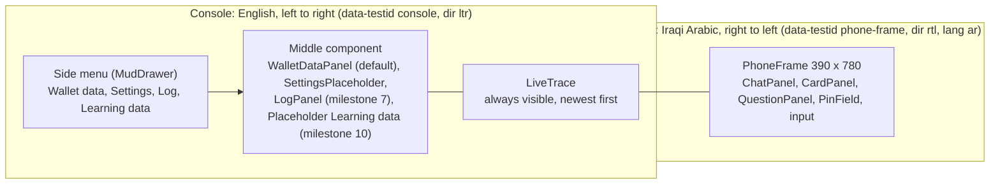
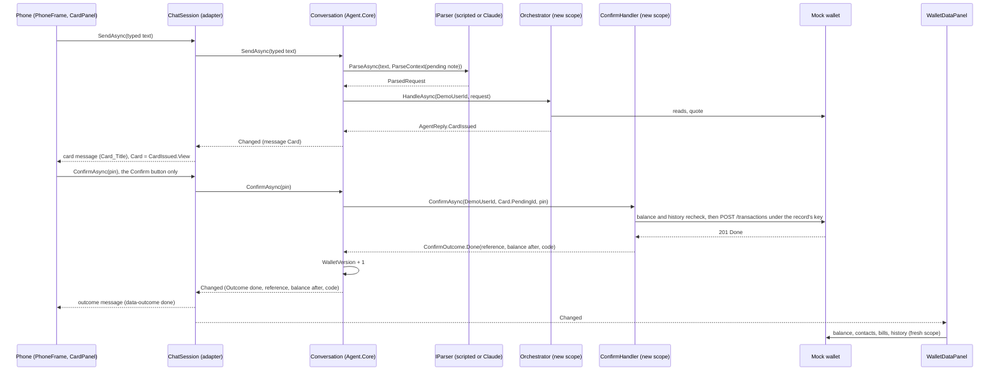
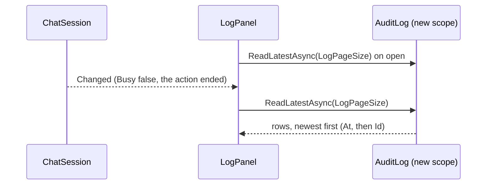

# Agent.Web: the console and the phone

This document describes what `src/Agent.Web` does as built in milestone 4. In milestone 5 the session's logic moved into `Agent.Core` as `Conversation` (see [agent-core.md](agent-core.md), "The conversation"), so the test runner drives the same logic; `ChatSession` is now the phone's adapter over it. It covers:

- page layout B (D17);
- the phone and its session;
- the live trace;
- the phone strings for Khalil;
- the screen journeys;
- known gaps.

The agent's logic is in [agent-core.md](agent-core.md). `Agent.Web` references `Agent.Core` only and talks to the mock wallet over HTTP through `Agent.Core`'s `WalletClient`. The page has one route, `/`, and uses global interactive server rendering (Blazor Server, MudBlazor 9.11.0).

## Layout B

`Components/Layout/MainLayout.razor` holds the app bar and the side menu, a persistent `MudDrawer`. `Components/Pages/Home.razor` holds the three columns. The menu sets `ConsoleNavigation.Selected` (one per circuit), and the middle column shows that component.

The side menu sits in the layout outside the `console` element, and it is English and left to right like the rest of the page.

## Services

`AddAgentWebServices(configuration)` (`Services/ServiceCollectionExtensions.cs`), called by `Program.cs`, registers the following:

| Service | Lifetime | Role |
|---|---|---|
| `AddAgentCore` | as there | The orchestrator, the Confirm handler, the wallet client, the pending store, and the hosted `PendingSweeper` when `SweepIntervalSeconds` > 0 |
| `IStringLocalizer<PhoneStrings>` (`AddLocalization`) | transient (its factory is a singleton) | The phone strings in `Resources/PhoneStrings.resx` (rule 4) |
| `TraceLog` | scoped (one per circuit) | The circuit's live trace; it implements `ITraceSink` |
| `ITraceSink` | scoped | `TraceLog.Current.Value ?? sp.GetRequiredService<TraceLog>()` (see "The live trace") |
| `IParser` | singleton or scoped | `ParserFactory.AddAgentParser`: `Agent:Parser` `scripted` (the default) gives the singleton `new ScriptedParser()`; `claude` (set in user secrets with `Anthropic:ApiKey`, see README) gives a scoped `ClaudeParser`, resolved in the circuit's scope so it writes `more_than_one_request` to the circuit's trace. The settings component shows `Agent:Parser` and the `Model` section read-only, never a key. The journeys pin `scripted` |
| `ChatSession` | scoped (one per circuit) | The phone's adapter over a `Conversation`: localised messages, the circuit's trace, `Changed` |
| `AgentOptions` post-configuration | options | `YesWords` and `NoWords` (D6) from the resource values `Word_yes` and `Word_no`, so `Agent.Core` holds no phone text |
| `ConsoleNavigation` | scoped | The side menu's selection |

## The session flow

`ChatSession` (`Services/ChatSession.cs`) is the adapter. It builds one `Conversation` for the circuit (with the circuit's `TraceLog` as its sink and `DemoUserId` as the user) and passes its state through to the components:

- the messages, localised (below);
- the card as a `CardView` and its status (`CardStatus`, from `Agent.Core.Conversation`: Live, Done, NotDone, Checking, Expired, Cancelled);
- the open question;
- the PIN-field flag;
- the messages the card, the question's options and the live button are shown under (`CardMessageId`, `QuestionMessageId`, `ActionMessageId`, mapped from the conversation's positions);
- `Busy`;
- `WalletVersion`.

It raises `Changed` after every change of the conversation. Components never see a `PendingRecord`, an idempotency key or a quoted balance, and the component contract (`ChatMessage`, the ids, the actions) is the same as in milestone 4.

Every action of the session follows the same pattern:

1. Set `TraceLog.Current` to the circuit's log.
2. Call the conversation's action of the same name. The conversation waits on its `SemaphoreSlim(1,1)`, so a timer refresh and a tap never run together, and opens its own `IServiceScopeFactory.CreateAsyncScope()` for the agent's services, so no two UI events share an `AgentDbContext`.

The conversation's messages are codes and figures, and a user message holds no text. The session keeps the typed words itself: `SendAsync` puts them in an `AsyncLocal`, and the conversation adds the user's message and raises `Changed` on that same async flow, while the action holds its turn. The session's `Changed` handler localises every new conversation message there and then.

### Actions

Each action below is the conversation's action of the same name ([agent-core.md](agent-core.md), "The conversation"):

| Action | Called by | What it does |
|---|---|---|
| `SendAsync(text)` | The send button and Enter | D6 first (below), then parse, then `Orchestrator.HandleAsync(DemoUserId, request)`; the reply becomes messages |
| `TapOptionAsync(value)` | A question option | Checks the value against the open question's options, then sends the request again with the slot filled (below) |
| `GiveConsentAsync()` | The consent button (`consent-button`) | `WalletClient.GiveConsentAsync(DemoUserId)`, then answers the last request again |
| `ConfirmAsync(pin)` | The card's Confirm button only | `ConfirmHandler.ConfirmAsync(DemoUserId, Card.PendingId, pin)` |
| `SettleAsync()` | The "check again" button (`check-again`) of a Checking outcome only | `ConfirmHandler.SettleCheckingAsync(DemoUserId, Card.PendingId)`: the same body under the same key (rule 6) |
| `CancelAsync()` | The card's Cancel button | `PendingStore.CancelAsync` |
| `ReissueAsync()` | The card's Try again (`card-try-again`) or Send again (`card-send-again`) button | `Orchestrator.ReissueAsync` (D19): a new card from the stored record; never the Confirm handler |
| `RefreshAsync()` | The card's countdown at zero | Reads the record; marks the card expired when it is Pending past `ExpiresAt`, Expired, or gone |

Rule 1: nothing in `Agent.Web` calls the Confirm handler, and only `ChatSession.ConfirmAsync` and `ChatSession.SettleAsync` call `Conversation.ConfirmAsync` and `Conversation.SettleAsync`, which are the handler's only callers in `Agent.Core`. `NoTapNoMoneyTests.NothingInAgentWebCallsTheConfirmHandler` and `OnlyTheSessionsConfirmAndSettleCallTheConversationsFromTheWeb` check this on the IL, and `NothingInAgentWebInvokesByReflection` checks the web assembly for reflection calls.

### How replies become messages

The conversation turns each reply into a `ConversationMessage` of codes and figures; the session turns each of those into the `ChatMessage` the components render. Every text comes from the resource file (rule 4). A user's typed message shows the words as typed; a tapped option shows the option's display text, its amount, or `Option_store_internet`.

| Reply | Message |
|---|---|
| `Refusal(code, detail, amount)` | `Refusal_<code>`, filled with the figure when there is one; an unknown code falls back to `Refusal_not_done_nothing_taken`. The detail is never shown. A parser that is unavailable gives `Refusal_model_unavailable` |
| `Question(kind, answer, options)` | `Question_<kind>`, with the options under it |
| `BalanceReply(balance)` | `Reply_balance` |
| `ConsentScreen` | `Reply_consent`, with the consent button |
| `CardIssued` | `Card_Title`, with the card under it |
| `Unsupported(reason)` | `Unsupported_<reason>`, or `Refusal_not_supported` for a reason without a key |

`ConfirmOutcome` becomes an outcome message with `data-outcome` (the conversation's outcome code in brackets where it differs):

| Outcome | `data-outcome` | Text |
|---|---|---|
| `Done` | `done` | `Outcome_done` with the reference and balance after, plus `Purchase_code` for a purchase (the full code on screen only) |
| `NotDone` | `not_done` | `Outcome_not_done` with the reason's `Refusal_` text and its figure |
| `Checking` | `checking` | `Outcome_checking`, with the "check again" button |
| `Expired` | `expired` | `Card_Expired` |
| `AlreadyHandled`, `NotFound` (`not_found`) | `already_handled` | `Outcome_already_handled` |
| `PinRequired`, `PinWrong(n)`, `PinMalformed` (`pin_required`, `pin_wrong`, `pin_malformed`) | `pin` | `Outcome_pin_required`, `Outcome_pin_wrong` (attempts left), `Outcome_pin_malformed`; the PIN field shows |
| Cancelled by the user or a new request | `cancelled` | `Refusal_card_cancelled` |

When the handler throws, the session reads the record:

- if it is Pending, nothing was sent, and the reply is `Refusal_not_done_nothing_taken`;
- otherwise the outcome is shown as checking, never as failed (rule 6).

### D6 as implemented

The conversation does D6 ([agent-core.md](agent-core.md), "D6, the typed yes and no"). Its words are `AgentOptions.YesWords` and `NoWords`, which `AddAgentWebServices` post-configures from the resource values `Word_yes` and `Word_no`. When a card is live, `SendAsync` first compares the typed text, after `ArabicText.Normalize`, with those words:

A yes (or a no) is a message of at most `MaxYesNoWords` words, after punctuation is dropped, made only of whole entries of those lists; an entry of two words matches only as the whole phrase.

- **The yes word** never confirms. The reply is `Refusal_points_to_confirm`, the card stays open, and nothing reaches the wallet.
- **The no word** cancels the card (`PendingStore.CancelAsync`, message `Refusal_card_cancelled`).
- **Any other text** cancels the card the same way and goes on as a new request.

A question that waits for a typed answer (`which_amount` or `which_contact` with no options) is answered into the pending request (D3; [agent-core.md](agent-core.md), "Answers to a question"):

- a message the parse call reads as unclear fills the slot from the text (the amount through `ArabicDigits.ToAscii` and invariant `decimal.TryParse`, so both digit forms work; the recipient as the trimmed text);
- a transfer that is itself missing the recipient or the amount merges into the pending transfer;
- anything else (a complete request, another intent, the yes or no word) replaces the pending request.

### Option taps

A tap is accepted only for a value that the open question offered. Anything else is ignored and traced as `option_rejected`. An accepted tap answers the pending request (D3) without reading the wallet; the orchestrator checks the answer against what it resolves (`Orchestrator.HandleAsync(user, request, SlotAnswers)`):

| Question | Pending request and answers |
|---|---|
| `which_contact`, `did_you_mean` | The same request; `SlotAnswers.ContactOption` = the option's value (a contact code, or `account:<id>`). The orchestrator takes the candidate of the same question with that value, so two contacts with one saved name are told apart |
| `which_amount` | `AmountValue` = the option's dinars, `AmountUnit.Dinars` |
| `which_operator` | `OperatorText` = the provider code |
| `which_product` | The same purchase, or `Purchase(null, "internet", null)` after a bill request (rule 17); `SlotAnswers.ProductCode` = the product code |
| `which_bill`, `bill_or_store` | The same bill request, or `Bill(null, null, null)`; `SlotAnswers.BillCode` = the bill code. `store:internet` is `Purchase(null, "internet", null)` with no answers, which asks the operator (rule 11) |

### The card, the countdown and the PIN

`CardPanel` shows the `CardView` fields with the resource labels. Names from the wallet render through Razor encoding inside `<bdi>`.

- **Countdown.** A one-second display tick computes the seconds left from `ExpiresAt`, and `MudProgressLinear` shows them as a bar. At zero, the panel calls `RefreshAsync`, and the server's record decides; the browser's clock only decides when to ask. The real timer is `CardTimerSeconds`, enforced by `PendingStore`.
- **Buttons.** Confirm and Cancel are disabled when any of these holds:
  - the card is not live;
  - the countdown is at zero;
  - the session is busy;
  - a click from this card is in flight (a flag set before the first await).

  The buttons stay on screen, disabled.
- **PIN field** (`PinField`). It is `type="password"`, `inputmode="numeric"`, `autocomplete="off"`. It shows when the card needs a PIN or after a PIN outcome. The value lives only in the card component's field and the `ConfirmAsync` call, and is cleared at every call.

### Figures in the phone

`PhoneFormat` (`Services/PhoneFormat.cs`):

- `Number(long)`: Arabic-Indic digits with U+066C (ARABIC THOUSANDS SEPARATOR).
- `Amount(long, IStringLocalizer<PhoneStrings>)`: `Number` plus `Currency_iqd`.
- `Digits(string)`: references, codes and phones with Arabic-Indic digits.
- `Console(long)`: ASCII `N0`, invariant, for everything outside the phone.

## The live trace

`ITraceSink.Record(zone, step, detail)` receives every step. Inside the web app the sink is the circuit's `TraceLog`:

- `TraceLog.Current` is a static `AsyncLocal<TraceLog?>`. Each session action sets it before it opens its own scope.
- The scoped `ITraceSink` registration returns `TraceLog.Current.Value` when it is set, and otherwise the scope's own `TraceLog`. That makes it the same instance as `TraceLog` in the circuit's scope.
- An `AsyncLocal` value set in an async method flows into the calls it awaits and is gone when the method returns, so one circuit's steps never reach another's trace.

`LiveTrace` lists the entries newest first. Each entry is a `trace-entry` with `data-zone`, and its colour marks the zone. Details hold codes, states and amounts only: never a PIN, an idempotency key, a purchase code, a phone or typed text. `TraceSinkTests.NoPinKeyCodeOrPhoneInAnyStep` and `ConversationTests.TheTraceKeepsNoPinKeyOrCodeAfterAPinPaymentAndAPurchase` check this, and `ChatSessionTests.ChangedIsRaisedAndTheAgentWritesToTheCircuitsTrace` checks that the agent's steps reach the circuit's log.

| Zone | Written by | Steps |
|---|---|---|
| User | `Conversation` | `message_received` (length only), `confirm_tapped`, `check_again_tapped`, `cancel_tapped` |
| Model | `Conversation` | `parse:<parser name>` (`parse:scripted`, `parse:claude:haiku`; the intent), `parse:unavailable` |
| Model | `ClaudeParser` | `more_than_one_request` (the count) |
| Code | `Orchestrator` (`TraceSteps`) | `parse_received`, `consent_checked`, `recipient_resolved`, `amount_resolved`, `checks_passed`, `check_failed:<reason>`, `card_created`, `question:<kind>`, `refusal:<code>`, `balance_shown` |
| Code | `Conversation` | `points_to_confirm`, `option_rejected`, `consent_given`, `error` (the exception type), `model_invalid_reply` (the field), `learning_logged` (the reason) |
| Write | `ConfirmHandler` (`TraceSteps`) | `begin_execute`, `recheck_ok`, `recheck_failed:<reason>`, `execute_sent`, `outcome:<name>`, `settle_sent`, `settle_outcome:<name>` |

The outcome names are `done`, `not_done`, `checking`, `expired`, `already_handled`, `not_found`, `pin_required`, `pin_wrong`, `pin_malformed`, `cancelled` and `exception`.

## The sweeper

`AddAgentCore` hosts `PendingSweeper` when `SweepIntervalSeconds` is above 0. The default and the web app's `appsettings.json` both set 5. At start and then every interval, the sweeper does the following in its own scope:

1. It expires the cards past their timer.
2. It moves to Checking the records that have been Executing for at least `StaleExecutingAfterSeconds` (40).

Options validation requires `StaleExecutingAfterSeconds` to be more than three times `WalletTimeoutSeconds` (10), because a Confirm makes three timed wallet calls while its record is Executing. A failed sweep is logged at Warning once per outage (the first failure after a success), at Debug while the outage lasts, and the recovery at Information; the loop goes on. The EF command log is set to Warning in `appsettings.json`, so the healthy sweep stays quiet. Details are in [agent-core.md](agent-core.md), "The pending sweeper".

## The phone strings, for Khalil

`src/Agent.Web/Resources/PhoneStrings.resx` (neutral culture, read through `IStringLocalizer<PhoneStrings>`) holds every text the phone shows. Every value is an English placeholder marked `TODO-AR`, for Khalil to replace with Iraqi Arabic. `{0}` and `{1}` are filled by code, with figures in Arabic-Indic digits. The yes and no words compare after `ArabicText.Normalize`.

| Key | Placeholder |
|---|---|
| `Card_Title` | `TODO-AR: Confirm this payment` |
| `Card_To` | `TODO-AR: To` |
| `Card_Registered` | `TODO-AR: Registered name` |
| `Card_Amount` | `TODO-AR: Amount` |
| `Card_Fee` | `TODO-AR: Fee` |
| `Card_Total` | `TODO-AR: Total` |
| `Card_BalanceAfter` | `TODO-AR: Balance after` |
| `Card_FirstTime` | `TODO-AR: First time you send to this number` |
| `Card_Warning_repeat` | `TODO-AR: You sent the same amount to this person a few minutes ago` |
| `Card_Confirm` | `TODO-AR: Confirm` |
| `Card_Cancel` | `TODO-AR: Cancel` |
| `Card_Pin` | `TODO-AR: PIN` |
| `Card_Expired` | `TODO-AR: This card has expired. Nothing was sent` |
| `Card_Cancelled` | `TODO-AR: Cancelled` |
| `Card_Timer` | `TODO-AR: {0} seconds left` |
| `Card_TryAgain` | `TODO-AR: Try again` (milestone 7, still a placeholder) |
| `Card_SendAgain` | `TODO-AR: Send again` (milestone 7, still a placeholder) |
| `Outcome_done` | `TODO-AR: Done. Reference {0}. Your balance is now {1}` |
| `Outcome_checking` | `TODO-AR: Checking with the wallet. Nothing is shown as failed` |
| `Outcome_check_again` | `TODO-AR: Check again` |
| `Outcome_not_done` | `TODO-AR: Not done: {0}` |
| `Outcome_pin_required` | `TODO-AR: Enter your PIN, then confirm` |
| `Outcome_pin_wrong` | `TODO-AR: Wrong PIN. {0} attempts left` |
| `Outcome_pin_malformed` | `TODO-AR: The PIN is 4 to 6 digits` |
| `Outcome_already_handled` | `TODO-AR: This card was already handled` |
| `Reply_balance` | `TODO-AR: Your balance is {0}` |
| `Reply_consent` | `TODO-AR: Before I can help, please allow me to act on your wallet` |
| `Reply_consent_button` | `TODO-AR: I agree` |
| `Question_which_contact` | `TODO-AR: Which person do you mean?` |
| `Question_did_you_mean` | `TODO-AR: Did you mean` |
| `Question_which_product` | `TODO-AR: Which product?` |
| `Question_which_bill` | `TODO-AR: Which bill?` |
| `Question_which_amount` | `TODO-AR: How much?` |
| `Question_bill_or_store` | `TODO-AR: Pay the bill, or buy a card from the store?` |
| `Question_which_operator` | `TODO-AR: Which operator?` |
| `Option_store_internet` | `TODO-AR: A card from the store` |
| `Refusal_insufficient_balance` | `TODO-AR: Your balance is not enough. You are {0} short` |
| `Refusal_recipient_not_found` | `TODO-AR: I could not find this person in your contacts` |
| `Refusal_number_has_no_wallet` | `TODO-AR: This number has no wallet` |
| `Refusal_invalid_number` | `TODO-AR: This is not a complete phone number` |
| `Refusal_over_per_transaction_cap` | `TODO-AR: One payment can be at most {0}` |
| `Refusal_over_daily_cap` | `TODO-AR: That passes your daily limit. {0} left today` |
| `Refusal_account_closed` | `TODO-AR: This account is closed` |
| `Refusal_consent_required` | `TODO-AR: Consent is needed first` |
| `Refusal_nothing_due` | `TODO-AR: Nothing is due on this bill` |
| `Refusal_bill_not_found` | `TODO-AR: I could not find this bill` |
| `Refusal_biller_unavailable` | `TODO-AR: This biller is not available now` |
| `Refusal_product_not_found` | `TODO-AR: I could not find this product` |
| `Refusal_not_supported` | `TODO-AR: I cannot do this` |
| `Refusal_not_understood` | `TODO-AR: I did not understand. Please say it again` |
| `Refusal_only_own_balance` | `TODO-AR: I can only show your own balance` |
| `Refusal_model_unavailable` | `TODO-AR: I cannot read messages right now. Please try again later` |
| `Refusal_dinars_only` | `TODO-AR: I work in Iraqi dinars only` |
| `Refusal_bills_paid_in_full` | `TODO-AR: Bills are paid in full: {0}` |
| `Refusal_balance` | `TODO-AR: Your balance is {0}` |
| `Refusal_points_to_confirm` | `TODO-AR: Please use the Confirm button on the card` |
| `Refusal_card_cancelled` | `TODO-AR: The card was cancelled` |
| `Refusal_cannot_change_card` | `TODO-AR: A card cannot be changed. Cancel it and ask again` |
| `Refusal_account_choice_unavailable` | `TODO-AR: Choosing the account is not available` |
| `Refusal_code_entered_by_user` | `TODO-AR: The code is entered by you` |
| `Refusal_max_three_requests` | `TODO-AR: At most three requests in one message` |
| `Refusal_not_done_nothing_taken` | `TODO-AR: Not done. Nothing was taken from your balance` |
| `Refusal_amount_below_minimum` | `TODO-AR: The smallest amount is {0}` |
| `Refusal_pin_locked` | `TODO-AR: Your PIN is locked` |
| `Refusal_caller_cancelled` | `TODO-AR: Stopped before sending. Nothing was taken` |
| `Word_yes` | `TODO-AR: yes` |
| `Word_no` | `TODO-AR: no` |
| `Unsupported_withdrawal` | `TODO-AR: I cannot do cash withdrawals` |
| `Unsupported_other_balance` | `TODO-AR: I can only show your own balance` |
| `Unsupported_other_currency` | `TODO-AR: I work in Iraqi dinars only` |
| `Unsupported_refers_back` | `TODO-AR: Please say the full request again` |
| `Unsupported_same_as_last_time` | `TODO-AR: Please say the full request again` |
| `Unsupported_choose_account` | `TODO-AR: Choosing the account is not available` |
| `Unsupported_part_of_bill` | `TODO-AR: Bills are paid in full` |
| `Unsupported_credit_to_own_number` | `TODO-AR: I cannot send credit to your own number` |
| `Unsupported_change_waiting_card` | `TODO-AR: A card cannot be changed. Cancel it and ask again` |
| `Unsupported_other_language` | `TODO-AR: Please write in Iraqi Arabic` |
| `Purchase_code` | `TODO-AR: Your code: {0}` |
| `Type_transfer` | `TODO-AR: Transfer` |
| `Type_bill` | `TODO-AR: Bill` |
| `Type_purchase` | `TODO-AR: Purchase` |
| `Currency_iqd` | `TODO-AR: IQD` |
| `Phone_Placeholder` | `TODO-AR: Write your request` |
| `Phone_Send` | `TODO-AR: Send` |

### The scripted sentences

`src/Agent.Core/Parsing/scripted-sentences.json` (an embedded resource) holds the sentences the scripted parser knows. Each entry has a `note`, the `sentence` and the `request`. There are two placeholders, both marked `TODO-AR` in their note:

| Sentence (placeholder) | Request |
|---|---|
| `send fifty thousand to my brother Hammoudi` | `Transfer`, `recipientText` = S01's alias (copied from `data/seed/contacts.json`), `amountValue` 50, `amountUnit` `Thousand` |
| `balance` | `Balance` |

Khalil replaces the two sentences; the requests stay. A sentence may hold a phone number written as the user would type it: the parser masks each sentence at load as the conversation masks the typed text. The journeys type the transfer sentence through `ScriptedParser.EmbeddedSentences()`, so they keep working after the change.

## The log component

`LogPanel` (`Components/Console/LogPanel.razor`, the side menu's Log) lists the latest `LogPageSize` (100, a setting) audit rows, newest first, through `AuditLog.ReadLatestAsync` in a fresh scope (the `WalletDataPanel` pattern). It reads when it opens, when the session raises `Changed` with no action running (so once per action, not once per message), and on its Refresh button (`log-refresh`). A read that arrives while one runs is followed by one more read. Columns, English and left to right: At (UTC, `yyyy-MM-dd HH:mm:ss`), User, Event, Pending (the first 8 characters of the ID), From → To, Reason, Reference, Amount (`PhoneFormat.Console`, blank when null), Detail. No PIN, balance figure or purchase code can appear, because an audit row never holds one (`AuditLogTests`).

## The `data-testid` contract

The journeys locate elements only by these attributes.

| Element | `data-testid` | Other attributes |
|---|---|---|
| Phone frame root | `phone-frame` | `dir="rtl"`, `lang="ar"`, `data-interactive` (`true` after the first interactive render) |
| Console root | `console` | `dir="ltr"` |
| Phone input, send button | `phone-input`, `phone-send` | |
| Chat message | `chat-message` | `data-role` (`user`, `agent`), `data-kind` (`text`, `card`, `question`, `outcome`) |
| Outcome text inside a message | `outcome` | `data-outcome` (`done`, `checking`, `not_done`, `expired`, `cancelled`, `pin`, `already_handled`) |
| Card root | `card` | `data-state` (`live`, `done`, `notdone`, `checking`, `expired`, `cancelled`) |
| Card fields | `card-display`, `card-registered`, `card-amount`, `card-fee`, `card-total`, `card-balance-after`, `card-first-time`, `card-warning`, `card-timer` | |
| Card buttons and PIN | `card-confirm`, `card-cancel`, `card-pin` | |
| Card reissue buttons (D19) | `card-try-again` (state `expired`, `cancelled` or `notdone`), `card-send-again` (state `done`); neither while live or checking | |
| Question option | `question-option` | `data-value` |
| Consent and settle buttons | `consent-button`, `check-again` | |
| Trace entry | `trace-entry` | `data-zone` (`user`, `code`, `model`, `write`) |
| Wallet balance | `wallet-balance` | `data-value` (ASCII) |
| Wallet history row | `wallet-history-row` | `data-reference` |
| Settings row | `setting-row` | `data-name` |
| Log row, log refresh button | `log-row`, `log-refresh` | `log-row`: `data-event`, `data-reason` (empty when null), `data-pending` (the first 8 characters of the pending ID, empty when null) |
| Settings value, input, Save, Reset, error (editable agent rows) | `setting-value`, `setting-input`, `setting-save`, `setting-reset`, `setting-error` | `data-name` (the setting's name, as on its row) |
| Menu items | `menu-wallet`, `menu-settings`, `menu-log`, `menu-learning` | |

## The journeys

`tests/Agent.Web.Journeys` drives the page with headless Chromium (Playwright 1.63.0) through the scripted parser, never a live model. The fixture `JourneyHost` (collection `journeys`) sets up the run as follows:

- It hosts the mock wallet with `WebApplicationFactory<Program>.UseKestrel(...)` on a dynamic loopback port, on `ZainCashWalletJourneys_Test` (override `ConnectionStrings__WalletJourneysTest`), recreated, migrated and seeded.
- It drops and migrates the agent database `ZainCashAgent_Journeys_Test` (override `ConnectionStrings__AgentJourneysTest`) before any console starts.
- It hosts five consoles, the same way, sharing that database:
  - one with the default card timer (U1);
  - one with `CardTimerSeconds` 4 (U1);
  - one each with `Agent:DemoUserId` 2, 3 and 5 (`UserWebAddress(userId)`).

  All use `Agent:WalletClientKey` `journeys-client-key-0001` and `SweepIntervalSeconds` 1.
- Before each journey it resets the wallet (`POST /admin/reset`), empties the agent tables (audit, pending, learning), turns every console's kill switch off and clears every saved setting.
- Each journey opens a new browser context and page, and waits for `data-interactive="true"` before typing.

| Journey | Asserts |
|---|---|
| `HammoudiHappyPath` | The card's amount, fee, total and balance after equal `PhoneFormat.Amount` of 50,000, 1,000, 51,000 and 699,000. The display and registered names equal S01's alias and registered name, read from the wallet. Confirm gives exactly one done outcome containing the reference `ZC-0000000087` in Arabic-Indic digits. The wallet panel shows 699,000 (ASCII) and the new history row. The wallet reports 699,000. The trace has entries in the user, model, code and write zones. The phone frame is `rtl` and the console `ltr` |
| `TimerKillsTheButton` | On the 4-second console, Confirm is enabled, then disabled within 8 seconds, and the expired outcome shows. The balance stays at 750,000 and no history row is added |
| `DoubleTapExecutesOnce` | Two forced clicks on Confirm at once give exactly one done outcome, still one after another second. There is one new history row, the balance is 699,000, and there is exactly one `done` audit row |
| `TypedNumberShowsTheRegisteredNameAndFirstTime` | ADD-01: `card-display` is the typed number in Arabic-Indic digits, `card-registered` the account's registered name read from the wallet by phone, `card-first-time` shows; Confirm gives one done outcome, the newest history row is to that number, balance 729,000 |
| `AccountNumberIsRefusedAndMasked` | ADD-03: the reply is `Refusal_invalid_number`, no card, balance unchanged; the 14 digits are in no `trace-entry` and no audit or learning row |
| `UnknownContactIsRefused` | ADD-02: the reply is `Refusal_recipient_not_found`, no card, balance unchanged |
| `InsufficientBalanceIsRefused` | NOGO-11 on U2's console: the reply holds the fixed text of `Refusal_insufficient_balance`, no card, the balance stays 18,500 |
| `OverCapIsRefusedWithTheCap` | NOGO-04 on U3's console: the reply is `Refusal_over_per_transaction_cap` with 5,000,000, no card, balance unchanged |
| `TypedYesPointsToConfirm` | CLN-16, both says: the card stays live, the reply is `Refusal_points_to_confirm`, nothing moved; Confirm then gives done |
| `TypedNoCancelsTheCard` | CLN-01, then the first `Word_no` entry: the card is `cancelled`, the outcome is `Refusal_card_cancelled`, nothing moved |
| `NewRequestCancelsTheCardAndStartsFresh` | CLN-01 then CLN-02: one cancelled outcome, one card, live, for 100,000; two `created` and one `cancelled` audit rows; nothing moved |
| `UnclearTextLeavesTheCard` | CLN-01 then `TODO: not a request`: the reply is `Refusal_not_understood`, the card stays live, no cancel; Confirm then gives done |
| `TryAgainAfterExpiry` | 4-second console, CLN-01: after the expired outcome `card-try-again` shows (no `card-send-again`); the tap gives a new live card with its timer and a second `created` row, nothing moved; Confirm gives done and exactly one new history row |
| `SendAgainAfterDone` | CLN-01, Confirm, `card-send-again`: a live card with `card-warning` `Card_Warning_repeat`; Cancel; exactly one new history row |
| `BalanceAnswersAfterConsentAndTheLogKeepsNoFigure` | CLN-31: the reply is `Reply_balance` with 750,000; the log has one `balance_shown` row with an empty Amount; no trace entry holds `750` |
| `ConsentScreenComesBeforeTheBalance` | CLN-31 on U5's console: `Reply_consent` with `consent-button`, no chat message holds U5's balance in any digit form; the tap gives `Reply_balance`; the wallet reports consent given |
| `AChangedCapTakesEffectWithoutARestart` | `PerTransactionCapIqd` saved as 40,000: CLN-01 is refused with 40,000 and no card; after `setting-reset` CLN-01 gives a live card; `Wallet:PinRequiredAboveIqd` shows 1,000,000 |
| `PinFieldShowsForALargeAmountAndThePinIsNeverLogged` | RED-09 on U3's console: `card-pin` shows; a wrong PIN gives `Outcome_pin_wrong` with 2 left, the card stays live, nothing moved; U3's seed PIN gives done (1,501,000 taken); neither PIN, in either digit form, is in any chat message, trace entry, audit row or learning row |
| `KillSwitchStopsEverything` | CLN-01 live, kill switch on: Confirm gives `not_done`, nothing moved; CLN-02 gives `Refusal_not_done_nothing_taken` and no new card; CLN-31 still answers; switch off: CLN-02 gives a live card for 100,000; the log has two `kill_switch` rows |

- **Run:** `dotnet test tests/Agent.Web.Journeys`. The 19 journeys take about a minute (57.1 s on 16 Oct 2026; the three of milestone 4 took about 20 seconds).
- **Install Chromium once,** after the first build: `pwsh tests/Agent.Web.Journeys/bin/Debug/net10.0/playwright.ps1 install chromium`.
- **Skips:** the journeys skip when SQL Server does not answer a 3-second probe on `master`, and when Chromium cannot be launched. The skip message gives the install command.
- **Database names:** both databases must end in `_Test`; the host refuses any other name, because it drops them.

## Known gaps

| Gap | Plan |
|---|---|
| The card shows the amount in figures only, not in words | Needs Khalil's Iraqi number words |
| Learning data is a placeholder | Milestone 10 (the settings and log components came in milestone 7) |
| Option taps send the request again with the slot filled, so an ambiguous display text asks again | The orchestrator's answer entry point, milestone 7 |
| Text typed before the circuit is interactive is lost | The `data-interactive` marker tells the journeys; a person types again |
| A Checking record whose circuit is gone has no "check again" button in a new circuit | The Checking screen in milestone 8; the record stays Checking and is never shown as failed |
| The live trace keeps every entry for the life of the circuit | A cap would be a new setting |
