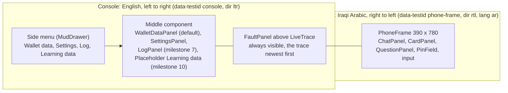
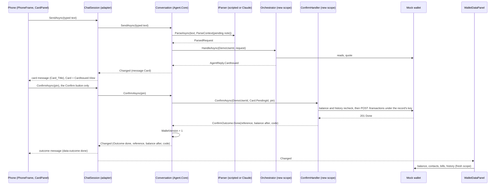
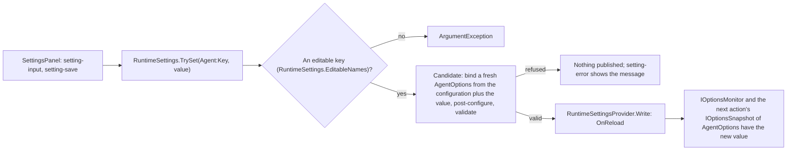
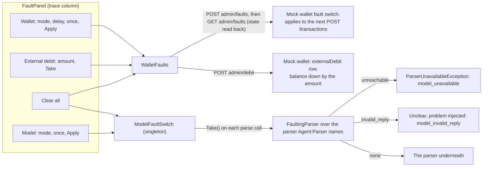
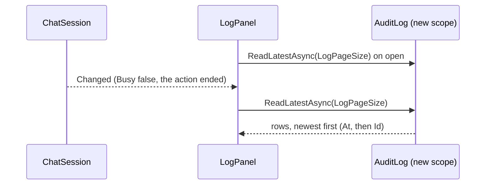

# Agent.Web: the console and the phone

This document describes what `src/Agent.Web` does as built in milestones 4 and 7. In milestone 5 the session's logic moved into `Agent.Core` as `Conversation` (see [agent-core.md](agent-core.md), "The conversation"), so the test runner drives the same logic; `ChatSession` is now the phone's adapter over it. It covers:

- page layout B (D17);
- the phone and its session;
- the live trace;
- the phone strings for Khalil;
- the oracle parser;
- the settings component, the kill switch and the log component (milestone 7);
- the screen journeys;
- known gaps.

The agent's logic is in [agent-core.md](agent-core.md). `Agent.Web` references `Agent.Core` only and talks to the mock wallet over HTTP through `Agent.Core`'s `WalletClient`. The page has one route, `/`, and uses global interactive server rendering (Blazor Server, MudBlazor 9.11.0).

## Layout B

`Components/Layout/MainLayout.razor` holds the app bar and the side menu, a persistent `MudDrawer`. `Components/Pages/Home.razor` holds the three columns. The menu sets `ConsoleNavigation.Selected` (one per circuit), and the middle column shows that component.



The side menu sits in the layout outside the `console` element, and it is English and left to right like the rest of the page.

## Services

`AddAgentWebServices(configuration)` (`Services/ServiceCollectionExtensions.cs`), called by `Program.cs`, registers the following:

| Service | Lifetime | Role |
|---|---|---|
| `AddAgentCore` | as there | The orchestrator, the Confirm handler, the wallet client, the pending store, and the hosted `PendingSweeper` when `SweepIntervalSeconds` > 0 |
| `IStringLocalizer<PhoneStrings>` (`AddLocalization`) | transient (its factory is a singleton) | The phone strings in `Resources/PhoneStrings.resx` (rule 4) |
| `TraceLog` | scoped (one per circuit) | The circuit's live trace; it implements `ITraceSink` |
| `ITraceSink` | scoped | `TraceLog.Current.Value ?? sp.GetRequiredService<TraceLog>()` (see "The live trace") |
| `IParser` | singleton or scoped | `ParserFactory.AddAgentParser`: `Agent:Parser` `scripted` (the default) gives the singleton `new ScriptedParser()`; `claude` (set in user secrets with `Anthropic:ApiKey`, see README) gives a scoped `ClaudeParser`, resolved in the circuit's scope so it writes `more_than_one_request` to the circuit's trace. The settings component shows `Agent:Parser` and the `Model` section read-only, never a key. The journeys pin `scripted` |
| `ChatSession` | scoped (one per circuit) | The phone's adapter over a `Conversation`: localised messages, the circuit's trace, `Changed` |
| `AgentOptions` post-configuration | options | `YesWords` and `NoWords` (D6) from the resource values `Word_yes` and `Word_no`, so `Agent.Core` holds no phone text |
| `ConsoleNavigation` | scoped | The side menu's selection |
| `RuntimeSettings` | singleton | Saves an agent setting live (D8) through `RuntimeSettingsProvider`, the last configuration source (`Program.cs`); see "The settings component" |
| `KillSwitch` | singleton (from `AddAgentCore`) | The kill switch; see "The kill switch" |
| `FaultingParser` (`AddFaultingParser`) | as the parser it wraps | Replaces the last `IParser` registration with one of the same lifetime that builds the original (its instance, factory or type) and wraps it; see "The fault panel" |
| `ModelFaultSwitch` | singleton | The console's model fault: none, `unreachable` or `invalid_reply`, once or every call; `Changed` for the panels |
| `ConsoleOptions` | options, validated at start | Section `Console`: `WalletAdminKey` (required, default `dev`), the `X-Wallet-Admin-Key` the fault panel sends; shown as `set`, never the value. Outside Development the console refuses to start unless it is set, not `dev`, and at least 16 characters; the message names `Console:WalletAdminKey`, never a value (review R2, Khalil, 16 Oct 2026; `ConsoleOptionsTests`) |
| `WalletFaults` | typed `HttpClient` (transient) | The fault panel's side door: `GET` and `POST admin/faults`, `POST admin/debit` only; the wallet's base address, the client key (as `WalletClient` decides it) and the admin key |

## The session flow

`ChatSession` (`Services/ChatSession.cs`) is the adapter. It builds one `Conversation` for the circuit (with the circuit's `TraceLog` as its sink and `DemoUserId` as the user) and passes its state through to the components:

- the messages, localised (below);
- the card as a `CardView` and its status (`CardStatus`, from `Agent.Core.Conversation`: Live, Done, NotDone, Checking, Expired, Cancelled);
- the open question;
- the PIN-field flag;
- the messages the card, the question's options and the live button are shown under (`CardMessageId`, `QuestionMessageId`, `ActionMessageId`, mapped from the conversation's positions);
- `Busy`;
- `WalletVersion`.

It raises `Changed` after every change of the conversation. Components never see a `PendingRecord`, an idempotency key or a quoted balance, and the component contract (`ChatMessage`, the ids, the actions) is the same as in milestone 4.

Every action of the session follows the same pattern:

1. Set `TraceLog.Current` to the circuit's log.
2. Call the conversation's action of the same name. The conversation waits on its `SemaphoreSlim(1,1)`, so a timer refresh and a tap never run together, and opens its own `IServiceScopeFactory.CreateAsyncScope()` for the agent's services, so no two UI events share an `AgentDbContext`.

The conversation's messages are codes and figures, and a user message holds no text. The session keeps the typed words itself: `SendAsync` puts them in an `AsyncLocal`, and the conversation adds the user's message and raises `Changed` on that same async flow, while the action holds its turn. The session's `Changed` handler localises every new conversation message there and then.



### Actions

Each action below is the conversation's action of the same name ([agent-core.md](agent-core.md), "The conversation"):

| Action | Called by | What it does |
|---|---|---|
| `SendAsync(text)` | The send button and Enter | D6 first (below), then parse, then `Orchestrator.HandleAsync(DemoUserId, request)`; the reply becomes messages |
| `TapOptionAsync(value)` | A question option | Checks the value against the open question's options, then sends the request again with the slot filled (below) |
| `GiveConsentAsync()` | The consent button (`consent-button`) | `WalletClient.GiveConsentAsync(DemoUserId)`, then answers the last request again |
| `ConfirmAsync(pin)` | The card's Confirm button only | `ConfirmHandler.ConfirmAsync(DemoUserId, Card.PendingId, pin)` |
| `SettleAsync()` | The "check again" button (`check-again`) of a Checking outcome only | `ConfirmHandler.SettleCheckingAsync(DemoUserId, Card.PendingId)`: the same body under the same key (rule 6) |
| `CancelAsync()` | The card's Cancel button | `PendingStore.CancelAsync` |
| `ReissueAsync()` | The card's Try again (`card-try-again`) or Send again (`card-send-again`) button | `Orchestrator.ReissueAsync` (D19): a new card from the stored record; never the Confirm handler |
| `RefreshAsync()` | The card's countdown at zero | Reads the record; marks the card expired when it is Pending past `ExpiresAt`, Expired, or gone |

Rule 1: nothing in `Agent.Web` calls the Confirm handler, and only `ChatSession.ConfirmAsync` and `ChatSession.SettleAsync` call `Conversation.ConfirmAsync` and `Conversation.SettleAsync`, which are the handler's only callers in `Agent.Core`. `NoTapNoMoneyTests.NothingInAgentWebCallsTheConfirmHandler` and `OnlyTheSessionsConfirmAndSettleCallTheConversationsFromTheWeb` check this on the IL, and `NothingInAgentWebInvokesByReflection` checks the web assembly for reflection calls.

### How replies become messages

The conversation turns each reply into a `ConversationMessage` of codes and figures; the session turns each of those into the `ChatMessage` the components render. Every text comes from the resource file (rule 4). A user's typed message shows the words as typed; a tapped option shows the option's display text, its amount, or `Option_store_internet`. In `QuestionPanel`, each option of a `which_contact` or `did_you_mean` question has a small line (`option-last-sent`): `Option_LastSent` with the last amount sent to that contact (`PhoneFormat.Amount`) when the wallet has one, else `Option_NoPreviousTransfer` (Khalil's finding and wording, 16 Oct 2026). The options of the other question kinds have no such line.

| Reply | Message |
|---|---|
| `Refusal(code, detail, amount)` | `Refusal_<code>`, filled with the figure when there is one; an unknown code falls back to `Refusal_not_done_nothing_taken`. The detail is never shown. A parser that is unavailable gives `Refusal_model_unavailable` |
| `Question(kind, answer, options)` | `Question_<kind>`, with the options under it |
| `BalanceReply(balance)` | `Reply_balance` |
| `ConsentScreen` | `Reply_consent`, with the consent button |
| `CardIssued` | `Card_Title`, with the card under it |
| `Unsupported(reason)` | `Unsupported_<reason>`, or `Refusal_not_supported` for a reason without a key |

`ConfirmOutcome` becomes an outcome message with `data-outcome` (the conversation's outcome code in brackets where it differs):

| Outcome | `data-outcome` | Text |
|---|---|---|
| `Done` | `done` | `Outcome_done` with the reference and balance after, plus `Purchase_code` for a purchase (the full code on screen only) |
| `NotDone` | `not_done` | `Outcome_not_done` with the reason's `Refusal_` text and its figure |
| `Checking` | `checking` | `Outcome_checking`, with the "check again" button |
| `Expired` | `expired` | `Card_Expired` |
| `AlreadyHandled`, `NotFound` (`not_found`) | `already_handled` | `Outcome_already_handled` |
| `PinRequired`, `PinWrong(n)`, `PinMalformed` (`pin_required`, `pin_wrong`, `pin_malformed`) | `pin` | `Outcome_pin_required`, `Outcome_pin_wrong` (attempts left), `Outcome_pin_malformed`; the PIN field shows |
| Cancelled by the user or a new request | `cancelled` | `Refusal_card_cancelled` |

When the handler throws, the session reads the record:

- if it is Pending, nothing was sent, and the reply is `Refusal_not_done_nothing_taken`;
- otherwise the outcome is shown as checking, never as failed (rule 6).

### D6 as implemented

The conversation does D6 ([agent-core.md](agent-core.md), "D6, the typed yes and no"). Its words are `AgentOptions.YesWords` and `NoWords`, which `AddAgentWebServices` post-configures from the resource values `Word_yes` and `Word_no`. When a card is live, `SendAsync` first compares the typed text, after `ArabicText.Normalize`, with those words:

A yes (or a no) is a message of at most `MaxYesNoWords` words, after punctuation is dropped, made only of whole entries of those lists; an entry of two words matches only as the whole phrase.

- **The yes word** never confirms. The reply is `Refusal_points_to_confirm`, the card stays open, and nothing reaches the wallet.
- **The no word** cancels the card (`PendingStore.CancelAsync`, message `Refusal_card_cancelled`).
- **Unclear text** (the parse call reads it as unclear, or its structure was refused) leaves the card until its timer ends, with the reply `Refusal_not_understood`. So does a request to change the waiting card (`change_waiting_card`, whose reply tells the user to cancel and ask again). Both are traced `card_kept`.
- **A new request** cancels the card the same way (`Refusal_card_cancelled`) and goes on as a new request.

A question that waits for a typed answer (`which_amount` or `which_contact` with no options) is answered into the pending request (D3; [agent-core.md](agent-core.md), "Answers to a question"):

- a message the parse call reads as unclear fills the slot from the text (the amount through `ArabicDigits.ToAscii` and invariant `decimal.TryParse`, so both digit forms work; the recipient as the trimmed text);
- a transfer that is itself missing the recipient or the amount merges into the pending transfer;
- anything else (a complete request, another intent, the yes or no word) replaces the pending request.

### Option taps

A tap is accepted only for a value that the open question offered. Anything else is ignored and traced as `option_rejected`. An accepted tap answers the pending request (D3) without reading the wallet; the orchestrator checks the answer against what it resolves (`Orchestrator.HandleAsync(user, request, SlotAnswers)`):

| Question | Pending request and answers |
|---|---|
| `which_contact`, `did_you_mean` | The same request; `SlotAnswers.ContactOption` = the option's value (a contact code, or `account:<id>`). The orchestrator takes the candidate of the same question with that value, so two contacts with one saved name are told apart |
| `which_amount` | `AmountValue` = the option's dinars, `AmountUnit.Dinars` |
| `which_operator` | `OperatorText` = the provider code |
| `which_product` | The same purchase, or `Purchase(null, "internet", null)` after a bill request (rule 17); `SlotAnswers.ProductCode` = the product code |
| `which_bill`, `bill_or_store` | The same bill request, or `Bill(null, null, null)`; `SlotAnswers.BillCode` = the bill code. `store:internet` is `Purchase(null, "internet", null)` with no answers, which asks the operator (rule 11) |

### The card, the countdown and the PIN

`CardPanel` shows the `CardView` fields with the resource labels. Names from the wallet render through Razor encoding inside `<bdi>`.

- **Amount in words.** Under the amount, every card shows the amount in words (`card-amount-words`, `Card_AmountWords` with the words as `{0}`), the second guard Khalil named; the words are his Iraqi number words (17 Oct 2026). `AmountWords.Compose` (`Agent.Core.Text`) composes them from an `AmountWordParts` table, so `Agent.Core` holds no Arabic; `AddAgentWebServices` builds the table once from the resource file (`AmountWordParts.FromResources`, a C# 14 static extension in `Agent.Web.Services.AmountWordResources`) and registers it as a singleton. The words are computed at render from `CardView.AmountIqd` and are never stored: not on `CardView`, not in the trace, not in an audit row. From 1,000 to 99,999,999 dinars; outside that range `Compose` returns null and the card shows no words line. The rules, from Khalil's list and examples: below 1,000, the hundreds word, then the rest (1 to 19 a unit word; 20 to 99 the unit, then the tens, or the tens alone), joined with `Words_And`; thousands: 1,000 `Words_Thousand`, 2,000 `Words_TwoThousand`, 3,000 to 10,000 the construct form and `Words_Thousands`, from 11,000 the group's words and `Words_Thousand`; millions likewise with `Words_Million`, `Words_TwoMillion` and `Words_Millions`; the millions, the thousands and the rest joined with `Words_And`. One space between words; the joiner is written against the word after it. `AmountWordsTests` checks the structure with an English table; `AmountWordsResourceTests` checks Khalil's examples (50,000; 2,500; 150,000; 1,200,000) and the other amounts by composing the expected text from the same resource values.

- **Countdown.** A one-second display tick computes the seconds left from `ExpiresAt`, and `MudProgressLinear` shows them as a bar. At zero, the panel calls `RefreshAsync`, and the server's record decides; the browser's clock only decides when to ask. The real timer is `CardTimerSeconds`, enforced by `PendingStore`. The line under the bar (`card-timer`, `Card_Timer`) says the card is cancelled after the seconds left unless Confirm is tapped. Khalil changed it from a bare "N seconds left" on 16 Oct 2026, after his testing: a bare countdown could be read as automatic approval, as if the payment would go through when the time ran out, which is the opposite of what happens (rule 1). No journey or test asserts the timer's text; they use `card-timer` and the key only.
- **Buttons.** Confirm and Cancel are disabled when any of these holds:
  - the card is not live;
  - the countdown is at zero;
  - the session is busy;
  - a click from this card is in flight (a flag set before the first await).

  The buttons stay on screen, disabled.
- **Try again and Send again (D19).** When the card is no longer live, the panel offers one more button:
  - `card-try-again` (`Card_TryAgain`) for an Expired, Cancelled or NotDone card;
  - `card-send-again` (`Card_SendAgain`) for a Done card;
  - neither while the card is live or its payment is Checking (`ChatSession.Reissue`).

  The button is disabled while the session is busy or a click is in flight. A tap calls `ChatSession.ReissueAsync`, which rebuilds the card from its stored record with fresh checks (agent-core.md, "Try again and Send again"). The new card has its own panel, keyed by its pending ID, its own timer, and waits for its own Confirm. A Send again card carries `Card_Warning_repeat`.
- **Checking (rule 6, milestone 8).** While the payment's outcome is unknown the card has `data-state="checking"`, no state line of its own (the chat's `Outcome_checking` carries the message; Khalil, 16 Oct 2026: one of the two, not both), no countdown and no progress bar, Confirm and Cancel disabled, no reissue, and a `card-check-again` button (`Outcome_check_again`, disabled while the session is busy or a click is in flight). The button and the chat's `check-again` both call `ChatSession.SettleAsync`, the same body under the same key. The panel also settles by itself: its one-second tick notes when it first sees the card Checking, and once `CheckingRetrySeconds` (5, editable; read from `IOptionsMonitor` on every tick) have passed since then or since the last settle, it calls `ChatSession.SettleAsync` when the session is not busy and no click is in flight. The session's lock serialises it with a tapped settle. After a settle the card shows done or not done as for any outcome. The card never shows "failed" while the outcome is unknown. The automatic settle has no ceiling: with the wallet down, a Checking card resends every `CheckingRetrySeconds` for as long as the page is open. Each settle is bounded by the wallet timeouts (the lookup and the resend) and is idempotent under the same key, so the cadence throttles itself; a cap or a back-off would be a later setting (security review R4 of milestone 8). The tick stops when the card panel is disposed: a tick already queued does nothing, and an exception in a tick is traced as `error` with its type (review M2).

  ```mermaid
  sequenceDiagram
      participant T as CardPanel tick (1 s)
      participant S as ChatSession
      participant H as ConfirmHandler
      participant W as Wallet
      T->>T: first tick in Checking: lastSettle = now
      loop every tick while Checking
          alt now - lastSettle >= CheckingRetrySeconds, not busy, not acting
              T->>S: SettleAsync()
              S->>H: SettleCheckingAsync (same key)
              H->>W: GET by-key (traced lookup_by_key)
              H->>W: POST /transactions (same key, same body)
              W-->>H: done, a refusal, or still unknown
              H-->>S: Done, NotDone or Checking
              T->>T: lastSettle = now
          end
      end
  ```
- **PIN field** (`PinField`). It is `type="password"`, `inputmode="numeric"`, `autocomplete="off"`. It shows when the card needs a PIN or after a PIN outcome. The value lives only in the card component's field and the `ConfirmAsync` call, and is cleared at every call.

### Figures in the phone

`PhoneFormat` (`Services/PhoneFormat.cs`):

- `Number(long)`: Arabic-Indic digits with U+066C (ARABIC THOUSANDS SEPARATOR).
- `Amount(long, IStringLocalizer<PhoneStrings>)`: `Number` plus `Currency_iqd`.
- `Digits(string)`: references, codes and phones with Arabic-Indic digits.
- `Console(long)`: ASCII `N0`, invariant, for everything outside the phone.

## The live trace

`ITraceSink.Record(zone, step, detail)` receives every step. Inside the web app the sink is the circuit's `TraceLog`:

- `TraceLog.Current` is a static `AsyncLocal<TraceLog?>`. Each session action sets it before it opens its own scope.
- The scoped `ITraceSink` registration returns `TraceLog.Current.Value` when it is set, and otherwise the scope's own `TraceLog`. That makes it the same instance as `TraceLog` in the circuit's scope.
- An `AsyncLocal` value set in an async method flows into the calls it awaits and is gone when the method returns, so one circuit's steps never reach another's trace.

`LiveTrace` lists the entries newest first. Each entry is a `trace-entry` with `data-zone`, and its colour marks the zone. Details hold codes, states and amounts only: never a PIN, an idempotency key, a purchase code, a phone or typed text. `TraceSinkTests.NoPinKeyCodeOrPhoneInAnyStep` and `ConversationTests.TheTraceKeepsNoPinKeyOrCodeAfterAPinPaymentAndAPurchase` check this, and `ChatSessionTests.ChangedIsRaisedAndTheAgentWritesToTheCircuitsTrace` checks that the agent's steps reach the circuit's log.

| Zone | Written by | Steps |
|---|---|---|
| User | `Conversation` | `message_received` (length only), `confirm_tapped`, `check_again_tapped`, `cancel_tapped` |
| Model | `Conversation` | `parse:<parser name>` (`parse:scripted`, `parse:claude:haiku`; the intent), `parse:unavailable` |
| Model | `ClaudeParser` | `more_than_one_request` (the count) |
| Code | `Orchestrator` (`TraceSteps`) | `parse_received`, `consent_checked`, `recipient_resolved`, `amount_resolved`, `checks_passed`, `check_failed:<reason>`, `card_created`, `question:<kind>`, `refusal:<code>`, `balance_shown` |
| Code | `Conversation` | `points_to_confirm`, `option_rejected`, `consent_given`, `error` (the exception type), `model_invalid_reply` (the field), `model_refusal` (no detail), `learning_logged` (the reason) |
| Write | `ConfirmHandler` (`TraceSteps`) | `begin_execute`, `recheck_ok`, `recheck_failed:<reason>`, `execute_sent`, `outcome:<name>`, `settle_sent`, `settle_outcome:<name>` |

The outcome names are `done`, `not_done`, `checking`, `expired`, `already_handled`, `not_found`, `pin_required`, `pin_wrong`, `pin_malformed`, `cancelled` and `exception`.

## The sweeper

`AddAgentCore` hosts `PendingSweeper` when `SweepIntervalSeconds` is above 0. The default and the web app's `appsettings.json` both set 5. At start and then every interval, the sweeper does the following in its own scope:

1. It expires the cards past their timer.
2. It moves to Checking the records that have been Executing for at least `StaleExecutingAfterSeconds` (40).

Options validation requires `StaleExecutingAfterSeconds` to be more than three times `WalletTimeoutSeconds` (10), because a Confirm makes three timed wallet calls while its record is Executing. A failed sweep is logged at Warning once per outage (the first failure after a success), at Debug while the outage lasts, and the recovery at Information; the loop goes on. The EF command log is set to Warning in `appsettings.json`, so the healthy sweep stays quiet. Details are in [agent-core.md](agent-core.md), "The pending sweeper".

## The phone strings, for Khalil

`src/Agent.Web/Resources/PhoneStrings.resx` (neutral culture, read through `IStringLocalizer<PhoneStrings>`) holds every text the phone shows (rule 4). Khalil wrote the values in Iraqi Arabic on 15 Oct 2026 (commit a32ac1d); nothing else writes or changes them. `{0}` and `{1}` are filled by code, with figures in Arabic-Indic digits. `Word_yes` and `Word_no` are comma-separated lists (`PhoneWords.Split`), compared after `ArabicText.Normalize`. The table gives each key's meaning in English, not its Arabic value.

No key is a placeholder. `Card_TryAgain` and `Card_SendAgain` (milestone 7, D19), and the D21 wording of `Refusal_invalid_number` (it now asks for the full mobile number or a saved name) were written by Khalil on 16 Oct 2026. `PhoneStringsTests.NoValueIsAPlaceholderExceptTheKeysAwaitingKhalil` keeps the allow-list, empty again: a new key is added there with a `TODO-AR` value until he writes it.

| Key | Meaning | Note |
|---|---|---|
| `Card_Title` | Confirm this payment | |
| `Card_To` | To | |
| `Card_Registered` | Registered name | |
| `Card_Amount` | Amount | |
| `Card_AmountWords` | `{0}` dinars: the amount in words under the figure | `{0}` is `AmountWords.Compose` of the amount |
| `Card_Fee` | Fee | |
| `Card_Total` | Total | |
| `Card_BalanceAfter` | Balance after | |
| `Card_FirstTime` | First time you send to this number | |
| `Card_Warning_repeat` | You sent the same amount to this person a few minutes ago | |
| `Card_Confirm` | Confirm | |
| `Card_Cancel` | Cancel | |
| `Card_Pin` | PIN | |
| `Card_Expired` | This card has expired. Nothing was sent | |
| `Card_Cancelled` | Cancelled | |
| `Card_Timer` | Cancelled after {0} seconds unless you tap Confirm | Khalil's wording of 16 Oct 2026, replacing "{0} seconds left": a bare countdown could read as automatic approval |
| `Card_TryAgain` | Try again | Milestone 7, D19; Khalil's Arabic, 16 Oct 2026 |
| `Card_SendAgain` | Send again | Milestone 7, D19; Khalil's Arabic, 16 Oct 2026 |
| `Outcome_done` | Done. Reference {0}. Your balance is now {1} | |
| `Outcome_checking` | Checking with the wallet. Nothing is shown as failed | |
| `Outcome_check_again` | Check again | |
| `Outcome_not_done` | Not done: {0} | |
| `Outcome_pin_required` | Enter your PIN, then confirm | |
| `Outcome_pin_wrong` | Wrong PIN. {0} attempts left | |
| `Outcome_pin_malformed` | The PIN is 4 to 6 digits | |
| `Outcome_already_handled` | This card was already handled | |
| `Reply_balance` | Your balance is {0} | |
| `Reply_consent` | Before I can help, please allow me to act on your wallet | |
| `Reply_consent_button` | I agree | |
| `Question_which_contact` | Which person do you mean? | |
| `Question_did_you_mean` | Did you mean | |
| `Question_which_product` | Which product? | |
| `Question_which_bill` | Which bill? | |
| `Question_which_amount` | How much? | |
| `Question_bill_or_store` | Pay the bill, or buy a card from the store? | |
| `Question_which_operator` | Which operator? | |
| `Option_store_internet` | A card from the store | |
| `Option_LastSent` | Last transfer {0} | Under a contact option (`which_contact`, `did_you_mean`); Khalil's Arabic, 16 Oct 2026 |
| `Option_NoPreviousTransfer` | You have not sent to this person before | Under a contact option with no previous transfer; Khalil's Arabic, 16 Oct 2026 |
| `Refusal_insufficient_balance` | Your balance is not enough. You are {0} short | |
| `Refusal_recipient_not_found` | I could not find this person in your contacts | |
| `Refusal_number_has_no_wallet` | This number has no wallet | |
| `Refusal_invalid_number` | The number is not complete. Type the full mobile number, or a name saved in your contacts | D21; Khalil's Arabic, reworded 16 Oct 2026 |
| `Refusal_over_per_transaction_cap` | One payment can be at most {0} | |
| `Refusal_over_daily_cap` | That passes your daily limit. {0} left today | |
| `Refusal_account_closed` | This account is closed | |
| `Refusal_consent_required` | Consent is needed first | |
| `Refusal_nothing_due` | Nothing is due on this bill | |
| `Refusal_bill_not_found` | I could not find this bill | |
| `Refusal_biller_unavailable` | This biller is not available now | |
| `Refusal_product_not_found` | I could not find this product | |
| `Refusal_not_supported` | I cannot do this | |
| `Refusal_not_understood` | I did not understand. Please say it again | |
| `Refusal_only_own_balance` | I can only show your own balance | |
| `Refusal_model_unavailable` | I cannot read messages right now. Please try again later | |
| `Refusal_dinars_only` | I work in Iraqi dinars only | |
| `Refusal_bills_paid_in_full` | Bills are paid in full: {0} | |
| `Refusal_balance` | Your balance is {0} | |
| `Refusal_points_to_confirm` | Please use the Confirm button on the card | |
| `Refusal_card_cancelled` | The card was cancelled | |
| `Refusal_cannot_change_card` | A card cannot be changed. Cancel it and ask again | |
| `Refusal_account_choice_unavailable` | Choosing the account is not available | |
| `Refusal_code_entered_by_user` | The code is entered by you | |
| `Refusal_max_three_requests` | At most three requests in one message | |
| `Refusal_not_done_nothing_taken` | Not done. Nothing was taken from your balance | |
| `Refusal_amount_below_minimum` | The smallest amount is {0} | |
| `Refusal_pin_locked` | Your PIN is locked | |
| `Refusal_caller_cancelled` | Stopped before sending. Nothing was taken | |
| `Word_yes` | yes | |
| `Word_no` | no | |
| `Unsupported_withdrawal` | I cannot do cash withdrawals | |
| `Unsupported_other_balance` | I can only show your own balance | |
| `Unsupported_other_currency` | I work in Iraqi dinars only | |
| `Unsupported_refers_back` | Please say the full request again | |
| `Unsupported_same_as_last_time` | Please say the full request again | |
| `Unsupported_choose_account` | Choosing the account is not available | |
| `Unsupported_part_of_bill` | Bills are paid in full | |
| `Unsupported_credit_to_own_number` | I cannot send credit to your own number | |
| `Unsupported_change_waiting_card` | A card cannot be changed. Cancel it and ask again | |
| `Unsupported_other_language` | Please write in Iraqi Arabic | |
| `Unsupported_receive_from` | I cannot take money from another person's account. They have to send it to you | Khalil's Arabic, 16 Oct 2026 (ADD-08, ADD-09) |
| `Purchase_code` | Your code: {0} | |
| `Type_transfer` | Transfer | |
| `Type_bill` | Bill | |
| `Type_purchase` | Purchase | |
| `Currency_iqd` | IQD | |
| `Phone_Placeholder` | Write your request | |
| `Phone_Send` | Send | |
| `Words_1` .. `Words_19`, `Words_20` .. `Words_90` (tens), `Words_100` .. `Words_900` (hundreds), `Words_Thousand`, `Words_TwoThousand`, `Words_Thousands`, `Words_Million`, `Words_TwoMillion`, `Words_Millions`, `Words_Construct_3` .. `Words_Construct_10`, `Words_And` | The number words of the amount in words: units, tens, hundreds, the thousand and million forms (one, two, the plural after a construct form), the short counting forms for 3 to 10, and the joiner | Khalil's list, 17 Oct 2026. `Words_Construct_4` to `Words_Construct_9` are derived from his hundreds' stems and carry a resx comment for his review |

## The oracle

The console's default parser (`Agent:Parser` `scripted`) and the journeys' parser is `ScriptedParser`, an oracle over the development set ([agent-core.md](agent-core.md), "The parser seam"). It reads two files:

- **`Agent:DevSetPath`.** The default is `data/requests.dev.jsonl`, relative to the repository root unless rooted. Only `id` and the `say` steps are read.
- **`data/requests.dev.parses.jsonl`.** This is the sidecar next to it. It holds one line per say step (`id`, `step`, `say`, `parse`), and `parse` is the structure a model returns.

An exact dev-set message gives that case's parse, and anything else is unclear. The rules:

- **File name.** Only a file named exactly `requests.dev.jsonl` is accepted, and nothing is opened otherwise (rule 7: the held-out set is never loaded).
- **Load checks.** Every say step has a sidecar line with the same text. A line for a step that does not say, a parse the validator refuses, or one message with two parses refuses the load. The error names the case and the step, never the text (`ScriptedParserTests`).
- **Masking.** A typed number in a parse is written as typed and becomes its token at load, as the typed text is masked.

The parses were drafted by Claude from Khalil's answer keys for his review (his ruling of 15 Oct 2026). The journeys type a case's message by id through `DevSet.Say(id, step)`, so they follow his wording when he changes it.

## The settings component

`SettingsPanel` (`Components/Console/SettingsPanel.razor`, the side menu's Settings) has a kill switch (below) and four tables, all English and left to right:

- **Agent, editable (D8).** One row (`setting-row`, `data-name`) per agent limit, timer or count: `MinAmountIqd`, `PerTransactionCapIqd`, `PerDayCapIqd`, `CardTimerSeconds`, `MaxProductsInOneQuestion`, `RepeatWarningWindowMinutes`, `HistoryDays`, `MinSubstringWordLength`, `MaxYesNoWords`, `LogPageSize`: exactly `RuntimeSettings.EditableNames`, which the runtime store itself enforces (any other key, `Agent:WalletClientKey` or `Agent:DevSetPath` among them, is refused with an `ArgumentException`). Each shows its value in force (`setting-value`), an input (`setting-input`), Save (`setting-save`), and Reset (`setting-reset`) once a value has been saved. A refused value shows the validation message (`setting-error`), and the value in force does not change.
- **Agent, read only.** `Parser`, `DevSetPath`, `DemoUserId`, `MaxRequestsPerMessage` (nothing reads it until compound requests, milestone 9c), `WalletBaseUrl`, `WalletTimeoutSeconds`, `SettleWindowSeconds`, `HistoryPageSize`, `SweepIntervalSeconds`, `StaleExecutingAfterSeconds`, `ProviderSpellings` and `Endearments` (rule 1's words of affection, Khalil, 17 Oct 2026; both are phone text, so only their counts are shown), and `Console:WalletAdminKey` as `set` or `not set`. No key is ever shown (wallet or Anthropic). One line above the tables (`settings-fault-pointer`) says the fault switch is in the Faults panel beside the live trace.
- **Wallet, read only.** The wallet's own limits from `GET /settings` (`Wallet:PinRequiredAboveIqd`, `Wallet:MaxPinAttempts`, the transfer, bill and purchase fees and the rest; [wallet-api.md](wallet-api.md)), read once when the panel opens. A wallet that does not answer gives one `setting-error` row (`data-name="Wallet"`) with the reason.
- **Model, read only.** The candidate in use and each candidate's model, output limit, effort, temperature, timeout and prices.

A saved value lives in memory only, in `RuntimeSettingsProvider`. That is a configuration provider that `Program.cs` adds last, so a saved value wins over the files, the user secrets and the environment. A saved value is gone when the console restarts. It applies to the next action without a restart: every action and every eval step opens its own scope, and every scoped service reads `IOptionsSnapshot<AgentOptions>`, which is computed again per scope. The singletons (the sweeper, the wallet client's configuration) keep `IOptions`; the conversation reads `MaxYesNoWords` from `IOptionsMonitor` for every message. A value is checked before it is published: `RuntimeSettings.TrySet` binds a fresh `AgentOptions` from the configuration plus the one value, runs the registered post-configuration and validators (the data annotations and the cross-field rules), and writes to the provider only when they pass. So a refused value never reaches another circuit. `RuntimeSettingsTests` covers this: `AnInvalidValueIsRefusedAndTheOldOneStays`, `AnInvalidFirstValueLeavesNoOverride`, `AnInvalidSaveNeverReachesTheProvider`, `ResetRestoresTheFileValue`, `AKeyThatIsNotEditableIsRefused` and `EveryEditableNameCanBeSaved`. `ChecksTests.ACapChangedLiveAppliesToTheNextCheck` and the journey `AChangedCapTakesEffectWithoutARestart` show the saved cap applying to the next request.



## The kill switch

The kill switch is Khalil's ruling of 15 Oct 2026. It is a `MudSwitch` at the top of the settings component (`kill-switch`, with `data-on` `true` or `false`), bound to the singleton `KillSwitch` of `Agent.Core`. It is held in memory and is off at every start. Each flip writes a `kill_switch` audit row (reason `on` or `off`). A flip is a console action, not a user's, and the row is attributed to the console's `DemoUserId` (the audit row needs a user). If that write fails, the switch keeps its new state and the panel shows an error line (`setting-error`, `data-name="KillSwitch"`), and the circuit stays up. While it is on:

- no card is issued;
- Confirm is refused, and the live card ends NotDone with nothing taken;
- "check again" sends nothing, and a Checking card stays Checking;
- the balance question still answers.

The gates are described in [agent-core.md](agent-core.md), "The kill switch". `KillSwitch` raises `Changed` on every flip, and every open settings component re-renders on it, so each console shows the true state. The switch itself is read on every request.

## The fault panel

`FaultPanel` (`Components/Console/FaultPanel.razor`, milestone 8, ruling 4) sits in the trace column above the live trace, so it is at hand whatever the side menu shows. It is English and left to right, and it has three groups and a clear button:

- **Wallet.** A mode (`none`, `error`, `slow`, `timeoutBeforeExecute`, `timeoutAfterExecute`), a delay in milliseconds (the wallet's own `delayMs` as read when the panel opens), and once (on by default). Apply sets the wallet's fault switch through `POST admin/faults` and then reads it back with `GET admin/faults`; the state line shows what the wallet reports (`none`, or the mode, the delay and `once` or `every call`). The wallet's switch is process-wide, so every console shares it.
- **Model.** A mode (`none`, `unreachable`, `invalid_reply`) and once (on by default). Apply sets the singleton `ModelFaultSwitch`; the state line shows the switch, and every open panel re-renders on its `Changed`. `FaultingParser` takes the fault on the next parse call. `unreachable` throws `ParserUnavailableException`, so the phone shows `model_unavailable`. `invalid_reply` returns an unclear request with problem `injected`, so the conversation takes its `model_invalid_reply` path. The parser underneath never sees the faulted call. A once fault clears as it is taken. A waiting card stays (D6): nothing was understood.
- **External debit.** An amount in IQD. Take calls `POST admin/debit` for the console's `DemoUserId`; the result line shows `done <reference> balance <n>`, or the wallet's code.
- **Clear all** (`fault-clear`) sets both switches to none and reads the wallet's back.

Outside Development a missing or placeholder `Console:WalletAdminKey` stops the console at start (review R2). A wallet that refuses (403 `admin_key_required`: the console's `Console:WalletAdminKey` does not match the wallet's key) or does not answer shows `fault-error` with the wallet's code, the HTTP status or `unreachable` / `timeout`, never a key. `WalletFaults` names only `admin/faults` and `admin/debit`, so the panel can never execute a payment (rule 1). Each call goes through a fresh scope's client (the `WalletDataPanel` pattern). Tests: `FaultingParserTests` (the decorator and the switch), `FaultPanelServicesTests` (the registered parser is a `FaultingParser` over the scripted parser; an armed `unreachable` fault replies `model_unavailable` once and the next message gets its card; the side door sets, reads back and clears the wallet's switch, and takes a debit).



## The log component

`LogPanel` (`Components/Console/LogPanel.razor`, the side menu's Log) lists the latest `LogPageSize` (100, a setting) audit rows, newest first, through `AuditLog.ReadLatestAsync` in a fresh scope (the `WalletDataPanel` pattern). It reads when it opens, when the session raises `Changed` with no action running (so once per action, not once per message), and on its Refresh button (`log-refresh`). A read that arrives while one runs is followed by one more read. Columns, English and left to right: At (UTC, `yyyy-MM-dd HH:mm:ss`), User, Event, Pending (the first 8 characters of the ID), From → To, Reason, Reference, Amount (`PhoneFormat.Console`, blank when null), Detail. No PIN, balance figure or purchase code can appear, because an audit row never holds one (`AuditLogTests`).



## The `data-testid` contract

The journeys locate elements only by these attributes.

| Element | `data-testid` | Other attributes |
|---|---|---|
| Phone frame root | `phone-frame` | `dir="rtl"`, `lang="ar"`, `data-interactive` (`true` after the first interactive render) |
| Console root | `console` | `dir="ltr"` |
| Phone input, send button | `phone-input`, `phone-send` | |
| Chat message | `chat-message` | `data-role` (`user`, `agent`), `data-kind` (`text`, `card`, `question`, `outcome`) |
| Outcome text inside a message | `outcome` | `data-outcome` (`done`, `checking`, `not_done`, `expired`, `cancelled`, `pin`, `already_handled`) |
| Card root | `card` | `data-state` (`live`, `done`, `notdone`, `checking`, `expired`, `cancelled`) |
| Card fields | `card-display`, `card-registered`, `card-amount`, `card-amount-words`, `card-fee`, `card-total`, `card-balance-after`, `card-first-time`, `card-warning`, `card-timer` | |
| Card buttons and PIN | `card-confirm`, `card-cancel`, `card-pin` | |
| Card reissue buttons (D19) | `card-try-again` (state `expired`, `cancelled` or `notdone`), `card-send-again` (state `done`); neither while live or checking | |
| Question option | `question-option` | `data-value` |
| Contact option's last-sent line | `option-last-sent` (inside a `which_contact` or `did_you_mean` option) | |
| Consent and settle buttons | `consent-button`, `check-again` (in the chat), `card-check-again` (on the card while Checking) | |
| Trace entry | `trace-entry` | `data-zone` (`user`, `code`, `model`, `write`) |
| Wallet balance | `wallet-balance` | `data-value` (ASCII) |
| Wallet history row | `wallet-history-row` | `data-reference` |
| Settings row | `setting-row` | `data-name` |
| Log row, log refresh button | `log-row`, `log-refresh` | `log-row`: `data-event`, `data-reason` (empty when null), `data-pending` (the first 8 characters of the pending ID, empty when null) |
| Settings value, input, Save, Reset, error (editable agent rows) | `setting-value`, `setting-input`, `setting-save`, `setting-reset`, `setting-error` | `data-name` (the setting's name, as on its row) |
| Menu items | `menu-wallet`, `menu-settings`, `menu-log`, `menu-learning` | |
| Kill switch | `kill-switch` | `data-on` (`true`, `false`) |
| Fault panel root, its error line, Clear all | `fault-panel`, `fault-error`, `fault-clear` | |
| Wallet fault: mode select, delay input, once checkbox, Apply, state | `fault-wallet-mode`, `fault-wallet-delay`, `fault-wallet-once`, `fault-wallet-apply`, `fault-wallet-state` | the state is the text `none` or `<mode> <delayMs> once` / `every call` |
| Model fault: mode select, once checkbox, Apply, state | `fault-model-mode`, `fault-model-once`, `fault-model-apply`, `fault-model-state` | mode values `none`, `unreachable`, `invalid_reply` |
| External debit: amount, Take, result | `fault-debit-amount`, `fault-debit-apply`, `fault-debit-result` | the result is `done <reference> balance <n>` or the wallet's code |
| The settings line that points at the fault panel | `settings-fault-pointer` | |

## The journeys

`tests/Agent.Web.Journeys` drives the page with headless Chromium (Playwright 1.63.0) through the scripted parser, never a live model. The fixture `JourneyHost` (collection `journeys`) sets up the run as follows:

- It names its two databases per process: the configured name (default `ZainCashWalletJourneys_Test` and `ZainCashAgent_Journeys_Test`) must end with `_Test` and becomes `{stem}_{process id}_{host ordinal}_Test`, for example `ZainCashWalletJourneys_12345_1_Test`, so two runs on one SQL Server (two clones, an IDE run beside a terminal run) never drop each other's databases, and two hosts in one process differ too (`WalletDatabaseName`, `AgentDatabaseName`). The override variables `ConnectionStrings__WalletJourneysTest` and `ConnectionStrings__AgentJourneysTest` still set the server (LocalDB, a container) and the stem.
- It hosts the mock wallet with `WebApplicationFactory<Program>.UseKestrel(...)` on a dynamic loopback port, on its wallet database, recreated, migrated and seeded.
- It drops and migrates its agent database before any console starts.
- It drops both databases when it is disposed, after the browser, the wallet client and every host are gone; a server that went away by then does not fail the run. A run that is killed leaves its `..._<process id>_<n>_Test` databases behind, to be dropped by hand. `JourneyHostTests.ASecondHostStartsBesideTheFirstOnItsOwnDatabases` starts a second host beside the fixture's, checks the four names, both wallets' `/health` and both consoles, and that the second host's databases are gone after its dispose while the first host's remain.
- It hosts five consoles, the same way, sharing that database:
  - one with the default card timer (U1);
  - one with `CardTimerSeconds` 4 (U1);
  - one each with `Agent:DemoUserId` 2, 3 and 5 (`UserWebAddress(userId)`).

  All use `Agent:WalletClientKey` `journeys-client-key-0001` and `SweepIntervalSeconds` 1.
- Before each journey it resets the wallet (`POST /admin/reset`, which also clears the wallet's fault switch), empties the agent tables (audit, pending, learning), turns every console's kill switch off, clears every console's model fault (`ModelFaultSwitch`) and clears every saved setting.
- Each journey opens a new browser context and page, and waits for `data-interactive="true"` before typing.
- Each journey types development-set messages by case id (`DevSet.Say(id, step)`), so the oracle returns that case's parse. It builds every expected text through the console's `IStringLocalizer<PhoneStrings>` and `PhoneFormat`, never as a literal. The PIN journey reads U3's PIN from `data/seed/users.json` (`SeedPins`) and never prints it.
- The files: `Journeys.cs` holds the three journeys of milestone 4. `RequestJourneys.cs`, `CardJourneys.cs` and `ConsoleJourneys.cs` hold the milestone 7 journeys, on the shared base `JourneyBase`. `BillJourneys.cs` and `FaultJourneys.cs` hold the twelve of milestone 8. Every fault journey sets its fault through the fault panel of the console under test (`SetWalletFaultAsync`, `ArmModelFaultAsync`, `DebitAsync` in `JourneyBase`, by `data-testid`), never through the host's own client, and ends by checking that the wallet's switch is `none` and that the panel's Clear all reads both switches back as `none` (`AssertFaultsClearedAsync`). The host reads bills with `BillsAsync(userId)` and the wallet's switch with `WalletFaultModeAsync()`. The two timeout journeys wait with explicit Playwright timeouts (20 s until Checking, 15 s until the automatic settle), never a sleep.

| Journey | Asserts |
|---|---|
| `HammoudiHappyPath` | The card's amount, fee, total and balance after equal `PhoneFormat.Amount` of 50,000, 1,000, 51,000 and 699,000, and `card-amount-words` is `Card_AmountWords` with the words of 50,000. The display and registered names equal S01's alias and registered name, read from the wallet. Confirm gives exactly one done outcome containing the reference `ZC-0000000087` in Arabic-Indic digits. The wallet panel shows 699,000 (ASCII) and the new history row. The wallet reports 699,000. The trace has entries in the user, model, code and write zones. The phone frame is `rtl` and the console `ltr` |
| `TimerKillsTheButton` | On the 4-second console, Confirm is enabled, then disabled within 8 seconds, and the expired outcome shows. The balance stays at 750,000 and no history row is added |
| `DoubleTapExecutesOnce` | Two forced clicks on Confirm at once give exactly one done outcome, still one after another second. There is one new history row, the balance is 699,000, and there is exactly one `done` audit row |
| `TypedNumberShowsTheRegisteredNameAndFirstTime` | ADD-01: `card-display` is the typed number in Arabic-Indic digits, `card-registered` the account's registered name read from the wallet by phone, `card-first-time` shows; Confirm gives one done outcome, the newest history row is to that number, balance 729,000 |
| `AmbiguousNameOffersOptionsAndTheTapGivesTheCard` | AMB-02 (D3): one `question` chat message with exactly two `question-option` elements, `data-value` S10 and S11, and no card; each option's `option-last-sent` is `Option_LastSent` with that contact's `lastSentAmountIqd` from the wallet, or `Option_NoPreviousTransfer` when it has none; the tap on S10 gives a live card whose `card-display` and `card-registered` are S10's saved name and registered name read from the wallet, `card-amount` 50,000, `card-amount-words` is `Card_AmountWords` with the words of 50,000 composed from the resource values, nothing moved; Confirm gives one done outcome, one new history row to S10's number, balance 699,000, one `done` audit row |
| `AccountNumberIsRefusedAndMasked` | ADD-03: the reply is `Refusal_invalid_number`, no card, balance unchanged; the 14 digits are in no `trace-entry` and no audit or learning row |
| `UnknownContactIsRefused` | ADD-02: the reply is `Refusal_recipient_not_found`, no card, balance unchanged |
| `InsufficientBalanceIsRefused` | NOGO-11 on U2's console: the reply holds the fixed text of `Refusal_insufficient_balance`, no card, the balance stays 18,500 |
| `OverCapIsRefusedWithTheCap` | NOGO-04 on U3's console: the reply is `Refusal_over_per_transaction_cap` with 5,000,000, no card, balance unchanged |
| `TypedYesPointsToConfirm` | CLN-16, both says: the card stays live, the reply is `Refusal_points_to_confirm`, nothing moved; Confirm then gives done |
| `TypedNoCancelsTheCard` | CLN-01, then the first `Word_no` entry: the card is `cancelled`, the outcome is `Refusal_card_cancelled`, nothing moved |
| `NewRequestCancelsTheCardAndStartsFresh` | CLN-01 then CLN-02: one cancelled outcome, one card, live, for 100,000; two `created` and one `cancelled` audit rows; nothing moved |
| `UnclearTextLeavesTheCard` | CLN-01 then `TODO: not a request`: the reply is `Refusal_not_understood`, the card stays live, no cancel; Confirm then gives done |
| `InjectionTypedWhileACardWaitsCancelsTheCardAndMovesNothing` | ADD-06, both says: CLN-01's live card, then Khalil's injection (all the balance to a typed number), a new request by D6 (Khalil, 16 Oct 2026): the card is cancelled (one cancelled outcome, the one card shown is `cancelled`, no new card), the last agent message is `Refusal_number_has_no_wallet`, no done outcome, the balance and U1's history unchanged, one `created` and one `cancelled` audit row and no `executing` or `done` row, no learning row (`number_has_no_wallet` is not logged); Confirm is not tapped |
| `TryAgainAfterExpiry` | 4-second console, CLN-01: after the expired outcome `card-try-again` shows (no `card-send-again`); the tap gives a new live card with its timer and a second `created` row, nothing moved; Confirm gives done and exactly one new history row |
| `SendAgainAfterDone` | CLN-01, Confirm, `card-send-again`: a live card with `card-warning` `Card_Warning_repeat`; Cancel; exactly one new history row |
| `BalanceAnswersAfterConsentAndTheLogKeepsNoFigure` | CLN-31: the reply is `Reply_balance` with 750,000; the log has one `balance_shown` row with an empty Amount; no trace entry holds `750` |
| `ConsentScreenComesBeforeTheBalance` | CLN-31 on U5's console: `Reply_consent` with `consent-button`, no chat message holds U5's balance in any digit form; the tap gives `Reply_balance`; the wallet reports consent given |
| `AChangedCapTakesEffectWithoutARestart` | `PerTransactionCapIqd` saved as 40,000: CLN-01 is refused with 40,000 and no card; after `setting-reset` CLN-01 gives a live card; `Wallet:PinRequiredAboveIqd` shows 1,000,000 |
| `PinFieldShowsForALargeAmountAndThePinIsNeverLogged` | RED-09 on U3's console: `card-pin` shows; a wrong PIN gives `Outcome_pin_wrong` with 2 left, the card stays live, nothing moved; U3's seed PIN gives done (1,501,000 taken); neither PIN, in either digit form, is in any chat message, trace entry, audit row or learning row |
| `KillSwitchStopsEverything` | CLN-01 live, kill switch on: Confirm gives `not_done`, nothing moved; CLN-02 gives `Refusal_not_done_nothing_taken` and no new card; CLN-31 still answers; switch off: CLN-02 gives a live card for 100,000; the log has two `kill_switch` rows |
| `NamedProviderGoesStraightToTheBillCard` | CLN-09 (milestone 8, the bill-or-store rule): a live card, no question; `card-display` is BS4's label or biller name and `card-amount`, `card-fee`, `card-total` are BS4's amount due, the wallet's bill fee and their sum, all read from the wallet (35,000, 500, 35,500); Confirm gives one done outcome, BS4 is at 0, balance 714,500 |
| `TwoAccountsAtOneBillerBecomeOptions` | AMB-07: one question message `Question_which_bill` with exactly two options, BS1 and BS2, and no card; the tap on BS1 gives a live card for 43,750 with BS1's name; Confirm gives done, BS1 at 0, balance 705,750 |
| `InternetWithoutAProviderAsksBillOrStore` | CLN-25 on U3's console: `Question_bill_or_store` with options BT3 and `store:internet` (shown as `Option_store_internet`), no card; the tap on BT3 gives a live card for 65,000; Confirm gives done, BT3 at 0, balance down by 65,500 |
| `NothingDueGivesNoCard` | ADD-05 on U2's console: the reply is `Refusal_nothing_due`, no card, balance 18,500, no `created` audit row, no learning row |
| `PartOfABillIsRefusedWithTheFullAmount` | ADD-04: the reply is `Refusal_bills_paid_in_full` with BS3's amount due from the wallet (9,250), no card, balance unchanged, no `created` row, one learning row `part_of_bill` |
| `RepeatedRequestCarriesTheDuplicateWarning` | FLT-05: say, Confirm, done; the second say gives a live card with `card-warning` `Card_Warning_repeat`; Cancel; exactly one new history row, balance 724,000 |
| `TimeoutAfterExecuteShowsCheckingThenDone` | The panel sets `timeoutAfterExecute` 12,000 ms once (state read back); CLN-23, Confirm: within 20 s the `checking` outcome, the card `data-state` `checking` with `card-check-again` and no `card-checking` line, no `not_done`; within 15 s more, with no tap, one done outcome, the card `done`, a `lookup_by_key` trace entry and one `settle_outcome:done`; one new history row, balance 740,250, one `done` audit row; the switches end `none` |
| `TimeoutBeforeExecuteShowsCheckingThenResolves` | As above with `timeoutBeforeExecute`: Checking first, then done by the automatic resend under the same key; the money moved once (one history row, one `done` audit row, balance 740,250) |
| `WalletErrorEndsTheCardNotDone` | U3's console, the panel sets `error` once; FLT-03, Confirm: the `not_done` outcome is `Outcome_not_done` with `Refusal_not_done_nothing_taken`, the card `notdone` with `card-try-again`; no history row, balance unchanged; the switches end `none` |
| `ModelUnreachableShowsTheHandoverMessage` | The panel arms `unreachable` once; CLN-01: `Refusal_model_unavailable`, no card, the model state reads `none` again; CLN-01 again: a live card; nothing moved |
| `ModelInvalidReplyIsNotUnderstood` | The panel arms `invalid_reply` once; CLN-01: `Refusal_not_understood`, no card, one learning row `model_invalid_reply` with detail `injected`; nothing moved |
| `ExternalDebitWhileTheCardWaitsIsCaughtByTheRecheck` | FLT-08 on U2's console: a live card for 15,000; the panel takes 5,000 (`fault-debit-result` done); Confirm: `Outcome_not_done` with `Refusal_insufficient_balance` and 2,500; balance 13,500; the wallet's history (`Host.HistoryAsync`, since the wallet panel does not reload after a panel debit) has exactly one new row, of type `externalDebit` for 5,000, and no payment |

- **Run:** `dotnet test tests/Agent.Web.Journeys`. The 34 journeys take about two minutes (1 min 57 s and 1 min 52 s in two runs of the 32 of that day on 16 Oct 2026; the two timeout journeys take about 20 s each). The 20 of milestone 7 took about a minute.
- **Install Chromium once,** after the first build: `pwsh tests/Agent.Web.Journeys/bin/Debug/net10.0/playwright.ps1 install chromium`.
- **Skips:** the journeys skip when SQL Server does not answer a 3-second probe on `master`, and when Chromium cannot be launched. The skip message gives the install command.
- **Database names:** both databases must end in `_Test`; the host refuses any other name, because it drops them.

## Known gaps

| Gap | Plan |
|---|---|
| Learning data is a placeholder | Milestone 10 (the settings and log components came in milestone 7) |
| A reissued card of the known gap `choose_account` does not carry the `account_choice_unavailable` note | Deferred, minor |
| Text typed before the circuit is interactive is lost | The `data-interactive` marker tells the journeys; a person types again |
| A Checking record whose circuit is gone has no "check again" button in a new circuit | Still open after milestone 8: the Checking card and its automatic settle live in the card's own circuit. The record stays Checking and is never shown as failed |
| The live trace keeps every entry for the life of the circuit | A cap would be a new setting |
| The wallet data component does not reload after an external debit from the fault panel (it reloads after a payment) | Reopen the component; the phone's card recheck reads the wallet itself |
| The live trace's height does not allow for the fault panel above it, so the trace column can be taller than the window | The page scrolls and the panel stays at the top; a layout change if it matters in the demo |
| The model fault is per console process, the wallet's fault switch is shared by every console | Shown as read back on each panel; the demo runs one console |
