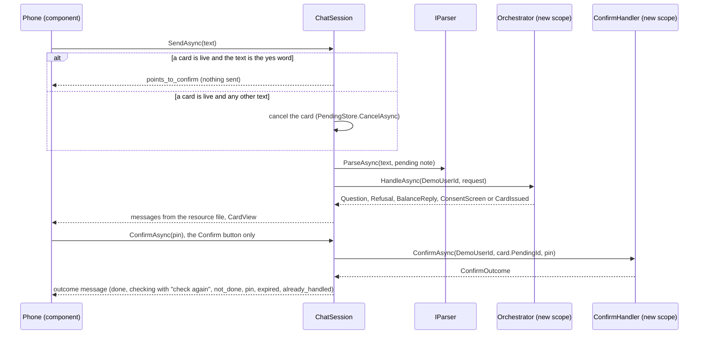

# Agent.Web: the console and the phone

What `src/Agent.Web` does as built in milestone 4, Task 2. It uses page layout B (D17): a side menu, the selected console component in the middle, the live trace, and the phone frame on the right. The page has one route, `/`, and uses global interactive server rendering. The agent's logic is in [agent-core.md](agent-core.md); `Agent.Web` references `Agent.Core` only.

## Services

`AddAgentWebServices(configuration)` (`Services/ServiceCollectionExtensions.cs`) is what `Program.cs` calls. It registers the following:

| Service | Lifetime | Role |
|---|---|---|
| `AddAgentCore` | as there | The agent, the wallet client, the hosted `PendingSweeper` |
| `IStringLocalizer<PhoneStrings>` (`AddLocalization`) | singleton | The phone strings in `Resources/PhoneStrings.resx` (rule 4). Every value is `TODO-AR`, for Khalil to write |
| `TraceLog` | scoped (one per circuit) | The circuit's live trace; it implements `ITraceSink` |
| `ITraceSink` | scoped | Inside an action's own scope, it returns `TraceLog.Current`, the circuit's log; otherwise it returns the scope's `TraceLog` |
| `IParser` → `ScriptedParser` | singleton | The parser until milestone 6. It is registered through a factory, because DI would otherwise pick the constructor that takes a sentence list and pass an empty one |
| `ChatSession` | scoped (one per circuit) | The phone's state and actions |
| `ConsoleNavigation` | scoped | The side menu's selection |

## The session

`ChatSession` holds the messages, the `CardView`, the card's status, the open question, the PIN-field flag and `Busy`. It raises `Changed` after every change. Components never see a `PendingRecord`, an idempotency key or a quoted balance.

Every action follows the same pattern:

1. Set `TraceLog.Current` to the circuit's log, so the agent's steps reach this circuit's trace.
2. Wait on the session's `SemaphoreSlim(1,1)`, so one action runs at a time.
3. Open its own `CreateAsyncScope()`, so no two UI events share a database context.
4. Resolve the agent's service from that scope.

The actions are `SendAsync`, `TapOptionAsync`, `GiveConsentAsync`, `ConfirmAsync`, `SettleAsync`, `CancelAsync` and `RefreshAsync`.

- **Words never execute (rule 1, D6).** A typed yes points to the button. The only methods in `Agent.Web` that reach the Confirm handler are `ChatSession.ConfirmAsync` (the card's Confirm button) and `ChatSession.SettleAsync` (the "check again" button). `NoTapNoMoneyTests.OnlyTheSessionsConfirmAndSettleCallTheConfirmHandlerFromTheWeb` checks this on the IL.
- **The yes and no words** are `Word_yes` and `Word_no` from the resource file. They are compared with the typed text after `ArabicText.Normalize`.
- **Option taps** are accepted only for a value the open question offered. Anything else is ignored and traced as `option_rejected`. A tapped option sends the original request again with that slot filled:
  - contact: the option's display text;
  - amount: the dinars;
  - operator: the provider code;
  - product: the product's provider, type and face value;
  - bill: its biller code and label;
  - `store:internet`: an internet purchase.
- **Typed answers** fill the missing amount or recipient, unless the text is a scripted sentence of its own. The amount accepts both digit forms.
- **The PIN** lives only in the card component's field and the Confirm call. The field is a password input with a numeric keypad and no autocomplete, and it is cleared after every call.
- **After an exception** from the handler, the session reads the record. If it is Pending, the reply is `not_done_nothing_taken`. Otherwise it is shown as checking, never as failed (rule 6).

## The phone frame

`Components/Phone` holds `PhoneFrame`, `ChatPanel`, `CardPanel`, `QuestionPanel` and `PinField`. The frame is 390 × 780, right to left (`dir="rtl"`, `lang="ar"`, inside `MudRTLProvider`).

- Figures go through `PhoneFormat`: Arabic-Indic digits, U+066C as the thousands separator, and the currency word `Currency_iqd`. The console uses ASCII digits.
- Names from the wallet render through Razor encoding inside `<bdi>`.
- The card's countdown is a one-second display tick against `ExpiresAt`. At zero it calls `RefreshAsync`, which marks the card expired; the buttons are then disabled.
- The `data-testid` attributes the journeys use are listed in the milestone 4 task 2 resolutions and appear on the elements in the components.

## The console

`Components/Console`:

- `WalletDataPanel` (read only): balance, contacts, bills and the last 20 history rows of `DemoUserId`. Each load goes through a fresh scope's `WalletClient`. It reloads after a Done outcome.
- `LiveTrace`: the circuit's trace, newest first, coloured by zone.
- `SettingsPlaceholder`: the settings, read only until milestone 7.
- `Placeholder`: Log (milestone 7) and Learning data (milestone 10).
