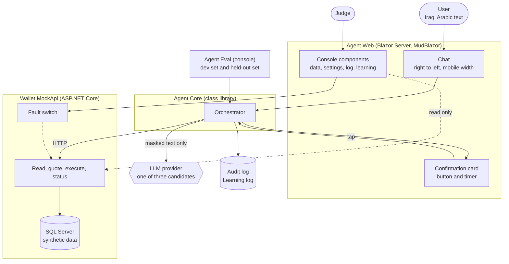
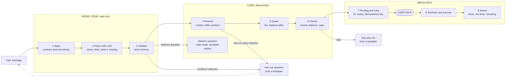
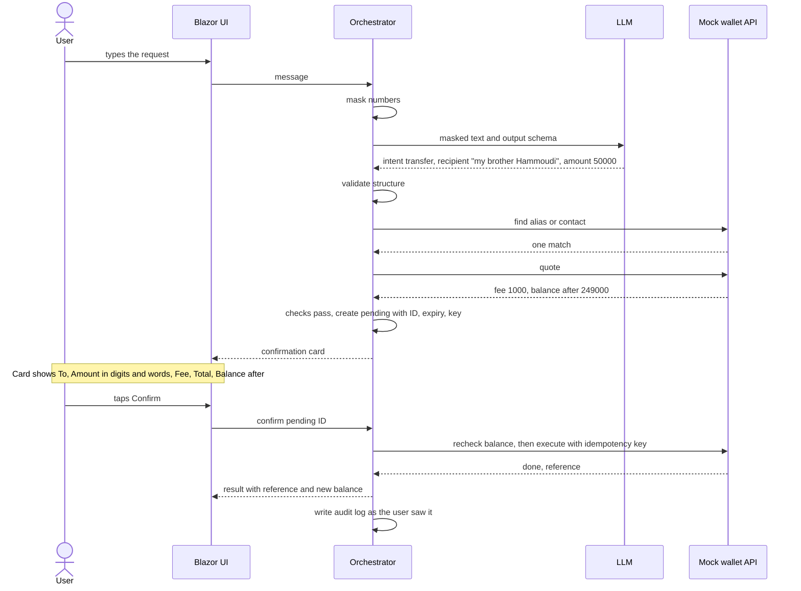
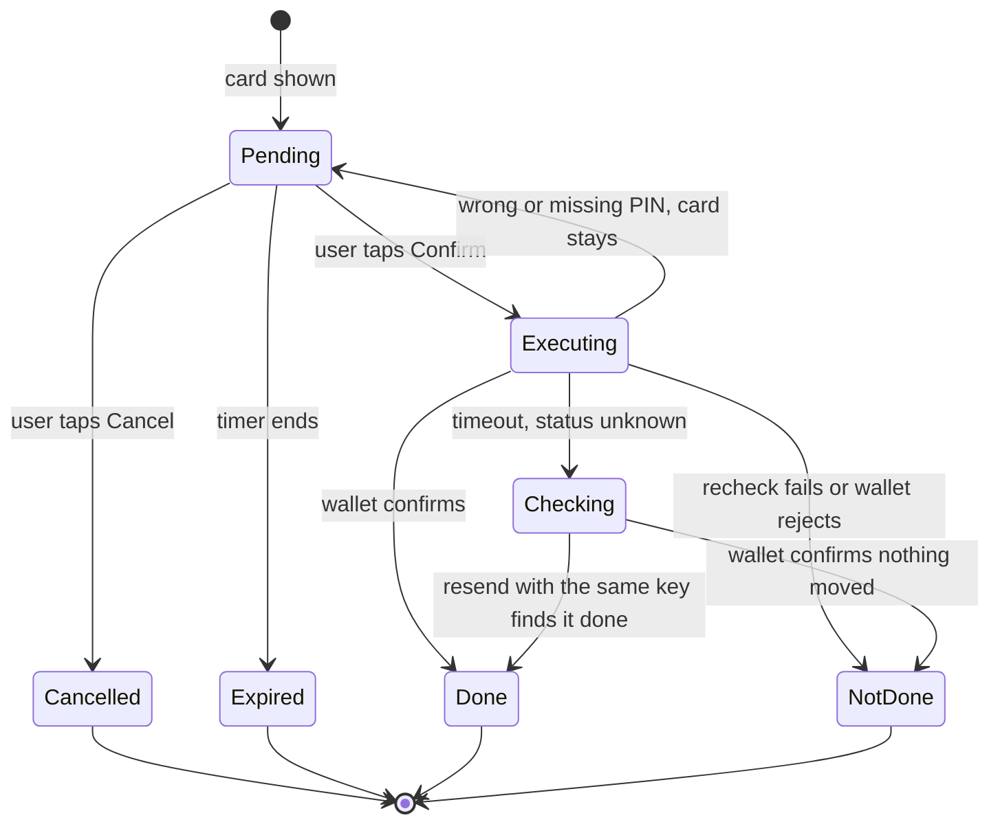

# Topic 04 · Bill Pay & Transfer Agent · Architecture

**Version 0.11, agreed in brainstorm and updated with the test-set session of 05/10/2026. The build plan is in `docs/build-plan.md`.** Built from the two submitted slides. The diagrams show what the slides already commit to; the decisions log at the end records how the open questions were settled.

## 1. What is already fixed

These come straight from the submission, so the architecture treats them as rules, not options.

| Rule | What it means in the build |
|---|---|
| No tap, no money | Only a button bound to one pending transaction can trigger an execute. Words never do. |
| The model is read only | It has no write tool. Its output is a strict structure that code validates. |
| The card is built by code | No field on the confirmation card comes from model text. |
| Replies are templates | Everything the agent says is written by an Iraqi, not generated. |
| Masking | Phone and account numbers are replaced with tokens before the model sees the text. It never sees balances. Account numbers are still masked even though they are not accepted as a recipient (D21), because a user may type one anyway. |
| Idempotency | Every execute carries a key. Unknown status is reported as "checking", never "failed". |
| Held-out test set | At least 50 requests committed to the repo before any tuning. |

## Decisions so far

| # | Decision | Why |
|---|---|---|
| D1 | **Parse only.** The model reads the message once and returns intent and slots through the tool-calling interface. Code does every lookup and treats the model's output as a request to check, not a command. | Money needs a deterministic path. A model mistake can only produce a wrong card or a question. The model never sees contact names, so that injection route is closed. |
| D2 | **Tap budget.** Clean request: one sentence and one tap. Ambiguous request: one sentence and two taps, a choice and then Confirm. More taps only on rare events (first-use consent, PIN on large amounts). | If it takes five or six presses, people will use what already exists. Every clarifying question is a cost. |
| D3 | **Ambiguity shows options to tap.** Each option shows the saved name, the registered name, and when the user last sent to that person and how much. No typed answers for choices. | Fewer keystrokes, and the model stays out of the choice. |
| D4 | **"Same as last time" is out of the first build.** Such requests go to the learning log. | Rarely used at the shop counter. The log will tell us if that changes. |
| D5 | **Minimal context.** The model sees the new message plus a one-line note of what is pending. Code holds the half-built request. The newest intent always wins and drops anything half-built. No memory of earlier transactions. | Smallest input for speed, cost and privacy. A missing amount stays missing, so the agent asks instead of borrowing a value from an earlier message. |
| D6 | **Typing while a card waits.** A new request cancels the card and starts fresh. A typed yes keeps the card and points to the Confirm button. A typed no cancels it. Anything unclear leaves the card until its timer ends. | Words can stop money but never move it. |
| D7 | **Compound requests.** The model always returns a list. Code shows separate cards in the order spoken, each with its own tap, and builds the next card only after the previous one is finished. A cancel, expiry or failure on one still leads to the next. A new request cancels the rest. Cap of three. | The brief names this edge case. Separate cards keep one button bound to one transaction. |
| D8 | **Limits are configuration.** PIN required above 1,000,000 IQD; most per transaction 5,000,000; most per day 10,000,000 (placeholders). The PIN is a field on the card, checked by the mock wallet, three attempts, never in the chat or the logs. | Promised on slide 2. Visible in the settings component so the step can be tested. |
| D9 | **One card frame for every request type.** Bill amounts come from the biller and are paid in full. Nothing due means no card. A request to pay part of a bill also gets no card: the reply says bills are paid in full and gives the full amount. | The user learns one pattern. Amounts never come from the model when data can supply them. |
| D10 | **One account per user in the first build.** The data model allows several, but each mock user has one default account. | Choosing an account would touch every flow. Listed as a known gap with its design. |
| D11 | **Store purchases are the third request type**, next to transfers and bills. Demo catalogue: operator phone credit and internet cards, in dinars. The price comes from the catalogue. Every purchase returns a code, shown with a copy button and kept under My orders in case the user misses it. Codes never reach the model, and logs keep only the last digits. | For many users "paying for the internet" means buying this month's card, not settling a bill. One delivery mode keeps the flow simple: we cannot cover everything, and the goal is fewer presses. |
| D12 | **Testing split.** Khalil explores by hand as the real user, with no expected results. The reported numbers come from a test set with an answer key, graded by code against card fields and final wallet state. A console runner does the 124 measured requests; Playwright covers 10 to 15 screen journeys (timer kills the button, double tap, options, right-to-left layout). A "save as test case" button grows the development set. **On every case the runner also** checks that the text sent to the model has no phone number, no account number and no balance; records the time and the cost; and checks the learning-log entry where the answer key expects one. | The brief asks for a held-out set and honest results. A percentage needs an answer key. Checking the outbound text on every case turns the masking rule into a measured result. |
| D13 | **Model selection rule, fixed before any run.** Fewest wrong cards on the development set wins. A close call goes to the cheaper or in-country model. The held-out set runs once, on the chosen model. | Promised on both slides. The task is simple extraction; the dialect is where models differ. |
| D14 | **Test set: 124 requests, 62 development and 62 held out,** in one Iraqi variety. Clean 34 (four of them balance questions), ambiguous 24, should not go through 16, malformed 14, compound 10, red team 10, fault injection 8, known gaps 8. About half transfers, a quarter bills, a quarter purchases. Claude drafts each case with its answer key; Khalil rewrites the wording. **The matching and question rules the answer keys assume** are on the Rules and Matching sheets of `zaincash_testset_v0.10.xlsx`. The resolver and the question logic follow those sheets, and a change to either means checking the answer keys again. | Larger shares where the main targets sit. Small categories are reported as counts, with their ranges. |
| D15 | **Aliases are distinct.** One alias points to one account. Offered only after a completed payment, saved only with approval, or managed in the directory. An exact match after Arabic normalising goes straight to the card; a near match shows options. A bare name shared by several contacts is never offered as an alias. Alias text never reaches the model. | The user tells the agent once. Convenience never overrides certainty. |
| D16 | **The card shows the alias with the registered name under it.** No stars and no last digits. A phone number the user typed is shown in full with its registered name and a "first time" line. | Nobody recognises a person by four digits. The registered name is the one line the user did not write, so it catches an alias saved against the wrong account. |
| D17 | **The page.** A phone frame on the right with the working chat. Beside it, separate components for wallet data, settings (limits and fault switch), the log, and learning data. A results component is optional, pending the organisers' guidance. **Layout B chosen:** a side menu, the selected component in the middle, and a live trace of the current request always visible next to the phone. Proposed for the UI/UX pass: the fault switch always at hand, and a count on Learning data in the menu. Built on a CSS grid with named areas, 21 Oct 2026. Layout canvas: <https://claude.ai/artifact/Mt1nfsHywss8aZSt1bbA16>. Earlier clickable mock: <https://claude.ai/artifact/GbN1NJnc9NhDmxdbz5mzBA> | One screen serves development, hand testing and the judges' live run. |
| D18 | **Stack: .NET 10, Blazor Server with MudBlazor, SQL Server through EF Core.** | Khalil's daily stack, so build time goes into the agent and not into tooling. |
| D19 | **Try again and Send again.** A card that expired, was cancelled or definitely failed shows "Try again". A completed payment shows "Send again", and the new card carries a line saying the same amount was just sent to this person. Both rebuild a card from the stored request in code, without the model: new pending ID, new idempotency key, new timer, fresh checks. Nothing moves until Confirm. Never offered while a payment is "checking". Only on the most recent card, and disabled while another card is live. | No retyping after a missed timer, and a deliberate repeat costs two taps. The wording tells the user whether money moved. |
| D20 | **Language.** Everything inside the phone frame is Iraqi Arabic, written by Khalil, with Arabic-Indic digits and a comma between the thousands (٢, ٥٠,٠٠٠; the comma from 22 Oct 2026, Khalil, in place of the raised U+066C). Typed input is accepted in either digit form. The rest of the page (grids, settings, log, learning data) is English. Phone strings live in one resource file. | The brief makes Iraqi Arabic the default for users. The console is for developers and judges. |
| D21 | **No QR scanning and no account-number entry.** A recipient is a saved contact, an alias, or a typed phone number. To reach someone new, the user types their phone number, or saves an alias for them and then asks for the transfer. Scanning stays with the QR feature the wallet apps already have. | Both are separate ways in, outside one sentence and one tap, and a phone number is what people hand over at the shop counter. This narrows slide 1, which listed numbers and QR in scope; slide 2 already had both on the cut list. |
| D22 | **The balance question is the fourth request type.** "شكد رصيدي" and similar. The model only recognises the question. Code reads the balance and fills a template. No card and no tap, because no money moves. Own balance only, and only after the first-use consent. The model never sees the number. | People ask what they have before they send or pay. It is read only, so the tap rule is untouched, and the figure goes from the wallet to the screen without passing through the model. |

**The console's own setting (UI pass).** `Console:GridPageSize`, in the console's own `Console` section beside `Console:WalletAdminKey`: how many rows every console grid and the phone's two lists show on one page, 5 to 100, default 10, editable live in the settings component like D8's limits. Nothing in `Agent.Core` reads it, so it never changes a check, a card or a reply (UI pass, decision 2 of `docs/plans/ui-pass.md`, 21 Oct 2026; for Khalil's approval).

**First stretch once the core passes its targets: voice.** Speech is turned into text before step 1 of the pipeline, and nothing after that changes. The card is still read and tapped. The aim is speak and pay.

**Where autonomy can grow later.** A model trained on real requests could earn more room on the read side: fewer questions, wider phrasing, blind lookups measured on the development set. The write side does not change with model quality. The tap stays.

## 2. System view

Four projects, one external dependency. The mock wallet is its own service so the agent talks to it over HTTP, the way it would talk to a real wallet.



The evaluation console drives the same orchestrator as the chat screen. The numbers we report therefore come from the code the judges see running, not from a separate test path.

## 3. Request pipeline and the trust boundary

This is the centre of the design. The model sits in the first box only. Everything after it is ordinary code, and the write path can only be entered by the user's tap.



A model error can only produce a wrong card or an unnecessary question. It cannot move money, because there is no path from steps 1 to 3 into step 8 that skips the tap.

A balance question (D22) leaves the pipeline after step 3. Code checks that the user has given consent, reads their own balance from the wallet and fills a template. There is no pending record, no card and no tap. The number never passes through the model in either direction.

## 4. One request, traced

The example from slide 1: "send fifty thousand to my brother Hammoudi".



## 5. Life of a pending transaction

Every card is one pending record. The states below are what the audit log stores and what the failure handling is built on.



Two properties to keep: a pending record can leave `Pending` only once, so a double tap does nothing; and a retry from `Checking` always reuses the same key, so the wallet can never execute it twice. A `Checking` record is settled by resending the same request under the same key, not by a lookup alone: a lookup can say "not found" while the wallet is still writing the row, whereas a resend either replays the stored outcome or runs once. A wrong or missing PIN sends the record back to `Pending` with its timer and key unchanged, so the user can enter the PIN again on the same card (added 14 Oct 2026, milestone 3).

"Try again" and "Send again" (D19) do not reopen a finished record. They start a new one at `Pending`, with its own ID and key.

## 6. Solution layout

```text
zaincash-agent/
  src/
    Wallet.MockApi/     ASP.NET Core minimal API, EF Core with SQL Server, fault switch
    Agent.Core/         orchestrator, masker, parser client, validator, resolver,
                        checks, pending store, executor, templates
    Agent.Web/          Blazor Server with MudBlazor: phone chat, card, console components
      wwwroot/fonts/    Noto Naskh Arabic regular and bold (woff2) and its OFL.txt, the phone's font, self-hosted
    Agent.Eval/         console: runs the test sets, writes the results report
  tests/
    Agent.Core.Tests/   normalisation, matching, expiry, idempotency
    Agent.Web.Journeys/ Playwright screen journeys on the scripted parser (76 tests on 22 Oct 2026: 74 journeys, the host test and the screenshot helper)
  data/
    seed/               synthetic users, contacts, billers, history
    requests.dev.jsonl        96 requests (Khalil's 72, ADD-01 to ADD-24)
    requests.heldout.jsonl    62 requests, committed before tuning
  docs/
    architecture.md     this file
    failure-modes.md
    disclosure.md
```

## 7. Mock wallet API, first draft

The built contract, with every route, field and error code, is `docs/wallet-api.md`; this section is the first draft.

| Endpoint | Purpose |
|---|---|
| `GET /users/{id}/contacts?q=` | Search contacts and aliases |
| `GET /users/{id}/bills` | Biller accounts with the amount due |
| `GET /users/{id}/balance` | Current balance, used by code only: for checks and for the balance reply (D22) |
| `GET /users/{id}/history?to=` | Past transactions, for "when you last sent" and duplicate warnings |
| `GET /store/products?provider=&type=&value=` | Store catalogue: operator credit and internet cards |
| `GET /users/{id}/orders` | My orders: past purchases, to find a code again |
| `POST /quotes` | Fee, total and balance after. No money moves |
| `POST /transactions` | Execute a transfer, bill payment or purchase. Requires an `Idempotency-Key` header |
| `GET /transactions/by-key/{key}` | Status lookup after a timeout |
| `POST /admin/faults` | Inject timeout, error or slow response |
| `POST /admin/reset` | Reload the seed data |

## 8. Technology

| Part | Proposal | Why |
|---|---|---|
| Runtime | .NET 10 | The current long-term release and Khalil's daily stack |
| UI | Blazor Server with MudBlazor 9 | MudBlazor 9 supports .NET 8, 9 and 10. Tabs, data grids and form fields come ready-made, so effort goes into the card and the chat |
| Right to left | The phone frame is wrapped in MudBlazor's right-to-left provider; the console stays left to right | Arabic chat and an English console on one page |
| Model access | One provider-neutral chat interface (Microsoft.Extensions.AI) | Swapping the three candidates becomes configuration, not code |
| Storage | SQL Server through EF Core, created and seeded by migrations | Familiar, and closer to what a real wallet would run. Costs one thing: anyone running the repo needs a SQL Server instance |
| Logs | Two tables in the same database | Audit log and learning log are queryable from the page |
| Screen tests | Playwright for .NET | Proves what only a screen can show |

## Known gaps, reported on purpose

These are limits we chose, not bugs. Each one fails safely today, is counted in the learning log, and has a named fix.

| Gap | What the agent does today | How it would be fixed |
|---|---|---|
| "Same as last time", "like last month" | Refused with no card; the reply asks for the whole request again and the reason is logged. "Send again" on the last receipt covers the commonest case | A small fixed set of references that code resolves from history |
| Follow-ups that point back in the chat ("send him fifty more", "the same to Ali") | Refused with no card (`refers_back`); the reply asks for the whole request again | Code keeps a reference to the last completed transaction; wider context only if measured safe on the development set |
| Amending a card in words ("make it sixty") | The user cancels and says it again | An amend intent that kills the old card and builds a new one with a new pending ID |
| Users who cannot read the card | Not served in phase one | Voice input and a read-aloud card |
| Other Iraqi varieties (Moslawi, southern) and Kurdish | The first build is written and tested in one variety. Others may already work but are not measured | Add test cases per variety, then choose or tune a model on them |
| Several accounts and choosing where the money comes from | Uses the one default account | A "From" line on the card that the user taps to change; the data model already allows several accounts |
| Moving money between the user's own accounts | Not offered | Reuses the transfer flow with the user's own account as recipient |
| Paying part of a bill | No card. The reply says bills are paid in full and gives the full amount | An amount field on bill cards where the biller allows it |
| Credit delivered straight to the user's own number | Refused with no card; the reason `credit_to_own_number` is logged (GAP-06, milestone 10) | A delivery line on the card; code checks that the operator matches the number |
| Other goods and services in the store | "Not available", logged | More catalogue rows; the mechanism is the same |
| Scanning a QR code | Not offered. The user types the phone number, or uses a saved alias | Left to the wallet app's own QR feature. If wanted later, a scan feeds the same path as a typed phone number |
| Sending to an account number | Not offered. No card; the reply asks for a phone number or a saved name | Resolve the account number in code to its registered name, then the same path as a typed phone number |
| Currencies other than dinars | Out of scope | Add when the wallet supports them |

To turn this from a claim into evidence, the test set can carry a small "known gap" category, with the pass mark being a safe reply and no card.

## If time runs short, cut in this order

1.  Model comparison shrinks to two candidates.
2.  Compound requests become "one at a time, please".
3.  Store purchases are dropped and listed as a known gap.
4.  Aliases fall back to asking every time.

Already taken from the slide 2 cut list: account-number and QR entry (D21).

Never cut: tap binding, idempotency, honest failure messages, consent screen, held-out test set.

## 9. Decisions log

The questions this section once held, as they were settled. Items 1 to 10 were decided in the design sessions before the repository was created and are recorded in architecture v0.11 (5 Oct 2026), first committed in 763d870 (14 Oct 2026). Items 11 to 15 were settled during the build; the open items table of `docs/build-plan.md` records the same rulings. What is still open is in `docs/known-gaps.md`.

| # | Question | Resolved | Where decided |
|---|---|---|---|
| 1 | Tool calling, or one parse call? | 5 Oct 2026, first committed 14 Oct (763d870): one parse call | D1, this file |
| 2 | How does the user answer a question? | 5 Oct 2026, first committed 14 Oct (763d870): options to tap | D3, this file |
| 3 | How much conversation does the model see? | 5 Oct 2026, first committed 14 Oct (763d870): the new message and a one-line note of what is pending | D5, this file |
| 4 | A new message while a card is waiting | 5 Oct 2026, first committed 14 Oct (763d870) | D6, this file |
| 5 | Compound requests | 5 Oct 2026, first committed 14 Oct (763d870) | D7, this file |
| 6 | PIN above 1,000,000 IQD | 5 Oct 2026, first committed 14 Oct (763d870) | D8, this file |
| 7 | Bills and top-ups | 5 Oct 2026, first committed 14 Oct (763d870) | D9 and D11, this file |
| 8 | Purchase delivery rule | 5 Oct 2026, first committed 14 Oct (763d870): always a code | D11, this file |
| 9 | Simulating the tap in the test run | 5 Oct 2026, first committed 14 Oct (763d870) | D12, this file |
| 10 | Judge-supplied input | 5 Oct 2026, first committed 14 Oct (763d870): the judge types in the phone and sees the wallet data, the log and the learning data beside it | D17, this file |
| 11 | Where the demo runs: Khalil's laptop or a hosted copy | 16 Oct 2026: Khalil's laptop. Confirmation with the organisers is still open, see `docs/known-gaps.md` row 46 | `docs/build-plan.md`, open items (e65a2b2) |
| 12 | Results component in the page | 16 Oct 2026: a console panel showing the latest report's targets table, built in milestone 10 (not yet built: `docs/known-gaps.md` row 20) | `docs/build-plan.md`, open items (e65a2b2) |
| 13 | SQL Server for other people | 14 Oct 2026: the connection string is configuration; `README.md` gives two routes, LocalDB on Windows or SQL Server in a container, and one command creates and seeds the database | `README.md` (7d54c9d) |
| 14 | Rules for Claude Code without the held-out cases | 14 Oct 2026: the Rules and Matching sheets exported to `docs/matching-rules.md`; the workbook stays out of the coding sessions (`CLAUDE.md` rule 7) | `docs/matching-rules.md` (462187f) |
| 15 | What the audit log keeps for a balance reply | 14 Oct 2026: that the balance was shown and when, not the figure | `docs/plans/milestone-3-write-path.md` (8c730f1); built as the `balance_shown` audit event (dec55e4) |
