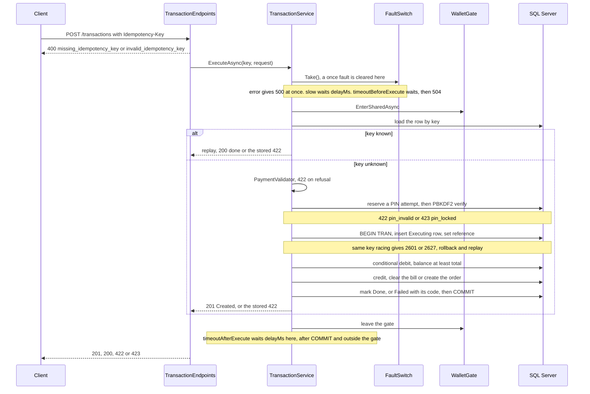
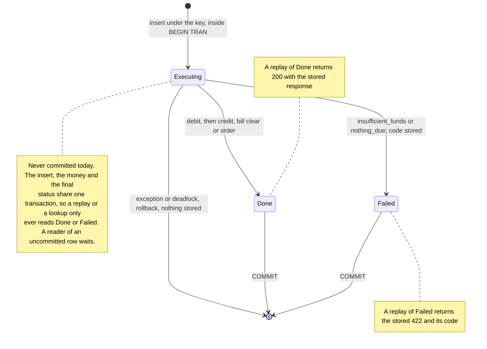
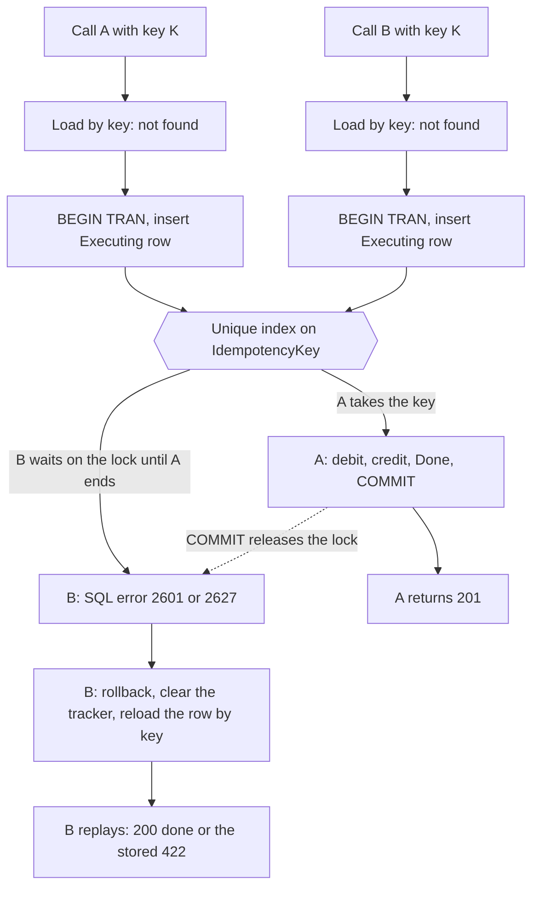
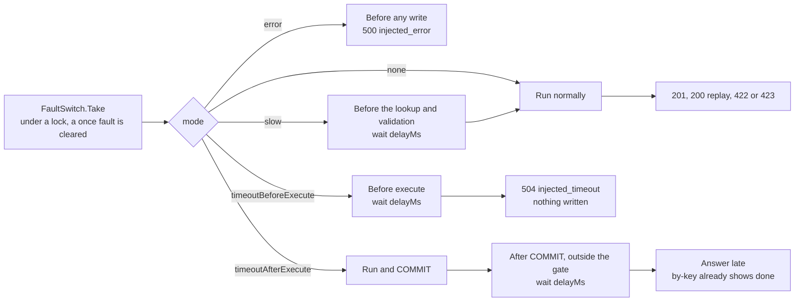
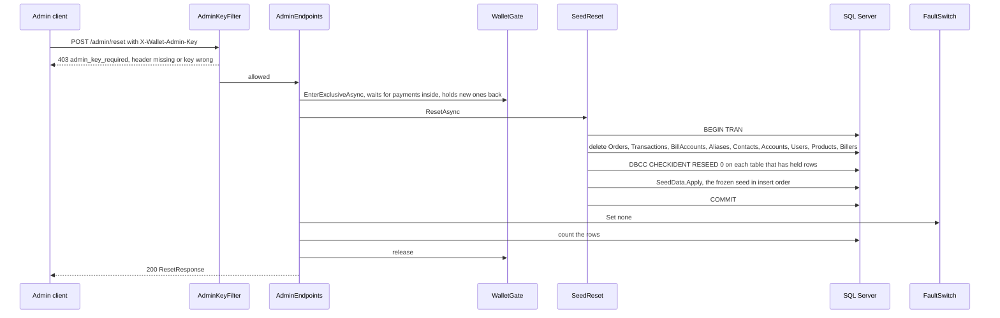

# Mock wallet API

The mock wallet stands in for the ZainCash wallet. The agent talks to it over HTTP only. It is a minimal API in `src/Wallet.MockApi`, backed by SQL Server through EF Core, and it starts from the frozen synthetic seed described in [data/seed/README.md](../data/seed/README.md). The first draft of the endpoint list is section 7 of [architecture.md](architecture.md); this file is the contract as built in milestone 2.

Every request below is in [src/Wallet.MockApi/Wallet.MockApi.http](../src/Wallet.MockApi/Wallet.MockApi.http), ready to send from Visual Studio or VS Code with the REST Client extension.

## Running it

```powershell
dotnet run --project src/Wallet.MockApi -- migrate   # create and seed the database, then exit
dotnet run --project src/Wallet.MockApi              # serve on http://localhost:5276
```

The API serves plain HTTP on loopback and does not redirect to HTTPS. `GET /health` returns `ok`. In Development the OpenAPI document is at `/openapi/v1.json`. The connection string and the database routes are in [README.md](../README.md#database).

## Conventions

- JSON in both directions, camelCase property names (the ASP.NET Core web defaults).
- Amounts are whole Iraqi dinars, as integers, in fields ending `Iqd`.
- Times are `DateTimeOffset` in ISO 8601. Seeded rows carry the seed's offset (`+03:00`); rows and clocks written at run time are UTC (`+00:00`). Treat every time as an instant and compare instants, never the text. Bill due dates are dates only (`2026-10-25`) or `null`.
- Every name the wallet puts on the wire for a type, status or kind is lower case: transaction types `transfer`, `bill`, `purchase`; statuses `executing`, `done`, `failed`; product types `credit`, `internet`. Fault modes are camelCase (`timeoutAfterExecute`).
- Every user has exactly one default account (D10). Payments are paid from it, and a phone number reaches its holder's default account. In the seed, account ids equal user ids.
- Errors are RFC 7807 ProblemDetails (`application/problem+json`). Every error the wallet raises itself carries a machine-readable `code` extension and a fixed English `title`; nothing from the request is echoed back. The agent branches on `code`, never on `title`. The exceptions are errors raised by ASP.NET Core itself: a body that is not valid JSON (400), a route that does not match (404), and an unhandled exception or a lost database connection (500). These are ProblemDetails too, but without `code`.

## Endpoints

| Method and route | Purpose | Success | Errors |
|---|---|---|---|
| `GET /health` | Liveness | 200 `ok` (text) | none |
| `GET /users/{id}` | One user | 200 `UserSummary` | 404 `unknown_user` |
| `GET /users/by-phone/{phone}` | The user behind a phone number (exact match) | 200 `UserSummary` | 404 `unknown_user` |
| `GET /users/{id}/contacts?q=` | Contacts and aliases, optionally filtered | 200 `ContactsResponse` | 404 `unknown_user` |
| `GET /users/{id}/bills` | Bill accounts with the amount due | 200 `BillItem[]` | 404 `unknown_user` |
| `GET /users/{id}/balance` | Balance of the default account (D22) | 200 `BalanceResponse` | 404 `unknown_user` |
| `GET /users/{id}/history?to=&since=&take=` | Transactions the user paid, newest first | 200 `HistoryItem[]` | 404 `unknown_user` |
| `GET /store/products?provider=&type=&value=` | Store catalogue (D11) | 200 `ProductItem[]` | none |
| `GET /users/{id}/orders` | Past purchases and their purchase codes, newest first | 200 `OrderItem[]` | 404 `unknown_user` |
| `POST /quotes` | Fee, total and balance after. No money moves | 200 `QuoteResponse` | 422 |
| `POST /transactions` | Execute a transfer, bill payment or purchase. Needs `Idempotency-Key` | 201 `TransactionResponse` (new), 200 (replay) | 400, 422, 423, 500, 504 (409 reserved) |
| `GET /transactions/by-key/{key}` | Outcome of a key, for display after a timeout | 200 `TransactionResponse` | 404 `unknown_key` |
| `GET /admin/faults` | Current fault switch | 200 `FaultState` | 403 |
| `POST /admin/faults` | Set the fault switch | 200 `FaultState` | 403, 422 |
| `POST /admin/reset` | Restore the seed, clear faults | 200 `ResetResponse` | 403 |

`{id}` is an integer; a path with a non-integer id matches no route and returns a ProblemDetails 404 from ASP.NET Core, without `code`.

### The user 404

Every `/users/...` read route answers a user that does not exist with the same ProblemDetails: status 404, `code` `unknown_user`, title `User not found`. It is built by `WalletProblems.UserNotFound`, like every other wallet error. Quote and execute use the same code for an unknown payer, there as 422. `GET /users/{id}/balance` treats "no default account" as "no such user".

### Read endpoints

`GET /users/{id}` and `GET /users/by-phone/{phone}` return `UserSummary`:

| Field | Type | Notes |
|---|---|---|
| `id` | int | |
| `phone` | string | `07700001001` form |
| `registeredName` | string | The name the wallet holds, in Arabic |

`GET /users/{id}/contacts?q=` returns `ContactsResponse` = `{ contacts: ContactItem[], aliases: AliasItem[] }`. `q` is a raw, case-insensitive substring match on the contact's saved name and on the alias text. The wallet does no Arabic normalising; that is the agent's job. Without `q`, everything is returned. Both lists are ordered by id.

`ContactItem`:

| Field | Type | Notes |
|---|---|---|
| `contactId` | int | |
| `savedName` | string | The name the user saved |
| `phone` | string | |
| `registeredName` | string | The wallet holder behind the phone |
| `targetAccountId` | int | That holder's default account |
| `lastSentAt` | DateTimeOffset or null | Latest `done` transfer from this user to that account (D3) |
| `lastSentAmountIqd` | long or null | Its amount |

`AliasItem` (one alias, one account, D15):

| Field | Type |
|---|---|
| `aliasId` | int |
| `text` | string |
| `targetAccountId` | int |
| `phone` | string |
| `registeredName` | string |

`GET /users/{id}/bills` returns `BillItem[]`, ordered by id:

| Field | Type | Notes |
|---|---|---|
| `billAccountId` | int | Use as `billAccountId` in a payment |
| `billerCode` | string | `electricity`, `water`, `internet` |
| `billerName` | string | Arabic |
| `label` | string | The user's label for the account, Arabic |
| `accountNumber` | string | |
| `amountDueIqd` | long | Zero means nothing is due |
| `dueDate` | date or null | |

`GET /users/{id}/balance` returns `BalanceResponse`: `accountId` (int), `balanceIqd` (long), `asOf` (DateTimeOffset, the server's clock). Code reads it for checks and the balance reply; it never reaches the model (CLAUDE.md, rule 5).

`GET /users/{id}/history` returns `HistoryItem[]`, the transactions the user paid, of every status, newest first (`createdAt`, then id).

| Query | Effect |
|---|---|
| `to` | Phone number. Only transfers to that phone holder's default account |
| `since` | DateTimeOffset. Only transactions created at or after it |
| `take` | Number of items. Default 50, clamped to 1..200 |

| Field | Type | Notes |
|---|---|---|
| `transactionId` | int | |
| `reference` | string | `ZC-` and the id padded to 10 digits |
| `type` | string | `transfer`, `bill`, `purchase` |
| `status` | string | `executing`, `done`, `failed` |
| `amountIqd`, `feeIqd`, `totalIqd` | long | |
| `counterpartyPhone`, `counterpartyName` | string or null | Transfers only: the recipient |
| `billAccountId` | int or null | Bills only |
| `productId` | int or null | Purchases only |
| `createdAt` | DateTimeOffset | |

History, products, quotes and transactions all use the same lower-case names.

`GET /store/products` returns `ProductItem[]`, ordered by id. All filters are optional and combine:

| Query | Effect |
|---|---|
| `provider` | Case-insensitive exact match: `Zain`, `Asiacell`, `Korek` |
| `type` | `credit` or `internet`, any case. An unknown name or a number returns an empty list |
| `value` | Exact face value in IQD. Internet cards have face value 0 |

Fields: `productId` (int), `provider`, `type` (`credit` or `internet`), `name` (Arabic), `faceValueIqd` (long), `priceIqd` (long).

`GET /users/{id}/orders` returns `OrderItem[]`, newest first: `orderId`, `transactionId`, `productId`, `productName`, `code` (the purchase code), `createdAt`. Purchase codes are for code and the card only, never for the model (rule 5).

### Payment request

`POST /quotes` and `POST /transactions` take the same body, `PaymentRequest`:

| Field | Type | Used by |
|---|---|---|
| `userId` | int | All. The payer |
| `type` | string | All. Exactly `transfer`, `bill` or `purchase` (lower case) |
| `amountIqd` | long or null | Transfer: required, above 0. Bill: optional, must equal the amount due (D9). Purchase: optional, must equal the price (D11) |
| `toPhone` | string or null | Transfer: recipient by phone (their default account) |
| `toAccountId` | int or null | Transfer: recipient by account. If both are sent, both must name the same account |
| `billAccountId` | int or null | Bill: one of the payer's own bill accounts |
| `productId` | int or null | Purchase |
| `pin` | string or null | Execute only; see PIN rules. Ignored by quotes |

Examples, all for the demo user 1:

```json
{ "userId": 1, "type": "transfer", "amountIqd": 50000, "toPhone": "07700001004" }
{ "userId": 1, "type": "bill", "billAccountId": 1 }
{ "userId": 1, "type": "purchase", "productId": 1 }
```

Fees are flat per type and come from configuration: `Wallet:TransferFeeIqd` (1,000), `Wallet:BillFeeIqd` (500), `Wallet:PurchaseFeeIqd` (0). Total = amount + fee. The amount of a bill and of a purchase always comes from the wallet's data, never from the request. (The seeded history uses its own frozen fee constants, so a configuration change never rewrites it.)

Checks, in order (the same for quote and execute, in `PaymentValidator`):

1. `type` is one of the three names, else `invalid_type`.
2. The payer exists, else `unknown_user`.
3. Transfer: `amountIqd` above 0, else `invalid_amount`; a recipient is given and exists, else `unknown_recipient`; the recipient is not the payer's own account, else `same_account`.
4. Bill: the bill account exists and belongs to the payer, else `unknown_recipient`; something is due, else `nothing_due`; an `amountIqd` other than the amount due gives `bills_paid_in_full` with `amountDueIqd`.
5. Purchase: the product exists, else `unknown_product`; an `amountIqd` other than the price gives `invalid_amount`.
6. Amount plus fee would overflow: `invalid_amount`.

Funds are not checked here. A quote never refuses for funds; only execute does, at the moment of the debit.

### `POST /quotes`

Returns 200 `QuoteResponse`. No money moves and nothing is written.

| Field | Type | Notes |
|---|---|---|
| `type` | string | `transfer`, `bill`, `purchase` |
| `amountIqd`, `feeIqd`, `totalIqd` | long | |
| `balanceBeforeIqd` | long | Payer's balance now |
| `balanceAfterIqd` | long | Before minus total. Negative when funds are short |
| `sufficient` | bool | Balance covers the total |
| `pinRequired` | bool | Total above `Wallet:PinRequiredAboveIqd` |
| `recipientPhone`, `recipientName` | string or null | Transfers only; the registered name |
| `billAccountId` | int or null | Bills only |
| `productId` | int or null | Purchases only |

Example: user 1 sends 50,000 to Hammoudi (07700001004): fee 1,000, total 51,000, balance 300,000 before and 249,000 after, `sufficient` true, `pinRequired` false (`QuoteTests.TransferQuoteToHammoudiMatchesTheSlideExample`).

### `POST /transactions`

The only endpoint that moves money. Header `Idempotency-Key` is required. A missing, empty or whitespace key is 400 `missing_idempotency_key`; a key that does not match `^[A-Za-z0-9_-]{1,64}$` (ASCII letters, digits, `_` and `-`, 1 to 64 characters) is 400 `invalid_idempotency_key`. Both are checked before anything else, before the fault switch, so a 400 does not use up a `once` fault. Use a lower-case GUID (`Guid.NewGuid().ToString("N")`).

| Status | When | Body |
|---|---|---|
| 201 Created | The payment ran now. `Location: /transactions/by-key/{key}` | `TransactionResponse`, `status` `done` |
| 200 OK | The key was used before and that payment is `done` (replay) | The stored `TransactionResponse` |
| 400 | `missing_idempotency_key`, `invalid_idempotency_key` | ProblemDetails |
| 409 | `in_progress`: reserved for a key whose payment is still executing. Not produced today (see the transaction row below) | ProblemDetails |
| 422 | Validation codes above, `insufficient_funds`, `pin_required`, `pin_invalid` | ProblemDetails |
| 423 | `pin_locked` | ProblemDetails |
| 500 with `code` | `injected_error` (fault switch). Nothing was written | ProblemDetails |
| 500 without `code` | Deadlock victim, lost database connection, unhandled exception. The outcome is unknown | ProblemDetails |
| 504 | `injected_timeout` (fault switch). Nothing was written | ProblemDetails |

**Unknown outcomes.** Any 500 without a `code` extension, and any transport failure (timeout, dropped connection, no response), means the client does not know whether the money moved. The record goes to Checking, never to Failed (CLAUDE.md, rule 6). Settle it by resending the same body with the same key: it executes once or replays the stored outcome (201 or 200 means done, a stored 422 means failed, 409 means keep checking). `GET /transactions/by-key/{key}` may be used for display while checking, but its 404 is final only once the original call has definitely ended (see below).

`TransactionResponse`:

| Field | Type | Notes |
|---|---|---|
| `transactionId` | int | |
| `reference` | string | `ZC-` and the id padded to 10 digits |
| `type` | string | `transfer`, `bill`, `purchase` |
| `status` | string | `executing`, `done`, `failed` |
| `amountIqd`, `feeIqd`, `totalIqd` | long | |
| `balanceAfterIqd` | long | Payer's balance when this response was made (for a replay or lookup, the balance now) |
| `code` | string or null | Purchase code, purchases only |
| `completedAt` | DateTimeOffset | Completion time, or creation time while executing |
| `errorCode` | string or null | The stored refusal code of a `failed` row (`insufficient_funds` or `nothing_due`); null otherwise. Filled on by-key lookups (a replay of a failed row returns the 422 instead) |

What execute does, in order (`TransactionService.ExecuteAsync`):

1. Takes the fault switch (see Faults). With `once`, this clears it, whatever happens next.
2. Enters the `WalletGate` shared, so a reset never runs in the middle of the payment.
3. Looks the key up. A known key replays its stored outcome at once (see Idempotency): no validation, no PIN check, no insert.
4. Validates as above. A refusal looks the key up once more (a call with the same key may have committed meanwhile) and replays if it is now known.
5. Checks the PIN if one was sent or one is required: reserves an attempt first, then verifies (see PIN rules).
6. In one database transaction (read committed): inserts the transaction row as `executing` under the key; debits the payer with one conditional update (`balance >= total`); then credits the recipient (transfer), clears the amount due only if it still equals the quoted amount (bill), or creates the order with a new purchase code (purchase); marks the row `done` and commits.
7. If the debit finds the balance short, the row is stored as `failed` with `insufficient_funds` and committed, and 422 is returned. If the bill was already cleared by another payment, the debit is refunded in the same transaction and the row is stored as `failed` with `nothing_due`.
8. From the debit on, the rest of the work and the commit run without the request's cancellation token, so a caller who disconnects cannot cancel the commit half-way; the outcome is stored either way and found by its key.



A transaction row, from insert to commit:



### `GET /transactions/by-key/{key}`

Returns 200 with the `TransactionResponse` stored under the key, whatever its status (`executing`, `done` or `failed`; a failed one carries the amounts, no purchase code, and its `errorCode`). An unknown key, or a key that does not match the key format, is 404 `unknown_key`.

A 404 is final only once the original call has definitely ended. It means the key has not been written yet: with the `slow` fault the delay comes before the insert, and a request still in transit behaves the same, so a client that gave up early can see 404 and then, a moment later, a `done` row. The safe way to settle an unknown outcome is to resend the same body with the same key (above); by-key is for display while the record is Checking (CLAUDE.md, rule 6).

## Error codes

Every code is the `code` extension of a ProblemDetails. Source: `PaymentErrors` and `PaymentValidator` (`Services/PaymentValidator.cs`), `FaultErrors` (`Services/FaultSwitch.cs`), `AdminErrors` (`Endpoints/AdminEndpoints.cs`); titles in `Endpoints/WalletProblems.cs`.

| Code | Status | Raised by | Meaning | Extensions |
|---|---|---|---|---|
| `missing_idempotency_key` | 400 | execute | Header missing, empty or whitespace | |
| `invalid_idempotency_key` | 400 | execute | Header present but not `^[A-Za-z0-9_-]{1,64}$` | |
| `invalid_type` | 422 | quote, execute | `type` is not `transfer`, `bill` or `purchase` | |
| `unknown_user` | 422 / 404 | quote, execute (422); every `/users/...` read (404) | The payer, or the user asked for, does not exist | |
| `unknown_recipient` | 422 | quote, execute | Transfer recipient missing or unknown; bill account missing or not the payer's | |
| `same_account` | 422 | quote, execute | Transfer to the payer's own account | |
| `invalid_amount` | 422 | quote, execute | Transfer amount not above 0; purchase amount not the price; total would overflow | |
| `nothing_due` | 422 | quote, execute | The bill has nothing due (also stored when a concurrent payment cleared it first) | |
| `bills_paid_in_full` | 422 | quote, execute | An amount other than the amount due was sent for a bill (D9) | `amountDueIqd` |
| `unknown_product` | 422 | quote, execute | Product missing or unknown | |
| `insufficient_funds` | 422 | execute | The balance does not cover the total at the moment of the debit. Stored against the key | |
| `pin_required` | 422 | execute | Total above the PIN threshold and no PIN sent | |
| `pin_invalid` | 422 | execute | Wrong PIN | `attemptsLeft` |
| `pin_locked` | 423 | execute | The user's PIN is locked | |
| `in_progress` | 409 | execute | Reserved: the key's payment is still executing. Not produced today | |
| `unknown_key` | 404 | by-key | No transaction has this key, or the key is malformed | |
| `injected_error` | 500 | execute | Fault switch, mode `error` | |
| `injected_timeout` | 504 | execute | Fault switch, mode `timeoutBeforeExecute` | |
| `admin_key_required` | 403 | `/admin/*` | Admin header missing, or wrong key, or no key configured outside Development | |
| `invalid_fault_mode` | 422 | `POST /admin/faults` | Unknown mode name | |
| `invalid_fault_delay` | 422 | `POST /admin/faults` | `delayMs` below 0 or above 600,000 | |

A ProblemDetails without `code` comes from ASP.NET Core, not from the wallet's rules (see Conventions). On execute, a 500 without `code` means the outcome is unknown.

## Idempotency

- The key is the `Idempotency-Key` header: 1 to 64 characters of `A-Z`, `a-z`, `0-9`, `_` and `-`. It is unique in the database (a unique index on `Transactions.IdempotencyKey`). Keys compare under the database collation, which is case-insensitive by default, so `AbC` and `abc` are one key; that is the safe direction (a retry can never run twice). Use lower-case GUIDs.
- The outcome is keyed by the header only: a retry with the same key and a different body gets the first outcome, not a new payment.
- A key executes at most once. A call with a used key is looked up first, inside the gate, and returns the stored outcome without running again:
  - stored `done`: 200 with the stored `TransactionResponse` (`balanceAfterIqd` is the balance now);
  - stored `failed`: the original 422 with its stored code (`insufficient_funds` or `nothing_due`);
  - `executing` would be 409 `in_progress`, but an executing row is never committed, so this is not produced today.
- The lookup comes before validation and before the PIN check, so a retry never depends on data the first call changed (a paid bill now has nothing due), and a PIN sent with a known key costs no attempt and changes no user row.
- Two calls with the same key at the same time: both find the key unknown; one insert wins; the other waits on the unique index until the first transaction ends, gets SQL error 2601/2627, and replays the stored outcome. Money moves once (`TransactionTests.SameKeyTwiceExecutesOnce`, `TwoConcurrentCallsWithTheSameKeyExecuteOnce`).



- Only an attempt that reached the database insert is recorded. Refusals by validation or the PIN rules, and the `error` and `timeoutBeforeExecute` faults, write nothing: the key stays unknown (`by-key` is 404) and a retry with the same key runs normally.
- The fault switch is taken before the lookup, so a replay also consumes a `once` fault (and, under `error`, a replay returns the injected 500).
- The agent sends one key per pending record and reuses it on every retry (CLAUDE.md, rule 6).

## PIN rules (D8)

- A PIN is required when the total is above `Wallet:PinRequiredAboveIqd` (1,000,000). The quote reports this as `pinRequired`.
- The PIN is checked on execute only, and only when one is sent or one is required. A PIN sent on a small payment is still verified.
- Every seeded PIN is `1234`, stored only as a salted PBKDF2 hash.
- Each check first reserves an attempt: one conditional update on the user row that succeeds only while the PIN is unlocked and the failed count is still the one just read, raises the count by one, and locks the PIN when that is the last allowed attempt. Only then does the slow PBKDF2 check run. Concurrent guesses therefore cannot all see the PIN unlocked: at most `Wallet:MaxPinAttempts` wrong PINs are checked before the lock, however many arrive together (`TransactionTests.ConcurrentWrongPinsCannotExceedTheLockout`).
- A wrong PIN is 422 `pin_invalid` with `attemptsLeft`, counted from that reservation. After `Wallet:MaxPinAttempts` (3) wrong entries the PIN is locked: the call that uses the last attempt still answers `pin_invalid` with `attemptsLeft: 0`, and every later call that checks the PIN, even with the right PIN, is 423 `pin_locked` (`TransactionTests.ThreeWrongPinsLockTheUser`).
- A right PIN gives its attempt back: it resets the count, and clears the lock only when its own reservation set it (it held the last attempt). A lock set by other wrong PINs after its reservation stands. Only `POST /admin/reset` unlocks a locked PIN.
- The PIN is never echoed in any response and never logged (`PaymentRequest.ToString()` leaves it out; the log lines carry the user id and attempt count only).

## Balance floor

A balance never goes below zero. The debit is one conditional update whose condition is `BalanceIqd >= total`, so two payments racing for the same money cannot both pass; the loser is stored as `failed` with `insufficient_funds` (`TransactionTests.InsufficientFundsIs422AndNothingMoves`, `TwoConcurrentAffordableTransfersNeverOverdraw`). Two payments of the same bill clear it once (`TransactionTests.TwoConcurrentPaymentsOfOneBillPayOnce`). The quote reports `sufficient` and a possibly negative `balanceAfterIqd`, but never refuses.

## Faults

A judge can inject failures into `POST /transactions`, and only there. Quotes, reads, by-key and admin routes are never affected. The switch is process-wide, held in memory, and starts as `none`.

`POST /admin/faults` takes `FaultRequest` and returns the new `FaultState`. `GET /admin/faults` returns the current `FaultState`.

| Field | Type | Notes |
|---|---|---|
| `mode` | string | `none`, `error`, `slow`, `timeoutBeforeExecute`, `timeoutAfterExecute`. Any case on input; reported in camelCase. Anything else is 422 `invalid_fault_mode` |
| `delayMs` | int or null | 0 to 600,000. Null or absent takes `Wallet:FaultDelayMs` (60,000). Out of range is 422 `invalid_fault_delay` |
| `once` | bool | Default false. True clears the fault after one `POST /transactions` takes it. Always false for `none` |

| Mode | What `POST /transactions` does |
|---|---|
| `none` | Runs normally |
| `error` | 500 `injected_error` at once. Nothing is written; by-key is 404 |
| `slow` | Waits `delayMs`, then runs normally (201). While it waits, nothing is written, so by-key is 404 even though the payment will still run |
| `timeoutBeforeExecute` | Waits `delayMs`, then 504 `injected_timeout`. Nothing is written; by-key is 404 `unknown_key`, and since the 504 ended the call, that 404 is final |
| `timeoutAfterExecute` | Runs and commits first, then waits `delayMs` before answering, so a caller with a shorter timeout gives up not knowing the outcome. `GET /transactions/by-key/{key}` already finds the `done` row while the request is still hanging. If the caller disconnects, the wait ends quietly and the committed result stands. The gate is released before the wait, so a reset may run meanwhile; the hanging request then answers 201 for a row the reset has deleted |

The fault is taken (and, with `once`, cleared under the same lock) before the key lookup and before validation, so it applies to any execute call with a valid key header, whatever the body, a replay included. Delays honour the request's cancellation and sit outside the reset gate, so a hanging request never blocks a reset.



Tests: `FaultTests.ErrorFaultReturns500AndMovesNothing`, `SlowFaultDelaysButSucceeds`, `TimeoutBeforeExecuteMovesNothingAndByKeyIs404`, `TimeoutAfterExecuteIsFoundByKeyWhileTheRequestStillHangs`, `OnceFaultClearsAfterOneRequest`.

## Reset

`POST /admin/reset` (no body; the admin header, see Admin key) returns the wallet to the frozen seed exactly, and clears the fault switch to `none`.

- In one database transaction it deletes every row, reseeds each identity column so ids start where the seed leaves them (the next transaction after a reset is id 20), and applies the seed. PIN failure counts and locks are back to the seed (unlocked).
- It is serialised with payments: it waits for payments in progress to finish, holds new ones back until it is done, and never runs alongside another reset (`WalletGate`). Fault delays are outside the gate.
- It returns `ResetResponse`, the row counts read back from the database. For the seed these are:

```json
{ "users": 12, "accounts": 12, "contacts": 12, "aliases": 3, "billAccounts": 5, "products": 8, "transactions": 19, "orders": 2 }
```



Tests: `ResetTests.ResetRestoresTheSeedExactly` (compares every table before and after, and the next transaction id), `ResetTests.ResetClearsFaults`.

## Admin key

The `/admin` routes are guarded by `AdminKeyFilter`. Every request to them carries the `X-Wallet-Admin-Key` header:

- With no `Wallet:AdminKey` configured (unset or empty), they are open in the Development environment (what `dotnet run` uses) to any request whose header has a non-empty value, and closed with 403 `admin_key_required` in any other environment. The header is required even then because a custom header makes a browser send a CORS preflight, which this API never grants, so a web page on the demo machine cannot reset the wallet or set a fault.
- With a key configured, the header must equal it; a missing or wrong key is 403 `admin_key_required`. The comparison is constant-time. The key must be at least 16 characters; a shorter one stops the API at start-up (options validation).
- The key is never committed. Set it in user secrets or the environment:

```powershell
dotnet user-secrets set "Wallet:AdminKey" "<choose-a-key-of-16-or-more-characters>" --project src/Wallet.MockApi
# or
$env:Wallet__AdminKey = '<choose-a-key-of-16-or-more-characters>'
# then, for example
Invoke-RestMethod -Method Post http://localhost:5276/admin/reset -Headers @{ 'X-Wallet-Admin-Key' = '<the key, or any value in Development without one>' }
```

Tests: `FaultTests.AdminKeyRequiredWhenConfigured`, `AdminIsClosedOutsideDevelopmentWithoutKey`, `AdminNeedsTheHeaderInDevelopmentWithoutKey`.

## Configuration

The `Wallet` section of `src/Wallet.MockApi/appsettings.json`, bound to `WalletOptions` and validated at start-up:

| Setting | Default | Range |
|---|---|---|
| `TransferFeeIqd` | 1,000 | 0 to 1,000,000 |
| `BillFeeIqd` | 500 | 0 to 1,000,000 |
| `PurchaseFeeIqd` | 0 | 0 to 1,000,000 |
| `PinRequiredAboveIqd` | 1,000,000 | 0 to 100,000,000 |
| `MaxPinAttempts` | 3 | 1 to 10 |
| `FaultDelayMs` | 60,000 | 0 to 600,000 (`WalletOptions.MaxFaultDelayMs`, also the limit of `delayMs`) |
| `AdminKey` | not set | at least 16 characters; user secrets or environment only |

## Tests

The API tests are in `tests/Agent.Core.Tests/Wallet/` and run the API in process (`WebApplicationFactory`) against a real SQL Server test database. They probe the server once (3-second timeout) and report Skipped when it does not answer, unless `ZAINCASH_TEST_SQL=1` is set, in which case they fail. They use `ConnectionStrings__WalletTest` (default: the local default instance, database `ZainCashWallet_Test`), refuse any database name that does not end in `_Test`, and never read the `Wallet` connection string. The shared client sends the admin header; every read test starts from a reset. Arabic seed values are referenced through `SeedStrings`, so test code holds no Arabic. Details in [README.md](../README.md#commands).
