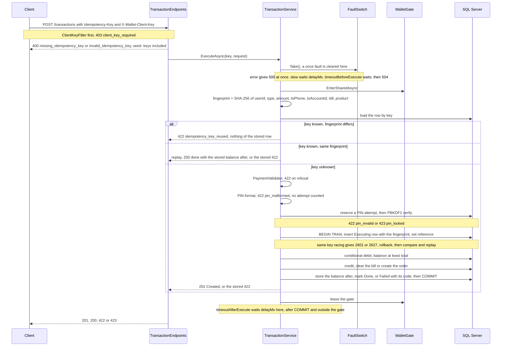
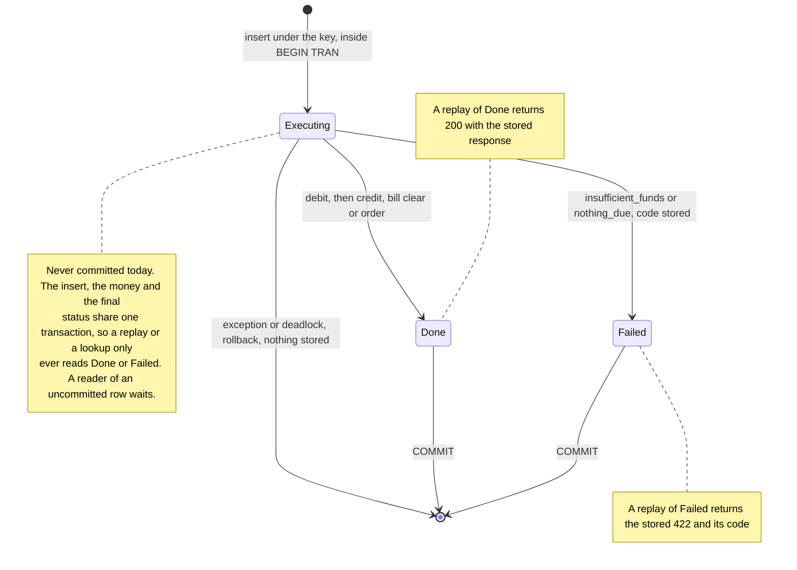
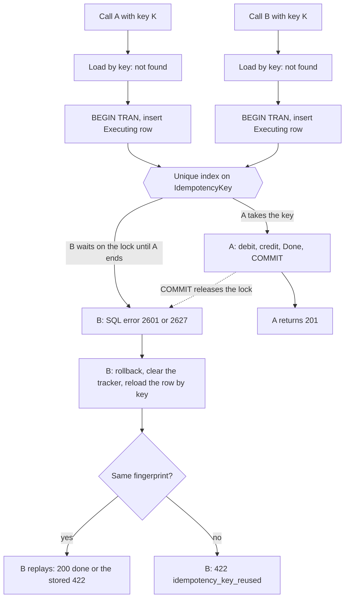
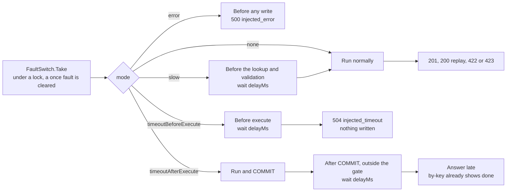
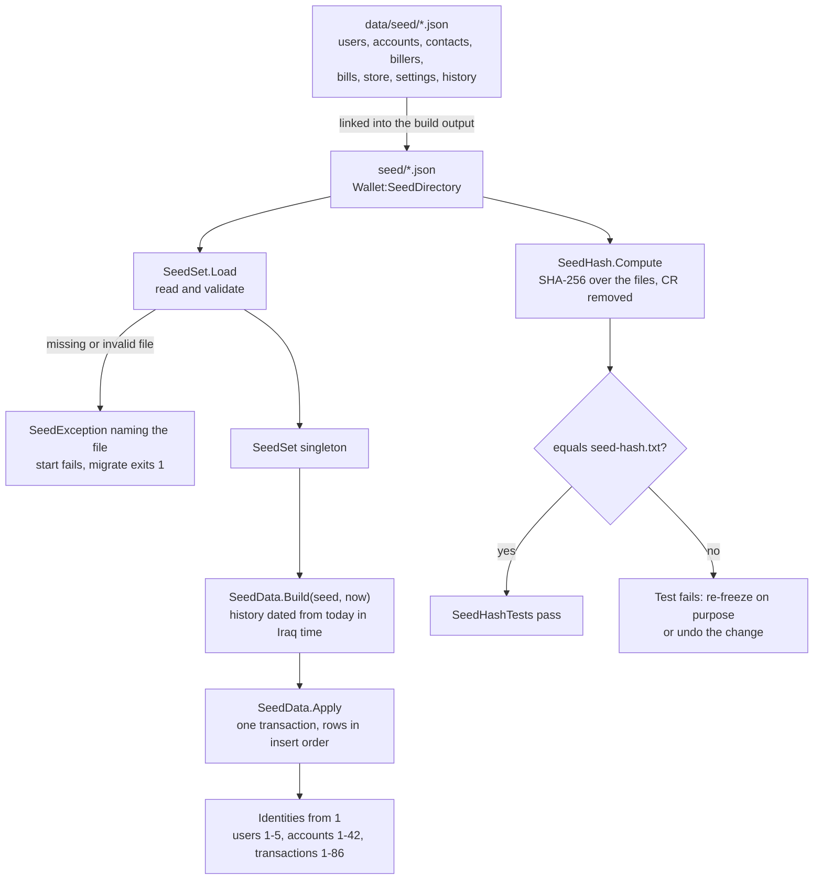
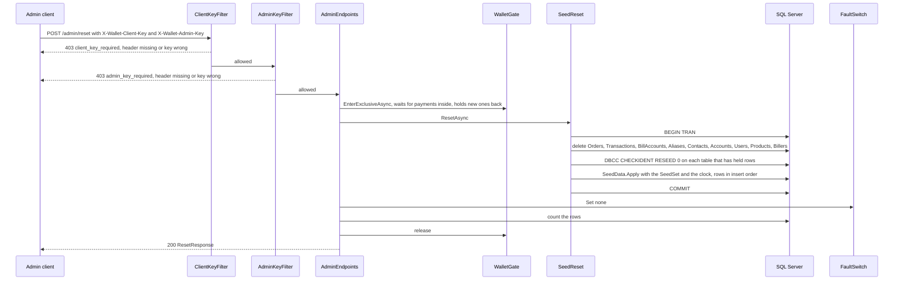

# Mock wallet API

The mock wallet stands in for the ZainCash wallet. The agent talks to it over HTTP only. It is a minimal API in `src/Wallet.MockApi`, backed by SQL Server through EF Core, and it starts from the frozen synthetic seed in `data/seed/*.json`, the test-set files described in [data/seed/README.md](../data/seed/README.md). The first draft of the endpoint list is section 7 of [architecture.md](architecture.md); this file is the contract as built in milestone 2, changed in milestone 2b, when the seed moved to the test-set files, and hardened in milestone 3 before the agent became its client (client key, request fingerprint on replay, stored balance after, PIN format, closed payer, `seed-` keys).

Every request below is in [src/Wallet.MockApi/Wallet.MockApi.http](../src/Wallet.MockApi/Wallet.MockApi.http), ready to send from Visual Studio or VS Code with the REST Client extension.

## Running it

```powershell
dotnet run --project src/Wallet.MockApi -- migrate   # create and seed the database, then exit
dotnet run --project src/Wallet.MockApi              # serve on http://localhost:5276
```

`migrate` prints `Database ready: 5 users, 42 accounts, 34 contacts, 86 transactions`. Both commands read the seed files first (see Seed); a missing or invalid file stops them with a message that names the file.

The API serves plain HTTP on loopback and does not redirect to HTTPS. `GET /health` returns `ok`; it is the only wallet route that needs no client key (see Client key). In Development the OpenAPI document is at `/openapi/v1.json`; it is mapped outside the client-key group, so it needs no key either. The connection string and the database routes are in [README.md](../README.md#database).

## Conventions

- JSON in both directions, camelCase property names (the ASP.NET Core web defaults).
- Amounts are whole Iraqi dinars, as integers, in fields ending `Iqd`.
- Times are `DateTimeOffset` in ISO 8601. Seeded rows carry Iraq time (`+03:00`) and are dated relative to the day the seed was applied (see Seed); rows and clocks written at run time are UTC (`+00:00`). Treat every time as an instant and compare instants, never the text.
- Every name the wallet puts on the wire for a type, status or kind is lower case: transaction types `transfer`, `bill`, `purchase` (and, in history and the debit's response only, `externalDebit`, camelCase like the fault modes); statuses `executing`, `done`, `failed`; product types `credit`, `internet`; account statuses `active`, `closed`; provider codes `zain`, `asiacell`, `korek`. Fault modes are camelCase (`timeoutAfterExecute`).
- Every user has exactly one default account (D10), and payments are paid from it; the database enforces it with a filtered unique index on `Accounts.UserId` where `IsDefault = 1`. The wallet also holds accounts that belong to no user (the people behind contacts and other numbers); a phone number reaches the account with that number, whoever holds it. An account is `active` or `closed`; a closed account exists but takes no money. In the seed, user ids 1 to 5 and their account ids 1 to 5 coincide; other accounts start at 6.
- Seeded rows carry the test set's id as `code` (`U1`, `S01`, `BS1`, `ZN-CR-5`) so answer keys can name them; integer ids are what payments take.
- Every route except `GET /health` (and `/openapi/v1.json` in Development) needs the `X-Wallet-Client-Key` header (see Client key); without it, the answer is 403 `client_key_required` before any of the wallet's own checks.
- Errors are RFC 7807 ProblemDetails (`application/problem+json`). Every error the wallet raises itself carries a machine-readable `code` extension and a fixed English `title`; nothing from the request is echoed back. The agent branches on `code`, never on `title`. The exceptions are errors raised by ASP.NET Core itself: a body that is not valid JSON (400, but 500 in Development; see Client key), a route that does not match (404), and an unhandled exception or a lost database connection (500). These are ProblemDetails too, but without `code`.

## Endpoints

| Method and route | Purpose | Success | Errors |
|---|---|---|---|
| `GET /health` | Liveness | 200 `ok` (text) | none |
| `GET /users/{id}` | One user | 200 `UserSummary` | 404 `unknown_user` |
| `POST /users/{id}/consent` | Record that the user has given consent (D22). Idempotent | 204, no body | 404 `unknown_user` |
| `GET /accounts/by-phone/{phone}` | The wallet account behind a phone number (exact match), user or not | 200 `AccountSummary` | 404 `unknown_account` |
| `GET /users/{id}/contacts?q=` | Contacts and aliases, optionally filtered | 200 `ContactsResponse` | 404 `unknown_user` |
| `GET /users/{id}/bills` | Bill accounts with the amount due | 200 `BillItem[]` | 404 `unknown_user` |
| `GET /users/{id}/balance` | Balance of the default account (D22) | 200 `BalanceResponse` | 404 `unknown_user` |
| `GET /users/{id}/history?to=&since=&take=` | Transactions the user paid, newest first | 200 `HistoryItem[]` | 404 `unknown_user` |
| `GET /store/products?provider=&type=&value=` | Store catalogue (D11) | 200 `ProductItem[]` | none |
| `GET /users/{id}/orders` | Past purchases and their purchase codes, newest first | 200 `OrderItem[]` | 404 `unknown_user` |
| `GET /settings` | The wallet's own fees and PIN limits, as configured (read only; milestone 7) | 200 `SettingsResponse` | none |
| `POST /quotes` | Fee, total and balance after. No money moves | 200 `QuoteResponse` | 422 |
| `POST /transactions` | Execute a transfer, bill payment or purchase. Needs `Idempotency-Key` | 201 `TransactionResponse` (new), 200 (replay) | 400, 422, 423, 500, 504 (409 reserved) |
| `GET /transactions/by-key/{key}?userId=` | Outcome of the user's key, for display after a timeout | 200 `TransactionResponse` | 400 `missing_user_id`, 404 `unknown_key` |
| `GET /admin/faults` | Current fault switch | 200 `FaultState` | 403 |
| `POST /admin/faults` | Set the fault switch | 200 `FaultState` | 403, 422 |
| `POST /admin/reset` | Restore the seed, clear faults | 200 `ResetResponse` | 403 |
| `POST /admin/debit` | Take money from a user's wallet from outside the agent (milestone 8) | 201 `TransactionResponse` | 403, 422 `invalid_amount`, `unknown_user`, `account_closed`, `insufficient_funds` |

Every route in the table except `/health` (and `/openapi/v1.json` in Development) also answers 403 `client_key_required` (see Client key), and the `/admin` routes 403 `admin_key_required` as well (see Admin key).

`{id}` is an integer; a path with a non-integer id matches no route and returns a ProblemDetails 404 from ASP.NET Core, without `code`.

Removed in milestone 2b: `GET /users/by-phone/{phone}`. A typed number can belong to an account that is no user's, so the lookup is now by account (`GET /accounts/by-phone/{phone}`). The old path matches no route and returns a 404 without `code`.

### The user and account 404s

Every `/users/...` read route, and `POST /users/{id}/consent`, answers a user that does not exist with the same ProblemDetails: status 404, `code` `unknown_user`, title `User not found`. It is built by `WalletProblems.UserNotFound`, like every other wallet error. Quote and execute use the same code for an unknown payer, there as 422. `GET /users/{id}/balance` treats "no default account" as "no such user".

`GET /accounts/by-phone/{phone}` answers a number with no account behind it with status 404, `code` `unknown_account`, title `Account not found` (`WalletProblems.AccountNotFound`). Such a number has no wallet.

### Read endpoints

`GET /users/{id}` returns `UserSummary`:

| Field | Type | Notes |
|---|---|---|
| `id` | int | |
| `code` | string | The test-set id, `U1` to `U5` |
| `phone` | string | `07805550001` form |
| `registeredName` | string | The name the wallet holds, in Arabic |
| `consentGiven` | bool | Whether the user has given consent (D22). False for U5 in the seed |

`POST /users/{id}/consent` (no body) sets `consentGiven` to true and returns 204. Sending it again changes nothing and also returns 204. It is the one route among the reads that writes; a reset restores the seed's value. Like execute, the write takes the wallet gate shared, so it never interleaves with a reset: a consent sent during a reset waits and then lands on the re-seeded user.

`GET /accounts/by-phone/{phone}` returns `AccountSummary`, for any account: a user's, a contact's or another number's. The match is exact on the stored number (`07805550101` form); the wallet does no normalising. It is the lookup D16 needs for a typed number; the registered name is for code and the card, never for the model (rule 5).

| Field | Type | Notes |
|---|---|---|
| `accountId` | int | Use as `toAccountId` in a payment |
| `phone` | string | |
| `registeredName` | string or null | The name the wallet holds, in Arabic; null when it holds none |
| `status` | string | `active` or `closed`. A closed account is refused as a recipient and as a payer (`account_closed`) |

`GET /users/{id}/contacts?q=` returns `ContactsResponse` = `{ contacts: ContactItem[], aliases: AliasItem[] }`. `q` is a raw, case-insensitive substring match on the contact's saved name and on the alias text. The wallet does no Arabic normalising; that is the agent's job. Without `q`, everything is returned. Both lists are ordered by id.

`ContactItem`:

| Field | Type | Notes |
|---|---|---|
| `contactId` | int | |
| `code` | string | The test-set id (`S01`) |
| `savedName` | string | The name the user saved |
| `phone` | string | |
| `registeredName` | string or null | The name the wallet holds for the account with that phone; null when it holds none |
| `accountStatus` | string | `active` or `closed` |
| `targetAccountId` | int | The account with that phone |
| `lastSentAt` | DateTimeOffset or null | Latest `done` transfer from this user to that account (D3) |
| `lastSentAmountIqd` | long or null | Its amount |

Two contacts may share one number (S12 and S13 of U1); both then carry the same `targetAccountId`.

`AliasItem` (one alias, one account, D15):

| Field | Type | Notes |
|---|---|---|
| `aliasId` | int | |
| `text` | string | |
| `targetAccountId` | int | |
| `phone` | string | |
| `registeredName` | string or null | Null when the wallet holds no name |
| `accountStatus` | string | `active` or `closed` |

`GET /users/{id}/bills` returns `BillItem[]`, ordered by id:

| Field | Type | Notes |
|---|---|---|
| `billAccountId` | int | Use as `billAccountId` in a payment |
| `code` | string | The test-set id (`BS1`) |
| `billerCode` | string | `electricity`, `water`, `internet`, `school_fees` |
| `billerName` | string | Arabic |
| `billerNameEn` | string | English |
| `label` | string or null | The user's label for the account, Arabic; null when there is none |
| `accountNumber` | string | The subscriber number as the biller writes it, spaces included (`2204 118 763`) |
| `amountDueIqd` | long | Zero means nothing is due |

There is no due date: `dueDate` was removed in milestone 2b, since the test set has none.

`GET /users/{id}/balance` returns `BalanceResponse`: `accountId` (int), `balanceIqd` (long), `asOf` (DateTimeOffset, the server's clock). Code reads it for checks and the balance reply; it never reaches the model (CLAUDE.md, rule 5).

`GET /users/{id}/history` returns `HistoryItem[]`, the transactions the user paid, of every status, newest first (`createdAt`, then id).

| Query | Effect |
|---|---|
| `to` | Phone number. Only transfers to the account with that phone |
| `since` | DateTimeOffset. Only transactions created at or after it |
| `take` | Number of items. Default 50, clamped to 1..200 |

| Field | Type | Notes |
|---|---|---|
| `transactionId` | int | |
| `reference` | string | `ZC-` and the id padded to 10 digits |
| `type` | string | `transfer`, `bill`, `purchase`, or `externalDebit` (money taken from outside by `POST /admin/debit`; fee 0, no counterparty) |
| `status` | string | `executing`, `done`, `failed` |
| `amountIqd`, `feeIqd`, `totalIqd` | long | |
| `counterpartyPhone`, `counterpartyName` | string or null | Transfers only: the recipient account's phone and registered name (the name can be null) |
| `counterpartyAccountId` | int or null | Transfers only: the recipient account |
| `billAccountId` | int or null | Bills only |
| `productId` | int or null | Purchases only |
| `createdAt` | DateTimeOffset | |

History, products, quotes and transactions all use the same lower-case names.

`GET /store/products` returns `ProductItem[]`, ordered by id. All filters are optional and combine:

| Query | Effect |
|---|---|
| `provider` | The provider code, exact match in any case: `zain`, `asiacell`, `korek` (`Zain` matches too) |
| `type` | `credit` or `internet`, any case. An unknown name or a number returns an empty list |
| `value` | Exact face value in IQD (`10000`) |

`ProductItem`:

| Field | Type | Notes |
|---|---|---|
| `productId` | int | Use as `productId` in a payment |
| `code` | string | The test-set id (`ZN-CR-5`) |
| `provider` | string | Lower-case provider code: `zain`, `asiacell`, `korek` |
| `providerNameEn` | string | `Zain`, `Asiacell`, `Korek` |
| `providerNameAr` | string | Arabic |
| `alsoCalled` | string or null | Another name the product is known by, Arabic; null when there is none |
| `type` | string | `credit` or `internet` |
| `faceValueIqd` | long | |
| `priceIqd` | long | |

`name` was removed in milestone 2b; the test set has no product name, only the fields above.

`GET /users/{id}/orders` returns `OrderItem[]`, newest first (`createdAt`, then id): `orderId`, `transactionId`, `productId`, `productCode` (the product's test-set id, which replaced `productName` in milestone 2b), `code` (the purchase code), `createdAt`. Purchase codes are for code and the card only, never for the model (rule 5). Seeded orders have codes `9` followed by 12 digits (see [data/seed/README.md](../data/seed/README.md#codes)).

`GET /settings` returns `SettingsResponse`, the values of the `Wallet` section (see Configuration) as the wallet runs with them. It reads no database and has no fault; it needs the client key, not the admin key. The agent's settings component shows them read only (section "Wallet (read only)"); the agent never changes them.

`SettingsResponse`:

| Field | Type | Notes |
|---|---|---|
| `transferFeeIqd` | long | `Wallet:TransferFeeIqd` (1,000 by default) |
| `billFeeIqd` | long | `Wallet:BillFeeIqd` (500) |
| `purchaseFeeIqd` | long | `Wallet:PurchaseFeeIqd` (0) |
| `pinRequiredAboveIqd` | long | `Wallet:PinRequiredAboveIqd` (1,000,000): an amount above it (without the fee) needs the PIN (D8); exactly 1,000,000 needs none |
| `maxPinAttempts` | int | `Wallet:MaxPinAttempts` (3) |

Tests: `ReadEndpointsTests.SettingsReturnTheConfiguredLimits`; the agent's client: `WalletClientTests.TheWalletSettingsAreMappedAndUnavailableOnAConnectionFailure`.

### Payment request

`POST /quotes` and `POST /transactions` take the same body, `PaymentRequest`:

| Field | Type | Used by |
|---|---|---|
| `userId` | int | All. The payer |
| `type` | string | All. Exactly `transfer`, `bill` or `purchase` (lower case) |
| `amountIqd` | long or null | Transfer: required, above 0. Bill: optional, must equal the amount due (D9). Purchase: optional, must equal the price (D11) |
| `toPhone` | string or null | Transfer: recipient by phone (the account with that number) |
| `toAccountId` | int or null | Transfer: recipient by account. If both are sent, both must name the same account |
| `billAccountId` | int or null | Bill: one of the payer's own bill accounts |
| `productId` | int or null | Purchase |
| `pin` | string or null | Execute only; see PIN rules. Ignored by quotes |

Examples, all for user 1 (U1, `07805550001`):

```json
{ "userId": 1, "type": "transfer", "amountIqd": 50000, "toPhone": "07805550101" }
{ "userId": 1, "type": "bill", "billAccountId": 1 }
{ "userId": 1, "type": "purchase", "productId": 1 }
```

Fees are flat per type and come from configuration: `Wallet:TransferFeeIqd` (1,000), `Wallet:BillFeeIqd` (500), `Wallet:PurchaseFeeIqd` (0). Total = amount + fee. The amount of a bill and of a purchase always comes from the wallet's data, never from the request. (The seeded history stores the fee each row carries in `history.json`, so a configuration change never rewrites it.)

Checks, in order (the same for quote and execute, in `PaymentValidator`):

1. `type` is one of the three names, else `invalid_type`.
2. The payer exists, else `unknown_user`; the payer's own account is not closed, else `account_closed` (the code a closed recipient gets).
3. Transfer: `amountIqd` above 0, else `invalid_amount`; a recipient is given and exists, else `unknown_recipient`; the recipient account is not closed, else `account_closed` (by phone or by id alike); the recipient is not the payer's own account, else `same_account`.
4. Bill: the bill account exists and belongs to the payer, else `unknown_recipient`; something is due, else `nothing_due`; an `amountIqd` other than the amount due gives `bills_paid_in_full` with `amountDueIqd`.
5. Purchase: the product exists, else `unknown_product`; an `amountIqd` other than the price gives `invalid_amount`.
6. Amount plus fee would overflow: `invalid_amount`.

Funds are not checked here. A quote never refuses for funds; only execute does, at the moment of the debit.

### `POST /quotes`

Returns 200 `QuoteResponse`. No money moves and nothing is written.

| Field | Type | Notes |
|---|---|---|
| `type` | string | `transfer`, `bill`, `purchase` |
| `amountIqd`, `feeIqd`, `totalIqd` | long | |
| `balanceBeforeIqd` | long | Payer's balance now |
| `balanceAfterIqd` | long | Before minus total. Negative when funds are short |
| `sufficient` | bool | Balance covers the total |
| `pinRequired` | bool | Amount (without the fee) above `Wallet:PinRequiredAboveIqd` |
| `recipientPhone`, `recipientName` | string or null | Transfers only; the registered name, null when the wallet holds none |
| `billAccountId` | int or null | Bills only |
| `productId` | int or null | Purchases only |

Example: user 1 (U1) sends 50,000 to Hammoudi (`07805550101`, contact S01): fee 1,000, total 51,000, balance 750,000 before and 699,000 after, `sufficient` true, `pinRequired` false (`QuoteTests.TransferQuoteToHammoudiMatchesTheSlideExample`).

A transfer to a closed account (`07805550120`, behind contact S20 of U1, or `07805550193`) is 422 `account_closed` on quote and on execute. It is refused in validation, so nothing moves, no row is written and `by-key` stays 404 (`QuoteTests.QuoteToClosedAccountIsRefused`, `TransactionTests.TransferToClosedAccountIsRefusedAndNothingMoves`). A payer whose own account is closed gets the same 422 `account_closed`, right after the payer is found, for any payment type (`TransactionTests.ClosedPayerIsRefused`). No seeded user's account is closed; the test closes one directly in the database.

### `POST /transactions`

The only endpoint that moves money. Header `Idempotency-Key` is required. A missing, empty or whitespace key is 400 `missing_idempotency_key`; a key that does not match `^[A-Za-z0-9_-]{1,64}$` (ASCII letters, digits, `_` and `-`, 1 to 64 characters) is 400 `invalid_idempotency_key`, and so is a key that starts with `seed-` (the seeded rows' keys; see Idempotency). Both are checked before anything else, before the fault switch, so a 400 does not use up a `once` fault. Use a lower-case GUID (`Guid.NewGuid().ToString("N")`).

| Status | When | Body |
|---|---|---|
| 201 Created | The payment ran now. `Location: /transactions/by-key/{key}` | `TransactionResponse`, `status` `done` |
| 200 OK | The key was used before for the same request and that payment is `done` (replay) | The stored `TransactionResponse` |
| 400 | `missing_idempotency_key`, `invalid_idempotency_key` | ProblemDetails |
| 403 | `client_key_required` (see Client key) | ProblemDetails |
| 409 | `in_progress`: reserved for a key whose payment is still executing. Not produced today (see the transaction row below) | ProblemDetails |
| 422 | Validation codes above, `insufficient_funds`, `pin_required`, `pin_malformed`, `pin_invalid`; `idempotency_key_reused` for a used key with a different request (no stored figures) | ProblemDetails |
| 423 | `pin_locked` | ProblemDetails |
| 500 with `code` | `injected_error` (fault switch). Nothing was written | ProblemDetails |
| 500 without `code` | Deadlock victim, lost database connection, unhandled exception. The outcome is unknown | ProblemDetails |
| 504 | `injected_timeout` (fault switch). Nothing was written | ProblemDetails |

**Unknown outcomes.** Any 500 without a `code` extension, and any transport failure (timeout, dropped connection, no response), means the client does not know whether the money moved. The record goes to Checking, never to Failed (CLAUDE.md, rule 6). Settle it by resending the same body with the same key: it executes once or replays the stored outcome (201 or 200 means done, a stored 422 means failed, 409 means keep checking). `GET /transactions/by-key/{key}` may be used for display while checking, but its 404 is final only once the original call has definitely ended (see below).

**A 5xx with a code that means nothing was written is a refusal; any other 5xx means unknown** (ruling of 14 Oct 2026, narrowed by the milestone 6 security review, M1). The 5xx codes that mean nothing was written are `injected_error` and `injected_timeout` (`WalletProblem.IsNothingWritten`). On a first execute call, the agent reads a 5xx with one of them as a refusal, like a 4xx: the card ends not done with `not_done_nothing_taken` and the code as detail, and the record leaves Pending once. A 5xx with any other code, without `code`, with no body or with a body it cannot read, stays unknown (Checking). On a resend that settles a Checking record, a coded 5xx stays Checking too: the fault switch answers before the key lookup, so it says nothing about whether the original call was written.

`TransactionResponse`:

| Field | Type | Notes |
|---|---|---|
| `transactionId` | int | |
| `reference` | string | `ZC-` and the id padded to 10 digits |
| `type` | string | `transfer`, `bill`, `purchase`; `externalDebit` from `POST /admin/debit` |
| `status` | string | `executing`, `done`, `failed` |
| `amountIqd`, `feeIqd`, `totalIqd` | long | |
| `balanceAfterIqd` | long | The payer's balance right after that payment; for seeded rows, the balance now. Stored on the row inside the payment's database transaction, so a replay or a lookup returns the same figure as the first response, whatever has happened since. A `failed` row stores the balance when the failure was stored |
| `code` | string or null | Purchase code, purchases only |
| `completedAt` | DateTimeOffset | Completion time, or creation time while executing |
| `errorCode` | string or null | The stored refusal code of a `failed` row (`insufficient_funds` or `nothing_due`); null otherwise. Filled on by-key lookups (a replay of a failed row returns the 422 instead) |

What execute does, in order (`TransactionService.ExecuteAsync`):

1. Takes the fault switch (see Faults). With `once`, this clears it, whatever happens next.
2. Enters the `WalletGate` shared, so a reset never runs in the middle of the payment.
3. Works out the request fingerprint and looks the key up. A known key with the same fingerprint replays its stored outcome at once (see Idempotency): no validation, no PIN check, no insert. A known key with a different fingerprint is 422 `idempotency_key_reused`.
4. Validates as above. A refusal looks the key up once more (a call with the same key may have committed meanwhile) and replays if it is now known (fingerprint compared as in step 3).
5. Checks the PIN if one was sent or one is required: refuses a malformed PIN with no attempt counted, otherwise reserves an attempt first, then verifies (see PIN rules).
6. In one database transaction (read committed): inserts the transaction row as `executing` under the key, with the request fingerprint; debits the payer with one conditional update (`balance >= total`); then credits the recipient (transfer), clears the amount due only if it still equals the quoted amount (bill), or creates the order with a new purchase code (purchase); reads the payer's balance, stores it on the row as the balance after, marks the row `done` and commits.
7. If the debit finds the balance short, the row is stored as `failed` with `insufficient_funds` and committed, and 422 is returned. If the bill was already cleared by another payment, the debit is refunded in the same transaction and the row is stored as `failed` with `nothing_due`.
8. From the debit on, the rest of the work and the commit run without the request's cancellation token, so a caller who disconnects cannot cancel the commit half-way; the outcome is stored either way and found by its key.



A transaction row, from insert to commit:



### `GET /transactions/by-key/{key}`

`userId` (query, integer) is required: the user whose key it is. Without it the answer is 400 `missing_user_id`. Returns 200 with the `TransactionResponse` stored under the key, whatever its status (`executing`, `done` or `failed`; a failed one carries the amounts, no purchase code, and its `errorCode`), with the stored `balanceAfterIqd`. An unknown key, a key that does not match the key format, a `seed-` key, or a key whose row belongs to another user is 404 `unknown_key`: a wrong user cannot tell another user's key from an unknown one (`ReplayFingerprintTests.ByKeyNeedsTheOwnersUserId`, `SeedKeysAreRejected`).

A 404 is final only once the original call has definitely ended. It means the key has not been written yet: with the `slow` fault the delay comes before the insert, and a request still in transit behaves the same, so a client that gave up early can see 404 and then, a moment later, a `done` row. The safe way to settle an unknown outcome is to resend the same body with the same key (above); by-key is for display while the record is Checking (CLAUDE.md, rule 6).

## Error codes

Every code is the `code` extension of a ProblemDetails. Source: `PaymentErrors` and `PaymentValidator` (`Services/PaymentValidator.cs`), `WalletProblems.UnknownAccount` (`Endpoints/WalletProblems.cs`), `FaultErrors` (`Services/FaultSwitch.cs`), `AdminErrors` (`Endpoints/AdminEndpoints.cs`), `ClientErrors` (`ClientKeyFilter.cs`); titles in `Endpoints/WalletProblems.cs`.

| Code | Status | Raised by | Meaning | Extensions |
|---|---|---|---|---|
| `missing_idempotency_key` | 400 | execute | Header missing, empty or whitespace | |
| `invalid_idempotency_key` | 400 | execute | Header present but not `^[A-Za-z0-9_-]{1,64}$`, or starting with `seed-` or `admin-` (in any case) | |
| `missing_user_id` | 400 | by-key | The `userId` query parameter is missing | |
| `idempotency_key_reused` | 422 | execute | The key was used before for a different request (another user, type, amount, recipient, bill or product). Nothing of the stored row is returned | |
| `invalid_type` | 422 | quote, execute | `type` is not `transfer`, `bill` or `purchase` | |
| `unknown_user` | 422 / 404 | quote, execute, `POST /admin/debit` (422); every `/users/...` route, consent included (404) | The payer, the user to debit, or the user asked for, does not exist | |
| `unknown_account` | 404 | `GET /accounts/by-phone/{phone}` | No wallet account has that number | |
| `unknown_recipient` | 422 | quote, execute | Transfer recipient missing or unknown; bill account missing or not the payer's | |
| `account_closed` | 422 | quote, execute, `POST /admin/debit` | The payer's own account (or the default account to debit), or the transfer's recipient account, is closed. Refused before anything is written | |
| `same_account` | 422 | quote, execute | Transfer to the payer's own account | |
| `invalid_amount` | 422 | quote, execute, `POST /admin/debit` | Transfer or debit amount not above 0; purchase amount not the price; total would overflow | |
| `nothing_due` | 422 | quote, execute | The bill has nothing due (also stored when a concurrent payment cleared it first) | |
| `bills_paid_in_full` | 422 | quote, execute | An amount other than the amount due was sent for a bill (D9) | `amountDueIqd` |
| `unknown_product` | 422 | quote, execute | Product missing or unknown | |
| `insufficient_funds` | 422 | execute, `POST /admin/debit` | The balance does not cover the total at the moment of the debit. Stored against the key on execute; nothing written on the admin debit | |
| `pin_required` | 422 | execute | Amount (without the fee) above the PIN threshold and no PIN sent | |
| `pin_malformed` | 422 | execute | The PIN sent is not 4 to 6 ASCII digits. No attempt counted | |
| `pin_invalid` | 422 | execute | Wrong PIN | `attemptsLeft` |
| `pin_locked` | 423 | execute | The user's PIN is locked | |
| `in_progress` | 409 | execute | Reserved: the key's payment is still executing. Not produced today | |
| `unknown_key` | 404 | by-key | No transaction of this user has this key, or the key is malformed, a `seed-` key or an `admin-` key | |
| `injected_error` | 500 | execute | Fault switch, mode `error` | |
| `injected_timeout` | 504 | execute | Fault switch, mode `timeoutBeforeExecute` | |
| `client_key_required` | 403 | every route except `/health` (and `/openapi/v1.json` in Development) | Client header missing, or wrong key, or no key configured outside Development | |
| `admin_key_required` | 403 | `/admin/*` | Admin header missing, or wrong key, or no key configured outside Development | |
| `invalid_fault_mode` | 422 | `POST /admin/faults` | Unknown mode name | |
| `invalid_fault_delay` | 422 | `POST /admin/faults` | `delayMs` below 0 or above 600,000 | |

A ProblemDetails without `code` comes from ASP.NET Core, not from the wallet's rules (see Conventions). On execute, a 500 without `code` means the outcome is unknown; a 5xx with `injected_error` or `injected_timeout` means the wallet refused before writing (see Unknown outcomes above); any other code on a 5xx is unknown.

## Idempotency

- The key is the `Idempotency-Key` header: 1 to 64 characters of `A-Z`, `a-z`, `0-9`, `_` and `-`. It is unique in the database (a unique index on `Transactions.IdempotencyKey`). Keys compare under the database collation, which is case-insensitive by default, so `AbC` and `abc` are one key; that is the safe direction (a retry can never run twice). Use lower-case GUIDs.
- Keys starting with `seed-` belong to the seeded history, and keys starting with `admin-` to the external debits of `POST /admin/debit` (from 16 Oct 2026); both are refused from callers, in any case (keys compare without case in the database): execute answers 400 `invalid_idempotency_key` and by-key 404 `unknown_key`. Those rows keep their keys; they can be neither replayed nor looked up by key (`AdminDebitTests.TheDebitsKeyCanNeitherBeReplayedNorLookedUp`).
- Each row stores a request fingerprint: SHA-256, lower-case hex, of `userId|type|amountIqd|toPhone|toAccountId|billAccountId|productId` from the body as received, each field empty when absent (`RequestFingerprint.Of`). The PIN is not part of it, so a retry with the PIN added or corrected is the same request. A retry must send the same body: a different value in any of those fields (a different user, amount or recipient, or the recipient by id instead of by phone) under a used key is 422 `idempotency_key_reused`, with no reference, no balance and nothing else of the stored row (`ReplayFingerprintTests.SameKeyDifferentBodyIs422WithoutStoredBody`, `SameKeyDifferentUserIs422`). Seeded rows store the fingerprint of their own fields (the recipient's phone for a transfer, their bill account or product id); since their keys are refused, it is never compared.
- A key executes at most once. A call with a used key and the same fingerprint is looked up first, inside the gate, and returns the stored outcome without running again:
  - stored `done`: 200 with the stored `TransactionResponse` (`balanceAfterIqd` is the stored balance right after that payment; `ReplayFingerprintTests.ReplayReturnsTheStoredBalanceAfter`);
  - stored `failed`: the original 422 with its stored code (`insufficient_funds` or `nothing_due`);
  - `executing` would be 409 `in_progress`, but an executing row is never committed, so this is not produced today.
- The lookup comes before validation and before the PIN check, so a retry never depends on data the first call changed (a paid bill now has nothing due), and a PIN sent with a known key costs no attempt and changes no user row.
- Two calls with the same key at the same time: both find the key unknown; one insert wins; the other waits on the unique index until the first transaction ends, gets SQL error 2601/2627, and replays the stored outcome (or, with a different fingerprint, gets 422 `idempotency_key_reused`). Money moves once (`TransactionTests.SameKeyTwiceExecutesOnce`, `TwoConcurrentCallsWithTheSameKeyExecuteOnce`).



- Only an attempt that reached the database insert is recorded. Refusals by validation or the PIN rules (`pin_malformed` included), and the `error` and `timeoutBeforeExecute` faults, write nothing: the key stays unknown (`by-key` is 404) and a retry with the same key runs normally.
- The fault switch is taken before the lookup, so a replay also consumes a `once` fault (and, under `error`, a replay returns the injected 500).
- The agent sends one key per pending record and reuses it on every retry (CLAUDE.md, rule 6).

## PIN rules (D8)

- A PIN is required when the amount (without the fee) is above `Wallet:PinRequiredAboveIqd` (1,000,000); exactly 1,000,000 needs none (Khalil, 16 Oct 2026). The quote reports this as `pinRequired`.
- The PIN is checked on execute only, and only when one is sent or one is required. A PIN sent on a small payment is still verified.
- Each seeded user has their own PIN, taken from `data/seed/users.json` and stored only as a salted PBKDF2 hash.
- A PIN sent must be 4 to 6 ASCII digits (`^[0-9]{4,6}\z`); anything else, Arabic-Indic digits included, is 422 `pin_malformed`. The agent turns Arabic-Indic digits into ASCII before it sends a PIN. The format is checked before an attempt is reserved, so a malformed PIN counts no attempt and changes no user row (`TransactionTests.MalformedPinIs422AndCostsNoAttempt`).
- Each check first reserves an attempt: one conditional update on the user row that succeeds only while the PIN is unlocked and the failed count is still the one just read, raises the count by one, and locks the PIN when that is the last allowed attempt. Only then does the slow PBKDF2 check run. Concurrent guesses therefore cannot all see the PIN unlocked: at most `Wallet:MaxPinAttempts` wrong PINs are checked before the lock, however many arrive together (`TransactionTests.ConcurrentWrongPinsCannotExceedTheLockout`).
- A wrong PIN is 422 `pin_invalid` with `attemptsLeft`, counted from that reservation. After `Wallet:MaxPinAttempts` (3) wrong entries the PIN is locked: the call that uses the last attempt still answers `pin_invalid` with `attemptsLeft: 0`, and every later call that checks the PIN, even with the right PIN, is 423 `pin_locked` (`TransactionTests.ThreeWrongPinsLockTheUser`).
- A right PIN gives its attempt back: it resets the count, and clears the lock only when its own reservation set it (it held the last attempt). A lock set by other wrong PINs after its reservation stands. Only `POST /admin/reset` unlocks a locked PIN.
- The PIN is never echoed in any response and never logged (`PaymentRequest.ToString()` leaves it out; the log lines carry the user id and attempt count only).

## Balance floor

A balance never goes below zero. The debit is one conditional update whose condition is `BalanceIqd >= total`, so two payments racing for the same money cannot both pass; the loser is stored as `failed` with `insufficient_funds` (`TransactionTests.InsufficientFundsIs422AndNothingMoves`, `TwoConcurrentAffordableTransfersNeverOverdraw`). Two payments of the same bill clear it once (`TransactionTests.TwoConcurrentPaymentsOfOneBillPayOnce`). The quote reports `sufficient` and a possibly negative `balanceAfterIqd`, but never refuses.

## Faults

A judge can inject failures into `POST /transactions`, and only there. Quotes, reads, by-key and admin routes are never affected. The switch is process-wide, held in memory, and starts as `none`.

`POST /admin/faults` takes `FaultRequest` and returns the new `FaultState`. `GET /admin/faults` returns the current `FaultState`.

| Field | Type | Notes |
|---|---|---|
| `mode` | string | `none`, `error`, `slow`, `timeoutBeforeExecute`, `timeoutAfterExecute`. Any case on input; reported in camelCase. Anything else is 422 `invalid_fault_mode` |
| `delayMs` | int or null | 0 to 600,000. Null or absent takes `Wallet:FaultDelayMs` (60,000). Out of range is 422 `invalid_fault_delay` |
| `once` | bool | Default false. True clears the fault after one `POST /transactions` takes it. Always false for `none` |

| Mode | What `POST /transactions` does |
|---|---|
| `none` | Runs normally |
| `error` | 500 `injected_error` at once. Nothing is written; by-key is 404 |
| `slow` | Waits `delayMs`, then runs normally (201). While it waits, nothing is written, so by-key is 404 even though the payment will still run |
| `timeoutBeforeExecute` | Waits `delayMs`, then 504 `injected_timeout`. Nothing is written; by-key is 404 `unknown_key`, and since the 504 ended the call, that 404 is final |
| `timeoutAfterExecute` | Runs and commits first, then waits `delayMs` before answering, so a caller with a shorter timeout gives up not knowing the outcome. `GET /transactions/by-key/{key}` already finds the `done` row while the request is still hanging. If the caller disconnects, the wait ends quietly and the committed result stands. The gate is released before the wait, so a reset may run meanwhile; the hanging request then answers 201 for a row the reset has deleted |

The fault is taken (and, with `once`, cleared under the same lock) before the key lookup and before validation, so it applies to any execute call with a valid key header, whatever the body, a replay included. Delays honour the request's cancellation and sit outside the reset gate, so a hanging request never blocks a reset.



Tests: `FaultTests.ErrorFaultReturns500AndMovesNothing`, `SlowFaultDelaysButSucceeds`, `TimeoutBeforeExecuteMovesNothingAndByKeyIs404`, `TimeoutAfterExecuteIsFoundByKeyWhileTheRequestStillHangs`, `OnceFaultClearsAfterOneRequest`.

## Seed

The wallet's rows come from the eight test-set files in `data/seed` ([data/seed/README.md](../data/seed/README.md) has the counts, the ids and the rules). The project links them into the build output as `seed/*.json`; `Wallet:SeedDirectory` names the folder read.

- At start-up, before anything is served, `SeedSet.Load` reads and validates the files (unique ids, every reference resolves, allowed values, required members present and not null). A missing or invalid file throws `SeedException`, whose message names the file, and the API does not start; `migrate` prints the message and exits 1.
- `SeedData.Build(seed, now)` turns the files into entities and dates the history: each row's `days_ago` before today in Iraq time (UTC+3), at the row's clock time.
- `SeedData.Apply` inserts the rows one at a time in a fixed order, in one database transaction, and only into a database with no user. The order fixes the identity values: users 1 to 5 with their accounts 1 to 5, the other accounts 6 to 42, billers, products, contacts, aliases, bill accounts, transactions oldest first (1 to 86), orders.
- The hash path is separate and needs no database: `SeedHash.Compute` over the files (with `\r` removed) must equal `data/seed/seed-hash.txt`, which `SeedHashTests.SeedHashMatchesCommittedValue` checks; `seed-hash` prints it.



`migrate` calls `Apply` with the current clock after applying the migrations; the reset (below) deletes everything first and calls it the same way.

## Reset

`POST /admin/reset` (no body; the admin header, see Admin key) returns the wallet to the frozen seed exactly, and clears the fault switch to `none`.

- In one database transaction it deletes every row, reseeds each identity column so ids start where the seed leaves them (the next transaction after a reset is id 87), and applies the seed from the `SeedSet`, dated from the current clock. PIN failure counts, locks and consent are back to the seed (unlocked; consent false for U5 only).
- Because the history is dated from the day of the reset, a reset on a later day moves every seeded date with it; two resets either side of midnight Iraq time differ by one day.
- It is serialised with payments: it waits for payments in progress to finish, holds new ones back until it is done, and never runs alongside another reset (`WalletGate`). Fault delays are outside the gate.
- It returns `ResetResponse`, the row counts read back from the database. For the seed these are:

```json
{ "users": 5, "accounts": 42, "contacts": 34, "aliases": 9, "billAccounts": 11, "products": 15, "transactions": 86, "orders": 9 }
```



Tests: `ResetTests.ResetRestoresTheSeedExactly` (compares every table before and after, the counts above and the next transaction id), `ResetTests.ResetClearsFaults`, `SeedApplyTests.ResetRestoresIdentitiesFromOne`, `SeedApplyTests.HistoryIsDatedRelativeToToday`.

## Client key

Every route except `GET /health` (and `/openapi/v1.json` in Development) is guarded by `ClientKeyFilter`, an endpoint filter on the route group that the read, transaction and admin endpoints hang off. Every request to them carries the `X-Wallet-Client-Key` header:

- With no `Wallet:ClientKey` configured (unset or empty), they are open in the Development environment (what `dotnet run` uses) to any request whose header has a non-empty value, and closed with 403 `client_key_required` in any other environment. The header is required even then because a custom header makes a browser send a CORS preflight, which this API never grants, so a web page on the demo machine cannot move money, give consent or read a balance.
- With a key configured, the header must equal it; a missing or wrong key is 403 `client_key_required`. The comparison is constant-time. The key must be at least 16 characters; a shorter one stops the API at start-up (options validation). The agent holds the same value (milestone 3, task 2).
- The filter runs before the handler and every check of the wallet's own, so a request without the client key learns nothing else: not whether the user exists, not whether a key is known. ASP.NET Core binds the parameters before endpoint filters run, so a request it cannot bind (a body that is not valid JSON, a non-integer `userId`) is answered by ASP.NET Core without reaching the filter or the handler: 400 without `code` outside Development, and 500 without `code` in Development, where minimal APIs throw on bad requests. The `/admin` routes need both keys; the client key is checked first.
- The key is never committed. Set it in user secrets or the environment:

```powershell
dotnet user-secrets set "Wallet:ClientKey" "<choose-a-key-of-16-or-more-characters>" --project src/Wallet.MockApi
# or
$env:Wallet__ClientKey = '<choose-a-key-of-16-or-more-characters>'
```

`GET /settings` is a read like the others: it needs the client key and nothing more.

Tests: `ClientKeyTests.NoHeaderIs403OnEveryRouteExceptHealth`, `TheSettingsRouteNeedsTheClientKey`, `HeaderWithAnyValueOpensInDevelopment`, `ConfiguredKeyMustMatch`, `ProductionWithoutKeyIsClosed`.

## Admin key

The `/admin` routes are guarded by `AdminKeyFilter`, in addition to the client key. Every request to them carries the `X-Wallet-Admin-Key` header:

- With no `Wallet:AdminKey` configured (unset or empty), they are open in the Development environment (what `dotnet run` uses) to any request whose header has a non-empty value, and closed with 403 `admin_key_required` in any other environment. The header is required even then because a custom header makes a browser send a CORS preflight, which this API never grants, so a web page on the demo machine cannot reset the wallet or set a fault.
- With a key configured, the header must equal it; a missing or wrong key is 403 `admin_key_required`. The comparison is constant-time. The key must be at least 16 characters; a shorter one stops the API at start-up (options validation).
- The key is never committed. Set it in user secrets or the environment:

```powershell
dotnet user-secrets set "Wallet:AdminKey" "<choose-a-key-of-16-or-more-characters>" --project src/Wallet.MockApi
# or
$env:Wallet__AdminKey = '<choose-a-key-of-16-or-more-characters>'
# then, for example
Invoke-RestMethod -Method Post http://localhost:5276/admin/reset -Headers @{ 'X-Wallet-Client-Key' = '<the client key, or any value in Development without one>'; 'X-Wallet-Admin-Key' = '<the key, or any value in Development without one>' }
```

Tests: `FaultTests.AdminKeyRequiredWhenConfigured`, `AdminIsClosedOutsideDevelopmentWithoutKey`, `AdminNeedsTheHeaderInDevelopmentWithoutKey`, `ClientKeyTests.ProductionWithoutKeyIsClosed`.

### `POST /admin/debit` (milestone 8)

Khalil's contract of 14 Oct 2026, built on 16 Oct 2026 (`Services/ExternalDebitService.cs`). It takes money out of a user's wallet from outside the agent, to show "balance changed between card and tap" on screen and to play the fault `external_debit`.

- Body (`DebitRequest`): `{ "userId": 1, "amountIqd": 5000 }`. Admin key and client key, like every admin route.
- `amountIqd` not above 0 is 422 `invalid_amount`, the code quote and execute use for a transfer amount not above 0. A user with no default account is 422 `unknown_user`, as quote and execute answer an unknown payer named in a body (the 404 form is for a user named in the path). A user whose default account is closed is 422 `account_closed`, the code execute gives a closed payer (Khalil, 16 Oct 2026). All three are checked before anything is written.
- Runs under the wallet gate held exclusive, so no payment and no reset interleaves with it. The fault switch does not apply to it.
- Debits the user's default account with one conditional update (`BalanceIqd >= amountIqd`); if the balance would go below zero it is 422 `insufficient_funds` and nothing changes (no row). The whole balance may be taken.
- On success, one `Transaction` row in the same database transaction: type `externalDebit`, status `done`, amount `amountIqd`, fee 0, total `amountIqd`, the balance after read inside the transaction, a `ZC-` reference, and an idempotency key `admin-` plus a GUID (the column is required). `admin-` keys are refused on execute and unknown on by-key, as `seed-` keys are. The user's history shows the row, with no counterparty. The answer is 201 with its `TransactionResponse` (`code` and `errorCode` null).
- A reset removes the row and restores the balance, as for any row.
- `unknown_user` and `insufficient_funds` are distinct answers, so an admin caller learns whether a user exists and whether the balance covers the amount. Nothing new: the client key alone already reads `GET /users/{id}/balance` (security review R5 of milestone 8).
- The type is stored as the string `ExternalDebit`, which fits the existing 16-character column, so no migration was needed.
- The agent's daily cap counts payments only (`transfer`, `bill`, `purchase`), so an external debit never counts toward it.

Tests: `AdminDebitTests.DebitLowersTheBalanceAndWritesAnExternalDebitRow`, `DebitBelowZeroIsRefusedAndNothingChanges`, `DebitNeedsTheAdminKey`, `DebitOfZeroOrNegativeIsRefused`, `DebitOfAnUnknownUserIsRefused`, `DebitOfAClosedDefaultAccountIsRefused`, `TheDebitsKeyCanNeitherBeReplayedNorLookedUp`, `ResetRemovesTheDebit`.

## Configuration

The `Wallet` section of `src/Wallet.MockApi/appsettings.json`, bound to `WalletOptions` and validated at start-up:

| Setting | Default | Range |
|---|---|---|
| `TransferFeeIqd` | 1,000 | 0 to 1,000,000 |
| `BillFeeIqd` | 500 | 0 to 1,000,000 |
| `PurchaseFeeIqd` | 0 | 0 to 1,000,000 |
| `PinRequiredAboveIqd` | 1,000,000 | 0 to 100,000,000 |
| `MaxPinAttempts` | 3 | 1 to 10 |
| `FaultDelayMs` | 60,000 | 0 to 600,000 (`WalletOptions.MaxFaultDelayMs`, also the limit of `delayMs`) |
| `AdminKey` | not set | at least 16 characters; user secrets or environment only |
| `ClientKey` | not set | at least 16 characters; user secrets or environment only. Unset: open in Development to any non-empty header, closed elsewhere |
| `SeedDirectory` | `seed` beside the built assembly, the copy of `data/seed` | required; the folder holding the eight seed files |

The defaults of the fees, the PIN threshold and the attempts match `data/seed/settings.json` (`SeedSetTests.WalletDefaultsMatchTheSettingsFile`).

## Tests

The API tests are in `tests/Agent.Core.Tests/Wallet/` and run the API in process (`WebApplicationFactory`) against a real SQL Server test database. They probe the server once (3-second timeout) and report Skipped when it does not answer, unless `ZAINCASH_TEST_SQL=1` is set, in which case they fail. They use `ConnectionStrings__WalletTest` (default: the local default instance, database `ZainCashWallet_Test`), refuse any database name that does not end in `_Test`, and never read the `Wallet` connection string. The shared client sends the client and admin headers (`CreateClient()` sends the client header only; `CreateHandler()` gives the agent-side client a handler with no headers); every read test starts from a reset. Seed figures the tests rely on are in `SeedFacts`; Arabic values and PINs are read from the seed files through `SeedSet`, so test code holds no Arabic. The seed files themselves are covered without a database by `SeedSetTests` (loading and validation) and `SeedHashTests` (the frozen hash), and with one by `SeedApplyTests` (apply twice, identities from 1 after a reset, dates relative to today, a reset removing rows that apply leaves). `SeedDatesTests` checks seed dates across midnight in Iraq without a database. The `AdoptTestSeed` migration's wipe has no automated test: it was verified by running `migrate` against a development database that held the old seed (a manual check, listed in [the milestone 2b plan](plans/milestone-2b-adopt-test-seed.md) and noted in the [build plan](build-plan.md)). Details in [README.md](../README.md#commands).
